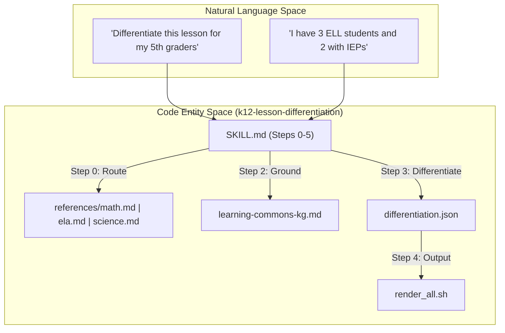
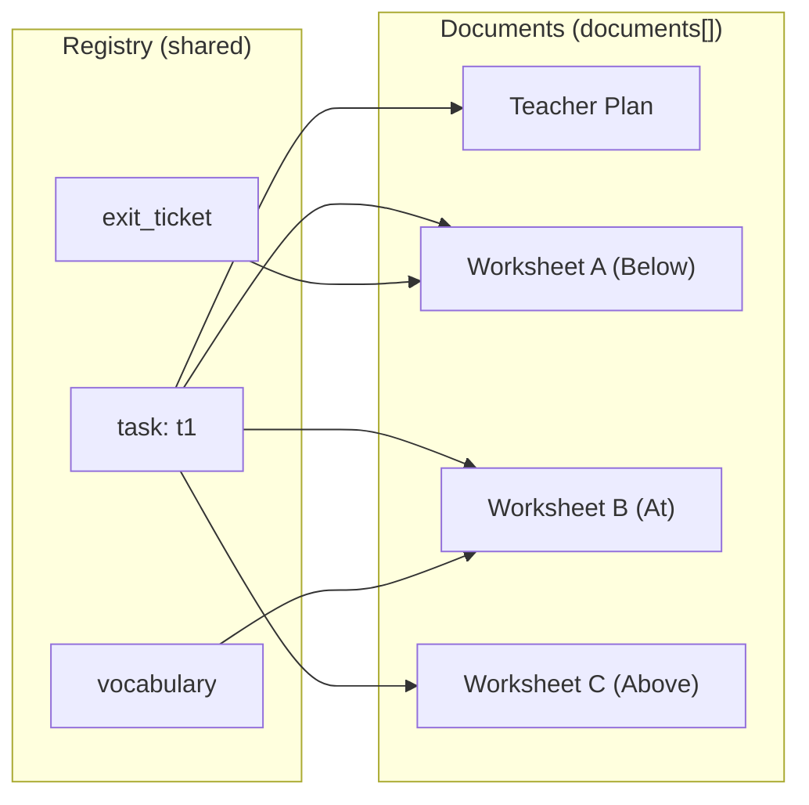

<!-- source: DeepWiki mcp.deepwiki.com · repo anthropics/k12-teacher-skills · page 3 k12-lesson-differentiation Skill · fetched 2026-10-26 -->

# k12-lesson-differentiation Skill

Relevant source files

The following files were used as context for generating this wiki page:

- [plugin/skills/k12-lesson-differentiation/SKILL.md](plugin/skills/k12-lesson-differentiation/SKILL.md)

The `k12-lesson-differentiation` skill is designed to adapt existing K-12 lessons (Math, ELA, Science, or Social Studies) into three distinct proficiency tiers: **Below**, **At**, and **Above** grade level. Unlike the lesson-planning skill which creates content from scratch, this skill acts as a stateful transformation engine that takes a source lesson—provided via upload, URL, or curriculum reference—and produces a unified differentiation plan along with student-ready materials.

The skill utilizes research-based frameworks (such as the Tomlinson framework for Math) and subject-specific access designs to ensure that all students engage with the same core learning standard while receiving appropriate scaffolds or extensions.

### High-Level Capabilities
*   **Three-Tier Model:** Generates a Teacher Plan and three student worksheets (Group A: Below, Group B: At, Group C: Above).
*   **Stateful Transformation:** Identifies source lessons from chat history, file uploads, or curriculum databases (Illustrative Mathematics / OpenSciEd).
*   **Invisible Modifications:** Prioritizes "invisible" scaffolds (e.g., simplified sentence structures, strategic vocabulary) to maintain student dignity.
*   **Knowledge Graph Integration:** Uses the Learning Commons KG to fetch prerequisite standards and misconceptions to ground the "Below" tier.

For a deep dive into the execution flow and the R1–R8 rules, see [Skill Orchestration & Differentiation Engine](#3.1).

---

### Core Transformation Pipeline

The differentiation process follows a strict six-step pipeline to ensure pedagogical integrity and copyright safety. The transition from a teacher's natural language request to structured code entities is managed by the `SKILL.md` orchestration logic.

#### Natural Language to Code Entity Mapping
The following diagram illustrates how teacher inputs and pedagogical rules map to specific system components and files.

**Differentiation Skill Architecture**

**Sources:** [plugin/skills/k12-lesson-differentiation/SKILL.md:37-140](), [plugin/skills/k12-lesson-differentiation/references/learning-commons-kg.md:1-20]()

---

### Subject-Specific Differentiation

Differentiation is not generic; it is governed by specific pedagogical files that dictate how content is modified for each subject. For example, Math differentiation focuses on prerequisite grounding and "scaffold density caps," while Science utilizes an Observation $\rightarrow$ Reasoning $\rightarrow$ Explanation (O-R-E) progression.

| Subject | Primary Framework / Strategy | Key Reference File |
| :--- | :--- | :--- |
| **Math** | Tomlinson Framework & Prerequisite Grounding | `references/math.md` |
| **ELA** | Grade-band arcs & Sentence Supports | `references/ela.md` |
| **Science** | 3D Scope & O-R-E Progression | `references/science.md` |
| **Social Studies** | C3 Inquiry Arc | `references/social_studies.md` |

For details on how each subject shapes the three-tier output, see [Subject-Specific Differentiation References](#3.2).

**Sources:** [plugin/skills/k12-lesson-differentiation/SKILL.md:39-49](), [plugin/skills/k12-lesson-differentiation/references/math.md:1-50]()

---

### The differentiation.json Schema

The output of the differentiation engine is a structured `differentiation.json` file. This file uses a **Shared Content Registry** pattern: core lesson elements (standards, tasks, vocabulary) are defined once in a `shared` block, and then referenced by the four output documents. This ensures that the "At" tier and the "Below" tier remain synchronized on the core lesson goals.

**Data Flow: Registry to Artifacts**

For documentation on the `differentiation.json` data model and the `from_shared` reference system, see [differentiation.json Schema & Output Contract](#3.3).

**Sources:** [plugin/skills/k12-lesson-differentiation/differentiation.json:1-100](), [plugin/skills/k12-lesson-differentiation/output.md:1-30]()

---

### Rendering Pipeline

Once the `differentiation.json` is produced, it is passed to a rendering suite that generates four `.docx` files and four `.html` files. The pipeline handles complex layout requirements, such as "glued units" (ensuring a header and its following block stay on the same page) and grade-appropriate writing spaces.

*   **Entry Point:** `render_all.sh` triggers the process.
*   **Orchestration:** `render_documents.py` iterates through the `documents[]` array.
*   **Logic:** `lesson_common.py` expands the `from_shared` references and applies "print-safety" repairs (e.g., fixing broken tables or lists for Word export).

For details on the conversion from JSON to teacher-deliverable files, see [Rendering Pipeline](#3.4).

**Sources:** [plugin/renderers/render_documents.py:1-50](), [plugin/renderers/lesson_common.py:1-100]()

---

