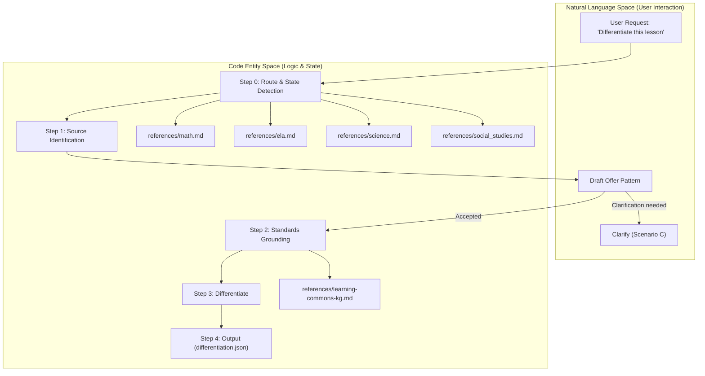
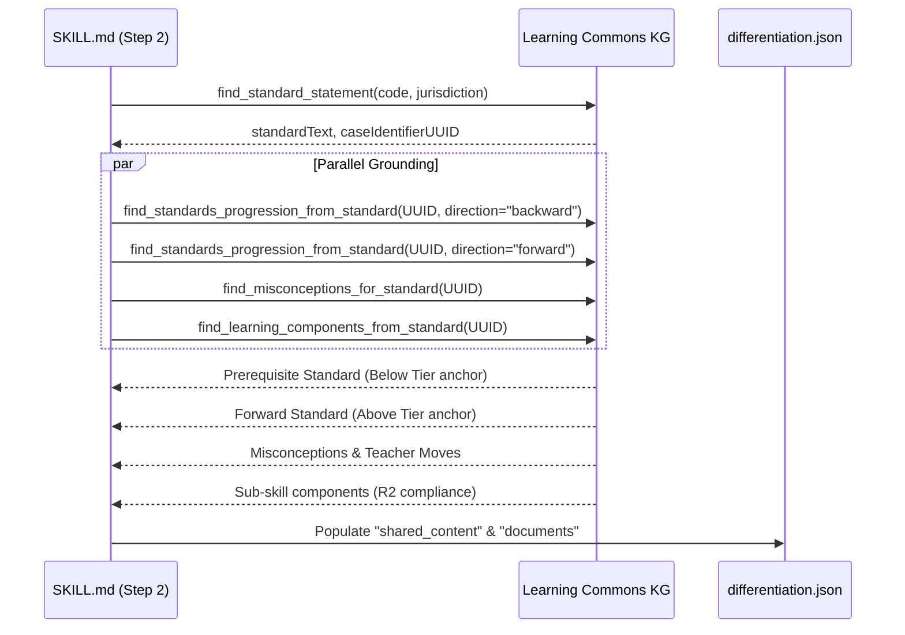

<!-- source: DeepWiki mcp.deepwiki.com · repo anthropics/k12-teacher-skills · page 3.1 Skill Orchestration & Differentiation Engine · fetched 2026-10-26 -->

# Skill Orchestration & Differentiation Engine

Relevant source files

The following files were used as context for generating this wiki page:

- [plugin/skills/k12-lesson-differentiation/SKILL.md](plugin/skills/k12-lesson-differentiation/SKILL.md)
- [plugin/skills/k12-lesson-differentiation/references/learning-commons-kg.md](plugin/skills/k12-lesson-differentiation/references/learning-commons-kg.md)

The **Skill Orchestration & Differentiation Engine** manages the lifecycle of adapting K-12 instructional materials for three proficiency tiers: **Below**, **At**, and **Above** grade level. It utilizes research-based frameworks (e.g., Tomlinson) and subject-specific pedagogy to ensure that all students, regardless of their starting point, engage with the same core learning components and standards.

## Execution Flow

The engine follows a six-step execution flow, transitioning from initial grounding to the generation of four distinct artifacts (one teacher plan and three student worksheets).

### High-Level Flow Diagram
This diagram maps the logical stages of the differentiation process to the specific reference files and data entities involved.

"Differentiation Execution Flow"

**Sources:** [plugin/skills/k12-lesson-differentiation/SKILL.md:37-148](), [plugin/skills/k12-lesson-differentiation/references/learning-commons-kg.md:7-13]()

### The Six-Step Lifecycle

1.  **Step 0: Route & State Detection**: The system detects the subject (Math, ELA, Science, Social Studies) and loads the corresponding reference file [plugin/skills/k12-lesson-differentiation/SKILL.md:37-49](). It also scans for state-specific signals (e.g., "I teach in Texas") to set the `jurisdiction` for standards lookups [plugin/skills/k12-lesson-differentiation/SKILL.md:68-77]().
2.  **Step 1: Identify Source Lesson**: The engine determines if the lesson is already in the chat, uploaded, linked via URL, or named by curriculum position (e.g., "IM Grade 6, Unit 2, Lesson 3") [plugin/skills/k12-lesson-differentiation/SKILL.md:87-97]().
3.  **Step 2: Ground in Standards**: If the Learning Commons Knowledge Graph (KG) is available, the engine calls `find_standard_statement` and progression tools to anchor the Below and Above tiers in prerequisite and forward standards [plugin/skills/k12-lesson-differentiation/references/learning-commons-kg.md:14-43]().
4.  **Step 3: Differentiate**: The engine applies the eight differentiation rules (R1–R8) to design the three tiers. This includes "Invisible Modifications" for the Below tier to maintain student dignity [plugin/skills/k12-lesson-differentiation/SKILL.md:126-135]().
5.  **Step 4: Output**: The engine generates a single `differentiation.json` file. This file is then processed by the rendering pipeline to produce four `.docx` and `.html` files [plugin/skills/k12-lesson-differentiation/SKILL.md:137-142]().
6.  **Step 5: Satisfaction Ask**: After delivery, the system asks if the tiers meet the specific learner needs and offers further refinement [plugin/skills/k12-lesson-differentiation/SKILL.md:144-148]().

**Sources:** [plugin/skills/k12-lesson-differentiation/SKILL.md:37-148](), [plugin/skills/k12-lesson-differentiation/references/learning-commons-kg.md:14-43]()

---

## Differentiation Rules (R1–R8)

The engine is governed by eight core rules that ensure pedagogical integrity across all subjects.

| Rule | Name | Description |
| :--- | :--- | :--- |
| **R1** | **Same Goal** | All tiers must work toward the exact same grade-level standard statement [plugin/skills/k12-lesson-differentiation/SKILL.md:128-128](). |
| **R2** | **Same Components** | All tiers must include all "Learning Components" (sub-skills) identified in Step 2 [plugin/skills/k12-lesson-differentiation/SKILL.md:129-129](). |
| **R3** | **Standard Verbatim** | The target standard must be quoted verbatim in the teacher plan [plugin/skills/k12-lesson-differentiation/SKILL.md:130-130](). |
| **R4** | **Tier Integrity** | Below = high support/scaffolding; At = standard lesson; Above = high challenge/extension [plugin/skills/k12-lesson-differentiation/SKILL.md:131-131](). |
| **R5** | **Invisible Mods** | Scaffolds for the Below tier (e.g., sentence frames) must not be labeled as "Below" or "Easy" on the student worksheet [plugin/skills/k12-lesson-differentiation/SKILL.md:132-132](). |
| **R6** | **Shared Content** | Tiers must share the same core text, data, or phenomena to allow for whole-class discussion [plugin/skills/k12-lesson-differentiation/SKILL.md:133-133](). |
| **R7** | **No Verbatim Copy** | Do not reproduce copyrighted curriculum text verbatim; paraphrase and describe moves instead [plugin/skills/k12-lesson-differentiation/SKILL.md:134-134](). |
| **R8** | **Draft Offer** | Always present the tier design (standard, prerequisites, and task changes) for teacher approval before generating artifacts [plugin/skills/k12-lesson-differentiation/SKILL.md:135-135](). |

**Sources:** [plugin/skills/k12-lesson-differentiation/SKILL.md:126-135]()

---

## Knowledge Graph Integration

The engine uses the Learning Commons KG to ensure that differentiation is not just "easier" or "harder" work, but is mathematically or conceptually grounded in learning progressions.

"Knowledge Graph Call Sequence"

**Sources:** [plugin/skills/k12-lesson-differentiation/references/learning-commons-kg.md:14-55]()

### Copyright Guardrail
A strict guardrail prevents the verbatim reproduction of curriculum materials (like Illustrative Mathematics or OpenSciEd). If a curriculum is recognized but not explicitly confirmed by the teacher, the engine must use generic terms (e.g., "a compare-strategies discussion") instead of trademarked routine names [plugin/skills/k12-lesson-differentiation/SKILL.md:57-63]().

---

## The Draft Offer & Revision Lifecycle

To ensure the teacher maintains agency, the engine follows a **Draft Offer** pattern.

1.  **The Offer**: Before writing the full `differentiation.json`, the engine presents a summary:
    *   The identified grade-level standard.
    *   The prerequisite standard (for the Below tier).
    *   The forward standard (for the Above tier).
    *   A high-level description of how the tasks will change across tiers [plugin/skills/k12-lesson-differentiation/SKILL.md:135-135]().
2.  **Teacher Intervention**: The teacher can accept, modify (e.g., "Make the Below tier focus more on vocabulary"), or reject the plan.
3.  **Generation**: Only after approval does the engine invoke the rendering tools to produce the final artifacts.
4.  **Revision**: Post-generation, the teacher can request adjustments. The engine updates the `differentiation.json` and re-renders the documents, ensuring that "shared content" remains consistent across all tiers to prevent "tier drift" [plugin/skills/k12-lesson-differentiation/SKILL.md:3-3]().

**Sources:** [plugin/skills/k12-lesson-differentiation/SKILL.md:3-3](), [plugin/skills/k12-lesson-differentiation/SKILL.md:135-135](), [plugin/skills/k12-lesson-differentiation/SKILL.md:144-148]()

---

