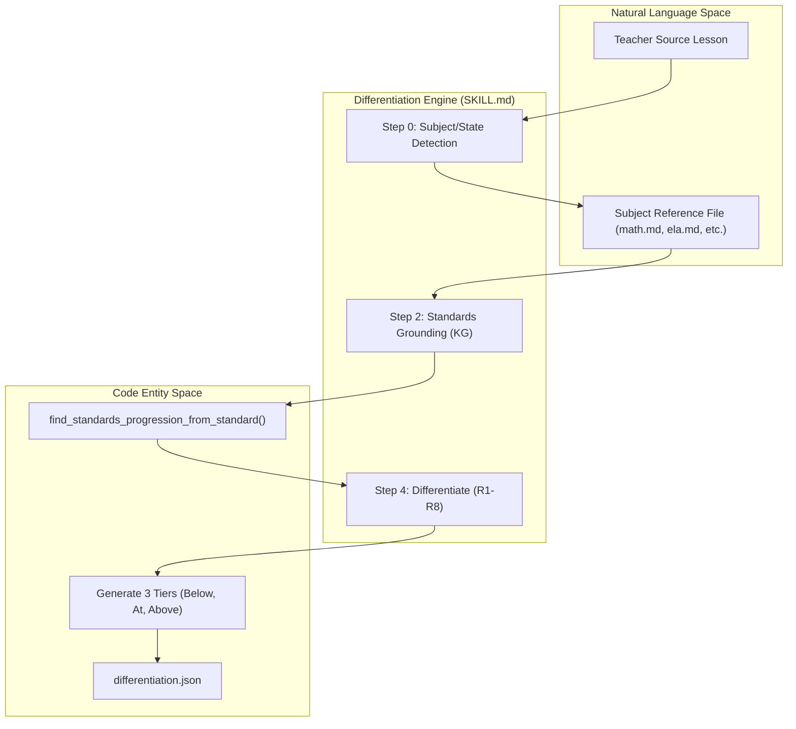
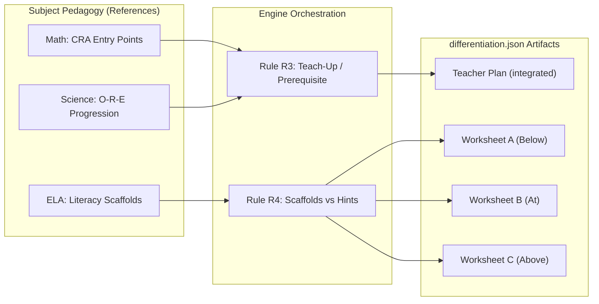

<!-- source: DeepWiki mcp.deepwiki.com · repo anthropics/k12-teacher-skills · page 3.2 Subject-Specific Differentiation References · fetched 2026-10-26 -->

# Subject-Specific Differentiation References

Relevant source files

The following files were used as context for generating this wiki page:

- [plugin/skills/k12-lesson-differentiation/references/ela.md](plugin/skills/k12-lesson-differentiation/references/ela.md)
- [plugin/skills/k12-lesson-differentiation/references/math.md](plugin/skills/k12-lesson-differentiation/references/math.md)
- [plugin/skills/k12-lesson-differentiation/references/science.md](plugin/skills/k12-lesson-differentiation/references/science.md)
- [plugin/skills/k12-lesson-differentiation/references/social_studies.md](plugin/skills/k12-lesson-differentiation/references/social_studies.md)

This page documents the technical implementation and pedagogical frameworks for the four subject-specific reference files used by the `k12-lesson-differentiation` skill. These files govern how the differentiation engine transforms a source lesson into a three-tiered output (Below, At, and Above level) while maintaining standard integrity and subject-specific rigor.

## Overview of Subject Routing

The differentiation process is driven by the subject identified during **Step 0** of the skill lifecycle. The system loads the corresponding reference file to apply specific pedagogical constraints, prerequisite engines, and scaffold density caps.

| Subject | Reference File | Primary Framework | Key Technical Mechanism |
| :--- | :--- | :--- | :--- |
| **Math** | `math.md` | Tomlinson / CRA | Prerequisite grounding engine |
| **ELA** | `ela.md` | Science of Reading | Grade-band literacy arcs |
| **Science** | `science.md` | NGSS / OpenSciEd | O→R→E progression |
| **Social Studies** | `social_studies.md` | C3 Inquiry Arc | Sourcing & Annotation routines |

**Sources:** [plugin/skills/k12-lesson-differentiation/references/math.md:7-9](), [plugin/skills/k12-lesson-differentiation/references/ela.md:7-9](), [plugin/skills/k12-lesson-differentiation/references/science.md:7-9](), [plugin/skills/k12-lesson-differentiation/references/social_studies.md:7-9]()

---

## Math: Prerequisite Grounding & CRA

The Math reference focuses on the **Concrete → Representational → Abstract (CRA)** progression and a strict prerequisite grounding requirement.

### Prerequisite Engine Fallback
Math differentiation requires identifying a specific conceptual prerequisite from a prior grade level. The system follows a three-step fallback chain:
1. **KG Lookup**: Call `find_standards_progression_from_standard`. If a predecessor exists, use it verbatim [plugin/skills/k12-lesson-differentiation/references/math.md:67-69]().
2. **CCSS Proxy**: If the teacher uses a non-CCSS framework (e.g., TEKS), the system finds the closest Common Core analog but hides the CCSS code in a footnote to avoid confusing the teacher [plugin/skills/k12-lesson-differentiation/references/math.md:71-80]().
3. **Concept Fallback**: If no standard is found, it describes the prerequisite in plain language [plugin/skills/k12-lesson-differentiation/references/math.md:82-84]().

### CRA Tier Mapping
| Tier | Entry Point | Implementation |
| :--- | :--- | :--- |
| **Below** | Concrete | Manipulatives or physical models [plugin/skills/k12-lesson-differentiation/references/math.md:92](). |
| **At** | Representational | Visual models and diagrams [plugin/skills/k12-lesson-differentiation/references/math.md:93](). |
| **Above** | Abstract | Symbolic manipulation and generalizations [plugin/skills/k12-lesson-differentiation/references/math.md:94](). |

**Sources:** [plugin/skills/k12-lesson-differentiation/references/math.md:58-95]()

---

## ELA: Literacy Arcs & Invisible Modifications

ELA differentiation is governed by the principle of **"Same Text, Different Scaffolds."** The system is prohibited from simplifying the text complexity for below-level students [plugin/skills/k12-lesson-differentiation/references/ela.md:62-64]().

### Foundational Literacy Check (K–5)
For elementary grades, the system performs a diagnostic check to determine if a student's barrier is **decoding/fluency** or **comprehension**. If a decoding gap is suspected, the system must inject a specific warning flag into the Teacher Plan [plugin/skills/k12-lesson-differentiation/references/ela.md:80-94]().

### Invisible Modifications
The ELA reference emphasizes "invisible" supports that do not stigmatize the student:
* **Below Tier**: Chunked reading, annotation cues, and sentence frames [plugin/skills/k12-lesson-differentiation/references/ela.md:72]().
* **Above Tier**: Author's craft analysis and cross-text synthesis [plugin/skills/k12-lesson-differentiation/references/ela.md:74]().

**Sources:** [plugin/skills/k12-lesson-differentiation/references/ela.md:62-96]()

---

## Science: 3D Scope & O→R→E Progression

Science differentiation utilizes the **Observation → Representation → Explanation (O→R→E)** progression to ensure students reach the grade-level Performance Expectation (PE).

### 3D Scope Preservation
The system must maintain all three NGSS dimensions (SEP, CCC, and DCI) across all tiers. Removing a dimension (e.g., replacing an investigation with a reading) is a critical failure [plugin/skills/k12-lesson-differentiation/references/science.md:63-72]().

### O→R→E Progression
| Tier | Entry Point | Scaffolding Goal |
| :--- | :--- | :--- |
| **Below** | Observation | Structured prompts to move from "what I see" to "what it means" [plugin/skills/k12-lesson-differentiation/references/science.md:82](). |
| **At** | Representation | Standard CER (Claim, Evidence, Reasoning) construction [plugin/skills/k12-lesson-differentiation/references/science.md:83](). |
| **Above** | Explanation | Extensions involving counter-phenomena or engineering applications [plugin/skills/k12-lesson-differentiation/references/science.md:84](). |

**Sources:** [plugin/skills/k12-lesson-differentiation/references/science.md:51-98]()

---

## Social Studies: Inquiry & Sourcing

Social Studies differentiation centers on the **C3 Framework Inquiry Arc** and state-specific content standards.

### Disciplinary Prerequisite Defaults
Since Social Studies lacks a strict cross-grade standard progression in the KG, the system defaults to two prerequisites:
1. **Content Vocabulary**: 4–6 key terms extracted from source materials [plugin/skills/k12-lesson-differentiation/references/social_studies.md:78]().
2. **Sourcing Routine**: Guided annotation frames (e.g., SOAPS or HAPP) to help students analyze primary sources [plugin/skills/k12-lesson-differentiation/references/social_studies.md:80]().

### Source Complexity Mapping
The system differentiates by the "entry point" of the source material:
* **Below**: Concrete/Visual (maps, artifacts) with analysis frames [plugin/skills/k12-lesson-differentiation/references/social_studies.md:88]().
* **Above**: Abstract/Argumentative (full primary sources) with open synthesis tasks [plugin/skills/k12-lesson-differentiation/references/social_studies.md:90]().

**Sources:** [plugin/skills/k12-lesson-differentiation/references/social_studies.md:69-91]()

---

## Data Flow: Reference to Output

The following diagram illustrates how subject-specific references interact with the core differentiation engine to produce the final `differentiation.json` artifacts.

### Differentiation Reference Logic Flow

**Sources:** [plugin/skills/k12-lesson-differentiation/SKILL.md:20-80](), [plugin/skills/k12-lesson-differentiation/references/math.md:67-70]()

---

## Three-Tier Output Mapping

The differentiation engine maps the pedagogical rules in the reference files to specific block structures in the output documents.

### Subject Transformation Mapping

**Sources:** [plugin/skills/k12-lesson-differentiation/references/math.md:44-50](), [plugin/skills/k12-lesson-differentiation/references/ela.md:46-51](), [plugin/skills/k12-lesson-differentiation/references/science.md:55-62]()

---

