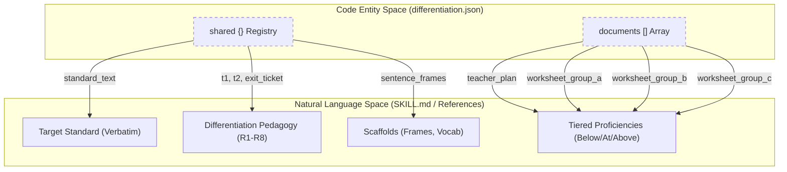
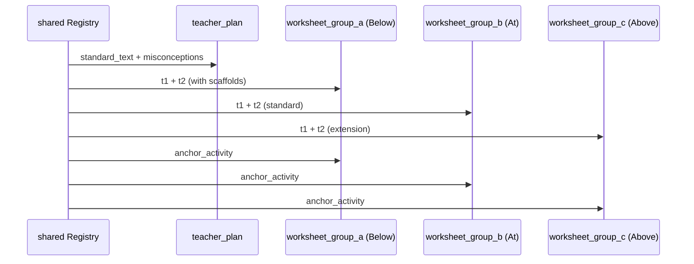

<!-- source: DeepWiki mcp.deepwiki.com · repo anthropics/k12-teacher-skills · page 3.3 differentiation.json Schema & Output Contract · fetched 2026-10-26 -->

# differentiation.json Schema & Output Contract

<details>
<summary>Relevant source files</summary>

The following files were used as context for generating this wiki page:

- [plugin/skills/k12-lesson-differentiation/SKILL.md](plugin/skills/k12-lesson-differentiation/SKILL.md)
- [plugin/skills/k12-lesson-differentiation/references/example_differentiation.json](plugin/skills/k12-lesson-differentiation/references/example_differentiation.json)
- [plugin/skills/k12-lesson-differentiation/references/output.md](plugin/skills/k12-lesson-differentiation/references/output.md)

</details>


The `differentiation.json` file is the central data artifact produced by the `k12-lesson-differentiation` skill. It represents a "Single Source of Truth" that encodes a teacher-facing differentiation plan and three distinct student-facing worksheets (Group A/Below, Group B/At, Group C/Above) [plugin/skills/k12-lesson-differentiation/SKILL.md:3-5](). By utilizing a shared content registry, the schema ensures that core lesson tasks remain consistent across all proficiency tiers while allowing for invisible modifications and scaffolds [plugin/skills/k12-lesson-differentiation/references/output.md:49-50]().

## Data Flow & Architecture

The differentiation engine follows a strict sequence where pedagogical grounding in standards and curriculum precedes the generation of the JSON artifact.

### Natural Language to Code Entity Mapping
The following diagram illustrates how pedagogical concepts from the `SKILL.md` orchestration flow map to specific keys and structures within the `differentiation.json` schema.

**Pedagogy to Schema Mapping**

**Sources:** [plugin/skills/k12-lesson-differentiation/SKILL.md:47-49](), [plugin/skills/k12-lesson-differentiation/references/example_differentiation.json:2-58]()

## The `shared` Content Registry

The `shared` object acts as a library of reusable content. This prevents "tier drift" where a task might accidentally change meaning between the teacher plan and the student worksheet.

| Key | Purpose | Contract Rules |
| :--- | :--- | :--- |
| `standard_text` | Verbatim text of the target standard. | Must be quoted exactly once in the teacher plan [plugin/skills/k12-lesson-differentiation/references/output.md:25](). |
| `t1`, `t2`, `tN` | Core lesson tasks. | Contains both `teacher` (rationale) and `student` (directions) strings [plugin/skills/k12-lesson-differentiation/references/example_differentiation.json:7-14](). |
| `vocabulary` | Subject-specific terms. | Usually rendered as a `table` block [plugin/skills/k12-lesson-differentiation/references/example_differentiation.json:19-31](). |
| `sentence_frames` | Language supports. | Student-facing; must be framed as "Finish these sentences" [plugin/skills/k12-lesson-differentiation/references/example_differentiation.json:32-36](). |
| `misconceptions` | Common student errors. | Required for the Below tier plan; must include "Teacher move" [plugin/skills/k12-lesson-differentiation/references/example_differentiation.json:37-51](). |
| `anchor_activity` | Early finisher task. | Must appear on all three student tiers via `from_shared` [plugin/skills/k12-lesson-differentiation/references/output.md:37-39](). |

**Sources:** [plugin/skills/k12-lesson-differentiation/references/example_differentiation.json:2-54](), [plugin/skills/k12-lesson-differentiation/references/output.md:25-27, 37-40]()

## The `documents` Array

The schema requires exactly four entries in the `documents` array. Each entry represents a physical file (HTML/DOCX) generated by the rendering pipeline.

### Document Orchestration Diagram

**Sources:** [plugin/skills/k12-lesson-differentiation/references/example_differentiation.json:58-200](), [plugin/skills/k12-lesson-differentiation/references/output.md:118-125]()

### Document Requirements
1.  **Teacher Plan (`teacher_plan`):**
    *   Must include `Flexible grouping` section with evidence basis [plugin/skills/k12-lesson-differentiation/references/output.md:63-69]().
    *   Must include `Why this works (1)` and `(2)` rationale blocks [plugin/skills/k12-lesson-differentiation/references/output.md:70-75]().
    *   `audience` is set to `"teacher"` [plugin/skills/k12-lesson-differentiation/references/example_differentiation.json:61]().
2.  **Student Worksheets (`worksheet_group_a/b/c`):**
    *   `audience` is set to `"student"` [plugin/skills/k12-lesson-differentiation/references/example_differentiation.json:181]().
    *   `eyebrow` must include the `standard_code` but **never** the tier level (e.g., "Below") [plugin/skills/k12-lesson-differentiation/references/output.md:87-90]().
    *   `title` uses the Group letter (e.g., "Group A") [plugin/skills/k12-lesson-differentiation/references/output.md:87-90]().

## Output Contract & Density Rules

The `output.md` file defines hard constraints on the content density and tone of the JSON blocks.

### Block-Level Constraints
*   **Paragraph/Labeled Blocks:** Maximum 3 sentences. Longer content must be split or converted to a `table` [plugin/skills/k12-lesson-differentiation/references/output.md:17-18]().
*   **Bullets:** Fragments only, ≤ 15 words [plugin/skills/k12-lesson-differentiation/references/output.md:19]().
*   **Tables:** Used for parallel tier content; ≤ 25 words per cell [plugin/skills/k12-lesson-differentiation/references/output.md:20-22]().
*   **Callouts:** Used for asides longer than one sentence [plugin/skills/k12-lesson-differentiation/references/output.md:23-24]().

### The `from_shared` Block Type
To maintain consistency, documents use the `from_shared` block type to reference the registry.
```json
{
  "type": "from_shared",
  "key": "t1",
  "label": "1"
}
```
The `lesson_common.py` logic (specifically `expand_from_shared`) resolves these references at render time [plugin/skills/k12-lesson-differentiation/references/example_differentiation.json:70-72]().

### Asset Framing (Student-Facing Rules)
For student documents, especially the **Below tier (Group A)**, specific "Asset Framing" rules apply to avoid signaling reduced expectations:
*   **No Instructional Jargon:** Avoid terms like "scaffold," "tier," or "anchor task" [plugin/skills/k12-lesson-differentiation/references/output.md:81-85]().
*   **Invisible Scaffolds:** Organizers and sentence frames must appear as natural parts of the layout, not announced supports (e.g., avoid "Use this if you need it") [plugin/skills/k12-lesson-differentiation/references/output.md:99-105]().

**Sources:** [plugin/skills/k12-lesson-differentiation/references/output.md:12-30, 76-108](), [plugin/skills/k12-lesson-differentiation/references/example_differentiation.json:70-72]()

---

