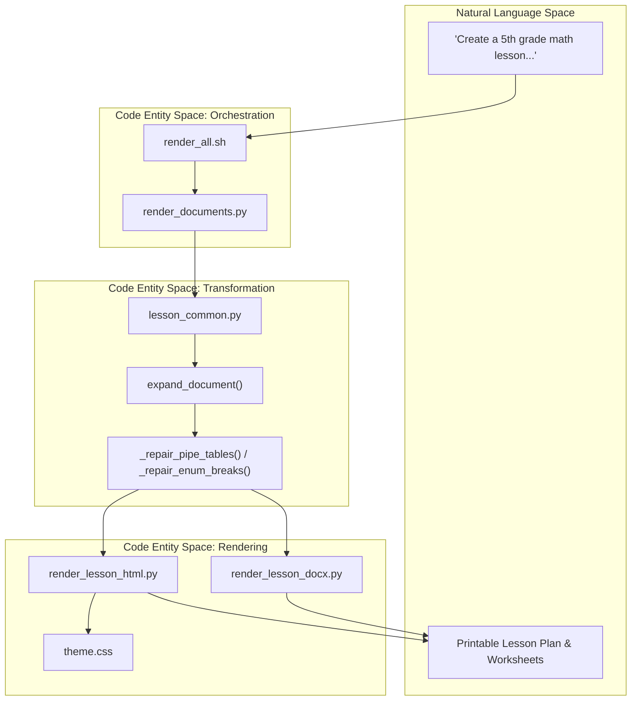

<!-- source: DeepWiki mcp.deepwiki.com · repo anthropics/k12-teacher-skills · page 3.4 Rendering Pipeline · fetched 2026-10-26 -->

# Rendering Pipeline

Relevant source files

The following files were used as context for generating this wiki page:

- [plugin/skills/k12-lesson-planning/scripts/lesson_common.py](plugin/skills/k12-lesson-planning/scripts/lesson_common.py)
- [plugin/skills/k12-lesson-planning/scripts/render_all.sh](plugin/skills/k12-lesson-planning/scripts/render_all.sh)
- [plugin/skills/k12-lesson-planning/scripts/render_documents.py](plugin/skills/k12-lesson-planning/scripts/render_documents.py)
- [plugin/skills/k12-lesson-planning/scripts/render_lesson_docx.py](plugin/skills/k12-lesson-planning/scripts/render_lesson_docx.py)
- [plugin/skills/k12-lesson-planning/scripts/render_lesson_html.py](plugin/skills/k12-lesson-planning/scripts/render_lesson_html.py)
- [plugin/skills/k12-lesson-planning/scripts/theme.css](plugin/skills/k12-lesson-planning/scripts/theme.css)

The rendering pipeline converts the structured `lesson.json` or `differentiation.json` output into teacher-deliverable artifacts: editable Microsoft Word documents (`.docx`) and styled HTML previews (`.html`). This system ensures visual consistency across different lesson components (e.g., a teacher plan and its associated student worksheets) by using a shared content registry and a unified block vocabulary.

## System Architecture Overview

The pipeline operates in three stages: **Orchestration**, **Expansion/Repair**, and **Format-Specific Dispatch**.

### Data Flow: JSON to Artifacts

This diagram bridges the "Natural Language Space" (the teacher's request for a lesson) to the "Code Entity Space" (the scripts and functions that process it).

**Sources:** [plugin/skills/k12-lesson-planning/scripts/render_all.sh:1-12](), [plugin/skills/k12-lesson-planning/scripts/render_documents.py:1-36](), [plugin/skills/k12-lesson-planning/scripts/lesson_common.py:5-11]()

---

## 1. Orchestration Layer

### `render_all.sh`
The shell script acts as the primary entry point for the plugin environment. It handles dependency management (ensuring `python-docx` is installed) and invokes the Python orchestrator [plugin/skills/k12-lesson-planning/scripts/render_all.sh:22-33]().

### `render_documents.py`
This script manages multi-document JSON structures. In the differentiation skill, a single JSON file contains a `documents[]` array representing different tiers (e.g., "Teacher Plan", "Worksheet Group A").
- **`build_doc`**: Merges global `theme` and `shared` content blocks into each individual document entry [plugin/skills/k12-lesson-planning/scripts/render_documents.py:48-56]().
- **Multi-format execution**: Iterates through the `documents` array and calls both the HTML and DOCX renderers for every ID found [plugin/skills/k12-lesson-planning/scripts/render_documents.py:78-97]().

**Sources:** [plugin/skills/k12-lesson-planning/scripts/render_all.sh:1-45](), [plugin/skills/k12-lesson-planning/scripts/render_documents.py:59-108]()

---

## 2. Common Transformation Layer (`lesson_common.py`)

Before a document is rendered, it passes through `lesson_common.py` to resolve references and fix structural issues that occur during LLM generation.

### Shared Content Expansion
The `expand_document()` function traverses the JSON block tree. When it encounters a `from_shared` block, it replaces it with the corresponding entry from the `shared` registry [plugin/skills/k12-lesson-planning/scripts/lesson_common.py:7-11](). This prevents content drift between the teacher plan and student worksheets.

### Print-Safety Repairs
The pipeline includes a "Repair Pipe" that fixes common LLM formatting artifacts that would otherwise break the layout:
- **`_repair_pipe_tables`**: Converts Markdown-style `| col |` text into structured `table` blocks [plugin/skills/k12-lesson-planning/scripts/lesson_common.py:137-160]().
- **`_repair_inline_bullets`**: Splits prose containing bullet characters (•, ▪) into a proper `list` block [plugin/skills/k12-lesson-planning/scripts/lesson_common.py:82-134]().
- **`_repair_enum_breaks`**: Identifies mid-prose enumerations like `(a) ... (b) ...` and inserts line breaks to ensure they don't render as a "wall of text" [plugin/skills/k12-lesson-planning/scripts/lesson_common.py:66-79]().

**Sources:** [plugin/skills/k12-lesson-planning/scripts/lesson_common.py:16-30](), [plugin/skills/k12-lesson-planning/scripts/lesson_common.py:58-62]()

---

## 3. HTML Renderer (`render_lesson_html.py`)

The HTML renderer produces a self-contained preview using `theme.css` for visual primitives.

### Block Dispatcher
The `render_block()` function uses a dispatch pattern to convert JSON types into HTML strings:
- **`phase_header`**: Renders a lesson phase with a duration (minutes) floated to the right [plugin/skills/k12-lesson-planning/scripts/render_lesson_html.py:144-150]().
- **`callout`**: Maps `kind` (e.g., `task`, `special`, `tnote`) to specific icons and CSS classes defined in `CALLOUT_KINDS` [plugin/skills/k12-lesson-planning/scripts/render_lesson_html.py:117-128]().
- **`workspace`**: Generates empty writing space or ruled lines via `answer_space()`, depending on the `ruled` theme property [plugin/skills/k12-lesson-planning/scripts/render_lesson_html.py:54-62]().

### CSS Theming
Styling is driven by `theme.css`. The renderer injects CSS Custom Properties (variables) into the `:root` based on the `Theme` object [plugin/skills/k12-lesson-planning/scripts/render_lesson_html.py:65-86]().

**Sources:** [plugin/skills/k12-lesson-planning/scripts/render_lesson_html.py:89-153](), [plugin/skills/k12-lesson-planning/scripts/theme.css:5-11]()

---

## 4. DOCX Renderer (`render_lesson_docx.py`)

The DOCX renderer uses `python-docx` to build a native Word document. It mirrors the HTML logic but uses a dispatch table for OOXML generation.

### Dispatch Table & Emitters
The renderer uses a private `_EMITTERS` dictionary to map block types to specific functions.

| Block Type | Emitter Function | Logic |
| :--- | :--- | :--- |
| `paragraph` | `_emit_paragraph` | Adds runs via `add_md` for bold/italic support [plugin/skills/k12-lesson-planning/scripts/render_lesson_docx.py:90-99](). |
| `callout` | `_emit_callout` | Creates a single-cell table with a specific border color [plugin/skills/k12-lesson-planning/scripts/render_lesson_docx.py:103-115](). |
| `workspace` | `_emit_workspace` | Adds an empty table with a fixed height and `w:cantSplit` [plugin/skills/k12-lesson-planning/scripts/render_lesson_docx.py:131-138](). |
| `list` | `_emit_list` | Uses `_restart_numbering` to ensure ordered lists start at 1 [plugin/skills/k12-lesson-planning/scripts/render_lesson_docx.py:162-179](). |

### Visual Consistency Logic
The renderer implements several Word-specific hacks to match the HTML design:
- **`setup_styles`**: Configures "LC Title", "LC H1", etc., using the same font sizes and colors as the CSS theme [plugin/skills/k12-lesson-planning/scripts/render_lesson_docx.py:54-86]().
- **`_set_borders`**: Manually manipulates `w:tblBorders` XML to create the clean, minimal table aesthetics required for professional lesson plans [plugin/skills/k12-lesson-planning/scripts/render_lesson_docx.py:103-115]().

**Sources:** [plugin/skills/k12-lesson-planning/scripts/render_lesson_docx.py:46-51](), [plugin/skills/k12-lesson-planning/scripts/render_lesson_docx.py:101-145]()

---

