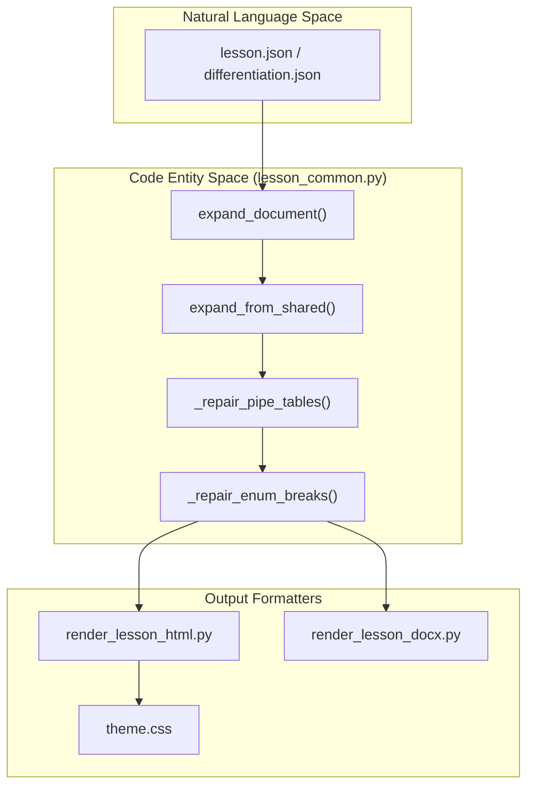

<!-- source: DeepWiki mcp.deepwiki.com · repo anthropics/k12-teacher-skills · page 4 Shared Rendering Architecture · fetched 2026-10-26 -->

# Shared Rendering Architecture

Relevant source files

The following files were used as context for generating this wiki page:

- [plugin/skills/k12-lesson-differentiation/scripts/lesson_common.py](plugin/skills/k12-lesson-differentiation/scripts/lesson_common.py)
- [plugin/skills/k12-lesson-differentiation/scripts/theme.css](plugin/skills/k12-lesson-differentiation/scripts/theme.css)
- [plugin/skills/k12-lesson-planning/scripts/lesson_common.py](plugin/skills/k12-lesson-planning/scripts/lesson_common.py)
- [plugin/skills/k12-lesson-planning/scripts/theme.css](plugin/skills/k12-lesson-planning/scripts/theme.css)

The rendering subsystem is a cross-skill engine designed to transform structured JSON artifacts (lessons and differentiated plans) into professional, classroom-ready materials. It employs a unified block vocabulary and a dual-output strategy to ensure that content generated by the LLM is consistently formatted across both HTML and Microsoft Word (.docx) formats.

## Core Concepts

The architecture relies on three pillars to maintain consistency and print-readiness:

1.  **Shared Content Registry**: A `shared` block in the source JSON stores reusable components (e.g., standards, tasks, vocabulary). Documents reference these via a `from_shared` key, preventing content drift [plugin/skills/k12-lesson-planning/scripts/lesson_common.py:7-11]().
2.  **Block Dispatch**: Both renderers iterate through a standardized list of block types (e.g., `callout`, `fill_table`, `workspace`, `number_line`) and dispatch them to format-specific emitters [plugin/skills/k12-lesson-planning/scripts/render_lesson_html.py:112-114]().
3.  **Print-Safety Repair**: A structural repair pipeline in `lesson_common.py` intercepts common LLM formatting errors—such as markdown pipe tables written inside text strings—and converts them into structured blocks before final rendering [plugin/skills/k12-lesson-planning/scripts/lesson_common.py:16-22]().

### Rendering Data Flow

The following diagram illustrates how a raw JSON artifact moves through the shared logic into the final output formats.

**Sources:** [plugin/skills/k12-lesson-planning/scripts/lesson_common.py:5-22](), [plugin/skills/k12-lesson-planning/scripts/render_lesson_html.py:11-20]().

---

## Shared Content & Repair Layer (`lesson_common.py`)

This layer acts as the pre-processor for all artifacts. It handles the expansion of the `shared` content registry and applies a "Repair Pipe" to fix structural issues that are difficult for the LLM to avoid consistently.

*   **Content Expansion**: The `expand_document()` function flattens the document by resolving all `from_shared` references [plugin/skills/k12-lesson-planning/scripts/lesson_common.py:228-235]().
*   **Structural Repairs**: Functions like `_repair_pipe_tables` and `_repair_inline_bullets` scan prose fields for markdown-style tables or bullets and convert them into formal `table` or `list` blocks [plugin/skills/k12-lesson-planning/scripts/lesson_common.py:82-85](), [plugin/skills/k12-lesson-planning/scripts/lesson_common.py:137-138]().
*   **Typography & Breaks**: `_repair_enum_breaks` ensures that sub-parts like `(a)` or `(1)` appearing mid-prose are moved to new lines for readability [plugin/skills/k12-lesson-planning/scripts/lesson_common.py:66-67]().

For details, see [lesson_common.py — Shared Content & Repair Layer](#4.1).

**Sources:** [plugin/skills/k12-lesson-planning/scripts/lesson_common.py:1-160]().

---

## HTML Renderer & CSS Theme

The HTML renderer produces a responsive, web-based version of the lesson, primarily used for previewing within the Claude interface and for high-fidelity printing.

*   **Block Dispatcher**: The `render_block()` function maps JSON block types to specific HTML generation logic [plugin/skills/k12-lesson-planning/scripts/render_lesson_html.py:112-150]().
*   **Theming**: The `theme.css` file defines visual primitives for callouts, number lines, and worksheet elements [plugin/skills/k12-lesson-differentiation/scripts/theme.css:5-8]().
*   **Print Layout**: The system uses `page-break-inside: avoid` and `page-break-after: avoid` on headings and cards to ensure logical grouping when printed to PDF [plugin/skills/k12-lesson-differentiation/scripts/theme.css:21-25]().

For details, see [HTML Renderer & CSS Theme](#4.2).

**Sources:** [plugin/skills/k12-lesson-planning/scripts/render_lesson_html.py:1-200](), [plugin/skills/k12-lesson-differentiation/scripts/theme.css:1-95]().

---

## DOCX Renderer

The DOCX renderer generates editable Microsoft Word files using `python-docx`. It is designed to mirror the visual styling of the HTML/CSS version as closely as possible within the constraints of Word's XML schema.

*   **Emitter Table**: Uses an `_EMITTERS` dictionary to route block types to internal functions like `_emit_callout` or `_emit_table` [plugin/skills/k12-lesson-planning/scripts/render_lesson_docx.py:84-105]().
*   **Style Engine**: `setup_styles()` initializes a standard set of Word styles (e.g., "LessonTitle", "PhaseHeader") to maintain consistent typography [plugin/skills/k12-lesson-planning/scripts/render_lesson_docx.py:138-160]().
*   **Complex Primitives**: Implements custom logic for `number_line` using tab stops and borders, and `fill_table` for student worksheets [plugin/skills/k12-lesson-planning/scripts/render_lesson_docx.py:465-480]().

For details, see [DOCX Renderer](#4.3).

**Sources:** [plugin/skills/k12-lesson-planning/scripts/render_lesson_docx.py:1-500]().

---

## Block Vocabulary Mapping

This table associates the JSON schema identifiers with the internal code entities responsible for rendering them.

| Block Type | JSON Identifier | HTML Emitter | DOCX Emitter |
| :--- | :--- | :--- | :--- |
| **Callout** | `callout` | `_render_callout` | `_emit_callout` |
| **Table** | `table` | `_render_table` | `_emit_table` |
| **Fill-in-Table** | `fill_table` | `_render_fill_table` | `_emit_fill_table` |
| **Number Line** | `number_line` | `_render_number_line` | `_emit_number_line` |
| **Workspace** | `workspace` | `_render_workspace` | `_emit_workspace` |

**Sources:** [plugin/skills/k12-lesson-planning/scripts/render_lesson_html.py:112-140](), [plugin/skills/k12-lesson-planning/scripts/render_lesson_docx.py:84-105]().

---

