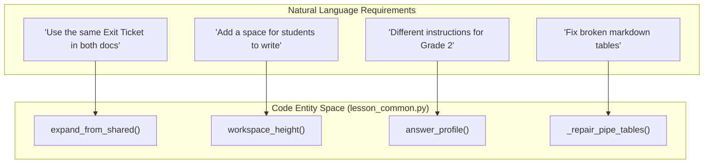
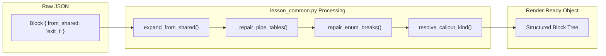

<!-- source: DeepWiki mcp.deepwiki.com · repo anthropics/k12-teacher-skills · page 4.1 lesson_common.py — Shared Content & Repair Layer · fetched 2026-10-26 -->

# lesson_common.py — Shared Content & Repair Layer

Relevant source files

The following files were used as context for generating this wiki page:

- [plugin/skills/k12-lesson-differentiation/scripts/lesson_common.py](plugin/skills/k12-lesson-differentiation/scripts/lesson_common.py)
- [plugin/skills/k12-lesson-planning/scripts/lesson_common.py](plugin/skills/k12-lesson-planning/scripts/lesson_common.py)

`lesson_common.py` serves as the shared utility layer for both the `k12-lesson-planning` and `k12-lesson-differentiation` skills. Its primary responsibility is to bridge the gap between the raw JSON artifact produced by the LLM and the final rendered documents (HTML and DOCX). It handles content expansion from the shared registry, grade-based layout logic, and a suite of "print-safety" repair functions that correct common LLM formatting artifacts that would otherwise break document layouts [plugin/skills/k12-lesson-planning/scripts/lesson_common.py:5-11]().

## Core Data Structures & Logic

### The Theme Class
The `Theme` class encapsulates the visual configuration for a lesson, including color palettes for callouts and subject-specific iconography [plugin/skills/k12-lesson-planning/scripts/lesson_common.py:228-232](). It maps semantic callout kinds (e.g., `check`, `alert`, `strategy`) to specific hex colors and icons used by both the HTML and DOCX renderers.

### Content Expansion
The rendering pipeline relies on a "write-once" pattern where content shared across multiple documents (like standards, vocabulary, or exit tickets) is stored in a top-level `shared` registry.

*   **`expand_from_shared(shared_map, block)`**: Recursively traverses a document's block tree. When it encounters a block with a `from_shared` key, it retrieves the corresponding content from the `shared_map` and merges it into the block [plugin/skills/k12-lesson-planning/scripts/lesson_common.py:356-370]().
*   **`expand_document(shared_map, doc_data)`**: The entry point for processing a single document entry from the JSON. It resolves all shared references and applies faceted content logic [plugin/skills/k12-lesson-planning/scripts/lesson_common.py:373-379]().

### Faceted Content (`_faceted`)
Blocks can contain a `_faceted` key, which allows the LLM to provide different versions of the same content (e.g., different scaffolding levels). `expand_document` selects the appropriate facet based on the document's context, ensuring the correct version is rendered without duplicating the entire block structure [plugin/skills/k12-lesson-planning/scripts/lesson_common.py:378-379]().

**Sources:** [plugin/skills/k12-lesson-planning/scripts/lesson_common.py:228-379]()

## Bridge: Natural Language Space to Code Entity Space

The following diagram illustrates how natural language concepts found in teacher requirements map to specific code entities within the shared rendering layer.

### Concept to Code Mapping

**Sources:** [plugin/skills/k12-lesson-planning/scripts/lesson_common.py:32-160](), [plugin/skills/k12-lesson-planning/scripts/lesson_common.py:356-379](), [plugin/skills/k12-lesson-planning/scripts/lesson_common.py:423-450]()

## Print-Safety Repair Layer

The repair layer consists of several functions that identify and fix structural issues in the LLM's output that would result in poor print quality or unreadable text.

| Function | Purpose | Implementation Detail |
| :--- | :--- | :--- |
| `_repair_pipe_tables` | Converts raw Markdown pipe tables (`| col |`) into structured `table` blocks. | Uses `_PIPE_LINE` and `_SEP_LINE` regex to identify and `_parse_pipe_rows` to extract data [plugin/skills/k12-lesson-planning/scripts/lesson_common.py:137-160](). |
| `_repair_inline_bullets` | Splits prose containing bullet characters into separate `paragraph` and `list` blocks. | Prevents bullets from running together as a single line of text [plugin/skills/k12-lesson-planning/scripts/lesson_common.py:82-134](). |
| `_repair_enum_breaks` | Inserts line breaks before mid-prose sub-parts like `(a)` or `(1)`. | Uses `_ENUM_MIDPROSE` regex to find markers following punctuation [plugin/skills/k12-lesson-planning/scripts/lesson_common.py:66-80](). |
| `_repair_cap_subparts` | Handles standards-style sub-parts (e.g., `A. ... B. ...`) written mid-prose. | Only triggers if both `A.` and `B.` are detected to avoid false positives with initials [plugin/skills/k12-lesson-planning/scripts/lesson_common.py:58-63](). |

**Sources:** [plugin/skills/k12-lesson-planning/scripts/lesson_common.py:16-160]()

## Layout & Styling Helpers

### Answer Profiles and Grade-Based Layout
The `answer_profile(grade, doc_type)` function determines the layout of student-facing documents based on the target grade level [plugin/skills/k12-lesson-planning/scripts/lesson_common.py:423-450]().
*   **Grades K-2**: Use larger fonts and more generous writing spaces.
*   **Grades 3-5**: Moderate spacing.
*   **Grades 6+**: Standard spacing for older students.

### Writing Space Sizing
`workspace_height(size_str)` converts semantic sizes (e.g., `small`, `large`) into physical dimensions (inches for DOCX, pixels/ems for HTML) [plugin/skills/k12-lesson-planning/scripts/lesson_common.py:408-420](). This ensures consistency across different output formats.

### Callout Resolution
`resolve_callout_kind(kind)` maps the LLM's requested callout type to the internal `Theme` registry [plugin/skills/k12-lesson-planning/scripts/lesson_common.py:307-318](). If an unknown kind is requested, it defaults to a standard `info` style to prevent rendering errors.

## Data Flow: JSON to Render-Ready Object

The following diagram tracks the transformation of a document block from the raw JSON state to a fully expanded and repaired state ready for the HTML/DOCX emitters.

### Block Transformation Pipeline

**Sources:** [plugin/skills/k12-lesson-planning/scripts/lesson_common.py:66-160](), [plugin/skills/k12-lesson-planning/scripts/lesson_common.py:356-379]()

---

