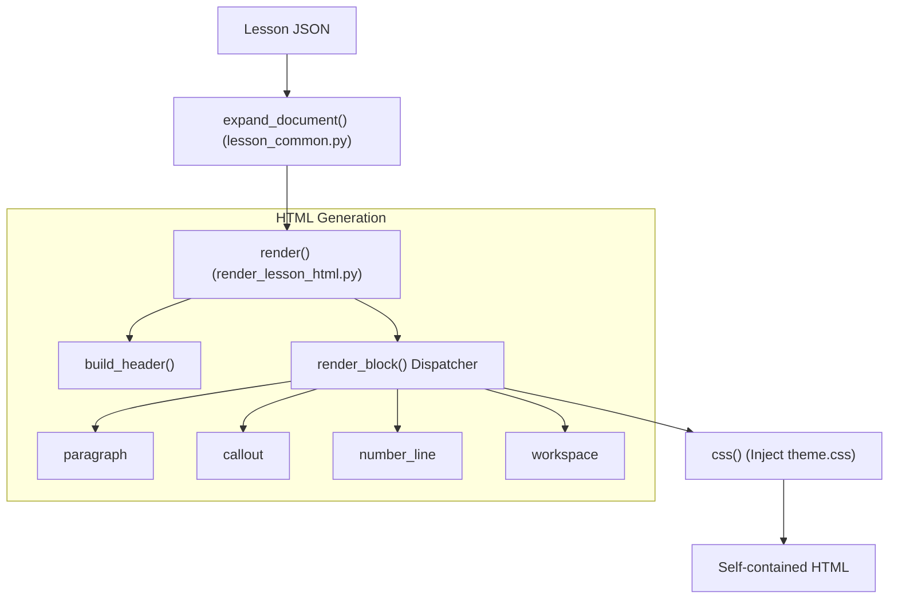
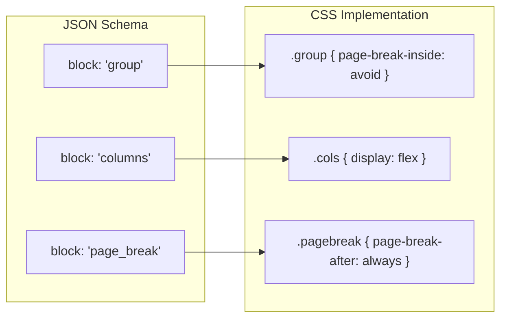

<!-- source: DeepWiki mcp.deepwiki.com · repo anthropics/k12-teacher-skills · page 4.2 HTML Renderer & CSS Theme · fetched 2026-10-26 -->

# HTML Renderer & CSS Theme

Relevant source files

The following files were used as context for generating this wiki page:

- [plugin/skills/k12-lesson-differentiation/scripts/render_lesson_html.py](plugin/skills/k12-lesson-differentiation/scripts/render_lesson_html.py)
- [plugin/skills/k12-lesson-differentiation/scripts/theme.css](plugin/skills/k12-lesson-differentiation/scripts/theme.css)
- [plugin/skills/k12-lesson-planning/scripts/render_lesson_html.py](plugin/skills/k12-lesson-planning/scripts/render_lesson_html.py)
- [plugin/skills/k12-lesson-planning/scripts/theme.css](plugin/skills/k12-lesson-planning/scripts/theme.css)

The HTML rendering pipeline transforms structured lesson JSON data into styled, self-contained HTML previews suitable for teacher review and black-and-white printing. The system prioritizes accessibility, semantic heading orders, and print-safe visual primitives.

### Orchestration and Data Flow

The rendering process is managed by `render_lesson_html.py`, which utilizes a dispatcher pattern to convert individual content blocks into HTML strings. The entry point for this process is the `render()` function.

#### Core Rendering Logic
1.  **Document Expansion**: The `render()` function first calls `expand_document()` to resolve `from_shared` references and apply print-safety repairs [plugin/skills/k12-lesson-planning/scripts/render_lesson_html.py:167-170]().
2.  **Header Generation**: It constructs the document header (title, metadata, and standards) using `build_header()` [plugin/skills/k12-lesson-planning/scripts/render_lesson_html.py:173-173]().
3.  **Block Dispatching**: The function iterates through the expanded blocks, passing each to `render_block()` [plugin/skills/k12-lesson-planning/scripts/render_lesson_html.py:180-181]().
4.  **Styling Injection**: CSS is injected directly into the `<head>` via the `css()` function, which reads `theme.css` and overlays dynamic `:root` variables [plugin/skills/k12-lesson-planning/scripts/render_lesson_html.py:65-86]().

**Rendering Pipeline Architecture**

**Sources:**
- [plugin/skills/k12-lesson-planning/scripts/render_lesson_html.py:65-87]()
- [plugin/skills/k12-lesson-planning/scripts/render_lesson_html.py:89-163]()
- [plugin/skills/k12-lesson-planning/scripts/render_lesson_html.py:165-188]()

---

### The `render_block` Dispatcher

The `render_block()` function serves as the central switchboard for the HTML renderer. It maps block types to specific HTML structures and ensures that heading levels remain semantically correct.

| Block Type | Implementation Detail | CSS Class / Tag |
| :--- | :--- | :--- |
| `paragraph` | Basic text with markdown-lite support [plugin/skills/k12-lesson-planning/scripts/render_lesson_html.py:93-94](). | `
` |
| `h2` / `h3` | Dynamic level calculation based on `theme.hbase` to prevent skipping levels [plugin/skills/k12-lesson-planning/scripts/render_lesson_html.py:98-107](). | `<h2>`, `<h3>` |
| `callout` | Uses `_resolve_callout_kind` to select icons and border colors [plugin/skills/k12-lesson-planning/scripts/render_lesson_html.py:117-128](). | `.co`, `.co-icon` |
| `fill_in` | Renders underscores of varying widths (`short`, `med`, `long`) [plugin/skills/k12-lesson-planning/scripts/render_lesson_html.py:138-143](). | `.fillin` |
| `workspace` | Generates empty space or ruled lines based on grade-level profiles [plugin/skills/k12-lesson-planning/scripts/render_lesson_html.py:157-158](). | `.ans`, `.ansline` |
| `number_line` | Renders a relative-positioned bar with ticks and marks [plugin/skills/k12-lesson-planning/scripts/render_lesson_html.py:159-160](). | `.numberline` |

**Heading Level Management**
To maintain accessibility (Axe `heading-order` compliance), the renderer tracks heading depth. If an `h2` block is encountered, it uses `theme.hbase` (defaulting to 3). If an `h3` follows, it increments the level only if a parent section header has been set [plugin/skills/k12-lesson-planning/scripts/render_lesson_html.py:99-107]().

**Sources:**
- [plugin/skills/k12-lesson-planning/scripts/render_lesson_html.py:89-163]()
- [plugin/skills/k12-lesson-planning/scripts/render_lesson_html.py:41-41]()

---

### Layout & Page-Break Logic

The renderer implements specific logic to ensure teacher and student artifacts remain readable when printed.

#### Glued Units
The `group` block type is used to "glue" content together. It applies `page-break-inside: avoid` to the container, ensuring that a set of instructions and its corresponding workspace are not split across two pages [plugin/skills/k12-lesson-planning/scripts/render_lesson_html.py:151-153]().

#### Two-Column Layouts
The `columns` block allows for side-by-side content, typically used in student worksheets to save vertical space. It utilizes a flexbox container with `gap: 24pt` [plugin/skills/k12-lesson-planning/scripts/render_lesson_html.py:154-156]().

**Layout Primitive Mapping**

**Sources:**
- [plugin/skills/k12-lesson-planning/scripts/render_lesson_html.py:151-163]()
- [plugin/skills/k12-lesson-planning/scripts/theme.css:68-68]()
- [plugin/skills/k12-lesson-planning/scripts/theme.css:88-88]()

---

### CSS Theme Visual Primitives

The `theme.css` file defines the visual language of the artifacts. It is designed to be "B+W safe," meaning it does not rely on background fills to convey meaning, as these often fail in school photocopiers.

#### CSS Custom Properties
The `css()` function in the renderer injects a `:root` block that overrides default values from the `Theme` object:
*   `--primary`: Used for icons, phase headers, and number line marks [plugin/skills/k12-lesson-planning/scripts/theme.css:81-85]().
*   `--title-size` / `--body-size`: Scaled based on the grade level defined in the lesson theme [plugin/skills/k12-lesson-planning/scripts/theme.css:11-11]().

#### Callout Registry
Callouts use specific border colors and Unicode icons rather than background colors:
*   **Teacher Note (`tnote`)**: Uses icon `💡` and color `#B8860B` [plugin/skills/k12-lesson-planning/scripts/theme.css:41-41]().
*   **Special (`special`)**: Uses icon `⭐` and color `#2F855A` [plugin/skills/k12-lesson-planning/scripts/theme.css:39-39]().
*   **Task (`task`)**: Uses icon `✏️` and color `#5B7FB8` [plugin/skills/k12-lesson-planning/scripts/theme.css:40-40]().

#### Number Line Implementation
The number line is a complex CSS primitive. It uses absolute positioning for ticks and marks relative to a `.nl-bar` [plugin/skills/k12-lesson-planning/scripts/theme.css:76-85](). Marks (`.nl-mark`) are rendered as CSS triangles [plugin/skills/k12-lesson-planning/scripts/theme.css:81-83]().

**Sources:**
- [plugin/skills/k12-lesson-planning/scripts/theme.css:6-11]()
- [plugin/skills/k12-lesson-planning/scripts/theme.css:34-43]()
- [plugin/skills/k12-lesson-planning/scripts/theme.css:76-86]()
- [plugin/skills/k12-lesson-planning/scripts/render_lesson_html.py:80-86]()

---

### Print Overrides

The renderer includes a `@media print` block to ensure that the HTML preview translates perfectly to paper.
*   **Margins**: The `.page` padding is removed to allow the browser's print margins to take over [plugin/skills/k12-lesson-planning/scripts/theme.css:91-91]().
*   **Backgrounds**: Forced to white to save ink [plugin/skills/k12-lesson-planning/scripts/theme.css:91-91]().
*   **Large Display Tables**: A special `display-large` class is available for K-2 word grids, bumping font sizes to `18pt` for classroom visibility [plugin/skills/k12-lesson-planning/scripts/theme.css:93-94]().

**Sources:**
- [plugin/skills/k12-lesson-planning/scripts/theme.css:91-95]()

---

