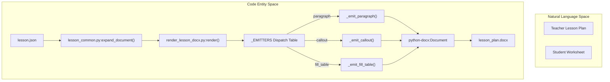
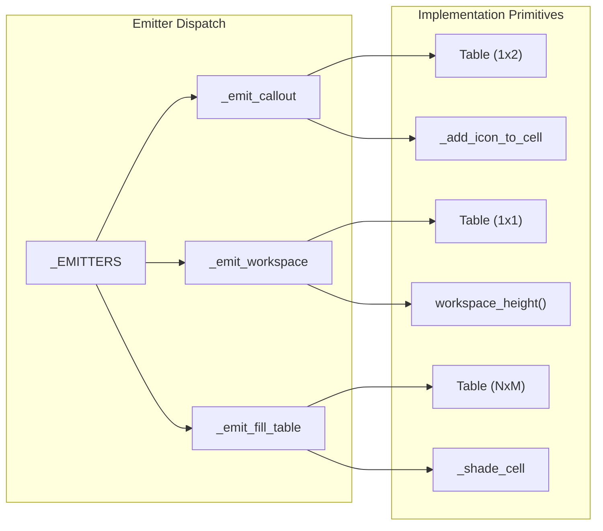

<!-- source: DeepWiki mcp.deepwiki.com · repo anthropics/k12-teacher-skills · page 4.3 DOCX Renderer · fetched 2026-10-26 -->

# DOCX Renderer

Relevant source files

The following files were used as context for generating this wiki page:

- [plugin/skills/k12-lesson-differentiation/scripts/render_lesson_docx.py](plugin/skills/k12-lesson-differentiation/scripts/render_lesson_docx.py)
- [plugin/skills/k12-lesson-planning/scripts/render_lesson_docx.py](plugin/skills/k12-lesson-planning/scripts/render_lesson_docx.py)

The `render_lesson_docx.py` script transforms lesson JSON data into editable Microsoft Word (`.docx`) files. It is designed to produce teacher-deliverable artifacts that maintain visual parity with the HTML output while adhering to print-safe design principles (minimal color, B+W compatibility, and pagination control) [plugin/skills/k12-lesson-planning/scripts/render_lesson_docx.py:6-15]().

## System Architecture

The renderer uses `python-docx` to construct the document object model. It employs a dispatch-table pattern to map block types from the `lesson.json` schema to specific emitter functions.

### Data Flow: JSON to DOCX

The following diagram illustrates how the renderer processes a lesson document.

**Figure 1: DOCX Generation Pipeline**

**Sources:** [plugin/skills/k12-lesson-planning/scripts/render_lesson_docx.py:8-12](), [plugin/skills/k12-lesson-planning/scripts/render_lesson_docx.py:340-356]()

## Style Engine & Theme Integration

The `setup_styles()` function initializes the Word document with custom styles derived from the `Theme` object [plugin/skills/k12-lesson-planning/scripts/render_lesson_docx.py:54-87]().

### Theme to Style Mapping
The renderer converts hex color strings to `RGBColor` objects via `_hex_rgb()` [plugin/skills/k12-lesson-planning/scripts/render_lesson_docx.py:46-52]().

| Word Style Name | Base Style | Attributes | Source |
| :--- | :--- | :--- | :--- |
| `Normal` | N/A | Helvetica, 10.5pt (default), 8pt after | [plugin/skills/k12-lesson-planning/scripts/render_lesson_docx.py:57-62]() |
| `LC Eyebrow` | `Normal` | 9pt, Bold, All Caps, Primary Color | [plugin/skills/k12-lesson-planning/scripts/render_lesson_docx.py:64-81]() |
| `LC Title` | `Normal` | 22pt, Bold, Text Color | [plugin/skills/k12-lesson-planning/scripts/render_lesson_docx.py:65]() |
| `LC H1` | `Normal` | 14pt, Bold, 18pt before, 8pt after | [plugin/skills/k12-lesson-planning/scripts/render_lesson_docx.py:67]() |
| `LC Spacer` | `Normal` | 2pt line height (structural separator) | [plugin/skills/k12-lesson-planning/scripts/render_lesson_docx.py:85]() |

**Sources:** [plugin/skills/k12-lesson-planning/scripts/render_lesson_docx.py:46-87]()

## Markdown Processing

The `add_md()` function serves as the mini-markdown processor for the DOCX engine. It iterates through tokens generated by `lesson_common.md_tokens()` and applies character-level formatting to `python-docx` runs [plugin/skills/k12-lesson-planning/scripts/render_lesson_docx.py:90-99]().

*   **Bold/Italic:** Applied via `r.bold` and `r.italic` attributes [plugin/skills/k12-lesson-planning/scripts/render_lesson_docx.py:97-98]().
*   **Line Breaks:** Detected via the `break` attribute in the token and injected using `add_break()` [plugin/skills/k12-lesson-planning/scripts/render_lesson_docx.py:93-95]().

**Sources:** [plugin/skills/k12-lesson-planning/scripts/render_lesson_docx.py:90-99]()

## Block Emitters & Table Primitives

Complex layout blocks (callouts, workspaces, tables) are implemented using Word tables to ensure structural integrity during printing.

### Table Helpers
The renderer uses several low-level helpers to manipulate OOXML directly via `docx.oxml`:
*   **`_set_borders`**: Manually sets `w:tblBorders` for specific sides [plugin/skills/k12-lesson-planning/scripts/render_lesson_docx.py:103-115]().
*   **`_cant_split`**: Appends `w:cantSplit` to row properties to prevent page breaks within a row [plugin/skills/k12-lesson-planning/scripts/render_lesson_docx.py:131-137]().
*   **`_set_cell_margins`**: Adjusts internal padding (twips) to prevent text from touching borders [plugin/skills/k12-lesson-planning/scripts/render_lesson_docx.py:118-128]().

### Implementation Details

**Figure 2: Block Emitter Logic**

**Sources:** [plugin/skills/k12-lesson-planning/scripts/render_lesson_docx.py:186-215](), [plugin/skills/k12-lesson-planning/scripts/render_lesson_docx.py:236-250](), [plugin/skills/k12-lesson-planning/scripts/render_lesson_docx.py:302-329]()

*   **`_emit_callout`**: Renders as a 2-column table. The left column contains the icon (if applicable) and the right column contains the content [plugin/skills/k12-lesson-planning/scripts/render_lesson_docx.py:186-215]().
*   **`_emit_workspace`**: Creates a single-cell table with a fixed height determined by the `workspace_height` utility from `lesson_common` [plugin/skills/k12-lesson-planning/scripts/render_lesson_docx.py:236-250]().
*   **`_emit_number_line`**: Renders a centered image-like placeholder for mathematical number lines [plugin/skills/k12-lesson-planning/scripts/render_lesson_docx.py:253-270]().

## Numbering Manager

Word's default "List Number" style shares a single sequence document-wide. The renderer implements a `_restart_numbering()` utility to ensure that ordered lists (e.g., in problem sets) start at 1 for each new block [plugin/skills/k12-lesson-planning/scripts/render_lesson_docx.py:162-183]().

1.  **`_list_number_abstract_id`**: Locates the `abstractNumId` associated with the "List Number" style [plugin/skills/k12-lesson-planning/scripts/render_lesson_docx.py:147-159]().
2.  **`_restart_numbering`**: Creates a new `numId` in the document's numbering part, links it to the abstract ID, and applies it to the paragraphs in the current list [plugin/skills/k12-lesson-planning/scripts/render_lesson_docx.py:169-183]().

**Sources:** [plugin/skills/k12-lesson-planning/scripts/render_lesson_docx.py:147-183]()

---

