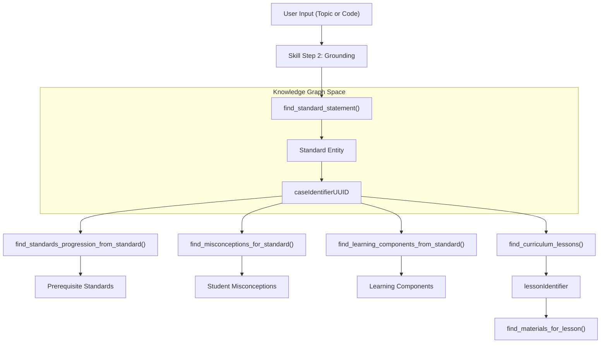
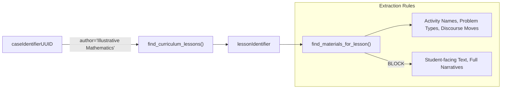

<!-- source: DeepWiki mcp.deepwiki.com · repo anthropics/k12-teacher-skills · page 5 Learning Commons Knowledge Graph Integration · fetched 2026-10-26 -->

# Learning Commons Knowledge Graph Integration

Relevant source files

The following files were used as context for generating this wiki page:

- [plugin/skills/k12-lesson-differentiation/references/learning-commons-kg.md](plugin/skills/k12-lesson-differentiation/references/learning-commons-kg.md)
- [plugin/skills/k12-lesson-planning/references/learning-commons-kg.md](plugin/skills/k12-lesson-planning/references/learning-commons-kg.md)

The Learning Commons (LC) Knowledge Graph (KG) serves as the authoritative source of truth for educational standards, learning progressions, and curriculum-specific materials for both the `k12-lesson-planning` and `k12-lesson-differentiation` skills. Integration with the KG ensures that generated content is grounded in state-specific requirements and research-backed pedagogical components like misconceptions and prerequisites.

### Core Integration Logic

The KG connector is invoked during the **Grounding** phase (Step 2) of both skills. Accessing the KG is mandatory when the tools are available; failure to call the KG when connected is considered a critical system failure [plugin/skills/k12-lesson-planning/references/learning-commons-kg.md:11-12]().

**High-Level Toolset:**
*   `find_standard_statement`: Resolves a natural language query or alphanumeric code into a specific standard entity.
*   `find_standards_progression_from_standard`: Identifies "backward" (prerequisite) or "forward" (extension) standards.
*   `find_misconceptions_for_standard`: Retrieves common student misunderstandings and recommended teacher moves.
*   `find_learning_components_from_standard`: Breaks a standard down into granular sub-skills.
*   `find_curriculum_lessons` & `find_materials_for_lesson`: Retrieves structural metadata for specific curricula (e.g., Illustrative Mathematics).

**Data Flow: From Natural Language to KG Entities**

The following diagram illustrates how user input is transformed into Knowledge Graph queries and how the `caseIdentifierUUID` acts as the primary key for subsequent data retrieval.

"KG Resolution and Data Flow"

Sources: [plugin/skills/k12-lesson-planning/references/learning-commons-kg.md:14-31](), [plugin/skills/k12-lesson-differentiation/references/learning-commons-kg.md:14-23]()

### Resolution Strategy and Constraints

The system employs a multi-step resolution strategy to ensure the correct standard is identified:

1.  **Code Search**: If a code (e.g., "5.NBT.A.1") is provided, the system performs a prefix match search. If no results are found, it falls back to keyword search [plugin/skills/k12-lesson-planning/references/learning-commons-kg.md:18-18]().
2.  **Keyword Search**: Uses a list of topic phrases to find matches. The resulting `code` can then be used to seed a follow-up code search for the "family" of standards [plugin/skills/k12-lesson-planning/references/learning-commons-kg.md:19-19]().
3.  **The 3-Attempt Cap**: To prevent infinite loops or excessive latency, the system is limited to **three total search attempts** for `find_standard_statement`. If no match is found, it reverts to training knowledge [plugin/skills/k12-lesson-planning/references/learning-commons-kg.md:23-27]().
4.  **Fallback Behavior**: If the KG is disconnected, the system proceeds using internal training data and must append a specific footer to the output: *"Generated without the Learning Commons Knowledge Graph..."* [plugin/skills/k12-lesson-planning/references/learning-commons-kg.md:54-55]().

### Per-Subject Call Sequences

Each subject has a specific orchestration pattern for KG tools:

| Subject | Primary KG Operations | Key Outputs |
| :--- | :--- | :--- |
| **Math** | Standard, Progression (Back/Forward), Misconceptions, Components, IM Materials | Prerequisite standards, sub-skills (SWBAT), teacher moves for misconceptions. |
| **ELA** | Standard, Components (K-2), Text Complexity | Sub-skill bullets, Lexile band verification. |
| **Science** | Standard, Components, Misconceptions, OpenSciEd Materials | 3D integration (SEP/CCC/DCI), phenomena-based components. |

For details on standard resolution algorithms and prerequisite logic, see [Standards Resolution & Prerequisite Grounding](#5.1).

### Copyright and Curriculum Constraints

The KG integration is subject to strict copyright guardrails. While the KG provides structural data (activity names, problem types, discourse moves), the skills are prohibited from reproducing student-facing text or full activity narratives verbatim [plugin/skills/k12-lesson-planning/references/learning-commons-kg.md:49-50]().

Furthermore, curriculum-specific terminology (e.g., "MLR 1," "Stronger and Clearer Each Time") is gated. If a curriculum like Illustrative Mathematics (IM) is not explicitly confirmed by the teacher, all IM-specific branding and terms must be scrubbed from the output [plugin/skills/k12-lesson-planning/references/learning-commons-kg.md:53-53]().

**Curriculum Retrieval Mapping**

"Curriculum Materials Retrieval Flow"

Sources: [plugin/skills/k12-lesson-planning/references/learning-commons-kg.md:49-53](), [plugin/skills/k12-lesson-differentiation/references/learning-commons-kg.md:49-57]()

For details on specific curriculum extraction and the IM-confirmed state, see [Curriculum Materials Retrieval (IM & OpenSciEd)](#5.2).

---

