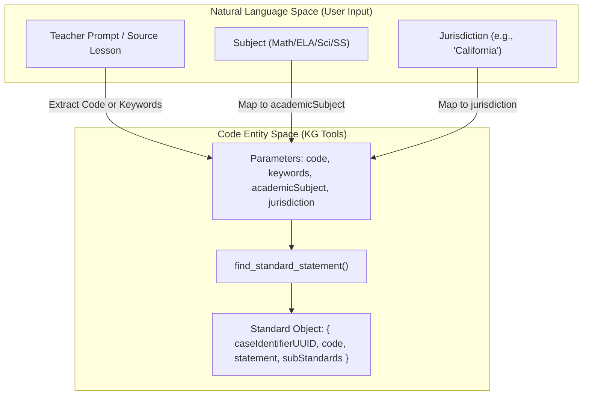
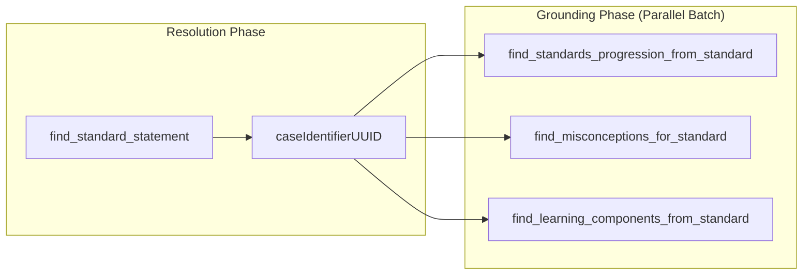

<!-- source: DeepWiki mcp.deepwiki.com · repo anthropics/k12-teacher-skills · page 5.1 Standards Resolution & Prerequisite Grounding · fetched 2026-10-26 -->

# Standards Resolution & Prerequisite Grounding

Relevant source files

The following files were used as context for generating this wiki page:

- [plugin/skills/k12-lesson-differentiation/references/learning-commons-kg.md](plugin/skills/k12-lesson-differentiation/references/learning-commons-kg.md)
- [plugin/skills/k12-lesson-planning/references/learning-commons-kg.md](plugin/skills/k12-lesson-planning/references/learning-commons-kg.md)

This page details the technical implementation of standards resolution and prerequisite grounding using the Learning Commons (LC) Knowledge Graph (KG). The system employs a multi-stage search algorithm to resolve educational standards, extract hierarchical data, and identify learning progressions (backward/forward) to ground lesson content in pedagogical best practices.

## Standards Resolution Algorithm

The resolution process is the entry point for all KG-related operations. It attempts to map natural language or shorthand codes provided by the teacher to a unique `caseIdentifierUUID` within the LC Knowledge Graph.

### Resolution Flow

The system follows a specific priority order for resolution, capped at **3 search attempts total** [plugin/skills/k12-lesson-planning/references/learning-commons-kg.md:23-27]().

1.  **Code Search**: If a code (e.g., `3.NF.A.1`) is provided, the skill calls `find_standard_statement(code=<code>, academicSubject="<subject>")` [plugin/skills/k12-lesson-planning/references/learning-commons-kg.md:18-18]().
    *   **Prefix Matching**: A code search for a parent (e.g., `2.OA`) returns the parent plus all sub-standards (`2.OA.*`) via the `subStandards` array [plugin/skills/k12-lesson-planning/references/learning-commons-kg.md:18-21]().
2.  **Keyword Search Fallback**: If no code is provided or the code search returns no results, the skill calls `find_standard_statement(keywords=[...], academicSubject="<subject>")` [plugin/skills/k12-lesson-planning/references/learning-commons-kg.md:19-19]().
3.  **Jurisdiction Awareness**: When the U.S. state is known from Step 0 state detection, the `jurisdiction` parameter is passed to ensure state-specific verbatim text is retrieved [plugin/skills/k12-lesson-differentiation/references/learning-commons-kg.md:37-41]().

### Data Extraction
Once a standard is resolved, the following entities are extracted and stored for subsequent tool calls:
*   `caseIdentifierUUID`: The primary key for all downstream KG queries [plugin/skills/k12-lesson-planning/references/learning-commons-kg.md:31-31]().
*   `code`: The official alphanumeric identifier.
*   `verbatim statement text`: The exact text used in the lesson plan's standard callout [plugin/skills/k12-lesson-planning/references/learning-commons-kg.md:41-41]().

### Natural Language to Code Entity Mapping: Resolution
The following diagram illustrates how teacher input is transformed into KG tool parameters.

**Standard Resolution Logic**

*Sources: [plugin/skills/k12-lesson-planning/references/learning-commons-kg.md:14-32](), [plugin/skills/k12-lesson-differentiation/references/learning-commons-kg.md:14-24]()*

---

## Prerequisite Grounding & Progressions

Prerequisite grounding is mandatory for Mathematics and Science to ensure vertical alignment across different student tiers (Below, At, and Above Grade Level).

### Progression Discovery
The skill uses the `find_standards_progression_from_standard` tool to navigate the curriculum tree [plugin/skills/k12-lesson-differentiation/references/learning-commons-kg.md:43-43]().

*   **Backward Progression (`direction="backward"`)**: Identifies the primary prerequisite standard. In `k12-lesson-differentiation`, this grounds the **Below Tier** [plugin/skills/k12-lesson-differentiation/references/learning-commons-kg.md:43-43](). In `k12-lesson-planning`, it is used in the **LEARNING GOAL** section [plugin/skills/k12-lesson-planning/references/learning-commons-kg.md:43-43]().
*   **Forward Progression (`direction="forward"`)**: Identifies the primary forward standard. In differentiation, this grounds the **Above Tier** [plugin/skills/k12-lesson-differentiation/references/learning-commons-kg.md:43-43]().

### Data Flow for Subsequent KG Calls
The `caseIdentifierUUID` obtained during resolution is the mandatory input for the "parallel batch" of grounding calls [plugin/skills/k12-lesson-differentiation/references/learning-commons-kg.md:32-34]().

**Entity Relationship: caseIdentifierUUID Flow**

*Sources: [plugin/skills/k12-lesson-planning/references/learning-commons-kg.md:37-39](), [plugin/skills/k12-lesson-differentiation/references/learning-commons-kg.md:32-34]()*

---

## Subject-Specific Implementations

| Subject | Resolution Priority | Prerequisite Tooling | Key Extraction |
| :--- | :--- | :--- | :--- |
| **Mathematics** | Code search preferred | `backward` & `forward` progressions | Verbatim prerequisite, 3 misconceptions, 5 sub-skills [plugin/skills/k12-lesson-planning/references/learning-commons-kg.md:41-47]() |
| **ELA** | Strand detection (RL, RI, W, L) | Learning Components (K-2 only) | Verbatim statement, Lexile check for anchor text [plugin/skills/k12-lesson-planning/references/learning-commons-kg.md:67-72]() |
| **Science** | NGSS code search | `backward` progression | DCI/SEP/CCC components, 3 misconceptions [plugin/skills/k12-lesson-planning/references/learning-commons-kg.md:82-88]() |

---

## Fallback & Partial Coverage

If the Learning Commons KG is unavailable or a standard cannot be resolved within 3 attempts, the system triggers a fallback mechanism.

### Partial-Coverage Footer
When the KG is disconnected or resolution fails, the system must append a specific footer to the generated artifacts to alert the teacher:

*   **Lesson Planning**: *"Generated without the Learning Commons Knowledge Graph. Standards and misconceptions reflect general best practice."* [plugin/skills/k12-lesson-planning/references/learning-commons-kg.md:55-55]()
*   **Differentiation**: *"Generated without the Learning Commons KG. Prerequisite grounding and misconceptions reflect general best practice."* [plugin/skills/k12-lesson-differentiation/references/learning-commons-kg.md:59-59]()

### Copyright Guardrail Integration
Regardless of KG availability, the system performs a "Curriculum-terminology check." If Illustrative Mathematics (IM) is not explicitly confirmed by the teacher, the skill must purge all IM-specific terms (e.g., MLR names, "Stronger and Clearer Each Time") from the output, even if they were retrieved via `find_materials_for_lesson` [plugin/skills/k12-lesson-planning/references/learning-commons-kg.md:53-53](), [plugin/skills/k12-lesson-differentiation/references/learning-commons-kg.md:57-57]().

*Sources: [plugin/skills/k12-lesson-planning/references/learning-commons-kg.md:53-56](), [plugin/skills/k12-lesson-differentiation/references/learning-commons-kg.md:57-60]()*

---

