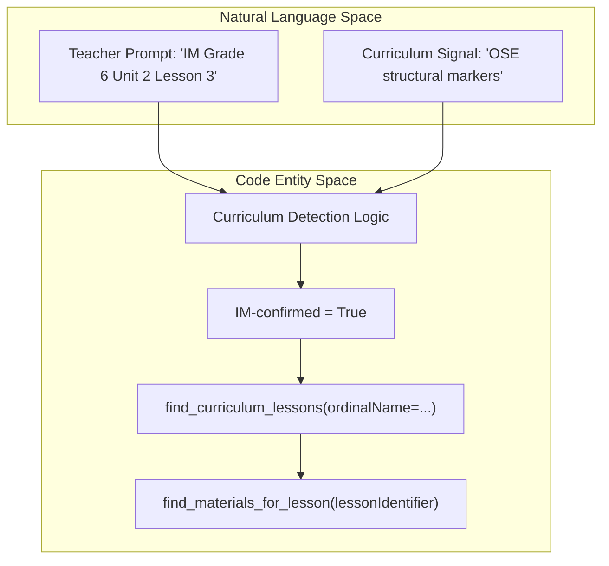
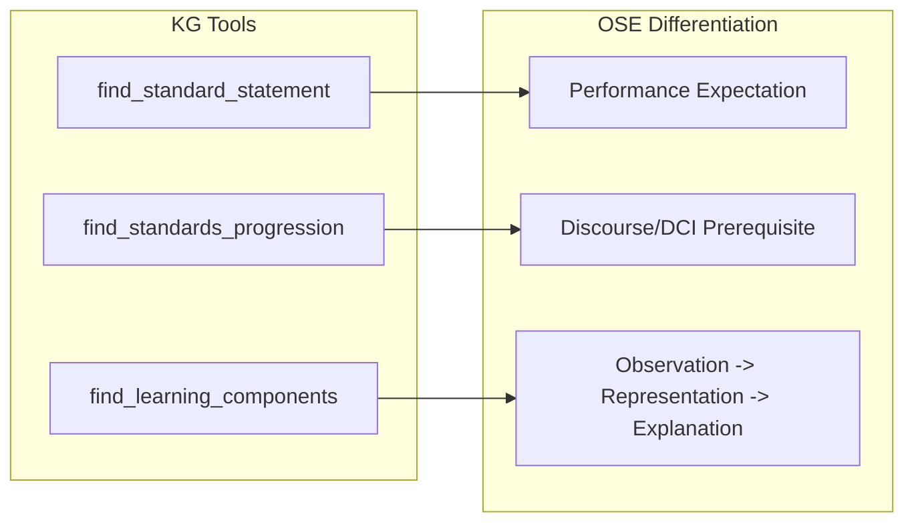

<!-- source: DeepWiki mcp.deepwiki.com · repo anthropics/k12-teacher-skills · page 5.2 Curriculum Materials Retrieval (IM & OpenSciEd) · fetched 2026-10-26 -->

# Curriculum Materials Retrieval (IM & OpenSciEd)

Relevant source files

The following files were used as context for generating this wiki page:

- [plugin/skills/k12-lesson-differentiation/references/learning-commons-kg.md](plugin/skills/k12-lesson-differentiation/references/learning-commons-kg.md)
- [plugin/skills/k12-lesson-differentiation/references/science.md](plugin/skills/k12-lesson-differentiation/references/science.md)
- [plugin/skills/k12-lesson-planning/references/learning-commons-kg.md](plugin/skills/k12-lesson-planning/references/learning-commons-kg.md)
- [plugin/skills/k12-lesson-planning/references/math.md](plugin/skills/k12-lesson-planning/references/math.md)

This page details the technical implementation and pedagogical constraints for retrieving and applying curriculum-specific materials from **Illustrative Mathematics (IM)** and **OpenSciEd (OSE)** via the Learning Commons Knowledge Graph (KG).

## Overview

The system integrates specific curriculum grounding to ensure that lessons generated for teachers using these frameworks adhere to their specific structural and discursive requirements. Retrieval is gated by a "confirmed state"—the system must detect or confirm curriculum use before applying these specialized patterns.

### Key Retrieval Functions
The following tools are used to bridge standards to specific curriculum artifacts:
*   `find_curriculum_lessons`: Locates lesson identifiers based on standard UUIDs or ordinal names (e.g., "Grade 6, Unit 2, Lesson 3") [plugin/skills/k12-lesson-planning/references/learning-commons-kg.md:49-50]().
*   `find_materials_for_lesson`: Extracts metadata including activity sequences, problem types, and discourse moves [plugin/skills/k12-lesson-planning/references/learning-commons-kg.md:49-50]().

---

## Data Flow: Natural Language to Curriculum Entities

The following diagram illustrates how teacher input is resolved into specific curriculum entities within the code.

**Curriculum Entity Resolution Flow**

**Sources:** [plugin/skills/k12-lesson-planning/references/math.md:16-17](), [plugin/skills/k12-lesson-differentiation/references/science.md:30-38](), [plugin/skills/k12-lesson-planning/references/learning-commons-kg.md:49-50]()

---

## Illustrative Mathematics (IM) Integration

### Detection and Gating
The system performs **Curriculum Detection** before drafting. IM is "confirmed" if the teacher explicitly mentions it or uses specific terminology like "MLRs," "cool-down," or "Stronger and Clearer Each Time" [plugin/skills/k12-lesson-planning/references/math.md:16-17]().

### Extraction and Usage
When IM is confirmed, the system retrieves:
1.  **Activity Names and Sequence:** To ground the lesson structure [plugin/skills/k12-lesson-planning/references/learning-commons-kg.md:49-50]().
2.  **Problem Types:** Specifically identifying unknown positions addressed [plugin/skills/k12-lesson-planning/references/learning-commons-kg.md:49-50]().
3.  **Discourse Moves:** Such as *Compare and Connect* or *Think-Pair-Share* [plugin/skills/k12-lesson-planning/references/math.md:44-45]().

### The "Not IM-Confirmed" Gate
If IM is not confirmed, the system is strictly forbidden from using IM-specific terminology. This is a copyright and pedagogical guardrail [plugin/skills/k12-lesson-planning/references/learning-commons-kg.md:53-54]().

| Feature | IM-Confirmed Path | Non-IM Path |
| :--- | :--- | :--- |
| **Structure** | Launch → Explore → Discuss → Synthesize → Exit Ticket | Problem-based (varies by grade) |
| **Terminology** | MLRs (1-8), "Stronger and Clearer" | Turn-and-Talk, Think-Pair-Share |
| **Discourse** | MLR 7 (Compare and Connect) | Strategy modeling, array/area models |

**Sources:** [plugin/skills/k12-lesson-planning/references/math.md:42-54](), [plugin/skills/k12-lesson-planning/references/learning-commons-kg.md:53-54]()

---

## OpenSciEd (OSE) Integration

### Structural Markers
OpenSciEd use is detected through specific structural markers in uploaded lessons or teacher prompts:
*   **Driving Question Board (DQB)** references [plugin/skills/k12-lesson-differentiation/references/science.md:33-33]().
*   **Scientists Circle** or consensus model activities [plugin/skills/k12-lesson-differentiation/references/science.md:34-34]().
*   **"What are we figuring out?"** framing in objectives [plugin/skills/k12-lesson-differentiation/references/science.md:35-35]().

### Retrieval for Differentiation
In science differentiation, the system retrieves curriculum-specific elements to ensure the **Three-Dimensional Scope** (SEP, CCC, DCI) is preserved across all tiers [plugin/skills/k12-lesson-differentiation/references/science.md:63-71]().

**Science Retrieval Logic**

**Sources:** [plugin/skills/k12-lesson-differentiation/references/science.md:76-85](), [plugin/skills/k12-lesson-differentiation/references/learning-commons-kg.md:34-47]()

---

## Strict Copyright Guardrails

A critical technical constraint in curriculum retrieval is the **verbatim reproduction ban**. The KG connector is used for grounding, but student-facing text and full activity narratives must never be reproduced [plugin/skills/k12-lesson-planning/references/learning-commons-kg.md:49-50]().

1.  **Extract only metadata:** Activity names, sequence, problem types, and discourse moves [plugin/skills/k12-lesson-planning/references/learning-commons-kg.md:49-50]().
2.  **Discard narratives:** Full activity narratives and student-facing text must be discarded immediately after extraction [plugin/skills/k12-lesson-planning/references/learning-commons-kg.md:49-50]().
3.  **Clean working notes:** Before drafting, the system must scan and remove any curriculum-specific terminology (like "MLR") if the curriculum was not explicitly confirmed [plugin/skills/k12-lesson-planning/references/learning-commons-kg.md:53-54]().

**Sources:** [plugin/skills/k12-lesson-planning/references/learning-commons-kg.md:49-54](), [plugin/skills/k12-lesson-differentiation/references/learning-commons-kg.md:57-58]()

---

