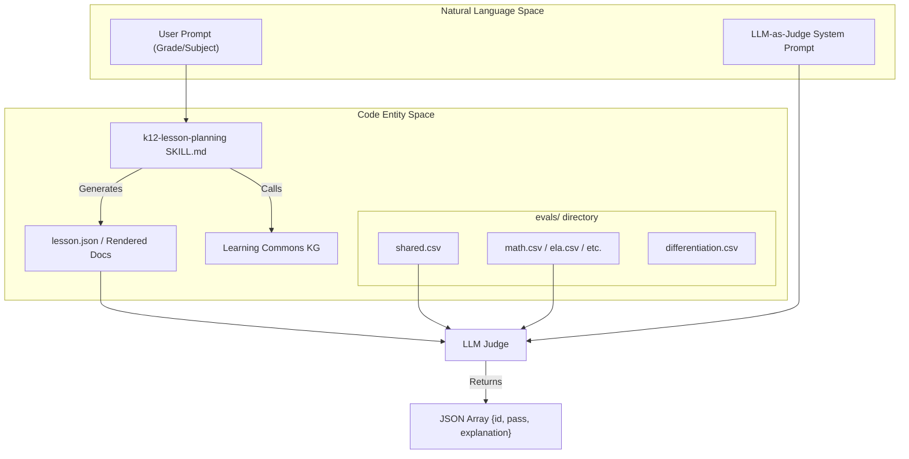

<!-- source: DeepWiki mcp.deepwiki.com · repo anthropics/k12-teacher-skills · page 6 Evaluation Framework · fetched 2026-10-26 -->

# Evaluation Framework

Relevant source files

The following files were used as context for generating this wiki page:

- [evals/README.md](evals/README.md)

The **Evaluation Framework** provides a standardized, field-grounded methodology for benchmarking the quality of AI-generated K-12 classroom materials. Developed jointly by **Learning Commons** and **Anthropic**, the framework ensures that every output produced by the `k12-lesson-planning` and `k12-lesson-differentiation` skills can be traced back to validated academic standards and learning science research [evals/README.md:2-6]().

The framework is housed in the `evals/` directory and is designed to be used by LLM-as-judge scoring systems, human evaluators, or deterministic scoring scripts [evals/README.md:1-6]().

## The P/R/O/M Rubric Framework

All evaluation criteria are categorized into four "buckets" (P, R, O, or M). These buckets balance pedagogical quality with technical usability [evals/README.md:25](), [evals/README.md:74-77]().

| Bucket | Category | Description |
| :--- | :--- | :--- |
| **P** | **Pedagogy** | Evaluates instructional design: standards alignment, prerequisite connections, discourse structures, and attention to student struggle [evals/README.md:78-82](). |
| **R** | **Rigor** | Ensures grade-level cognitive demand is maintained. Checks for student agency and prevents "downward drift" in intellectual work [evals/README.md:88-91](). |
| **O** | **Output** | Validates formatting, technical consistency, and usability (e.g., schema compliance, artifact alignment) [evals/README.md:25](). |
| **M** | **Model Scaffolding** | Evaluates the model's interaction behavior, such as asking clarifying questions before generating content [evals/README.md:25](), [evals/README.md:56-59](). |

**Sources:** [evals/README.md:25](), [evals/README.md:74-91]()

## Rubric Structure

Rubrics are stored as CSV files within the `evals/` subdirectories. Each file follows a strict schema to allow for automated parsing by evaluation harnesses [evals/README.md:11-14](), [evals/README.md:20-29]().

### CSV Schema
*   **ID**: Unique identifier (e.g., `P1`, `R3`) [evals/README.md:24]().
*   **Bucket**: The P/R/O/M category [evals/README.md:25]().
*   **Criterion**: Short descriptive name [evals/README.md:26]().
*   **What pass requires**: The specific, binary condition for a "Pass" [evals/README.md:27]().
*   **Notes**: Rationale or expert design notes [evals/README.md:28]().
*   **Conditional**: Logic that limits when a criterion applies (e.g., `K-5` or `ELA-Gr8+`). If the condition isn't met, the criterion is skipped [evals/README.md:29-33]().

### Rubric Layering
For lesson planning, rubrics are applied in layers. An evaluator first applies `shared.csv` (core criteria), then layers on the subject-specific file (e.g., `math.csv`) [evals/README.md:31]().

**Sources:** [evals/README.md:20-33]()

## LLM-as-Judge Scoring

The framework is optimized for "LLM-as-judge" workflows. In this setup, a highly capable model (like Claude 3.5 Sonnet) is provided with the generated lesson documents, the model's chat history, and the relevant rubric CSVs [evals/README.md:41-43]().

### Scoring Logic
*   **M (Model Scaffolding)** criteria are judged against the **chat response** [evals/README.md:56-57]().
*   **P, R, and O** criteria are judged strictly against the **attached documents** (e.g., `lesson.json` or rendered PDFs). Content must be present in the artifact, not just claimed in the chat [evals/README.md:57-59]().
*   **Binary Scoring**: Judges must return a `0` or `1` (fail/pass) for each ID [evals/README.md:42]().

### Evaluation Workflow
The following diagram illustrates how the codebase entities interact during an evaluation run:

**Evaluation Data Flow**

**Sources:** [evals/README.md:11-14](), [evals/README.md:44-66]()

## Dependency on Learning Commons KG

Accurate scoring, particularly for **P (Pedagogy)** and **R (Rigor)** buckets, depends on the model's ability to retrieve ground-truth data from the **Learning Commons Knowledge Graph (KG)**. 

The rubrics check for:
1.  **Standard Verbatim**: Does the output match the KG's `find_standard_statement` exactly? [evals/README.md:84-85]().
2.  **Prerequisite Alignment**: Does the lesson ground itself in the standards returned by `find_standards_progression_from_standard`? [evals/README.md:80-82]().
3.  **Curriculum Coherence**: If the lesson is flagged as Illustrative Mathematics (IM) or OpenSciEd, does it use the terminology and discourse moves retrieved via `find_materials_for_lesson`? [evals/README.md:84-85]().

**Sources:** [evals/README.md:4-6](), [evals/README.md:80-87]()

## Sub-pages

The evaluation framework is divided into two main areas:

### [Lesson-Planning Rubrics](#6.1)
Covers `shared.csv` and subject-specific rubrics for Math, ELA, Science, and Social Studies. These rubrics focus on curriculum coherence, "hardest case" exit tickets, and student agency.
For details, see [Lesson-Planning Rubrics](#6.1).

### [Lesson-Differentiation Rubrics](#6.2)
Covers `differentiation.csv` and `clarifying_question.csv`. These rubrics evaluate tier integrity (Below/At/Above), "invisible" modifications that preserve rigor, and the model's ability to scaffold the teacher's request through clarifying questions.
For details, see [Lesson-Differentiation Rubrics](#6.2).

---

