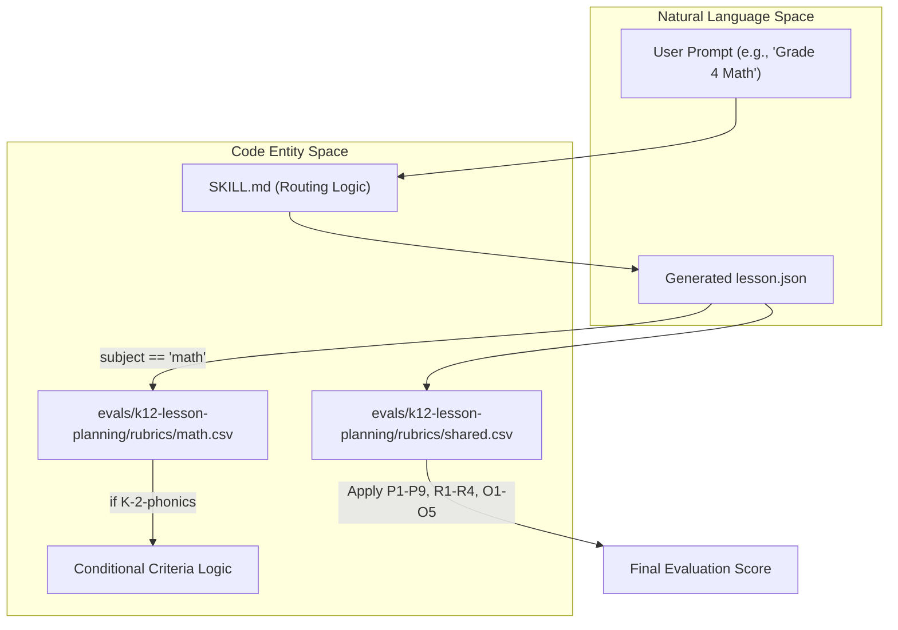
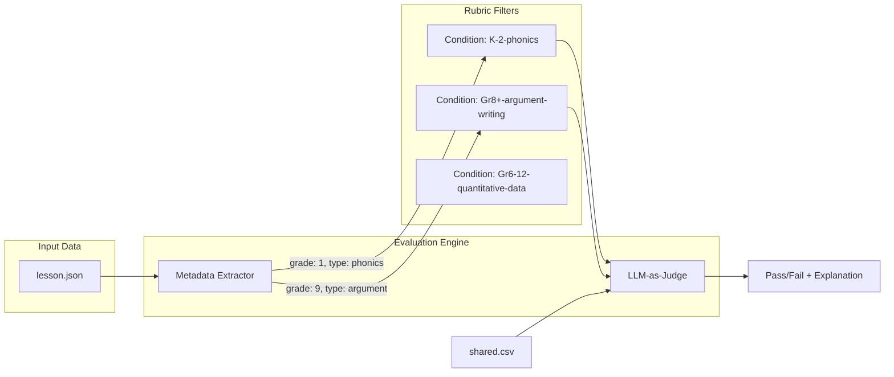

<!-- source: DeepWiki mcp.deepwiki.com · repo anthropics/k12-teacher-skills · page 6.1 Lesson-Planning Rubrics · fetched 2026-10-26 -->

# Lesson-Planning Rubrics

Relevant source files

The following files were used as context for generating this wiki page:

- [evals/k12-lesson-planning/rubrics/ela.csv](evals/k12-lesson-planning/rubrics/ela.csv)
- [evals/k12-lesson-planning/rubrics/math.csv](evals/k12-lesson-planning/rubrics/math.csv)
- [evals/k12-lesson-planning/rubrics/science.csv](evals/k12-lesson-planning/rubrics/science.csv)
- [evals/k12-lesson-planning/rubrics/shared.csv](evals/k12-lesson-planning/rubrics/shared.csv)
- [evals/k12-lesson-planning/rubrics/social_studies.csv](evals/k12-lesson-planning/rubrics/social_studies.csv)

This page documents the evaluation framework for the `k12-lesson-planning` skill. The framework utilizes a **P/R/O/M** (Pedagogy, Rigor, Output/Formatting, Misconceptions) rubric structure to assess the quality of generated lesson plans and student-facing artifacts.

## Rubric Architecture

The evaluation system is composed of a core "Shared" rubric applied to every lesson regardless of subject, layered with "Subject-Specific" rubrics that enforce domain-specific pedagogical standards (e.g., NGSS for Science, Science of Reading for ELA).

### P/R/O/M Bucket Definitions
*   **P — Pedagogy**: Evaluates instructional design, phase sequencing, and adherence to teaching frameworks.
*   **R — Rigor**: Ensures grade-level cognitive demand is maintained and tasks require student reasoning.
*   **O — Output / Formatting**: Validates the technical structure of the artifacts, including the separation of teacher and student content.
*   **M — Misconceptions**: (Often embedded in P) Assesses the accuracy and specificity of anticipated student errors.

### The Layering Mechanism
When an evaluation is performed, the system selects criteria based on the subject detected in the lesson metadata. The total rubric set is: `shared.csv` + `[subject].csv`.

### Logic Flow: Rubric Application
The following diagram illustrates how the system determines which criteria to apply to a generated lesson.

**Lesson Rubric Selection Logic**

Sources: [evals/k12-lesson-planning/rubrics/shared.csv:1-20](), [evals/k12-lesson-planning/rubrics/math.csv:1-8]()

---

## Shared Rubric (`shared.csv`)

The shared rubric defines the "Floor of Quality" for all lessons. Key technical requirements include:

| ID | Criterion | Key Requirement |
| :--- | :--- | :--- |
| **P1** | Standard Verbatim | The full text of the standard must match the header and all restatements exactly [evals/k12-lesson-planning/rubrics/shared.csv:2-2](). |
| **P6b** | Look-fors | Must describe *observable student behavior*, not teacher actions [evals/k12-lesson-planning/rubrics/shared.csv:9-9](). |
| **R3** | Exit Ticket Hardest Case | The exit ticket must target the "structurally hardest version" of the standard (e.g., start-unknown for math) [evals/k12-lesson-planning/rubrics/shared.csv:15-15](). |
| **O2** | Student Content Purity | Student-facing materials must contain zero "stage directions" (e.g., "The teacher distributes...") [evals/k12-lesson-planning/rubrics/shared.csv:17-17](). |

Sources: [evals/k12-lesson-planning/rubrics/shared.csv:1-20]()

---

## Subject-Specific Rubrics

Each subject file adds specialized pedagogical constraints.

### Math (`math.csv`)
Focuses on the **IM (Illustrative Mathematics)** structure and structural variety.
*   **P-M1**: If IM is confirmed, the lesson must use Launch → Explore → Discuss → Synthesize [evals/k12-lesson-planning/rubrics/math.csv:2-2]().
*   **P-M4**: Problem sets must cover the standard's "structural variety" (e.g., if a standard covers rational numbers, problems must include fractions/decimals) [evals/k12-lesson-planning/rubrics/math.csv:5-6]().

### ELA (`ela.csv`)
Focuses on **Text Complexity** and **Science of Reading**.
*   **P-E1**: Anchor texts must fall within the CCSS Lexile band for the grade [evals/k12-lesson-planning/rubrics/ela.csv:2-2]().
*   **P-E4**: Prohibits "three-cueing" strategies in K-2 phonics (No picture cues or initial-letter prompting) [evals/k12-lesson-planning/rubrics/ela.csv:5-5]().
*   **R-E1**: "Write before Speaking" — every discussion must be preceded by a written formulation step [evals/k12-lesson-planning/rubrics/ela.csv:8-8]().

### Science (`science.csv`)
Enforces **3D Learning (NGSS)** and phenomena-driven inquiry.
*   **P-S1**: Requires separate and explicit learning targets for SEP, DCI, and CCC [evals/k12-lesson-planning/rubrics/science.csv:2-2]().
*   **P-S3**: "Investigation precedes explanation" — students must gather evidence before the teacher reveals the scientific mechanism [evals/k12-lesson-planning/rubrics/science.csv:4-4]().

### Social Studies (`social_studies.csv`)
Built on the **C3 Framework Inquiry Arc**.
*   **P-SS1**: The driving "Compelling Question" must be genuinely contestable/debatable [evals/k12-lesson-planning/rubrics/social_studies.csv:2-2]().
*   **P-SS4**: Guided analysis must move from sourcing → contextualization → corroboration [evals/k12-lesson-planning/rubrics/social_studies.csv:5-5]().

Sources: [evals/k12-lesson-planning/rubrics/math.csv:1-8](), [evals/k12-lesson-planning/rubrics/ela.csv:1-9](), [evals/k12-lesson-planning/rubrics/science.csv:1-9](), [evals/k12-lesson-planning/rubrics/social_studies.csv:1-9]()

---

## Conditional Criteria & Data Flow

Rubrics use a `Conditional` column to filter criteria based on specific lesson attributes (e.g., Grade Level or Lesson Type).

**Data Flow: From JSON to Evaluated Score**

### Key Conditional Logic
*   **P-E4/P-E5**: Only applied if the lesson is tagged as `K-2-phonics` [evals/k12-lesson-planning/rubrics/ela.csv:5-6]().
*   **P-E6**: Only applied for `Gr8+-argument-writing` tasks, requiring a counterclaim [evals/k12-lesson-planning/rubrics/ela.csv:7-7]().
*   **R-S2**: Only applied to `Gr6-12` science standards that involve quantitative data [evals/k12-lesson-planning/rubrics/science.csv:8-8]().

Sources: [evals/k12-lesson-planning/rubrics/ela.csv:5-7](), [evals/k12-lesson-planning/rubrics/science.csv:8-8]()

---

