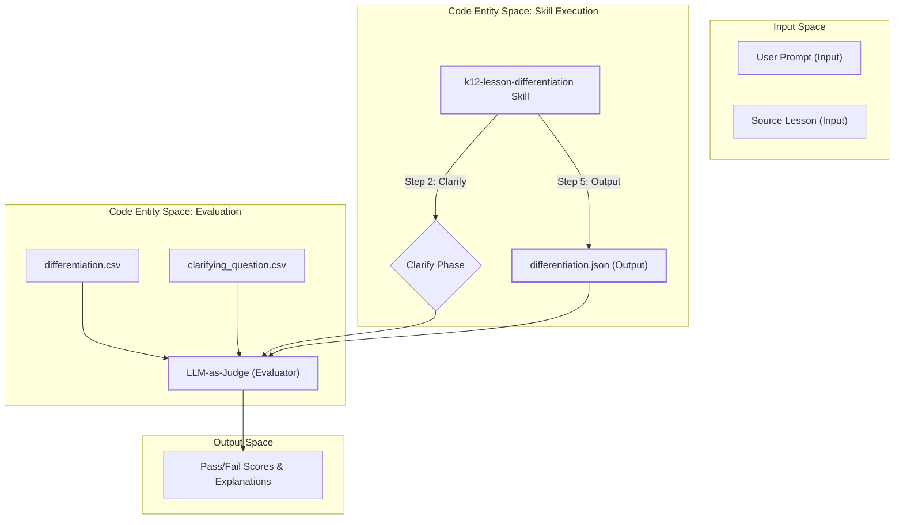
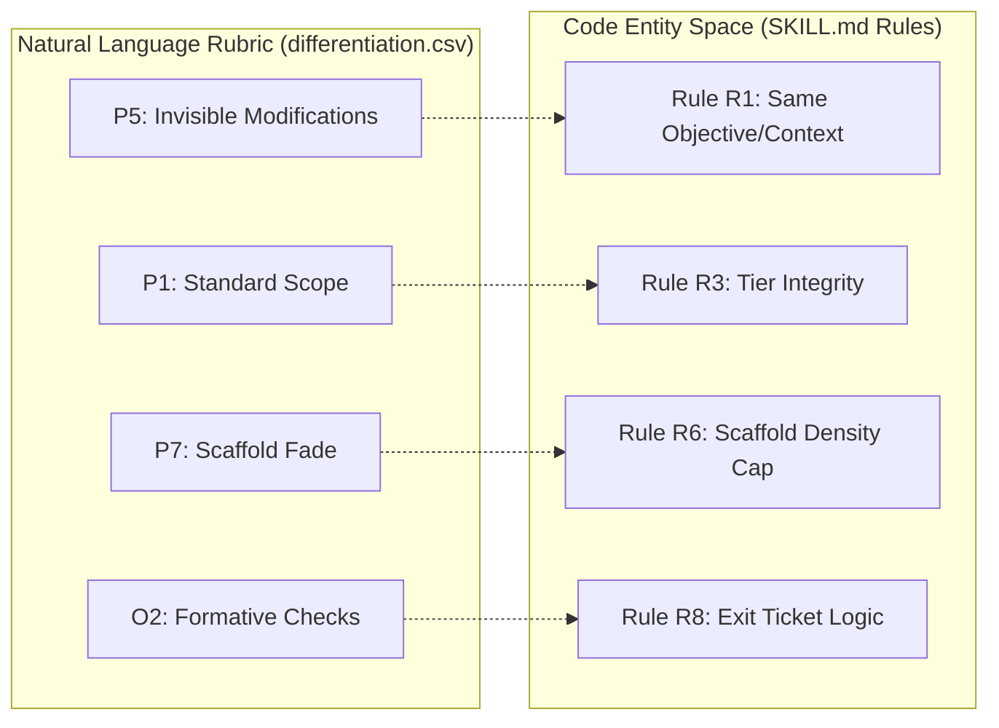

<!-- source: DeepWiki mcp.deepwiki.com · repo anthropics/k12-teacher-skills · page 6.2 Lesson-Differentiation Rubrics · fetched 2026-10-26 -->

# Lesson-Differentiation Rubrics

Relevant source files

The following files were used as context for generating this wiki page:

- [evals/k12-lesson-differentiation/rubrics/clarifying_question.csv](evals/k12-lesson-differentiation/rubrics/clarifying_question.csv)
- [evals/k12-lesson-differentiation/rubrics/differentiation.csv](evals/k12-lesson-differentiation/rubrics/differentiation.csv)

This page documents the evaluation rubrics used to assess the performance of the `k12-lesson-differentiation` skill. These rubrics serve as the "ground truth" for LLM-as-judge evaluations, ensuring that generated tiered materials adhere to specific pedagogical standards, maintain tier integrity, and exhibit correct scaffolding behavior.

The evaluation framework is split into two primary CSV-based rubrics:
1.  **differentiation.csv**: Governs the quality, rigor, and formatting of the generated teacher plans and tiered worksheets.
2.  **clarifying_question.csv**: Governs the model's interactive behavior, specifically its ability to pause and ask for missing context (like state standards) before generating content.

## Pedagogy and Tier Integrity (differentiation.csv)

The core of the differentiation evaluation is the P/R/O/M (Pedagogy, Rigor, Output, Model) framework. These criteria ensure that the "Below", "At", and "Above" tiers are not merely different levels of difficulty, but are structured according to the "Invisible Modifications" rule.

### Key Pedagogical Criteria
The following table summarizes the high-priority pedagogical checks defined in the rubric:

| ID | Criterion | Technical Requirement |
| :--- | :--- | :--- |
| **P1** | Standard Scope | The target standard must be named across all tiers; the "hardest case" of the standard must remain in play even in the Below tier. |
| **P2** | Prereq/Forward Grounding | Below tier must name a prerequisite standard; Above tier must name a forward extension. |
| **P5** | Invisible Modifications | All tiers must work toward the SAME objective in the SAME context. Tiers cannot change the topic or the kind of work produced. |
| **P7** | Scaffold Fade | Support density must not be uniform; scaffolds must reduce within the problem set to encourage independence. |
| **P8** | Flexible Grouping | Teacher plan must justify tier assignments and indicate that groups are revisable based on formative evidence. |

### Rigor and Output Alignment
The rubric enforces that differentiation does not result in "watered down" content for struggling students.

*   **Cognitive Demand (R1):** All tiers, including Below, must require students to explain, justify, or apply understanding rather than just recall [evals/k12-lesson-differentiation/rubrics/differentiation.csv:11-11]().
*   **Artifact Alignment (O6):** This requires a "two-direction cross-read." Every task mentioned in the teacher plan must exist in the student worksheets, and every task on the worksheets must be described in the teacher plan [evals/k12-lesson-differentiation/rubrics/differentiation.csv:19-19]().
*   **Universal Design (O5):** Access features like word banks or sentence stems must be applied across tiers, not just reserved for the Below tier [evals/k12-lesson-differentiation/rubrics/differentiation.csv:18-18]().

### Sources:
- [evals/k12-lesson-differentiation/rubrics/differentiation.csv:1-20]()

---

## Model Scaffolding Behavior (clarifying_question.csv)

The `k12-lesson-differentiation` skill is designed to be a "human-in-the-loop" system. It should not generate documents if critical context is missing. The `clarifying_question.csv` rubric specifically tests the model's state-management during the "Clarify" phase of the lifecycle.

### State Standards Detection
The primary check in this rubric is `M-CLARIFY-STATE`. If the user has not specified a geographic location or a specific set of state standards (especially in subjects like Social Studies where standards vary wildly by region), the model must ask for this information before proceeding to the "Build" step.

*   **Pass Condition:** The model asks a clear question identifying the state or framework as missing input in any turn preceding document delivery [evals/k12-lesson-differentiation/rubrics/clarifying_question.csv:2-2]() .
*   **Fail Condition:** The model generates documents without asking about the state, or asks only about unrelated details [evals/k12-lesson-differentiation/rubrics/clarifying_question.csv:2-2]().

### Sources:
- [evals/k12-lesson-differentiation/rubrics/clarifying_question.csv:1-2]()

---

## Data Flow: From Rubric to Score

The following diagram illustrates how the rubrics are applied during an evaluation run. The evaluator (LLM-as-judge) consumes the generated JSON artifacts and the CSV criteria to produce a final score.

**Evaluation Pipeline Architecture**

### Sources:
- [evals/k12-lesson-differentiation/rubrics/differentiation.csv:1-20]()
- [evals/k12-lesson-differentiation/rubrics/clarifying_question.csv:1-2]()

---

## Differentiation Logic Mapping

The rubrics are designed to validate the specific logic implemented in the skill's `SKILL.md`. The diagram below bridges the natural language requirements in the rubrics to the internal logic rules (R1-R8) that the model follows.

**Logic Mapping: Rubric to Skill Rules**

### Sources:
- [evals/k12-lesson-differentiation/rubrics/differentiation.csv:2-2]() (P1)
- [evals/k12-lesson-differentiation/rubrics/differentiation.csv:6-6]() (P5)
- [evals/k12-lesson-differentiation/rubrics/differentiation.csv:8-8]() (P7)
- [evals/k12-lesson-differentiation/rubrics/differentiation.csv:15-15]() (O2)

---

