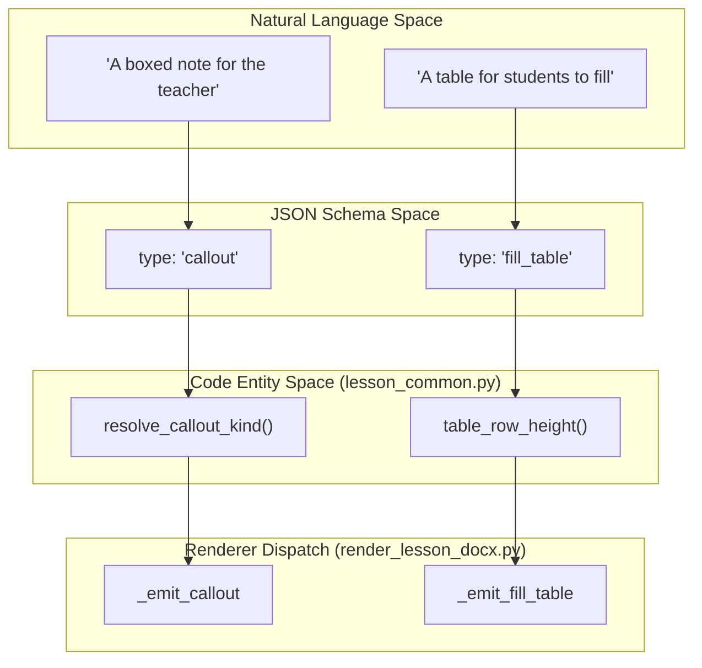
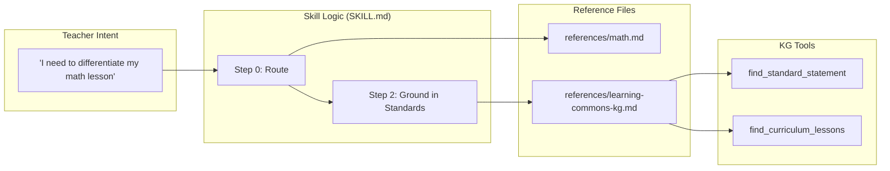

<!-- source: DeepWiki mcp.deepwiki.com · repo anthropics/k12-teacher-skills · page 7 Glossary · fetched 2026-10-26 -->

# Glossary

Relevant source files

The following files were used as context for generating this wiki page:

- [evals/README.md](evals/README.md)
- [plugin/skills/k12-lesson-differentiation/SKILL.md](plugin/skills/k12-lesson-differentiation/SKILL.md)
- [plugin/skills/k12-lesson-differentiation/references/example_differentiation.json](plugin/skills/k12-lesson-differentiation/references/example_differentiation.json)
- [plugin/skills/k12-lesson-differentiation/references/output.md](plugin/skills/k12-lesson-differentiation/references/output.md)
- [plugin/skills/k12-lesson-differentiation/references/science.md](plugin/skills/k12-lesson-differentiation/references/science.md)
- [plugin/skills/k12-lesson-differentiation/scripts/lesson_common.py](plugin/skills/k12-lesson-differentiation/scripts/lesson_common.py)
- [plugin/skills/k12-lesson-differentiation/scripts/render_lesson_docx.py](plugin/skills/k12-lesson-differentiation/scripts/render_lesson_docx.py)
- [plugin/skills/k12-lesson-differentiation/scripts/render_lesson_html.py](plugin/skills/k12-lesson-differentiation/scripts/render_lesson_html.py)
- [plugin/skills/k12-lesson-differentiation/scripts/theme.css](plugin/skills/k12-lesson-differentiation/scripts/theme.css)
- [plugin/skills/k12-lesson-planning/SKILL.md](plugin/skills/k12-lesson-planning/SKILL.md)
- [plugin/skills/k12-lesson-planning/references/ela.md](plugin/skills/k12-lesson-planning/references/ela.md)
- [plugin/skills/k12-lesson-planning/references/math.md](plugin/skills/k12-lesson-planning/references/math.md)
- [plugin/skills/k12-lesson-planning/references/output.md](plugin/skills/k12-lesson-planning/references/output.md)

This glossary defines technical terms, educational frameworks, and codebase-specific entities used within the `k12-teacher-skills` repository. It serves as a bridge between educational pedagogy and the underlying software implementation.

## Technical & Codebase Terms

### Block Vocabulary
The set of canonical JSON keys used to define content structure in `lesson.json` and `differentiation.json`. These blocks are dispatched by the rendering pipeline to specific HTML tags or Word XML elements.
*   **Implementation:** `btype` function in [plugin/skills/k12-lesson-differentiation/scripts/lesson_common.py:25-25]() and [plugin/skills/k12-lesson-differentiation/scripts/render_lesson_html.py:92-153]().
*   **Key Types:** `paragraph`, `labeled`, `list`, `callout`, `fill_table`, `number_line`, `workspace`, `phase_header`.

### Shared Content Registry (`shared`)
A design pattern where content appearing in multiple documents (e.g., the lesson standard or an exit ticket) is defined once in a top-level `shared` object. Individual documents then reference this content using a `from_shared` block type to prevent "content drift."
*   **Implementation:** `expand_from_shared` in [plugin/skills/k12-lesson-differentiation/scripts/lesson_common.py:9-10]().
*   **Usage:** [plugin/skills/k12-lesson-differentiation/references/example_differentiation.json:2-54]().

### Print-Safety Repair Pipeline
A series of regex-based functions in `lesson_common.py` that post-process LLM-generated text to fix common formatting errors before rendering to PDF-ready formats.
*   **Functions:** `_repair_pipe_tables`, `_repair_inline_bullets`, `_repair_enum_breaks`, `_repair_cap_subparts`.
*   **Source:** [plugin/skills/k12-lesson-differentiation/scripts/lesson_common.py:16-160]().

### Natural Language to Code Entity Mapping (Rendering)

The following diagram illustrates how natural language block descriptions are transformed into specific code entities during the rendering process.

**Diagram: Block Dispatch Flow**

**Sources:** [plugin/skills/k12-lesson-differentiation/scripts/lesson_common.py:24-29](), [plugin/skills/k12-lesson-differentiation/scripts/render_lesson_docx.py:23-29]()

---

## Educational & Pedagogical Terms

### 3D Learning (Three-Dimensional Learning)
A science education framework (NGSS) that integrates three distinct dimensions: **SEP** (Science and Engineering Practices), **CCC** (Crosscutting Concepts), and **DCI** (Disciplinary Core Ideas).
*   **Skill Constraint:** The differentiation skill must preserve all three dimensions across all student tiers.
*   **Source:** [plugin/skills/k12-lesson-differentiation/references/science.md:63-72]().

### CGI (Cognitively Guided Instruction)
A student-centered approach to primary mathematics. In this codebase, it dictates specific problem types (start-unknown, change-unknown) for K–2 math lessons.
*   **Source:** [plugin/skills/k12-lesson-planning/references/math.md:50-50]().

### Differentiated Tiers (Below / At / Above)
The three proficiency levels the `k12-lesson-differentiation` skill targets.
*   **Group A (Below):** Scaffolds access to grade-level standards without reducing cognitive demand.
*   **Group B (At):** Grade-level proficiency.
*   **Group C (Above):** Extensions that deepen understanding (extension/generalization) rather than just adding more work.
*   **Source:** [plugin/skills/k12-lesson-differentiation/SKILL.md:15-17](), [plugin/skills/k12-lesson-differentiation/references/science.md:80-84]().

### O→R→E Progression (Observation → Representation → Explanation)
A science-specific differentiation strategy used to "teach up."
*   **Source:** [plugin/skills/k12-lesson-differentiation/references/science.md:76-85]().

### Natural Language to Code Entity Mapping (Orchestration)

This diagram shows how high-level educational intents map to specific skill orchestration steps and reference files.

**Diagram: Skill Routing and Grounding**

**Sources:** [plugin/skills/k12-lesson-differentiation/SKILL.md:37-66](), [plugin/skills/k12-lesson-planning/SKILL.md:44-77]()

---

## Abbreviations

| Abbreviation | Meaning | Code Context / Pointers |
| :--- | :--- | :--- |
| **CCC** | Crosscutting Concept | Science pedagogy [plugin/skills/k12-lesson-differentiation/references/science.md:69-69]() |
| **DCI** | Disciplinary Core Idea | Prerequisite engine [plugin/skills/k12-lesson-differentiation/references/science.md:93-98]() |
| **IM** | Illustrative Mathematics | Math curriculum branching [plugin/skills/k12-lesson-planning/references/math.md:16-18]() |
| **KG** | Knowledge Graph | `learning-commons-kg.md` integration [plugin/skills/k12-lesson-planning/SKILL.md:94-99]() |
| **MLR** | Mathematical Language Routine | IM-specific discourse [plugin/skills/k12-lesson-planning/references/math.md:45-45]() |
| **NGSS** | Next Generation Science Standards | Science grounding [plugin/skills/k12-lesson-differentiation/SKILL.md:80-82]() |
| **OSE** | OpenSciEd | Science curriculum detection [plugin/skills/k12-lesson-differentiation/references/science.md:30-36]() |
| **PE** | Performance Expectation | Science standard target [plugin/skills/k12-lesson-differentiation/references/science.md:19-19]() |
| **SEP** | Science & Engineering Practice | Science pedagogy [plugin/skills/k12-lesson-differentiation/references/science.md:68-68]() |
| **SWBAT** | "Students Will Be Able To" | Learning objectives in `lesson.json` [plugin/skills/k12-lesson-planning/references/math.md:83-83]() |

**Sources:** [plugin/skills/k12-lesson-differentiation/SKILL.md](), [plugin/skills/k12-lesson-planning/SKILL.md](), [plugin/skills/k12-lesson-differentiation/references/science.md](), [plugin/skills/k12-lesson-planning/references/math.md]()