# Page: Overview

# Overview

<details>
<summary>Relevant source files</summary>

The following files were used as context for generating this wiki page:

- [README.md](README.md)
- [plugin/.claude-plugin/marketplace.json](plugin/.claude-plugin/marketplace.json)
- [plugin/.claude-plugin/plugin.json](plugin/.claude-plugin/plugin.json)
- [plugin/.mcp.json](plugin/.mcp.json)

</details>


The `k12-teacher-skills` repository contains the source code, pedagogical frameworks, and evaluation logic for the specialized agent skills integrated into **Claude for Teachers**. These skills are designed to assist educators in creating high-quality, standards-aligned classroom materials using research-backed learning science.

The repository primarily facilitates two core workflows:
1.  **Lesson Planning**: Generating classroom-ready lesson plans from scratch or curriculum prompts.
2.  **Lesson Differentiation**: Adapting existing lessons into tiered versions (Below, At, and Above proficiency) to meet diverse student needs.

## Purpose and Scope

This project bridges the gap between large language models and the specific, rigorous requirements of K-12 education. It leverages the **Learning Commons Knowledge Graph** [README.md:8-10]() to ground AI outputs in academic standards across all 50 U.S. states, ensuring that generated content is not only creative but also pedagogically sound.

The repository includes:
*   **Skill Definitions**: System prompts and execution flows for lesson generation and differentiation.
*   **Pedagogical References**: Subject-specific guidelines for Math, ELA, Science, and Social Studies.
*   **Rendering Engine**: A Python-based pipeline that converts JSON-structured lesson data into professional `.docx` and `.html` artifacts.
*   **Evaluation Framework**: A P/R/O/M (Pedagogy, Rigor, Organization, Mechanics) rubric system for automated and manual quality assurance.

## Core Skills

The repository is organized around two primary skills defined within the `plugin/` directory:

| Skill | Code Identifier | Primary Function |
| :--- | :--- | :--- |
| **Lesson Planning** | `k12-lesson-planning` | Builds standards-aligned plans, including teacher guides and student worksheets. [README.md:5-5]() |
| **Lesson Differentiation** | `k12-lesson-differentiation` | Adapts lessons into three tiers while maintaining core content consistency. [README.md:6-6]() |

### Skill Interaction Logic
Both skills follow a structured lifecycle—often involving a "Draft Offer" phase—where the agent proposes a plan before generating full artifacts. They share a common rendering architecture to ensure visual consistency across all exported documents.

**Skill Orchestration Overview**
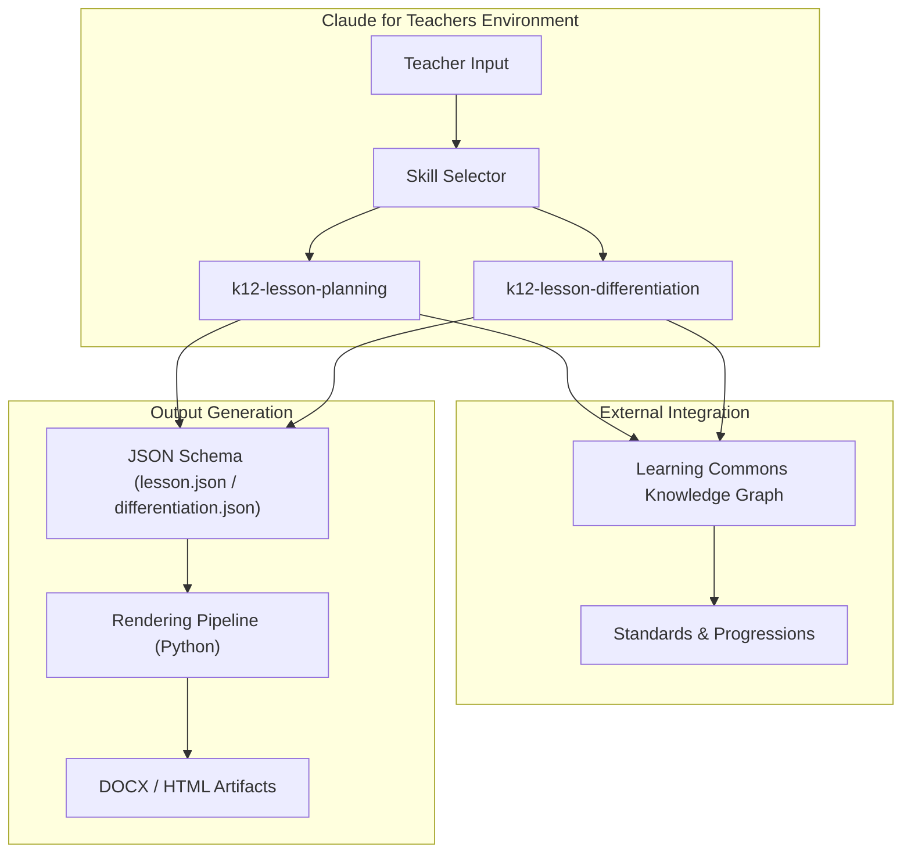
*Sources: [README.md:4-10](), [plugin/.claude-plugin/marketplace.json:11-14]()*

## Ecosystem Integration

The skills are bundled as a plugin [plugin/.claude-plugin/plugin.json:1-8]() and include support for third-party **Model Context Protocol (MCP)** servers. These servers allow Claude to interact with popular educational tools such as Canva, MagicSchool, and ASSISTments [plugin/.mcp.json:1-13]().

**System Component Mapping**
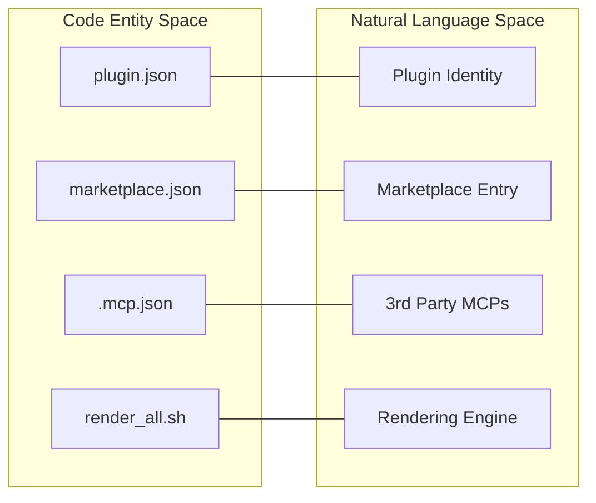
*Sources: [plugin/.claude-plugin/plugin.json:1-4](), [plugin/.claude-plugin/marketplace.json:9-17](), [plugin/.mcp.json:2-12]()*

## Getting Started

Depending on your environment, you can access these skills in two ways:

1.  **Claude for Teachers**: No installation is required; these skills are pre-configured for all accounts [README.md:15-16]().
2.  **Local/Claude Code**: You can clone the repository and add the plugin manually to environments like Claude Code using the `claude plugin` CLI [README.md:18-25]().

For detailed setup instructions, including manifest configurations and MCP setup, see **[Getting Started & Installation](#1.1)**.

## Repository Structure

The repository is divided into two main functional areas:
*   `plugin/`: Contains the logic, schemas, and assets for the teacher skills [README.md:29-29]().
*   `evals/`: Contains the P/R/O/M rubrics used to grade the model's pedagogical performance [README.md:30-30]().

For a full breakdown of the directory tree and contribution guidelines, see **[Repository Layout & Contributing](#1.2)**.

---
**Sources:**
* [README.md:1-31]()
* [plugin/.claude-plugin/marketplace.json:1-20]()
* [plugin/.claude-plugin/plugin.json:1-9]()
* [plugin/.mcp.json:1-14]()

---

# Page: Getting Started & Installation

# Getting Started & Installation

<details>
<summary>Relevant source files</summary>

The following files were used as context for generating this wiki page:

- [README.md](README.md)
- [plugin/.claude-plugin/marketplace.json](plugin/.claude-plugin/marketplace.json)
- [plugin/.claude-plugin/plugin.json](plugin/.claude-plugin/plugin.json)
- [plugin/.mcp.json](plugin/.mcp.json)

</details>


This page provides a technical guide for installing and configuring the K-12 Teacher Skills plugin. The repository contains two primary agentic skills—`k12-lesson-planning` and `k12-lesson-differentiation`—alongside a collection of third-party Model Context Protocol (MCP) servers tailored for educators.

## Overview of Installation Paths

There are three primary ways to access these skills depending on the environment:

1.  **Claude for Teachers:** The skills are natively integrated. No installation is required for users with a Claude for Teachers account [README.md:15-17]().
2.  **Claude Code:** Developers can manually add the plugin to their local environment using the `claude plugin` CLI [README.md:19-25]().
3.  **Manual Integration:** The skill definitions (`SKILL.md` files) and rendering scripts can be ported to custom LLM orchestration environments.

## Plugin Architecture & Manifests

The plugin is structured to be discoverable by Claude's plugin system via two primary manifest files located in the `plugin/` directory.

### Marketplace Configuration
The `marketplace.json` file defines the plugin's identity within the broader ecosystem, specifying the owner, version, and category [plugin/.claude-plugin/marketplace.json:1-19]().

| Field | Value | Description |
| :--- | :--- | :--- |
| `name` | `k12-teacher-skills` | Internal identifier for the plugin package. |
| `displayName` | `K-12 Education` | The name shown to users in the interface. |
| `version` | `0.6.0` | Current release version. |
| `source` | `./` | Relative path to the plugin root. |

### Plugin Metadata
The `plugin.json` file provides the specific metadata for the `k12-teacher-skills` entry point, ensuring the LLM understands the scope of the tools provided (standards-aligned planning and differentiation) [plugin/.claude-plugin/plugin.json:1-9]().

**Sources:**
- [plugin/.claude-plugin/marketplace.json:1-19]()
- [plugin/.claude-plugin/plugin.json:1-9]()

---

## Installing via Claude Code

For developers working outside the standard Claude for Teachers interface, the plugin can be installed locally. This process clones the repository and registers the `plugin/` directory as a local marketplace source.

### Step-by-Step Installation
1.  **Clone the repository:**
    `git clone https://github.com/anthropics/k12-teacher-skills`
2.  **Add to local marketplace:**
    `claude plugin marketplace add ./k12-teacher-skills/plugin`
3.  **Install the specific plugin:**
    `claude plugin install k12-teacher-skills@k12-teacher-skills`

**Sources:**
- [README.md:19-25]()

---

## Third-Party MCP Servers

The plugin includes a configuration file, `.mcp.json`, which bundles several third-party educational tools. These servers use the Model Context Protocol (MCP) to provide Claude with external capabilities, such as generating slide decks (Canva) or sourcing practice problems (ASSISTments).

### Included MCP Endpoints
The following servers are defined as `http` type endpoints [plugin/.mcp.json:1-13]():

| Provider | MCP URL |
| :--- | :--- |
| **ASSISTments** | `https://mcp.assistments.org/mcp` |
| **Canva** | `https://mcp.canva.com/mcp` |
| **MagicSchool** | `https://app.magicschool.ai/api/mcp` |
| **Brisk Teaching** | `https://mcp.briskteaching.com/mcp` |
| **Diffit** | `https://api.diffit.me/mcp` |

### Data Flow: Plugin to MCP
The diagram below illustrates how the plugin manifest coordinates between the LLM and the bundled MCP servers.

**Plugin Discovery and Tool Resolution**
```mermaid
graph TD
    subgraph "Claude Environment"
        [Claude_Client] --> [Plugin_Manager]
    end

    subgraph "k12-teacher-skills Plugin"
        [Plugin_Manager] --> [plugin.json]
        [Plugin_Manager] --> [mcp.json]
        
        [plugin.json] -- "Defines" --> [Skills_Logic]
        [mcp.json] -- "Registers" --> [MCP_Servers]
    end

    subgraph "External MCP Providers"
        [MCP_Servers] -- "HTTP POST" --> [Canva_API]
        [MCP_Servers] -- "HTTP POST" --> [MagicSchool_API]
        [MCP_Servers] -- "HTTP POST" --> [ASSISTments_API]
    end

    style [plugin.json] stroke-dasharray: 5 5
    style [mcp.json] stroke-dasharray: 5 5
```

**Sources:**
- [plugin/.mcp.json:1-13]()
- [plugin/.claude-plugin/plugin.json:1-8]()

---

## The Learning Commons Knowledge Graph

A critical dependency for these skills is the **Learning Commons Knowledge Graph**. This is a specialized Claude connector that provides the grounding data for academic standards across all 50 U.S. states [README.md:10]().

### Integration Logic
When a teacher requests a lesson for a specific grade and state, the skills call the Knowledge Graph to:
1.  Retrieve verbatim standard statements.
2.  Identify prerequisite standards (backward progressions).
3.  Source curriculum-specific materials (e.g., Illustrative Mathematics or OpenSciEd).

If the environment does not have the Learning Commons connector enabled, the skills will attempt to function using internal model knowledge but will include a disclaimer regarding potential standards inaccuracy [README.md:10-11]().

**Entity Mapping: Natural Language to Code**
```mermaid
graph LR
    subgraph "Natural Language Space"
        NL_1["'Create a math lesson for 3rd grade CCSS'"]
        NL_2["'Differentiate this for students below grade level'"]
    end

    subgraph "Code Entity Space"
        NL_1 --> [k12-lesson-planning]
        NL_2 --> [k12-lesson-differentiation]
        
        [k12-lesson-planning] -- "Uses" --> [LC_Knowledge_Graph_Connector]
        [k12-lesson-differentiation] -- "Uses" --> [LC_Knowledge_Graph_Connector]
        
        [LC_Knowledge_Graph_Connector] -- "API Call" --> [find_standard_statement]
        [LC_Knowledge_Graph_Connector] -- "API Call" --> [find_standards_progression]
    end
```

**Sources:**
- [README.md:4-11]()
- [plugin/.claude-plugin/marketplace.json:12-13]()

---

# Page: Repository Layout & Contributing

# Repository Layout & Contributing

<details>
<summary>Relevant source files</summary>

The following files were used as context for generating this wiki page:

- [.github/workflows/cla.yaml](.github/workflows/cla.yaml)
- [.gitignore](.gitignore)
- [CLA.md](CLA.md)
- [CODEOWNERS](CODEOWNERS)
- [CODE_OF_CONDUCT.md](CODE_OF_CONDUCT.md)
- [CONTRIBUTING.md](CONTRIBUTING.md)
- [LICENSE](LICENSE)
- [NOTICE](NOTICE)
- [SECURITY.md](SECURITY.md)

</details>


This page details the technical structure of the `k12-teacher-skills` repository, the governance policies for contributors, and the legal framework under which the project is licensed. It is intended for developers looking to extend the skills, fix bugs, or understand the project's operational standards.

## Directory Structure

The repository is organized into distinct functional areas separating the Claude skill definitions, the rendering engine, and the evaluation framework.

| Directory / File | Description |
|:---|:---|
| `plugin/` | Contains the core skill definitions, including `manifest.json`, system prompts (`SKILL.md`), and subject-specific pedagogical reference files. |
| `evals/` | Contains the P/R/O/M (Pedagogy, Rubric, Output, Model) evaluation framework, including CSV-based rubrics for LLM-as-judge scoring. |
| `.github/` | CI/CD configurations, including the automated CLA Assistant and PR workflows. |
| `signatures/` | Storage for signed CLA records (managed by the `cla-signatures` branch). |

### Code Entity Relationship Diagram
The following diagram illustrates how repository files map to the runtime execution and contribution flow.

**Repository Mapping to Skill Execution**
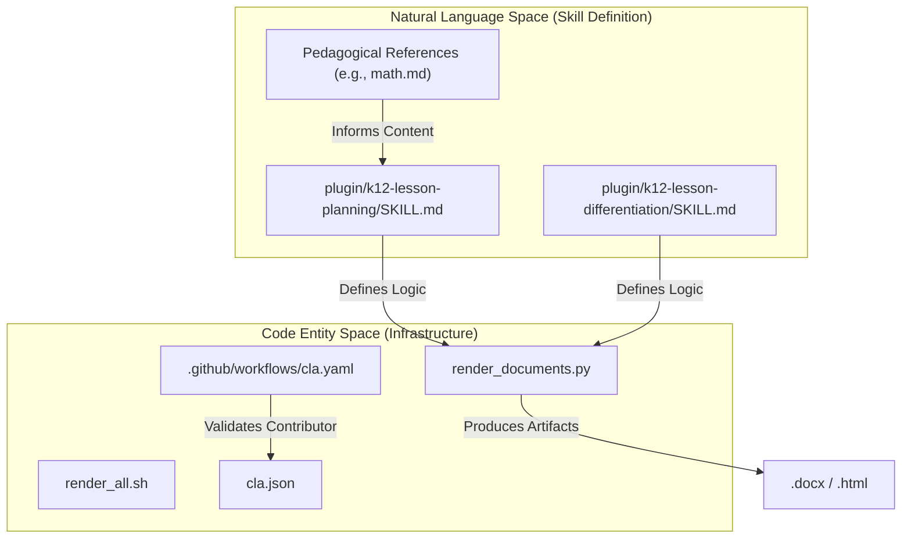
**Sources:** [.github/workflows/cla.yaml:36-38](), [CONTRIBUTING.md:19-21](), [NOTICE:1-5]()

---

## Licensing & Governance

### Apache-2.0 License
The project is licensed under the **Apache License, Version 2.0**. This allows for broad use, modification, and distribution while providing an express grant of patent rights from contributors to users.
* **Copyright:** Held by Anthropic, PBC and Learning Commons [NOTICE:1-5]().
* **Derivative Works:** Must include a copy of the license and prominent notices of modifications [LICENSE:95-99]().

### Contributor License Agreement (CLA)
All individual and corporate contributors must sign a CLA before pull requests can be merged [CONTRIBUTING.md:5-7](). 

**CLA Enforcement Flow**
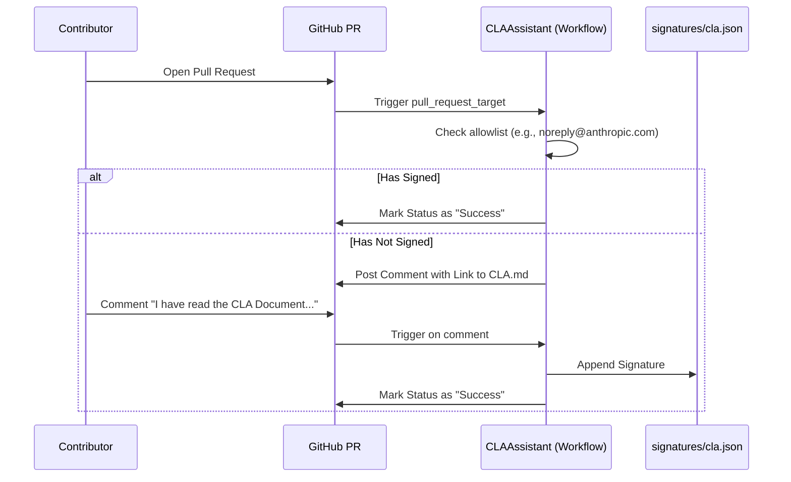
**Sources:** [.github/workflows/cla.yaml:21-43](), [CONTRIBUTING.md:5-10](), [CLA.md:1-40]()

---

## Contributing Guidelines

### Pull Request Process
1. **Fork & Branch:** Create a branch from `main` [CONTRIBUTING.md:36]().
2. **Implementation:** Follow existing code styles in the `plugin/` and `evals/` directories.
3. **Validation:** Load the modified skill into Claude to verify behavior [CONTRIBUTING.md:25-26]().
4. **Documentation:** Update relevant `.md` files if public APIs or user-facing behaviors change [CONTRIBUTING.md:39]().
5. **Review:** At least one maintainer (as defined in `CODEOWNERS`) must approve the PR [CONTRIBUTING.md:44-46](), [CODEOWNERS:1-2]().

### Code of Conduct
The project adheres to a standard of professional conduct adapted from the Contributor Covenant.
* **Expected Behavior:** Use inclusive language, respect differing viewpoints, and focus on community benefit [CODE_OF_CONDUCT.md:9-14]().
* **Reporting:** Unacceptable behavior should be reported to `support@anthropic.com` [CODE_OF_CONDUCT.md:29]().

**Sources:** [CONTRIBUTING.md:33-46](), [CODEOWNERS:1-2](), [CODE_OF_CONDUCT.md:1-37]()

---

## Security Policy

Security is managed via Anthropic's central security program.
* **Reporting:** Do not open public issues for security vulnerabilities. Instead, use the [HackerOne submission form](https://hackerone.com/4f1f16ba-10d3-4d09-9ecc-c721aad90f24/embedded_submissions/new) [SECURITY.md:13-15]().
* **Bug Bounty:** Validated vulnerabilities may be eligible for the Anthropic Bug Bounty Program [SECURITY.md:17-19]().

**Sources:** [SECURITY.md:1-19]()

---

# Page: k12-lesson-planning Skill

# k12-lesson-planning Skill

<details>
<summary>Relevant source files</summary>

The following files were used as context for generating this wiki page:

- [plugin/skills/k12-lesson-planning/SKILL.md](plugin/skills/k12-lesson-planning/SKILL.md)

</details>


The `k12-lesson-planning` skill is a specialized engine designed to produce a teacher-ready instructional package. This package includes a standards-aligned lesson plan, student-facing materials, and a teacher observation template, all delivered as editable Word documents and HTML previews.

The skill operates by transforming a teacher's intent (e.g., "I'm teaching long division to 5th graders") into a structured `lesson.json` artifact, which is then processed by a Python-based rendering pipeline.

Sources: [plugin/skills/k12-lesson-planning/SKILL.md:1-25]()

## Skill Lifecycle and Orchestration

The execution of this skill follows a strict five-step lifecycle managed by `SKILL.md`. This ensures that every lesson is pedagogically sound, grounded in verified standards, and formatted correctly for classroom use.

### The Five-Step Execution Flow

| Step | Name | Description |
| :--- | :--- | :--- |
| **0** | **Route** | Determines the subject (Math, ELA, Science, Social Studies) and loads the corresponding reference file. |
| **1** | **Clarify** | Asks up to two high-priority questions and presents the **Draft Offer**. |
| **2** | **Ground** | Queries the Learning Commons Knowledge Graph (KG) for standards, progressions, and misconceptions. |
| **3** | **Build** | Constructs the lesson content following subject-specific non-negotiables and grade-band arcs. |
| **4** | **Output** | Generates the `lesson.json` and invokes the rendering tools to produce `.docx` and `.html` files. |

For a deep dive into the orchestration logic, subject detection, and the "Draft Offer" interaction pattern, see [Skill Orchestration & Lifecycle](#2.1).

Sources: [plugin/skills/k12-lesson-planning/SKILL.md:44-150]()

## Subject-Specific Pedagogy

The skill does not use a "one size fits all" approach. Instead, it routes the request to one of four subject-specific reference files. These files contain the "DNA" of the lesson, including specific instructional frameworks (like CGI for Math or the C3 Inquiry Arc for Social Studies) and grade-level expectations.

*   **Math:** Focuses on Illustrative Mathematics (IM) structures, CGI problem types, and Standards for Mathematical Practice (SMPs).
*   **ELA:** Rooted in the Science of Reading, grade-band text complexity arcs, and Text-Dependent Questions (TDQs).
*   **Science:** Driven by NGSS Performance Expectations, phenomena-based instruction, and OpenSciEd routines.
*   **Social Studies:** Built around the C3 Framework, inquiry arcs, and state-level standards.

For details on how these pedagogical frameworks are applied, see [Subject-Specific Pedagogy References](#2.2).

Sources: [plugin/skills/k12-lesson-planning/SKILL.md:46-67](), [plugin/skills/k12-lesson-planning/references/math.md:1-20](), [plugin/skills/k12-lesson-planning/references/ela.md:1-20]()

## Data Model: lesson.json

The primary output of the LLM is a single JSON file named `lesson.json`. This file acts as the "source of truth" for the entire lesson package. It uses a **Shared Content Registry** to ensure consistency across the teacher plan and student worksheets.

### Technical Mapping: Intent to Artifacts

The following diagram illustrates how the system transitions from a natural language request to the structured code entities that define the lesson.

**System Entity Mapping**
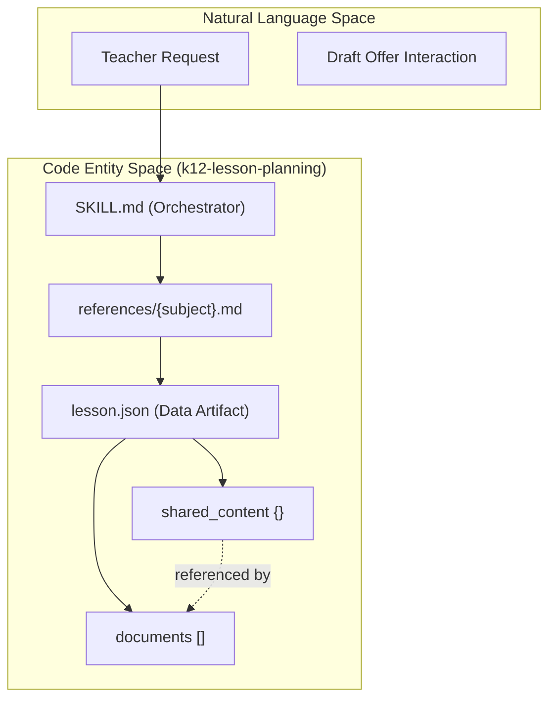

For the full schema specification, including block types (e.g., `fill_table`, `number_line`) and density rules, see [lesson.json Schema & Output Contract](#2.3).

Sources: [plugin/skills/k12-lesson-planning/output.md:1-50](), [plugin/skills/k12-lesson-planning/example_lesson.json:1-100]()

## The Rendering Pipeline

Once the `lesson.json` is generated, it is passed to a suite of Python scripts that handle the conversion to teacher-deliverable formats. The pipeline ensures that the visual styling is consistent and that the documents are optimized for printing.

**Rendering Pipeline Flow**
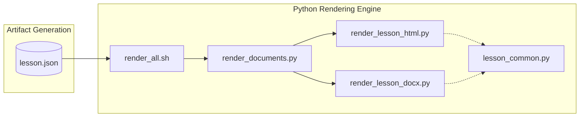

### Key Components:
*   `render_documents.py`: The entry point that orchestrates the creation of multiple files from one JSON.
*   `lesson_common.py`: Handles "Shared Content" expansion and print-safety repairs (e.g., fixing table breaks).
*   `render_lesson_docx.py`: Uses `python-docx` and a dispatch table (`_EMITTERS`) to build Word files.

For details on the rendering logic and CSS theming, see [Rendering Pipeline](#2.4).

Sources: [plugin/render_documents.py:1-30](), [plugin/lesson_common.py:1-50](), [plugin/render_lesson_docx.py:1-100]()

---

# Page: Skill Orchestration & Lifecycle

# Skill Orchestration & Lifecycle

<details>
<summary>Relevant source files</summary>

The following files were used as context for generating this wiki page:

- [plugin/skills/k12-lesson-planning/SKILL.md](plugin/skills/k12-lesson-planning/SKILL.md)
- [plugin/skills/k12-lesson-planning/references/learning-commons-kg.md](plugin/skills/k12-lesson-planning/references/learning-commons-kg.md)

</details>


This page provides a technical deep dive into the execution flow of the `k12-lesson-planning` skill. It covers the state machine governing lesson generation, from initial subject detection to the final delivery of editable artifacts, including the "Draft Offer" interaction pattern and the integration of the Learning Commons Knowledge Graph (KG).

## Five-Step Execution Flow

The `k12-lesson-planning` skill follows a rigid five-step lifecycle defined in `plugin/skills/k12-lesson-planning/SKILL.md`. This flow ensures that every lesson is pedagogically sound, standards-aligned, and respectful of intellectual property.

### 1. Step 0: Route
Before interacting with the teacher, the system performs silent routing based on the prompt and conversation history `[plugin/skills/k12-lesson-planning/SKILL.md:44-78]()`.
*   **Subject Detection:** Determines if the request falls under `math`, `ela`, `science`, or `social_studies` `[plugin/skills/k12-lesson-planning/SKILL.md:46-52]()`.
*   **Reference Loading:** The system **must** read the corresponding reference file (e.g., `references/math.md`) immediately. Failure to load the reference before drafting is a critical failure `[plugin/skills/k12-lesson-planning/SKILL.md:61-65]()`.
*   **Curriculum Detection:** Identifies if a specific curriculum like *Illustrative Mathematics* (IM) or *OpenSciEd* is implied `[plugin/skills/k12-lesson-planning/SKILL.md:69-74]()`.

### 2. Step 1: Clarify
The system asks at most two clarifying questions based on the priority ranking defined in the subject-specific reference file `[plugin/skills/k12-lesson-planning/SKILL.md:81-85]()`. These questions are bundled with the **Draft Offer** to minimize interaction rounds `[plugin/skills/k12-lesson-planning/SKILL.md:87-90]()`.

### 3. Step 2: Ground in Standards
If the Learning Commons Knowledge Graph tools are available, the system performs a sequence of calls to retrieve verbatim standards, prerequisites, and misconceptions `[plugin/skills/k12-lesson-planning/SKILL.md:96-99]()`.
*   **Tool Usage:** Uses `find_standard_statement` to resolve the target standard `[plugin/skills/k12-lesson-planning/references/learning-commons-kg.md:16-19]()`.
*   **Fallback:** If the KG is unavailable, the system proceeds using internal training knowledge and appends a mandatory disclaimer footer `[plugin/skills/k12-lesson-planning/SKILL.md:101-104]()`.

### 4. Step 3: Build
The system generates the lesson content following the "Build" section of the subject reference file `[plugin/skills/k12-lesson-planning/SKILL.md:108-112]()`. This phase is governed by the **Copyright Guardrail**, which prohibits verbatim reproduction of student-facing text from KG curriculum materials `[plugin/skills/k12-lesson-planning/SKILL.md:116-128]()`.

### 5. Step 4: The Draft Offer & Step 5: Output
The system presents a choice to the teacher: a **Fast Draft** (text-only summary) or the **Full Packet** (JSON-backed Word/HTML documents) `[plugin/skills/k12-lesson-planning/SKILL.md:131-150]()`. Once the packet is requested, the system emits the `lesson.json` and triggers the rendering scripts `[plugin/skills/k12-lesson-planning/SKILL.md:160-164]()`.

**Sources:**
* `plugin/skills/k12-lesson-planning/SKILL.md`
* `plugin/skills/k12-lesson-planning/references/learning-commons-kg.md`

---

## Data Flow: Natural Language to Code Entities

The following diagram illustrates how teacher intent is translated into specific code entities and reference files within the repository.

### Intent Routing and Reference Mapping
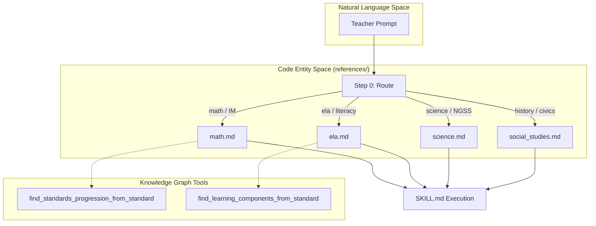
**Sources:**
* `plugin/skills/k12-lesson-planning/SKILL.md:44-67]()`
* `plugin/skills/k12-lesson-planning/references/learning-commons-kg.md:33-75]()`

---

## The Draft Offer Interaction Pattern

The "Draft Offer" is a critical UX pattern designed to save the teacher time. It allows the teacher to review the "shape" of the lesson before the LLM commits to the high-token-cost generation of multiple documents.

| Component | Description | Code Requirement |
| :--- | :--- | :--- |
| **Question** | Asks if the teacher wants a "Fast Draft" or "Full Packet". | `[plugin/skills/k12-lesson-planning/SKILL.md:138-142]()` |
| **Fast Draft** | A 1-2 paragraph summary of the lesson's arc and the resolved standard. | `[plugin/skills/k12-lesson-planning/SKILL.md:143-145]()` |
| **Full Packet** | Triggers the generation of `lesson.json` and the artifact rendering. | `[plugin/skills/k12-lesson-planning/SKILL.md:146-148]()` |
| **Default** | If the teacher is silent on the offer but answers clarifying questions, the system defaults to the **Full Packet**. | `[plugin/skills/k12-lesson-planning/SKILL.md:154-158]()` |

**Sources:**
* `plugin/skills/k12-lesson-planning/SKILL.md:131-158]()`

---

## Standards Resolution & KG Integration

When the Learning Commons Knowledge Graph is available, the skill executes a specific sequence of tool calls. The `caseIdentifierUUID` acts as the primary key linking the standard to prerequisites and curriculum materials.

### KG Call Sequence & Data Flow
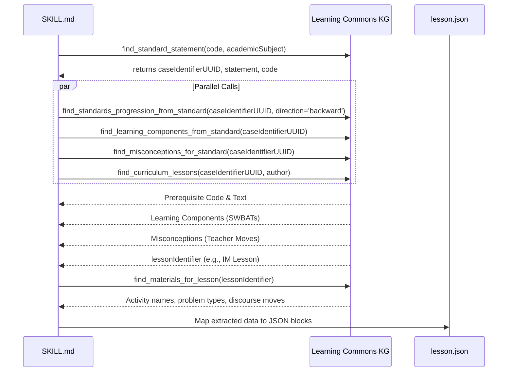
**Sources:**
* `plugin/skills/k12-lesson-planning/references/learning-commons-kg.md:14-50]()`
* `plugin/skills/k12-lesson-planning/SKILL.md:94-106]()`

---

## Revision Lifecycle

After the artifacts are generated, the teacher may request changes. The skill follows a "surgical" revision policy to maintain consistency across the three generated documents (Lesson Plan, Student Materials, Observation Template).

1.  **Implicit vs. Explicit:** If the teacher asks for a change, the system updates the underlying `lesson.json` and re-renders all documents `[plugin/skills/k12-lesson-planning/SKILL.md:167-170]()`.
2.  **Pedagogical Guardrail:** The system must reject revisions that violate subject-specific non-negotiables (e.g., removing the "Exit Ticket" in a Math lesson) `[plugin/skills/k12-lesson-planning/SKILL.md:172-175]()`.
3.  **Consistency:** Any change to the lesson plan (e.g., changing a problem context) must be reflected in the student-facing worksheet and the observation template `[plugin/skills/k12-lesson-planning/SKILL.md:177-179]()`.

**Sources:**
* `plugin/skills/k12-lesson-planning/SKILL.md:167-180]()`

---

# Page: Subject-Specific Pedagogy References

# Subject-Specific Pedagogy References

<details>
<summary>Relevant source files</summary>

The following files were used as context for generating this wiki page:

- [plugin/skills/k12-lesson-planning/references/ela.md](plugin/skills/k12-lesson-planning/references/ela.md)
- [plugin/skills/k12-lesson-planning/references/math.md](plugin/skills/k12-lesson-planning/references/math.md)
- [plugin/skills/k12-lesson-planning/references/science.md](plugin/skills/k12-lesson-planning/references/science.md)
- [plugin/skills/k12-lesson-planning/references/social_studies.md](plugin/skills/k12-lesson-planning/references/social_studies.md)

</details>


This page details the four subject-specific reference files that govern the pedagogical logic, structural requirements, and content standards for the `k12-lesson-planning` skill. These files act as the "pedagogical brain" of the system, ensuring that generated lessons adhere to evidence-based practices such as Cognitively Guided Instruction (CGI) for Math, the Science of Reading for ELA, the C3 Inquiry Arc for Social Studies, and Phenomena-based learning for Science.

## Overview of Reference Loading

When the `k12-lesson-planning` skill is invoked, it first routes the request to a specific subject. Based on this routing, the LLM loads the corresponding reference file from `plugin/skills/k12-lesson-planning/references/`. These files provide instructions for three critical phases:
1.  **Clarify**: Subject-specific signals to look for in the conversation (e.g., state codes, curriculum names).
2.  **Ground**: Instructions for using the Learning Commons Knowledge Graph (KG).
3.  **Build**: The structural blueprints and "non-negotiables" for the lesson artifacts.

### Data Flow: Natural Language to Pedagogical Constraints

The following diagram illustrates how user inputs are mapped to specific pedagogical frameworks defined in the reference files.

**Pedagogical Mapping Flow**
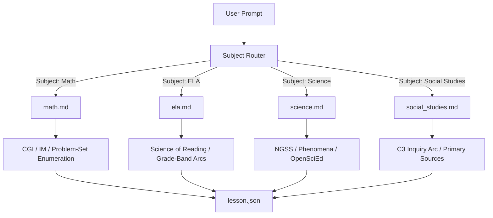
**Sources:** [plugin/skills/k12-lesson-planning/references/math.md:7-10](), [plugin/skills/k12-lesson-planning/references/ela.md:7-10](), [plugin/skills/k12-lesson-planning/references/science.md:7-10](), [plugin/skills/k12-lesson-planning/references/social_studies.md:7-11]()

---

## Mathematics Pedagogy (`math.md`)

The math reference focuses on **problem-based learning** and **structural variety** in problem sets.

### Key Frameworks
*   **Illustrative Mathematics (IM)**: If "IM-confirmed" (via terminology like MLRs or "cool-downs"), the system follows the **Launch → Explore → Discuss → Synthesize → Exit Ticket** arc strictly [plugin/skills/k12-lesson-planning/references/math.md:42-47]().
*   **Cognitively Guided Instruction (CGI)**: For K–2, the system ensures story problems span all four situation types (add-to, take-from, put-together, compare) [plugin/skills/k12-lesson-planning/references/math.md:50]().

### Problem-Set Enumeration
A unique requirement for math is the **enumeration of structural cases**. Before writing problems, the skill must list cases from the "baseline" to the "structurally hardest" (e.g., start-unknown problems or non-proportional linear relationships) [plugin/skills/k12-lesson-planning/references/math.md:57-65]().

**Sources:** [plugin/skills/k12-lesson-planning/references/math.md:16-18](), [plugin/skills/k12-lesson-planning/references/math.md:50-54](), [plugin/skills/k12-lesson-planning/references/math.md:57-65]()

---

## ELA Pedagogy (`ela.md`)

The ELA reference is rooted in the **Science of Reading** and varies significantly by grade band.

### Grade-Band Arcs
| Grade Band | Focus | Core Components |
| :--- | :--- | :--- |
| **K–2** | Foundational Literacy | Phonics (RF) or Comprehension (RL/RI) arcs; Decodable text; No three-cueing [plugin/skills/k12-lesson-planning/references/ela.md:61-110](). |
| **3–5** | Transitional | Close reading of complex text; Text-Dependent Questions (TDQs); Think-Write-Pair-Share [plugin/skills/k12-lesson-planning/references/ela.md:114-128](). |
| **6–12** | Analysis & Argument | Rhetorical analysis; Evidence-based claims; Tier 2/3 vocabulary integration [plugin/skills/k12-lesson-planning/references/ela.md:132-156](). |

### Anchor Texts
The skill distinguishes between **public domain** texts (reproduced in full) and **copyrighted** texts (cited with instructions for the teacher to provide copies) [plugin/skills/k12-lesson-planning/references/ela.md:23-31]().

**Sources:** [plugin/skills/k12-lesson-planning/references/ela.md:17-21](), [plugin/skills/k12-lesson-planning/references/ela.md:23-31](), [plugin/skills/k12-lesson-planning/references/ela.md:61-156]()

---

## Science Pedagogy (`science.md`)

Science lessons are driven by **phenomena** and the **Next Generation Science Standards (NGSS)** 3D learning model.

### Implementation Logic
*   **OpenSciEd (OSE)**: If OSE is detected, the skill uses OSE-specific routines like the "Driving Question Board" and "Consensus Models" [plugin/skills/k12-lesson-planning/references/science.md:46-55]().
*   **Sensemaking**: All lessons must follow an **Investigation before Explanation** sequence. Students gather data through Science and Engineering Practices (SEPs) before the teacher formalizes the disciplinary core ideas (DCIs) [plugin/skills/k12-lesson-planning/references/science.md:77-80]().
*   **CER Framework**: Grades 3–12 utilize the **Claim-Evidence-Reasoning** structure for formative writing [plugin/skills/k12-lesson-planning/references/science.md:91]().

**Sources:** [plugin/skills/k12-lesson-planning/references/science.md:17-18](), [plugin/skills/k12-lesson-planning/references/science.md:46-55](), [plugin/skills/k12-lesson-planning/references/science.md:77-80](), [plugin/skills/k12-lesson-planning/references/science.md:91]()

---

## Social Studies Pedagogy (`social_studies.md`)

Social Studies follows the **C3 Framework Inquiry Arc**, emphasizing primary source analysis.

### Inquiry Components
1.  **Compelling Questions**: Contestable, civically resonant questions (e.g., "Was World War I inevitable?") [plugin/skills/k12-lesson-planning/references/social_studies.md:42-52]().
2.  **Source Set**: Lessons must include at least two primary sources. The skill uses `source_card` blocks to excerpt public domain text or cite visual media [plugin/skills/k12-lesson-planning/references/social_studies.md:90-101]().
3.  **Disciplinary Tools**: Application of concepts from civics, economics, geography, and history [plugin/skills/k12-lesson-planning/references/social_studies.md:15]().

**Sources:** [plugin/skills/k12-lesson-planning/references/social_studies.md:13-17](), [plugin/skills/k12-lesson-planning/references/social_studies.md:42-52](), [plugin/skills/k12-lesson-planning/references/social_studies.md:90-101]()

---

## Technical Implementation & State Detection

All subject references share a common **State Detection** logic. The system scans for state names or specific codes (e.g., TEKS for Texas, SOL for Virginia) to set the `jurisdiction` parameter for Knowledge Graph lookups.

### Signal Processing to Code Entities
The following diagram bridges the natural language signals found in prompts to the code parameters used in the `learning-commons-kg` calls.

**State and Curriculum Detection Logic**
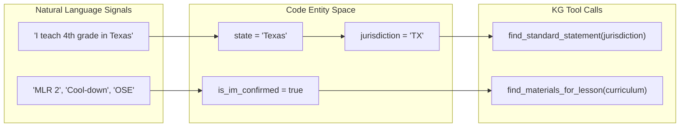
**Sources:** [plugin/skills/k12-lesson-planning/references/math.md:14-16](), [plugin/skills/k12-lesson-planning/references/ela.md:15](), [plugin/skills/k12-lesson-planning/references/science.md:15-17](), [plugin/skills/k12-lesson-planning/references/social_studies.md:29]()

---

# Page: lesson.json Schema & Output Contract

# lesson.json Schema & Output Contract

<details>
<summary>Relevant source files</summary>

The following files were used as context for generating this wiki page:

- [plugin/skills/k12-lesson-planning/SKILL.md](plugin/skills/k12-lesson-planning/SKILL.md)
- [plugin/skills/k12-lesson-planning/references/example_lesson.json](plugin/skills/k12-lesson-planning/references/example_lesson.json)
- [plugin/skills/k12-lesson-planning/references/output.md](plugin/skills/k12-lesson-planning/references/output.md)

</details>


The `lesson.json` file serves as the intermediate data model and "source of truth" for the `k12-lesson-planning` skill. It decouples the pedagogical generation logic from the final rendering process, ensuring that whether a lesson is viewed as HTML or downloaded as a Word document, the content remains consistent, accessible, and structured according to strict educational standards.

## The Data Model Architecture

The schema uses a "Shared Content Registry" pattern to ensure consistency across multiple documents (e.g., a teacher plan and a student worksheet).

### Shared Content Registry (`shared`)
The `shared` object acts as a central repository for reusable content. Blocks within the `documents` array reference these entries using the `from_shared` block type. This prevents data duplication and ensures that if a math problem is updated in the registry, it updates in both the teacher's "Look-fors" and the student's worksheet [plugin/skills/k12-lesson-planning/references/example_lesson.json:2-179]().

### Documents Array (`documents`)
The `documents[]` array contains the individual artifacts to be rendered. Each document specifies its target audience (teacher or student) and a sequence of sections containing content blocks [plugin/skills/k12-lesson-planning/references/example_lesson.json:180-187]().

### Content Blocks
The system uses a domain-specific vocabulary of blocks to represent instructional content.

| Block Type | Description |
| :--- | :--- |
| `paragraph` | Standard text, limited to 3 sentences [plugin/skills/k12-lesson-planning/references/output.md:18-19](). |
| `callout` | Highlighted boxes for critical teacher moves or student tasks [plugin/skills/k12-lesson-planning/references/output.md:25-29](). |
| `phase_header` | Defines a lesson phase with a title and duration [plugin/skills/k12-lesson-planning/references/example_lesson.json:232-236](). |
| `fill_table` | A table with designated empty cells for student input [plugin/skills/k12-lesson-planning/references/example_lesson.json:344-365](). |
| `workspace` | A dedicated area for student drawing or calculations [plugin/skills/k12-lesson-planning/references/example_lesson.json:366-370](). |
| `number_line` | A visual number line primitive with defined ranges and tick marks. |
| `from_shared` | A pointer to an entry in the `shared` registry [plugin/skills/k12-lesson-planning/references/example_lesson.json:192-195](). |

**Sources:** [plugin/skills/k12-lesson-planning/references/example_lesson.json:1-400](), [plugin/skills/k12-lesson-planning/references/output.md:12-38]()

---

## Output Contract & Density Rules

The `output.md` file defines a "Hard Contract" that the LLM must follow when generating `lesson.json`. These rules are enforced to ensure classroom usability and print safety.

### 1. Structural Density
*   **Prose Limit:** No `paragraph` or `labeled` block may exceed 3 sentences. Longer content must be converted to bullets or tables [plugin/skills/k12-lesson-planning/references/output.md:18-19]().
*   **Table Preference:** Parallel variants (like tiered look-fors or group supports) must use a `table` block rather than sequential paragraphs [plugin/skills/k12-lesson-planning/references/output.md:22-24]().
*   **Bullet Length:** Bullets must be fragments (≤ ~15 words) and never use semicolons to chain clauses [plugin/skills/k12-lesson-planning/references/output.md:21-21]().

### 2. Consistency & Integrity
*   **Materials Agreement:** Every item in the `Materials` list must be used in a phase, and every item used in a phase must be in the list [plugin/skills/k12-lesson-planning/references/output.md:44-45]().
*   **Verbatim Standard:** The curriculum standard is quoted verbatim exactly once (usually in the "At a Glance" section). All other references use the code plus a short gist [plugin/skills/k12-lesson-planning/references/output.md:33-35]().
*   **Classroom Ready:** The lesson must run on common classroom equipment (board, projector) or the pages shipped in the package [plugin/skills/k12-lesson-planning/references/output.md:46-52]().

### 3. Accessibility & Print Safety
*   **B&W Compatibility:** Meaning must never be conveyed by color alone. Students are directed to "the Evidence column," not "the blue box" [plugin/skills/k12-lesson-planning/references/output.md:118-119]().
*   **Writing Space:** Every `workspace` or `fill_in` must be labeled with what belongs there [plugin/skills/k12-lesson-planning/references/output.md:119-120]().

**Sources:** [plugin/skills/k12-lesson-planning/references/output.md:12-121]()

---

## Data Flow: From Intent to Artifact

The following diagram illustrates how the `lesson.json` acts as the bridge between the LLM's pedagogical reasoning and the final rendered files.

### Logic to Entity Mapping
**Title: Natural Language Space to Code Entity Space (Orchestration)**
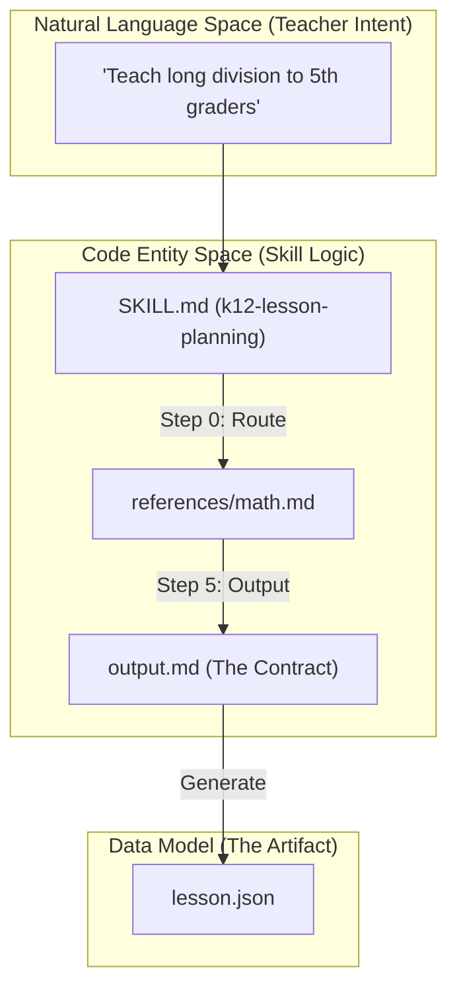
**Sources:** [plugin/skills/k12-lesson-planning/SKILL.md:44-67](), [plugin/skills/k12-lesson-planning/references/output.md:9-10]()

### Block Dispatching
**Title: JSON Schema to Rendering Dispatch**
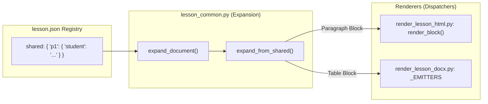
**Sources:** [plugin/skills/k12-lesson-planning/references/example_lesson.json:192-195](), [plugin/skills/k12-lesson-planning/SKILL.md:154-162]()

---

## Example Data Structure

A typical `lesson.json` follows this abbreviated structure, ensuring that the student-facing task and the teacher-facing "Look-fors" are synchronized.

```json
{
  "shared": {
    "task_1": {
      "student": "Find the price per bar at each store. Which store wins?",
      "teacher": "Watch for students who only compare the total price ($3.00 vs $3.60)."
    }
  },
  "documents": [
    {
      "id": "student_worksheet",
      "sections": [
        {
          "blocks": [
            { "type": "from_shared", "key": "task_1", "facet": "student" }
          ]
        }
      ]
    },
    {
      "id": "lesson_plan",
      "sections": [
        {
          "heading": "Monitoring",
          "blocks": [
            { "type": "from_shared", "key": "task_1", "facet": "teacher" }
          ]
        }
      ]
    }
  ]
}
```

**Sources:** [plugin/skills/k12-lesson-planning/references/example_lesson.json:56-61](), [plugin/skills/k12-lesson-planning/references/example_lesson.json:192-195]()

---

# Page: Rendering Pipeline

# Rendering Pipeline

<details>
<summary>Relevant source files</summary>

The following files were used as context for generating this wiki page:

- [plugin/skills/k12-lesson-planning/scripts/lesson_common.py](plugin/skills/k12-lesson-planning/scripts/lesson_common.py)
- [plugin/skills/k12-lesson-planning/scripts/render_all.sh](plugin/skills/k12-lesson-planning/scripts/render_all.sh)
- [plugin/skills/k12-lesson-planning/scripts/render_documents.py](plugin/skills/k12-lesson-planning/scripts/render_documents.py)
- [plugin/skills/k12-lesson-planning/scripts/render_lesson_docx.py](plugin/skills/k12-lesson-planning/scripts/render_lesson_docx.py)
- [plugin/skills/k12-lesson-planning/scripts/render_lesson_html.py](plugin/skills/k12-lesson-planning/scripts/render_lesson_html.py)
- [plugin/skills/k12-lesson-planning/scripts/theme.css](plugin/skills/k12-lesson-planning/scripts/theme.css)

</details>


The rendering pipeline converts the structured `lesson.json` or `differentiation.json` output into teacher-deliverable artifacts: editable Microsoft Word documents (`.docx`) and styled HTML previews (`.html`). This system ensures visual consistency across different lesson components (e.g., a teacher plan and its associated student worksheets) by using a shared content registry and a unified block vocabulary.

## System Architecture Overview

The pipeline operates in three stages: **Orchestration**, **Expansion/Repair**, and **Format-Specific Dispatch**.

### Data Flow: JSON to Artifacts

This diagram bridges the "Natural Language Space" (the teacher's request for a lesson) to the "Code Entity Space" (the scripts and functions that process it).

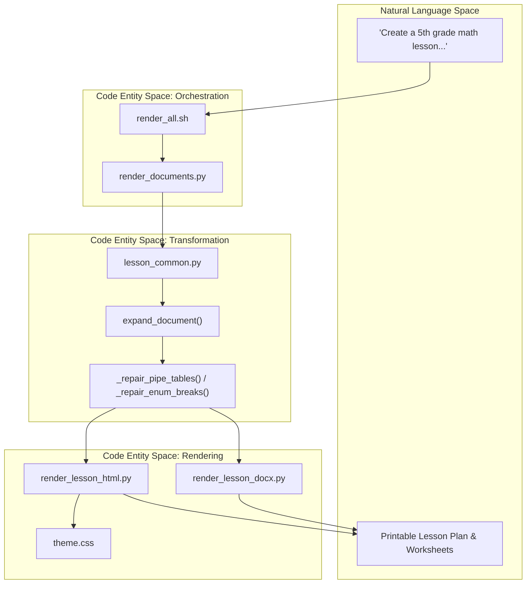
**Sources:** [plugin/skills/k12-lesson-planning/scripts/render_all.sh:1-12](), [plugin/skills/k12-lesson-planning/scripts/render_documents.py:1-36](), [plugin/skills/k12-lesson-planning/scripts/lesson_common.py:5-11]()

---

## 1. Orchestration Layer

### `render_all.sh`
The shell script acts as the primary entry point for the plugin environment. It handles dependency management (ensuring `python-docx` is installed) and invokes the Python orchestrator [plugin/skills/k12-lesson-planning/scripts/render_all.sh:22-33]().

### `render_documents.py`
This script manages multi-document JSON structures. In the differentiation skill, a single JSON file contains a `documents[]` array representing different tiers (e.g., "Teacher Plan", "Worksheet Group A").
- **`build_doc`**: Merges global `theme` and `shared` content blocks into each individual document entry [plugin/skills/k12-lesson-planning/scripts/render_documents.py:48-56]().
- **Multi-format execution**: Iterates through the `documents` array and calls both the HTML and DOCX renderers for every ID found [plugin/skills/k12-lesson-planning/scripts/render_documents.py:78-97]().

**Sources:** [plugin/skills/k12-lesson-planning/scripts/render_all.sh:1-45](), [plugin/skills/k12-lesson-planning/scripts/render_documents.py:59-108]()

---

## 2. Common Transformation Layer (`lesson_common.py`)

Before a document is rendered, it passes through `lesson_common.py` to resolve references and fix structural issues that occur during LLM generation.

### Shared Content Expansion
The `expand_document()` function traverses the JSON block tree. When it encounters a `from_shared` block, it replaces it with the corresponding entry from the `shared` registry [plugin/skills/k12-lesson-planning/scripts/lesson_common.py:7-11](). This prevents content drift between the teacher plan and student worksheets.

### Print-Safety Repairs
The pipeline includes a "Repair Pipe" that fixes common LLM formatting artifacts that would otherwise break the layout:
- **`_repair_pipe_tables`**: Converts Markdown-style `| col |` text into structured `table` blocks [plugin/skills/k12-lesson-planning/scripts/lesson_common.py:137-160]().
- **`_repair_inline_bullets`**: Splits prose containing bullet characters (•, ▪) into a proper `list` block [plugin/skills/k12-lesson-planning/scripts/lesson_common.py:82-134]().
- **`_repair_enum_breaks`**: Identifies mid-prose enumerations like `(a) ... (b) ...` and inserts line breaks to ensure they don't render as a "wall of text" [plugin/skills/k12-lesson-planning/scripts/lesson_common.py:66-79]().

**Sources:** [plugin/skills/k12-lesson-planning/scripts/lesson_common.py:16-30](), [plugin/skills/k12-lesson-planning/scripts/lesson_common.py:58-62]()

---

## 3. HTML Renderer (`render_lesson_html.py`)

The HTML renderer produces a self-contained preview using `theme.css` for visual primitives.

### Block Dispatcher
The `render_block()` function uses a dispatch pattern to convert JSON types into HTML strings:
- **`phase_header`**: Renders a lesson phase with a duration (minutes) floated to the right [plugin/skills/k12-lesson-planning/scripts/render_lesson_html.py:144-150]().
- **`callout`**: Maps `kind` (e.g., `task`, `special`, `tnote`) to specific icons and CSS classes defined in `CALLOUT_KINDS` [plugin/skills/k12-lesson-planning/scripts/render_lesson_html.py:117-128]().
- **`workspace`**: Generates empty writing space or ruled lines via `answer_space()`, depending on the `ruled` theme property [plugin/skills/k12-lesson-planning/scripts/render_lesson_html.py:54-62]().

### CSS Theming
Styling is driven by `theme.css`. The renderer injects CSS Custom Properties (variables) into the `:root` based on the `Theme` object [plugin/skills/k12-lesson-planning/scripts/render_lesson_html.py:65-86]().

**Sources:** [plugin/skills/k12-lesson-planning/scripts/render_lesson_html.py:89-153](), [plugin/skills/k12-lesson-planning/scripts/theme.css:5-11]()

---

## 4. DOCX Renderer (`render_lesson_docx.py`)

The DOCX renderer uses `python-docx` to build a native Word document. It mirrors the HTML logic but uses a dispatch table for OOXML generation.

### Dispatch Table & Emitters
The renderer uses a private `_EMITTERS` dictionary to map block types to specific functions.

| Block Type | Emitter Function | Logic |
| :--- | :--- | :--- |
| `paragraph` | `_emit_paragraph` | Adds runs via `add_md` for bold/italic support [plugin/skills/k12-lesson-planning/scripts/render_lesson_docx.py:90-99](). |
| `callout` | `_emit_callout` | Creates a single-cell table with a specific border color [plugin/skills/k12-lesson-planning/scripts/render_lesson_docx.py:103-115](). |
| `workspace` | `_emit_workspace` | Adds an empty table with a fixed height and `w:cantSplit` [plugin/skills/k12-lesson-planning/scripts/render_lesson_docx.py:131-138](). |
| `list` | `_emit_list` | Uses `_restart_numbering` to ensure ordered lists start at 1 [plugin/skills/k12-lesson-planning/scripts/render_lesson_docx.py:162-179](). |

### Visual Consistency Logic
The renderer implements several Word-specific hacks to match the HTML design:
- **`setup_styles`**: Configures "LC Title", "LC H1", etc., using the same font sizes and colors as the CSS theme [plugin/skills/k12-lesson-planning/scripts/render_lesson_docx.py:54-86]().
- **`_set_borders`**: Manually manipulates `w:tblBorders` XML to create the clean, minimal table aesthetics required for professional lesson plans [plugin/skills/k12-lesson-planning/scripts/render_lesson_docx.py:103-115]().

**Sources:** [plugin/skills/k12-lesson-planning/scripts/render_lesson_docx.py:46-51](), [plugin/skills/k12-lesson-planning/scripts/render_lesson_docx.py:101-145]()

---

# Page: k12-lesson-differentiation Skill

# k12-lesson-differentiation Skill

<details>
<summary>Relevant source files</summary>

The following files were used as context for generating this wiki page:

- [plugin/skills/k12-lesson-differentiation/SKILL.md](plugin/skills/k12-lesson-differentiation/SKILL.md)

</details>


The `k12-lesson-differentiation` skill is designed to adapt existing K-12 lessons (Math, ELA, Science, or Social Studies) into three distinct proficiency tiers: **Below**, **At**, and **Above** grade level. Unlike the lesson-planning skill which creates content from scratch, this skill acts as a stateful transformation engine that takes a source lesson—provided via upload, URL, or curriculum reference—and produces a unified differentiation plan along with student-ready materials.

The skill utilizes research-based frameworks (such as the Tomlinson framework for Math) and subject-specific access designs to ensure that all students engage with the same core learning standard while receiving appropriate scaffolds or extensions.

### High-Level Capabilities
*   **Three-Tier Model:** Generates a Teacher Plan and three student worksheets (Group A: Below, Group B: At, Group C: Above).
*   **Stateful Transformation:** Identifies source lessons from chat history, file uploads, or curriculum databases (Illustrative Mathematics / OpenSciEd).
*   **Invisible Modifications:** Prioritizes "invisible" scaffolds (e.g., simplified sentence structures, strategic vocabulary) to maintain student dignity.
*   **Knowledge Graph Integration:** Uses the Learning Commons KG to fetch prerequisite standards and misconceptions to ground the "Below" tier.

For a deep dive into the execution flow and the R1–R8 rules, see [Skill Orchestration & Differentiation Engine](#3.1).

---

### Core Transformation Pipeline

The differentiation process follows a strict six-step pipeline to ensure pedagogical integrity and copyright safety. The transition from a teacher's natural language request to structured code entities is managed by the `SKILL.md` orchestration logic.

#### Natural Language to Code Entity Mapping
The following diagram illustrates how teacher inputs and pedagogical rules map to specific system components and files.

**Differentiation Skill Architecture**
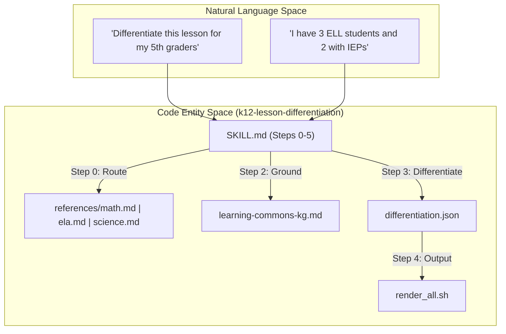
**Sources:** [plugin/skills/k12-lesson-differentiation/SKILL.md:37-140](), [plugin/skills/k12-lesson-differentiation/references/learning-commons-kg.md:1-20]()

---

### Subject-Specific Differentiation

Differentiation is not generic; it is governed by specific pedagogical files that dictate how content is modified for each subject. For example, Math differentiation focuses on prerequisite grounding and "scaffold density caps," while Science utilizes an Observation $\rightarrow$ Reasoning $\rightarrow$ Explanation (O-R-E) progression.

| Subject | Primary Framework / Strategy | Key Reference File |
| :--- | :--- | :--- |
| **Math** | Tomlinson Framework & Prerequisite Grounding | `references/math.md` |
| **ELA** | Grade-band arcs & Sentence Supports | `references/ela.md` |
| **Science** | 3D Scope & O-R-E Progression | `references/science.md` |
| **Social Studies** | C3 Inquiry Arc | `references/social_studies.md` |

For details on how each subject shapes the three-tier output, see [Subject-Specific Differentiation References](#3.2).

**Sources:** [plugin/skills/k12-lesson-differentiation/SKILL.md:39-49](), [plugin/skills/k12-lesson-differentiation/references/math.md:1-50]()

---

### The differentiation.json Schema

The output of the differentiation engine is a structured `differentiation.json` file. This file uses a **Shared Content Registry** pattern: core lesson elements (standards, tasks, vocabulary) are defined once in a `shared` block, and then referenced by the four output documents. This ensures that the "At" tier and the "Below" tier remain synchronized on the core lesson goals.

**Data Flow: Registry to Artifacts**
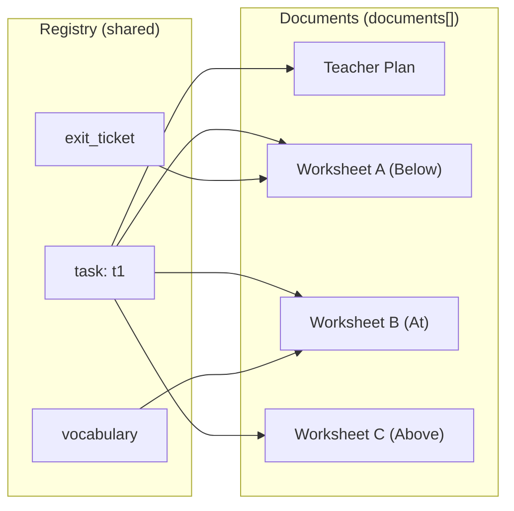

For documentation on the `differentiation.json` data model and the `from_shared` reference system, see [differentiation.json Schema & Output Contract](#3.3).

**Sources:** [plugin/skills/k12-lesson-differentiation/differentiation.json:1-100](), [plugin/skills/k12-lesson-differentiation/output.md:1-30]()

---

### Rendering Pipeline

Once the `differentiation.json` is produced, it is passed to a rendering suite that generates four `.docx` files and four `.html` files. The pipeline handles complex layout requirements, such as "glued units" (ensuring a header and its following block stay on the same page) and grade-appropriate writing spaces.

*   **Entry Point:** `render_all.sh` triggers the process.
*   **Orchestration:** `render_documents.py` iterates through the `documents[]` array.
*   **Logic:** `lesson_common.py` expands the `from_shared` references and applies "print-safety" repairs (e.g., fixing broken tables or lists for Word export).

For details on the conversion from JSON to teacher-deliverable files, see [Rendering Pipeline](#3.4).

**Sources:** [plugin/renderers/render_documents.py:1-50](), [plugin/renderers/lesson_common.py:1-100]()

---

# Page: Skill Orchestration & Differentiation Engine

# Skill Orchestration & Differentiation Engine

<details>
<summary>Relevant source files</summary>

The following files were used as context for generating this wiki page:

- [plugin/skills/k12-lesson-differentiation/SKILL.md](plugin/skills/k12-lesson-differentiation/SKILL.md)
- [plugin/skills/k12-lesson-differentiation/references/learning-commons-kg.md](plugin/skills/k12-lesson-differentiation/references/learning-commons-kg.md)

</details>


The **Skill Orchestration & Differentiation Engine** manages the lifecycle of adapting K-12 instructional materials for three proficiency tiers: **Below**, **At**, and **Above** grade level. It utilizes research-based frameworks (e.g., Tomlinson) and subject-specific pedagogy to ensure that all students, regardless of their starting point, engage with the same core learning components and standards.

## Execution Flow

The engine follows a six-step execution flow, transitioning from initial grounding to the generation of four distinct artifacts (one teacher plan and three student worksheets).

### High-Level Flow Diagram
This diagram maps the logical stages of the differentiation process to the specific reference files and data entities involved.

"Differentiation Execution Flow"
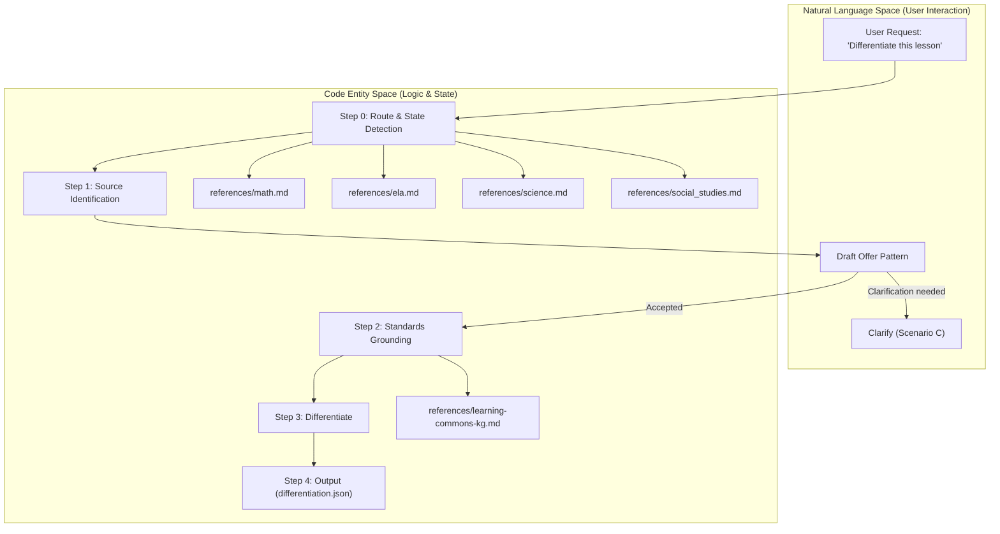
**Sources:** [plugin/skills/k12-lesson-differentiation/SKILL.md:37-148](), [plugin/skills/k12-lesson-differentiation/references/learning-commons-kg.md:7-13]()

### The Six-Step Lifecycle

1.  **Step 0: Route & State Detection**: The system detects the subject (Math, ELA, Science, Social Studies) and loads the corresponding reference file [plugin/skills/k12-lesson-differentiation/SKILL.md:37-49](). It also scans for state-specific signals (e.g., "I teach in Texas") to set the `jurisdiction` for standards lookups [plugin/skills/k12-lesson-differentiation/SKILL.md:68-77]().
2.  **Step 1: Identify Source Lesson**: The engine determines if the lesson is already in the chat, uploaded, linked via URL, or named by curriculum position (e.g., "IM Grade 6, Unit 2, Lesson 3") [plugin/skills/k12-lesson-differentiation/SKILL.md:87-97]().
3.  **Step 2: Ground in Standards**: If the Learning Commons Knowledge Graph (KG) is available, the engine calls `find_standard_statement` and progression tools to anchor the Below and Above tiers in prerequisite and forward standards [plugin/skills/k12-lesson-differentiation/references/learning-commons-kg.md:14-43]().
4.  **Step 3: Differentiate**: The engine applies the eight differentiation rules (R1–R8) to design the three tiers. This includes "Invisible Modifications" for the Below tier to maintain student dignity [plugin/skills/k12-lesson-differentiation/SKILL.md:126-135]().
5.  **Step 4: Output**: The engine generates a single `differentiation.json` file. This file is then processed by the rendering pipeline to produce four `.docx` and `.html` files [plugin/skills/k12-lesson-differentiation/SKILL.md:137-142]().
6.  **Step 5: Satisfaction Ask**: After delivery, the system asks if the tiers meet the specific learner needs and offers further refinement [plugin/skills/k12-lesson-differentiation/SKILL.md:144-148]().

**Sources:** [plugin/skills/k12-lesson-differentiation/SKILL.md:37-148](), [plugin/skills/k12-lesson-differentiation/references/learning-commons-kg.md:14-43]()

---

## Differentiation Rules (R1–R8)

The engine is governed by eight core rules that ensure pedagogical integrity across all subjects.

| Rule | Name | Description |
| :--- | :--- | :--- |
| **R1** | **Same Goal** | All tiers must work toward the exact same grade-level standard statement [plugin/skills/k12-lesson-differentiation/SKILL.md:128-128](). |
| **R2** | **Same Components** | All tiers must include all "Learning Components" (sub-skills) identified in Step 2 [plugin/skills/k12-lesson-differentiation/SKILL.md:129-129](). |
| **R3** | **Standard Verbatim** | The target standard must be quoted verbatim in the teacher plan [plugin/skills/k12-lesson-differentiation/SKILL.md:130-130](). |
| **R4** | **Tier Integrity** | Below = high support/scaffolding; At = standard lesson; Above = high challenge/extension [plugin/skills/k12-lesson-differentiation/SKILL.md:131-131](). |
| **R5** | **Invisible Mods** | Scaffolds for the Below tier (e.g., sentence frames) must not be labeled as "Below" or "Easy" on the student worksheet [plugin/skills/k12-lesson-differentiation/SKILL.md:132-132](). |
| **R6** | **Shared Content** | Tiers must share the same core text, data, or phenomena to allow for whole-class discussion [plugin/skills/k12-lesson-differentiation/SKILL.md:133-133](). |
| **R7** | **No Verbatim Copy** | Do not reproduce copyrighted curriculum text verbatim; paraphrase and describe moves instead [plugin/skills/k12-lesson-differentiation/SKILL.md:134-134](). |
| **R8** | **Draft Offer** | Always present the tier design (standard, prerequisites, and task changes) for teacher approval before generating artifacts [plugin/skills/k12-lesson-differentiation/SKILL.md:135-135](). |

**Sources:** [plugin/skills/k12-lesson-differentiation/SKILL.md:126-135]()

---

## Knowledge Graph Integration

The engine uses the Learning Commons KG to ensure that differentiation is not just "easier" or "harder" work, but is mathematically or conceptually grounded in learning progressions.

"Knowledge Graph Call Sequence"
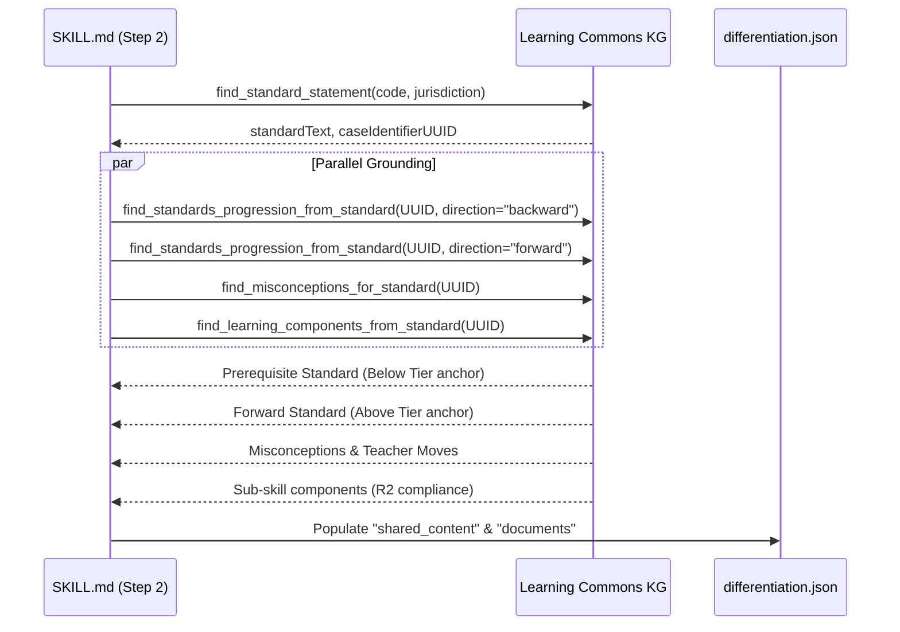
**Sources:** [plugin/skills/k12-lesson-differentiation/references/learning-commons-kg.md:14-55]()

### Copyright Guardrail
A strict guardrail prevents the verbatim reproduction of curriculum materials (like Illustrative Mathematics or OpenSciEd). If a curriculum is recognized but not explicitly confirmed by the teacher, the engine must use generic terms (e.g., "a compare-strategies discussion") instead of trademarked routine names [plugin/skills/k12-lesson-differentiation/SKILL.md:57-63]().

---

## The Draft Offer & Revision Lifecycle

To ensure the teacher maintains agency, the engine follows a **Draft Offer** pattern.

1.  **The Offer**: Before writing the full `differentiation.json`, the engine presents a summary:
    *   The identified grade-level standard.
    *   The prerequisite standard (for the Below tier).
    *   The forward standard (for the Above tier).
    *   A high-level description of how the tasks will change across tiers [plugin/skills/k12-lesson-differentiation/SKILL.md:135-135]().
2.  **Teacher Intervention**: The teacher can accept, modify (e.g., "Make the Below tier focus more on vocabulary"), or reject the plan.
3.  **Generation**: Only after approval does the engine invoke the rendering tools to produce the final artifacts.
4.  **Revision**: Post-generation, the teacher can request adjustments. The engine updates the `differentiation.json` and re-renders the documents, ensuring that "shared content" remains consistent across all tiers to prevent "tier drift" [plugin/skills/k12-lesson-differentiation/SKILL.md:3-3]().

**Sources:** [plugin/skills/k12-lesson-differentiation/SKILL.md:3-3](), [plugin/skills/k12-lesson-differentiation/SKILL.md:135-135](), [plugin/skills/k12-lesson-differentiation/SKILL.md:144-148]()

---

# Page: Subject-Specific Differentiation References

# Subject-Specific Differentiation References

<details>
<summary>Relevant source files</summary>

The following files were used as context for generating this wiki page:

- [plugin/skills/k12-lesson-differentiation/references/ela.md](plugin/skills/k12-lesson-differentiation/references/ela.md)
- [plugin/skills/k12-lesson-differentiation/references/math.md](plugin/skills/k12-lesson-differentiation/references/math.md)
- [plugin/skills/k12-lesson-differentiation/references/science.md](plugin/skills/k12-lesson-differentiation/references/science.md)
- [plugin/skills/k12-lesson-differentiation/references/social_studies.md](plugin/skills/k12-lesson-differentiation/references/social_studies.md)

</details>


This page documents the technical implementation and pedagogical frameworks for the four subject-specific reference files used by the `k12-lesson-differentiation` skill. These files govern how the differentiation engine transforms a source lesson into a three-tiered output (Below, At, and Above level) while maintaining standard integrity and subject-specific rigor.

## Overview of Subject Routing

The differentiation process is driven by the subject identified during **Step 0** of the skill lifecycle. The system loads the corresponding reference file to apply specific pedagogical constraints, prerequisite engines, and scaffold density caps.

| Subject | Reference File | Primary Framework | Key Technical Mechanism |
| :--- | :--- | :--- | :--- |
| **Math** | `math.md` | Tomlinson / CRA | Prerequisite grounding engine |
| **ELA** | `ela.md` | Science of Reading | Grade-band literacy arcs |
| **Science** | `science.md` | NGSS / OpenSciEd | O→R→E progression |
| **Social Studies** | `social_studies.md` | C3 Inquiry Arc | Sourcing & Annotation routines |

**Sources:** [plugin/skills/k12-lesson-differentiation/references/math.md:7-9](), [plugin/skills/k12-lesson-differentiation/references/ela.md:7-9](), [plugin/skills/k12-lesson-differentiation/references/science.md:7-9](), [plugin/skills/k12-lesson-differentiation/references/social_studies.md:7-9]()

---

## Math: Prerequisite Grounding & CRA

The Math reference focuses on the **Concrete → Representational → Abstract (CRA)** progression and a strict prerequisite grounding requirement.

### Prerequisite Engine Fallback
Math differentiation requires identifying a specific conceptual prerequisite from a prior grade level. The system follows a three-step fallback chain:
1. **KG Lookup**: Call `find_standards_progression_from_standard`. If a predecessor exists, use it verbatim [plugin/skills/k12-lesson-differentiation/references/math.md:67-69]().
2. **CCSS Proxy**: If the teacher uses a non-CCSS framework (e.g., TEKS), the system finds the closest Common Core analog but hides the CCSS code in a footnote to avoid confusing the teacher [plugin/skills/k12-lesson-differentiation/references/math.md:71-80]().
3. **Concept Fallback**: If no standard is found, it describes the prerequisite in plain language [plugin/skills/k12-lesson-differentiation/references/math.md:82-84]().

### CRA Tier Mapping
| Tier | Entry Point | Implementation |
| :--- | :--- | :--- |
| **Below** | Concrete | Manipulatives or physical models [plugin/skills/k12-lesson-differentiation/references/math.md:92](). |
| **At** | Representational | Visual models and diagrams [plugin/skills/k12-lesson-differentiation/references/math.md:93](). |
| **Above** | Abstract | Symbolic manipulation and generalizations [plugin/skills/k12-lesson-differentiation/references/math.md:94](). |

**Sources:** [plugin/skills/k12-lesson-differentiation/references/math.md:58-95]()

---

## ELA: Literacy Arcs & Invisible Modifications

ELA differentiation is governed by the principle of **"Same Text, Different Scaffolds."** The system is prohibited from simplifying the text complexity for below-level students [plugin/skills/k12-lesson-differentiation/references/ela.md:62-64]().

### Foundational Literacy Check (K–5)
For elementary grades, the system performs a diagnostic check to determine if a student's barrier is **decoding/fluency** or **comprehension**. If a decoding gap is suspected, the system must inject a specific warning flag into the Teacher Plan [plugin/skills/k12-lesson-differentiation/references/ela.md:80-94]().

### Invisible Modifications
The ELA reference emphasizes "invisible" supports that do not stigmatize the student:
* **Below Tier**: Chunked reading, annotation cues, and sentence frames [plugin/skills/k12-lesson-differentiation/references/ela.md:72]().
* **Above Tier**: Author's craft analysis and cross-text synthesis [plugin/skills/k12-lesson-differentiation/references/ela.md:74]().

**Sources:** [plugin/skills/k12-lesson-differentiation/references/ela.md:62-96]()

---

## Science: 3D Scope & O→R→E Progression

Science differentiation utilizes the **Observation → Representation → Explanation (O→R→E)** progression to ensure students reach the grade-level Performance Expectation (PE).

### 3D Scope Preservation
The system must maintain all three NGSS dimensions (SEP, CCC, and DCI) across all tiers. Removing a dimension (e.g., replacing an investigation with a reading) is a critical failure [plugin/skills/k12-lesson-differentiation/references/science.md:63-72]().

### O→R→E Progression
| Tier | Entry Point | Scaffolding Goal |
| :--- | :--- | :--- |
| **Below** | Observation | Structured prompts to move from "what I see" to "what it means" [plugin/skills/k12-lesson-differentiation/references/science.md:82](). |
| **At** | Representation | Standard CER (Claim, Evidence, Reasoning) construction [plugin/skills/k12-lesson-differentiation/references/science.md:83](). |
| **Above** | Explanation | Extensions involving counter-phenomena or engineering applications [plugin/skills/k12-lesson-differentiation/references/science.md:84](). |

**Sources:** [plugin/skills/k12-lesson-differentiation/references/science.md:51-98]()

---

## Social Studies: Inquiry & Sourcing

Social Studies differentiation centers on the **C3 Framework Inquiry Arc** and state-specific content standards.

### Disciplinary Prerequisite Defaults
Since Social Studies lacks a strict cross-grade standard progression in the KG, the system defaults to two prerequisites:
1. **Content Vocabulary**: 4–6 key terms extracted from source materials [plugin/skills/k12-lesson-differentiation/references/social_studies.md:78]().
2. **Sourcing Routine**: Guided annotation frames (e.g., SOAPS or HAPP) to help students analyze primary sources [plugin/skills/k12-lesson-differentiation/references/social_studies.md:80]().

### Source Complexity Mapping
The system differentiates by the "entry point" of the source material:
* **Below**: Concrete/Visual (maps, artifacts) with analysis frames [plugin/skills/k12-lesson-differentiation/references/social_studies.md:88]().
* **Above**: Abstract/Argumentative (full primary sources) with open synthesis tasks [plugin/skills/k12-lesson-differentiation/references/social_studies.md:90]().

**Sources:** [plugin/skills/k12-lesson-differentiation/references/social_studies.md:69-91]()

---

## Data Flow: Reference to Output

The following diagram illustrates how subject-specific references interact with the core differentiation engine to produce the final `differentiation.json` artifacts.

### Differentiation Reference Logic Flow
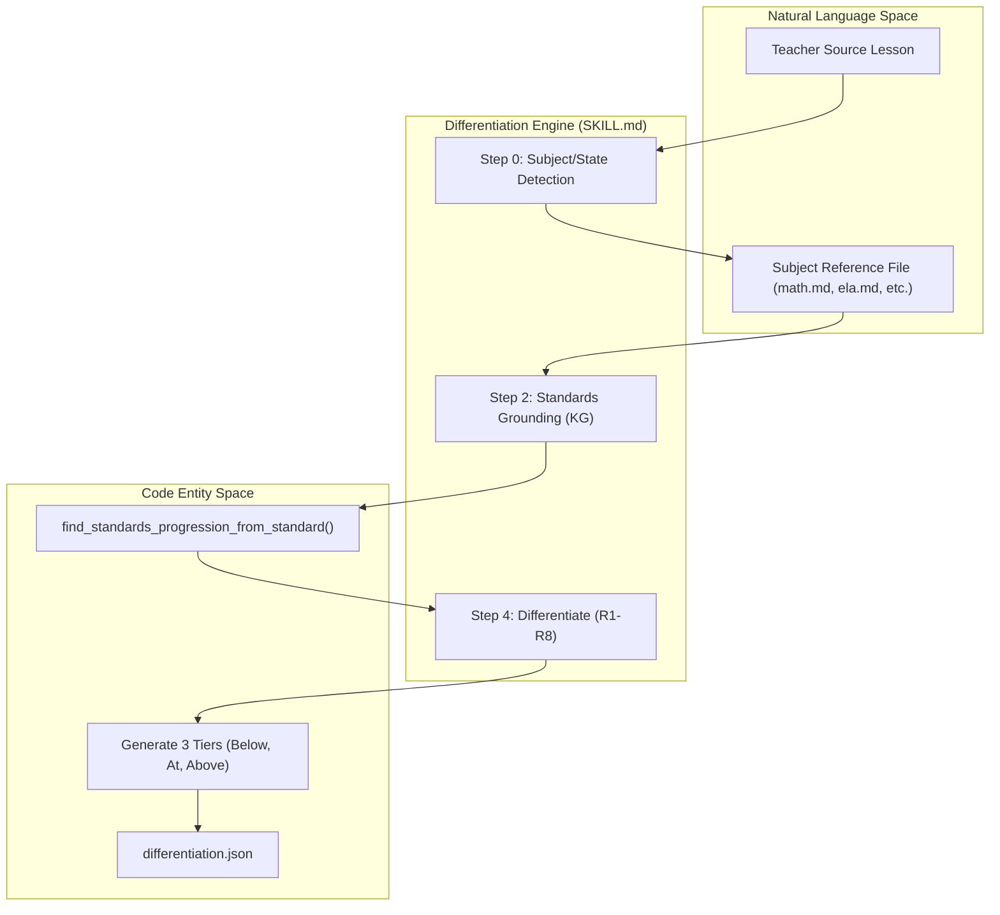
**Sources:** [plugin/skills/k12-lesson-differentiation/SKILL.md:20-80](), [plugin/skills/k12-lesson-differentiation/references/math.md:67-70]()

---

## Three-Tier Output Mapping

The differentiation engine maps the pedagogical rules in the reference files to specific block structures in the output documents.

### Subject Transformation Mapping
```mermaid
graph LR
    subgraph "Subject Pedagogy (References)"
        Math_CRA["Math: CRA Entry Points"]
        ELA_SoR["ELA: Literacy Scaffolds"]
        Sci_ORE["Science: O-R-E Progression"]
    end

    subgraph "Engine Orchestration"
        R3_Rule["Rule R3: Teach-Up / Prerequisite"]
        R4_Rule["Rule R4: Scaffolds vs Hints"]
    end

    subgraph "differentiation.json Artifacts"
        TeacherPlan["Teacher Plan (integrated)"]
        WorksheetA["Worksheet A (Below)"]
        WorksheetB["Worksheet B (At)"]
        WorksheetC["Worksheet C (Above)"]
    end

    Math_CRA --> R3_Rule
    ELA_SoR --> R4_Rule
    Sci_ORE --> R3_Rule
    
    R3_Rule --> TeacherPlan
    R4_Rule --> WorksheetA
    R4_Rule --> WorksheetB
    R4_Rule --> WorksheetC
```
**Sources:** [plugin/skills/k12-lesson-differentiation/references/math.md:44-50](), [plugin/skills/k12-lesson-differentiation/references/ela.md:46-51](), [plugin/skills/k12-lesson-differentiation/references/science.md:55-62]()

---

# Page: differentiation.json Schema & Output Contract

# differentiation.json Schema & Output Contract

<details>
<summary>Relevant source files</summary>

The following files were used as context for generating this wiki page:

- [plugin/skills/k12-lesson-differentiation/SKILL.md](plugin/skills/k12-lesson-differentiation/SKILL.md)
- [plugin/skills/k12-lesson-differentiation/references/example_differentiation.json](plugin/skills/k12-lesson-differentiation/references/example_differentiation.json)
- [plugin/skills/k12-lesson-differentiation/references/output.md](plugin/skills/k12-lesson-differentiation/references/output.md)

</details>


The `differentiation.json` file is the central data artifact produced by the `k12-lesson-differentiation` skill. It represents a "Single Source of Truth" that encodes a teacher-facing differentiation plan and three distinct student-facing worksheets (Group A/Below, Group B/At, Group C/Above) [plugin/skills/k12-lesson-differentiation/SKILL.md:3-5](). By utilizing a shared content registry, the schema ensures that core lesson tasks remain consistent across all proficiency tiers while allowing for invisible modifications and scaffolds [plugin/skills/k12-lesson-differentiation/references/output.md:49-50]().

## Data Flow & Architecture

The differentiation engine follows a strict sequence where pedagogical grounding in standards and curriculum precedes the generation of the JSON artifact.

### Natural Language to Code Entity Mapping
The following diagram illustrates how pedagogical concepts from the `SKILL.md` orchestration flow map to specific keys and structures within the `differentiation.json` schema.

**Pedagogy to Schema Mapping**
```mermaid
graph TD
    subgraph "Natural Language Space (SKILL.md / References)"
        Pedagogy["Differentiation Pedagogy (R1-R8)"]
        Standard["Target Standard (Verbatim)"]
        Tiers["Tiered Proficiencies (Below/At/Above)"]
        Supports["Scaffolds (Frames, Vocab)"]
    end

    subgraph "Code Entity Space (differentiation.json)"
        Registry["shared {} Registry"]
        DocArray["documents [] Array"]
        
        Registry -- "standard_text" --> Standard
        Registry -- "t1, t2, exit_ticket" --> Pedagogy
        Registry -- "sentence_frames" --> Supports
        
        DocArray -- "teacher_plan" --> Tiers
        DocArray -- "worksheet_group_a" --> Tiers
        DocArray -- "worksheet_group_b" --> Tiers
        DocArray -- "worksheet_group_c" --> Tiers
    end

    style Registry stroke-dasharray: 5 5
    style DocArray stroke-dasharray: 5 5
```
**Sources:** [plugin/skills/k12-lesson-differentiation/SKILL.md:47-49](), [plugin/skills/k12-lesson-differentiation/references/example_differentiation.json:2-58]()

## The `shared` Content Registry

The `shared` object acts as a library of reusable content. This prevents "tier drift" where a task might accidentally change meaning between the teacher plan and the student worksheet.

| Key | Purpose | Contract Rules |
| :--- | :--- | :--- |
| `standard_text` | Verbatim text of the target standard. | Must be quoted exactly once in the teacher plan [plugin/skills/k12-lesson-differentiation/references/output.md:25](). |
| `t1`, `t2`, `tN` | Core lesson tasks. | Contains both `teacher` (rationale) and `student` (directions) strings [plugin/skills/k12-lesson-differentiation/references/example_differentiation.json:7-14](). |
| `vocabulary` | Subject-specific terms. | Usually rendered as a `table` block [plugin/skills/k12-lesson-differentiation/references/example_differentiation.json:19-31](). |
| `sentence_frames` | Language supports. | Student-facing; must be framed as "Finish these sentences" [plugin/skills/k12-lesson-differentiation/references/example_differentiation.json:32-36](). |
| `misconceptions` | Common student errors. | Required for the Below tier plan; must include "Teacher move" [plugin/skills/k12-lesson-differentiation/references/example_differentiation.json:37-51](). |
| `anchor_activity` | Early finisher task. | Must appear on all three student tiers via `from_shared` [plugin/skills/k12-lesson-differentiation/references/output.md:37-39](). |

**Sources:** [plugin/skills/k12-lesson-differentiation/references/example_differentiation.json:2-54](), [plugin/skills/k12-lesson-differentiation/references/output.md:25-27, 37-40]()

## The `documents` Array

The schema requires exactly four entries in the `documents` array. Each entry represents a physical file (HTML/DOCX) generated by the rendering pipeline.

### Document Orchestration Diagram
```mermaid
sequenceDiagram
    participant S as shared Registry
    participant TP as teacher_plan
    participant GA as worksheet_group_a (Below)
    participant GB as worksheet_group_b (At)
    participant GC as worksheet_group_c (Above)

    S->>TP: standard_text + misconceptions
    S->>GA: t1 + t2 (with scaffolds)
    S->>GB: t1 + t2 (standard)
    S->>GC: t1 + t2 (extension)
    S->>GA: anchor_activity
    S->>GB: anchor_activity
    S->>GC: anchor_activity
```
**Sources:** [plugin/skills/k12-lesson-differentiation/references/example_differentiation.json:58-200](), [plugin/skills/k12-lesson-differentiation/references/output.md:118-125]()

### Document Requirements
1.  **Teacher Plan (`teacher_plan`):**
    *   Must include `Flexible grouping` section with evidence basis [plugin/skills/k12-lesson-differentiation/references/output.md:63-69]().
    *   Must include `Why this works (1)` and `(2)` rationale blocks [plugin/skills/k12-lesson-differentiation/references/output.md:70-75]().
    *   `audience` is set to `"teacher"` [plugin/skills/k12-lesson-differentiation/references/example_differentiation.json:61]().
2.  **Student Worksheets (`worksheet_group_a/b/c`):**
    *   `audience` is set to `"student"` [plugin/skills/k12-lesson-differentiation/references/example_differentiation.json:181]().
    *   `eyebrow` must include the `standard_code` but **never** the tier level (e.g., "Below") [plugin/skills/k12-lesson-differentiation/references/output.md:87-90]().
    *   `title` uses the Group letter (e.g., "Group A") [plugin/skills/k12-lesson-differentiation/references/output.md:87-90]().

## Output Contract & Density Rules

The `output.md` file defines hard constraints on the content density and tone of the JSON blocks.

### Block-Level Constraints
*   **Paragraph/Labeled Blocks:** Maximum 3 sentences. Longer content must be split or converted to a `table` [plugin/skills/k12-lesson-differentiation/references/output.md:17-18]().
*   **Bullets:** Fragments only, ≤ 15 words [plugin/skills/k12-lesson-differentiation/references/output.md:19]().
*   **Tables:** Used for parallel tier content; ≤ 25 words per cell [plugin/skills/k12-lesson-differentiation/references/output.md:20-22]().
*   **Callouts:** Used for asides longer than one sentence [plugin/skills/k12-lesson-differentiation/references/output.md:23-24]().

### The `from_shared` Block Type
To maintain consistency, documents use the `from_shared` block type to reference the registry.
```json
{
  "type": "from_shared",
  "key": "t1",
  "label": "1"
}
```
The `lesson_common.py` logic (specifically `expand_from_shared`) resolves these references at render time [plugin/skills/k12-lesson-differentiation/references/example_differentiation.json:70-72]().

### Asset Framing (Student-Facing Rules)
For student documents, especially the **Below tier (Group A)**, specific "Asset Framing" rules apply to avoid signaling reduced expectations:
*   **No Instructional Jargon:** Avoid terms like "scaffold," "tier," or "anchor task" [plugin/skills/k12-lesson-differentiation/references/output.md:81-85]().
*   **Invisible Scaffolds:** Organizers and sentence frames must appear as natural parts of the layout, not announced supports (e.g., avoid "Use this if you need it") [plugin/skills/k12-lesson-differentiation/references/output.md:99-105]().

**Sources:** [plugin/skills/k12-lesson-differentiation/references/output.md:12-30, 76-108](), [plugin/skills/k12-lesson-differentiation/references/example_differentiation.json:70-72]()

---

# Page: Rendering Pipeline

# Rendering Pipeline

<details>
<summary>Relevant source files</summary>

The following files were used as context for generating this wiki page:

- [plugin/skills/k12-lesson-differentiation/scripts/lesson_common.py](plugin/skills/k12-lesson-differentiation/scripts/lesson_common.py)
- [plugin/skills/k12-lesson-differentiation/scripts/render_all.sh](plugin/skills/k12-lesson-differentiation/scripts/render_all.sh)
- [plugin/skills/k12-lesson-differentiation/scripts/render_documents.py](plugin/skills/k12-lesson-differentiation/scripts/render_documents.py)
- [plugin/skills/k12-lesson-differentiation/scripts/render_lesson_docx.py](plugin/skills/k12-lesson-differentiation/scripts/render_lesson_docx.py)
- [plugin/skills/k12-lesson-differentiation/scripts/render_lesson_html.py](plugin/skills/k12-lesson-differentiation/scripts/render_lesson_html.py)
- [plugin/skills/k12-lesson-differentiation/scripts/theme.css](plugin/skills/k12-lesson-differentiation/scripts/theme.css)

</details>


The rendering pipeline converts the structured `differentiation.json` (or `lesson.json`) into teacher-ready artifacts. It produces two primary formats: **.docx** (the editable deliverable for teachers) and **.html** (a self-contained, styled preview). The pipeline is designed for "print-safety," ensuring that pedagogical content like number lines, workspace areas, and complex tables render correctly on physical paper without visual drift between formats.

### Data Flow Overview

The process begins with a multi-document JSON structure containing a `shared` content registry and a `documents` array. This architecture ensures that tiered worksheets (Group A, B, and C) and the teacher plan remain synchronized by pulling from the same content source.

#### Diagram: Natural Language to Code Entity Space (Orchestration)

```mermaid
graph TD
    subgraph "Natural Language Space"
        Input["differentiation.json (Source)"]
        TeacherPlan["Teacher Lesson Plan"]
        Worksheets["Tiered Student Worksheets"]
    end

    subgraph "Code Entity Space (Scripts)"
        RA["render_all.sh"]
        RD["render_documents.py"]
        RLH["render_lesson_html.py"]
        RLD["render_lesson_docx.py"]
        LC["lesson_common.py"]
    end

    Input --> RA
    RA -- "Executes" --> RD
    RD -- "Iterates documents[]" --> RLH
    RD -- "Iterates documents[]" --> RLD
    RLH -- "expand_document()" --> LC
    RLD -- "expand_document()" --> LC
    RLH -- "HTML Output" --> TeacherPlan
    RLD -- "DOCX Output" --> Worksheets
```
**Sources:** [plugin/skills/k12-lesson-differentiation/scripts/render_all.sh:6-15](), [plugin/skills/k12-lesson-differentiation/scripts/render_documents.py:6-30](), [plugin/skills/k12-lesson-differentiation/scripts/render_lesson_html.py:8-22]()

---

### 1. Orchestration Layer

The pipeline uses a two-tier orchestration strategy to handle multi-artifact generation.

#### `render_all.sh` (Entry Point)
The shell script serves as the primary entry point. It ensures the environment is prepared (installing `python-docx` if missing) and invokes the Python orchestrator. It also ensures the source `differentiation.json` is persisted alongside the outputs for future revision turns [plugin/skills/k12-lesson-differentiation/scripts/render_all.sh:21-44]().

#### `render_documents.py` (Multi-Document Orchestrator)
This script manages the `documents` array within the JSON.
*   **`build_doc`**: Merges the top-level `shared` registry and `theme` into individual document entries [plugin/skills/k12-lesson-differentiation/scripts/render_documents.py:48-56]().
*   **Sanitization**: Sanitizes `doc_id` fields to create safe filenames, replacing non-alphanumeric characters with underscores [plugin/skills/k12-lesson-differentiation/scripts/render_documents.py:78-82]().
*   **Dispatch**: Calls `render_lesson_html.render()` and `render_lesson_docx.render()` for each document in the set [plugin/skills/k12-lesson-differentiation/scripts/render_documents.py:89-97]().

**Sources:** [plugin/skills/k12-lesson-differentiation/scripts/render_all.sh:1-45](), [plugin/skills/k12-lesson-differentiation/scripts/render_documents.py:1-109]()

---

### 2. Common Logic and Repair Layer (`lesson_common.py`)

This module provides the shared infrastructure used by both HTML and DOCX renderers. Its primary responsibility is expanding the document schema and performing "print-safety" repairs.

#### Content Expansion
*   **`expand_document`**: Recursively traverses the block tree to resolve `from_shared` references and faceted content [plugin/skills/k12-lesson-differentiation/scripts/lesson_common.py:8-11]().
*   **Faceted Content**: Selects the appropriate version of a block based on the document's `audience` (e.g., showing teacher notes in the plan but hiding them in student worksheets).

#### Print-Safety Repair Pipe
The pipeline includes a series of regex-based repairs to fix common LLM formatting artifacts that would otherwise break the layout:
*   **`_repair_pipe_tables`**: Converts raw Markdown pipe tables (`| col |`) found inside prose strings into structured `table` blocks [plugin/skills/k12-lesson-differentiation/scripts/lesson_common.py:137-160]().
*   **`_repair_inline_bullets`**: Detects bullet symbols (•, ▪) written mid-paragraph and splits them into proper `list` blocks [plugin/skills/k12-lesson-differentiation/scripts/lesson_common.py:82-134]().
*   **`_repair_enum_breaks`**: Identifies mid-prose enumerations like `(a) ... (b)` and inserts line breaks to ensure they start on new lines [plugin/skills/k12-lesson-differentiation/scripts/lesson_common.py:66-79]().

**Sources:** [plugin/skills/k12-lesson-differentiation/scripts/lesson_common.py:5-79](), [plugin/skills/k12-lesson-differentiation/scripts/lesson_common.py:82-160]()

---

### 3. HTML Rendering & CSS Theming

`render_lesson_html.py` generates a self-contained HTML file. It uses `theme.css` for visual primitives and CSS Custom Properties for themeable values (colors, font sizes).

#### Block Dispatcher
The `render_block` function acts as a central dispatcher for the block vocabulary:
*   **`phase_header`**: Renders lesson phases with optional duration badges [plugin/skills/k12-lesson-differentiation/scripts/render_lesson_html.py:144-150]().
*   **`callout`**: Renders icon-prefixed boxes (e.g., "Teacher Note", "Task") using `CALLOUT_KINDS` mapping [plugin/skills/k12-lesson-differentiation/scripts/render_lesson_html.py:117-128]().
*   **`workspace`**: Generates writing spaces, including ruled lines for lower grades if `theme.ruled_default` is set [plugin/skills/k12-lesson-differentiation/scripts/render_lesson_html.py:54-62]().

#### CSS Primitives (`theme.css`)
The visual design focuses on B+W print-safety.
*   **Callouts**: Distinguished by icons and border colors rather than background fills [plugin/skills/k12-lesson-differentiation/scripts/theme.css:35-42]().
*   **Number Lines**: Implemented via absolute positioning of ticks and marks within a relative container [plugin/skills/k12-lesson-differentiation/scripts/theme.css:76-86]().

**Sources:** [plugin/skills/k12-lesson-differentiation/scripts/render_lesson_html.py:89-153](), [plugin/skills/k12-lesson-differentiation/scripts/theme.css:1-95]()

---

### 4. DOCX Rendering (`render_lesson_docx.py`)

The DOCX renderer uses `python-docx` to build an editable Word document. It mirrors the HTML layout logic but implements it via OOXML primitives.

#### Diagram: Block Dispatch to Emitter Mapping

```mermaid
graph LR
    subgraph "Block Vocabulary"
        B1["paragraph"]
        B2["callout"]
        B3["workspace"]
        B4["fill_table"]
    end

    subgraph "render_lesson_docx.py Dispatch"
        E1["add_md()"]
        E2["_emit_callout()"]
        E3["_emit_workspace()"]
        E4["_emit_table()"]
    end

    B1 --> E1
    B2 --> E2
    B3 --> E3
    B4 --> E4

    subgraph "Word Engine"
        S["setup_styles()"]
        N["_restart_numbering()"]
    end

    E1 --> S
    E2 --> S
    E4 --> N
```
**Sources:** [plugin/skills/k12-lesson-differentiation/scripts/render_lesson_docx.py:54-86](), [plugin/skills/k12-lesson-differentiation/scripts/render_lesson_docx.py:90-100](), [plugin/skills/k12-lesson-differentiation/scripts/render_lesson_docx.py:162-179]()

#### Key Implementations
*   **`setup_styles`**: Initializes a suite of "LC" (Learning Commons) prefixed styles in the Word document, mapping theme values to `RGBColor` [plugin/skills/k12-lesson-differentiation/scripts/render_lesson_docx.py:54-86]().
*   **`_restart_numbering`**: A critical utility that manipulates `w:abstractNumId` to ensure ordered lists restart at 1, overcoming `python-docx`'s document-wide list numbering [plugin/skills/k12-lesson-differentiation/scripts/render_lesson_docx.py:162-179]().
*   **Table Primitives**: Functions like `_set_borders` and `_cant_split` ensure tables look consistent and do not break awkwardly across page boundaries [plugin/skills/k12-lesson-differentiation/scripts/render_lesson_docx.py:103-138]().

**Sources:** [plugin/skills/k12-lesson-differentiation/scripts/render_lesson_docx.py:46-86](), [plugin/skills/k12-lesson-differentiation/scripts/render_lesson_docx.py:103-179]()

---

# Page: Shared Rendering Architecture

# Shared Rendering Architecture

<details>
<summary>Relevant source files</summary>

The following files were used as context for generating this wiki page:

- [plugin/skills/k12-lesson-differentiation/scripts/lesson_common.py](plugin/skills/k12-lesson-differentiation/scripts/lesson_common.py)
- [plugin/skills/k12-lesson-differentiation/scripts/theme.css](plugin/skills/k12-lesson-differentiation/scripts/theme.css)
- [plugin/skills/k12-lesson-planning/scripts/lesson_common.py](plugin/skills/k12-lesson-planning/scripts/lesson_common.py)
- [plugin/skills/k12-lesson-planning/scripts/theme.css](plugin/skills/k12-lesson-planning/scripts/theme.css)

</details>


The rendering subsystem is a cross-skill engine designed to transform structured JSON artifacts (lessons and differentiated plans) into professional, classroom-ready materials. It employs a unified block vocabulary and a dual-output strategy to ensure that content generated by the LLM is consistently formatted across both HTML and Microsoft Word (.docx) formats.

## Core Concepts

The architecture relies on three pillars to maintain consistency and print-readiness:

1.  **Shared Content Registry**: A `shared` block in the source JSON stores reusable components (e.g., standards, tasks, vocabulary). Documents reference these via a `from_shared` key, preventing content drift [plugin/skills/k12-lesson-planning/scripts/lesson_common.py:7-11]().
2.  **Block Dispatch**: Both renderers iterate through a standardized list of block types (e.g., `callout`, `fill_table`, `workspace`, `number_line`) and dispatch them to format-specific emitters [plugin/skills/k12-lesson-planning/scripts/render_lesson_html.py:112-114]().
3.  **Print-Safety Repair**: A structural repair pipeline in `lesson_common.py` intercepts common LLM formatting errors—such as markdown pipe tables written inside text strings—and converts them into structured blocks before final rendering [plugin/skills/k12-lesson-planning/scripts/lesson_common.py:16-22]().

### Rendering Data Flow

The following diagram illustrates how a raw JSON artifact moves through the shared logic into the final output formats.

```mermaid
graph TD
    subgraph "Natural Language Space"
        JSON["lesson.json / differentiation.json"]
    end

    subgraph "Code Entity Space (lesson_common.py)"
        EXP["expand_document()"]
        REG["expand_from_shared()"]
        REP["_repair_pipe_tables()"]
        REB["_repair_enum_breaks()"]
    end

    subgraph "Output Formatters"
        HTML["render_lesson_html.py"]
        DOCX["render_lesson_docx.py"]
        CSS["theme.css"]
    end

    JSON --> EXP
    EXP --> REG
    REG --> REP
    REP --> REB
    REB --> HTML
    REB --> DOCX
    HTML --> CSS
```
**Sources:** [plugin/skills/k12-lesson-planning/scripts/lesson_common.py:5-22](), [plugin/skills/k12-lesson-planning/scripts/render_lesson_html.py:11-20]().

---

## Shared Content & Repair Layer (`lesson_common.py`)

This layer acts as the pre-processor for all artifacts. It handles the expansion of the `shared` content registry and applies a "Repair Pipe" to fix structural issues that are difficult for the LLM to avoid consistently.

*   **Content Expansion**: The `expand_document()` function flattens the document by resolving all `from_shared` references [plugin/skills/k12-lesson-planning/scripts/lesson_common.py:228-235]().
*   **Structural Repairs**: Functions like `_repair_pipe_tables` and `_repair_inline_bullets` scan prose fields for markdown-style tables or bullets and convert them into formal `table` or `list` blocks [plugin/skills/k12-lesson-planning/scripts/lesson_common.py:82-85](), [plugin/skills/k12-lesson-planning/scripts/lesson_common.py:137-138]().
*   **Typography & Breaks**: `_repair_enum_breaks` ensures that sub-parts like `(a)` or `(1)` appearing mid-prose are moved to new lines for readability [plugin/skills/k12-lesson-planning/scripts/lesson_common.py:66-67]().

For details, see [lesson_common.py — Shared Content & Repair Layer](#4.1).

**Sources:** [plugin/skills/k12-lesson-planning/scripts/lesson_common.py:1-160]().

---

## HTML Renderer & CSS Theme

The HTML renderer produces a responsive, web-based version of the lesson, primarily used for previewing within the Claude interface and for high-fidelity printing.

*   **Block Dispatcher**: The `render_block()` function maps JSON block types to specific HTML generation logic [plugin/skills/k12-lesson-planning/scripts/render_lesson_html.py:112-150]().
*   **Theming**: The `theme.css` file defines visual primitives for callouts, number lines, and worksheet elements [plugin/skills/k12-lesson-differentiation/scripts/theme.css:5-8]().
*   **Print Layout**: The system uses `page-break-inside: avoid` and `page-break-after: avoid` on headings and cards to ensure logical grouping when printed to PDF [plugin/skills/k12-lesson-differentiation/scripts/theme.css:21-25]().

For details, see [HTML Renderer & CSS Theme](#4.2).

**Sources:** [plugin/skills/k12-lesson-planning/scripts/render_lesson_html.py:1-200](), [plugin/skills/k12-lesson-differentiation/scripts/theme.css:1-95]().

---

## DOCX Renderer

The DOCX renderer generates editable Microsoft Word files using `python-docx`. It is designed to mirror the visual styling of the HTML/CSS version as closely as possible within the constraints of Word's XML schema.

*   **Emitter Table**: Uses an `_EMITTERS` dictionary to route block types to internal functions like `_emit_callout` or `_emit_table` [plugin/skills/k12-lesson-planning/scripts/render_lesson_docx.py:84-105]().
*   **Style Engine**: `setup_styles()` initializes a standard set of Word styles (e.g., "LessonTitle", "PhaseHeader") to maintain consistent typography [plugin/skills/k12-lesson-planning/scripts/render_lesson_docx.py:138-160]().
*   **Complex Primitives**: Implements custom logic for `number_line` using tab stops and borders, and `fill_table` for student worksheets [plugin/skills/k12-lesson-planning/scripts/render_lesson_docx.py:465-480]().

For details, see [DOCX Renderer](#4.3).

**Sources:** [plugin/skills/k12-lesson-planning/scripts/render_lesson_docx.py:1-500]().

---

## Block Vocabulary Mapping

This table associates the JSON schema identifiers with the internal code entities responsible for rendering them.

| Block Type | JSON Identifier | HTML Emitter | DOCX Emitter |
| :--- | :--- | :--- | :--- |
| **Callout** | `callout` | `_render_callout` | `_emit_callout` |
| **Table** | `table` | `_render_table` | `_emit_table` |
| **Fill-in-Table** | `fill_table` | `_render_fill_table` | `_emit_fill_table` |
| **Number Line** | `number_line` | `_render_number_line` | `_emit_number_line` |
| **Workspace** | `workspace` | `_render_workspace` | `_emit_workspace` |

**Sources:** [plugin/skills/k12-lesson-planning/scripts/render_lesson_html.py:112-140](), [plugin/skills/k12-lesson-planning/scripts/render_lesson_docx.py:84-105]().

---

# Page: lesson_common.py — Shared Content & Repair Layer

# lesson_common.py — Shared Content & Repair Layer

<details>
<summary>Relevant source files</summary>

The following files were used as context for generating this wiki page:

- [plugin/skills/k12-lesson-differentiation/scripts/lesson_common.py](plugin/skills/k12-lesson-differentiation/scripts/lesson_common.py)
- [plugin/skills/k12-lesson-planning/scripts/lesson_common.py](plugin/skills/k12-lesson-planning/scripts/lesson_common.py)

</details>


`lesson_common.py` serves as the shared utility layer for both the `k12-lesson-planning` and `k12-lesson-differentiation` skills. Its primary responsibility is to bridge the gap between the raw JSON artifact produced by the LLM and the final rendered documents (HTML and DOCX). It handles content expansion from the shared registry, grade-based layout logic, and a suite of "print-safety" repair functions that correct common LLM formatting artifacts that would otherwise break document layouts [plugin/skills/k12-lesson-planning/scripts/lesson_common.py:5-11]().

## Core Data Structures & Logic

### The Theme Class
The `Theme` class encapsulates the visual configuration for a lesson, including color palettes for callouts and subject-specific iconography [plugin/skills/k12-lesson-planning/scripts/lesson_common.py:228-232](). It maps semantic callout kinds (e.g., `check`, `alert`, `strategy`) to specific hex colors and icons used by both the HTML and DOCX renderers.

### Content Expansion
The rendering pipeline relies on a "write-once" pattern where content shared across multiple documents (like standards, vocabulary, or exit tickets) is stored in a top-level `shared` registry.

*   **`expand_from_shared(shared_map, block)`**: Recursively traverses a document's block tree. When it encounters a block with a `from_shared` key, it retrieves the corresponding content from the `shared_map` and merges it into the block [plugin/skills/k12-lesson-planning/scripts/lesson_common.py:356-370]().
*   **`expand_document(shared_map, doc_data)`**: The entry point for processing a single document entry from the JSON. It resolves all shared references and applies faceted content logic [plugin/skills/k12-lesson-planning/scripts/lesson_common.py:373-379]().

### Faceted Content (`_faceted`)
Blocks can contain a `_faceted` key, which allows the LLM to provide different versions of the same content (e.g., different scaffolding levels). `expand_document` selects the appropriate facet based on the document's context, ensuring the correct version is rendered without duplicating the entire block structure [plugin/skills/k12-lesson-planning/scripts/lesson_common.py:378-379]().

**Sources:** [plugin/skills/k12-lesson-planning/scripts/lesson_common.py:228-379]()

## Bridge: Natural Language Space to Code Entity Space

The following diagram illustrates how natural language concepts found in teacher requirements map to specific code entities within the shared rendering layer.

### Concept to Code Mapping
```mermaid
graph TD
    subgraph "Natural Language Requirements"
        A["'Use the same Exit Ticket in both docs'"]
        B["'Add a space for students to write'"]
        C["'Different instructions for Grade 2'"]
        D["'Fix broken markdown tables'"]
    end

    subgraph "Code Entity Space (lesson_common.py)"
        A1["expand_from_shared()"]
        B1["workspace_height()"]
        C1["answer_profile()"]
        D1["_repair_pipe_tables()"]
    end

    A --> A1
    B --> B1
    C --> C1
    D --> D1
```
**Sources:** [plugin/skills/k12-lesson-planning/scripts/lesson_common.py:32-160](), [plugin/skills/k12-lesson-planning/scripts/lesson_common.py:356-379](), [plugin/skills/k12-lesson-planning/scripts/lesson_common.py:423-450]()

## Print-Safety Repair Layer

The repair layer consists of several functions that identify and fix structural issues in the LLM's output that would result in poor print quality or unreadable text.

| Function | Purpose | Implementation Detail |
| :--- | :--- | :--- |
| `_repair_pipe_tables` | Converts raw Markdown pipe tables (`| col |`) into structured `table` blocks. | Uses `_PIPE_LINE` and `_SEP_LINE` regex to identify and `_parse_pipe_rows` to extract data [plugin/skills/k12-lesson-planning/scripts/lesson_common.py:137-160](). |
| `_repair_inline_bullets` | Splits prose containing bullet characters into separate `paragraph` and `list` blocks. | Prevents bullets from running together as a single line of text [plugin/skills/k12-lesson-planning/scripts/lesson_common.py:82-134](). |
| `_repair_enum_breaks` | Inserts line breaks before mid-prose sub-parts like `(a)` or `(1)`. | Uses `_ENUM_MIDPROSE` regex to find markers following punctuation [plugin/skills/k12-lesson-planning/scripts/lesson_common.py:66-80](). |
| `_repair_cap_subparts` | Handles standards-style sub-parts (e.g., `A. ... B. ...`) written mid-prose. | Only triggers if both `A.` and `B.` are detected to avoid false positives with initials [plugin/skills/k12-lesson-planning/scripts/lesson_common.py:58-63](). |

**Sources:** [plugin/skills/k12-lesson-planning/scripts/lesson_common.py:16-160]()

## Layout & Styling Helpers

### Answer Profiles and Grade-Based Layout
The `answer_profile(grade, doc_type)` function determines the layout of student-facing documents based on the target grade level [plugin/skills/k12-lesson-planning/scripts/lesson_common.py:423-450]().
*   **Grades K-2**: Use larger fonts and more generous writing spaces.
*   **Grades 3-5**: Moderate spacing.
*   **Grades 6+**: Standard spacing for older students.

### Writing Space Sizing
`workspace_height(size_str)` converts semantic sizes (e.g., `small`, `large`) into physical dimensions (inches for DOCX, pixels/ems for HTML) [plugin/skills/k12-lesson-planning/scripts/lesson_common.py:408-420](). This ensures consistency across different output formats.

### Callout Resolution
`resolve_callout_kind(kind)` maps the LLM's requested callout type to the internal `Theme` registry [plugin/skills/k12-lesson-planning/scripts/lesson_common.py:307-318](). If an unknown kind is requested, it defaults to a standard `info` style to prevent rendering errors.

## Data Flow: JSON to Render-Ready Object

The following diagram tracks the transformation of a document block from the raw JSON state to a fully expanded and repaired state ready for the HTML/DOCX emitters.

### Block Transformation Pipeline
```mermaid
flowchart LR
    subgraph "Raw JSON"
        J1["Block { from_shared: 'exit_t' }"]
    end

    subgraph "lesson_common.py Processing"
        P1["expand_from_shared()"]
        P2["_repair_pipe_tables()"]
        P3["_repair_enum_breaks()"]
        P4["resolve_callout_kind()"]
    end

    subgraph "Render-Ready Object"
        R1["Structured Block Tree"]
    end

    J1 --> P1
    P1 --> P2
    P2 --> P3
    P3 --> P4
    P4 --> R1
```
**Sources:** [plugin/skills/k12-lesson-planning/scripts/lesson_common.py:66-160](), [plugin/skills/k12-lesson-planning/scripts/lesson_common.py:356-379]()

---

# Page: HTML Renderer & CSS Theme

# HTML Renderer & CSS Theme

<details>
<summary>Relevant source files</summary>

The following files were used as context for generating this wiki page:

- [plugin/skills/k12-lesson-differentiation/scripts/render_lesson_html.py](plugin/skills/k12-lesson-differentiation/scripts/render_lesson_html.py)
- [plugin/skills/k12-lesson-differentiation/scripts/theme.css](plugin/skills/k12-lesson-differentiation/scripts/theme.css)
- [plugin/skills/k12-lesson-planning/scripts/render_lesson_html.py](plugin/skills/k12-lesson-planning/scripts/render_lesson_html.py)
- [plugin/skills/k12-lesson-planning/scripts/theme.css](plugin/skills/k12-lesson-planning/scripts/theme.css)

</details>


The HTML rendering pipeline transforms structured lesson JSON data into styled, self-contained HTML previews suitable for teacher review and black-and-white printing. The system prioritizes accessibility, semantic heading orders, and print-safe visual primitives.

### Orchestration and Data Flow

The rendering process is managed by `render_lesson_html.py`, which utilizes a dispatcher pattern to convert individual content blocks into HTML strings. The entry point for this process is the `render()` function.

#### Core Rendering Logic
1.  **Document Expansion**: The `render()` function first calls `expand_document()` to resolve `from_shared` references and apply print-safety repairs [plugin/skills/k12-lesson-planning/scripts/render_lesson_html.py:167-170]().
2.  **Header Generation**: It constructs the document header (title, metadata, and standards) using `build_header()` [plugin/skills/k12-lesson-planning/scripts/render_lesson_html.py:173-173]().
3.  **Block Dispatching**: The function iterates through the expanded blocks, passing each to `render_block()` [plugin/skills/k12-lesson-planning/scripts/render_lesson_html.py:180-181]().
4.  **Styling Injection**: CSS is injected directly into the `<head>` via the `css()` function, which reads `theme.css` and overlays dynamic `:root` variables [plugin/skills/k12-lesson-planning/scripts/render_lesson_html.py:65-86]().

**Rendering Pipeline Architecture**

```mermaid
graph TD
    JSON["Lesson JSON"] --> ED["expand_document() (lesson_common.py)"]
    ED --> R["render() (render_lesson_html.py)"]
    subgraph "HTML Generation"
        R --> BH["build_header()"]
        R --> RB["render_block() Dispatcher"]
        RB --> P["paragraph"]
        RB --> C["callout"]
        RB --> NL["number_line"]
        RB --> WS["workspace"]
    end
    RB --> CSS["css() (Inject theme.css)"]
    CSS --> Final["Self-contained HTML"]
```

**Sources:**
- [plugin/skills/k12-lesson-planning/scripts/render_lesson_html.py:65-87]()
- [plugin/skills/k12-lesson-planning/scripts/render_lesson_html.py:89-163]()
- [plugin/skills/k12-lesson-planning/scripts/render_lesson_html.py:165-188]()

---

### The `render_block` Dispatcher

The `render_block()` function serves as the central switchboard for the HTML renderer. It maps block types to specific HTML structures and ensures that heading levels remain semantically correct.

| Block Type | Implementation Detail | CSS Class / Tag |
| :--- | :--- | :--- |
| `paragraph` | Basic text with markdown-lite support [plugin/skills/k12-lesson-planning/scripts/render_lesson_html.py:93-94](). | `<p>` |
| `h2` / `h3` | Dynamic level calculation based on `theme.hbase` to prevent skipping levels [plugin/skills/k12-lesson-planning/scripts/render_lesson_html.py:98-107](). | `<h2>`, `<h3>` |
| `callout` | Uses `_resolve_callout_kind` to select icons and border colors [plugin/skills/k12-lesson-planning/scripts/render_lesson_html.py:117-128](). | `.co`, `.co-icon` |
| `fill_in` | Renders underscores of varying widths (`short`, `med`, `long`) [plugin/skills/k12-lesson-planning/scripts/render_lesson_html.py:138-143](). | `.fillin` |
| `workspace` | Generates empty space or ruled lines based on grade-level profiles [plugin/skills/k12-lesson-planning/scripts/render_lesson_html.py:157-158](). | `.ans`, `.ansline` |
| `number_line` | Renders a relative-positioned bar with ticks and marks [plugin/skills/k12-lesson-planning/scripts/render_lesson_html.py:159-160](). | `.numberline` |

**Heading Level Management**
To maintain accessibility (Axe `heading-order` compliance), the renderer tracks heading depth. If an `h2` block is encountered, it uses `theme.hbase` (defaulting to 3). If an `h3` follows, it increments the level only if a parent section header has been set [plugin/skills/k12-lesson-planning/scripts/render_lesson_html.py:99-107]().

**Sources:**
- [plugin/skills/k12-lesson-planning/scripts/render_lesson_html.py:89-163]()
- [plugin/skills/k12-lesson-planning/scripts/render_lesson_html.py:41-41]()

---

### Layout & Page-Break Logic

The renderer implements specific logic to ensure teacher and student artifacts remain readable when printed.

#### Glued Units
The `group` block type is used to "glue" content together. It applies `page-break-inside: avoid` to the container, ensuring that a set of instructions and its corresponding workspace are not split across two pages [plugin/skills/k12-lesson-planning/scripts/render_lesson_html.py:151-153]().

#### Two-Column Layouts
The `columns` block allows for side-by-side content, typically used in student worksheets to save vertical space. It utilizes a flexbox container with `gap: 24pt` [plugin/skills/k12-lesson-planning/scripts/render_lesson_html.py:154-156]().

**Layout Primitive Mapping**

```mermaid
graph LR
    subgraph "JSON Schema"
        J_Group["block: 'group'"]
        J_Cols["block: 'columns'"]
        J_PB["block: 'page_break'"]
    end

    subgraph "CSS Implementation"
        C_Avoid[".group { page-break-inside: avoid }"]
        C_Flex[".cols { display: flex }"]
        C_Always[".pagebreak { page-break-after: always }"]
    end

    J_Group --> C_Avoid
    J_Cols --> C_Flex
    J_PB --> C_Always
```

**Sources:**
- [plugin/skills/k12-lesson-planning/scripts/render_lesson_html.py:151-163]()
- [plugin/skills/k12-lesson-planning/scripts/theme.css:68-68]()
- [plugin/skills/k12-lesson-planning/scripts/theme.css:88-88]()

---

### CSS Theme Visual Primitives

The `theme.css` file defines the visual language of the artifacts. It is designed to be "B+W safe," meaning it does not rely on background fills to convey meaning, as these often fail in school photocopiers.

#### CSS Custom Properties
The `css()` function in the renderer injects a `:root` block that overrides default values from the `Theme` object:
*   `--primary`: Used for icons, phase headers, and number line marks [plugin/skills/k12-lesson-planning/scripts/theme.css:81-85]().
*   `--title-size` / `--body-size`: Scaled based on the grade level defined in the lesson theme [plugin/skills/k12-lesson-planning/scripts/theme.css:11-11]().

#### Callout Registry
Callouts use specific border colors and Unicode icons rather than background colors:
*   **Teacher Note (`tnote`)**: Uses icon `💡` and color `#B8860B` [plugin/skills/k12-lesson-planning/scripts/theme.css:41-41]().
*   **Special (`special`)**: Uses icon `⭐` and color `#2F855A` [plugin/skills/k12-lesson-planning/scripts/theme.css:39-39]().
*   **Task (`task`)**: Uses icon `✏️` and color `#5B7FB8` [plugin/skills/k12-lesson-planning/scripts/theme.css:40-40]().

#### Number Line Implementation
The number line is a complex CSS primitive. It uses absolute positioning for ticks and marks relative to a `.nl-bar` [plugin/skills/k12-lesson-planning/scripts/theme.css:76-85](). Marks (`.nl-mark`) are rendered as CSS triangles [plugin/skills/k12-lesson-planning/scripts/theme.css:81-83]().

**Sources:**
- [plugin/skills/k12-lesson-planning/scripts/theme.css:6-11]()
- [plugin/skills/k12-lesson-planning/scripts/theme.css:34-43]()
- [plugin/skills/k12-lesson-planning/scripts/theme.css:76-86]()
- [plugin/skills/k12-lesson-planning/scripts/render_lesson_html.py:80-86]()

---

### Print Overrides

The renderer includes a `@media print` block to ensure that the HTML preview translates perfectly to paper.
*   **Margins**: The `.page` padding is removed to allow the browser's print margins to take over [plugin/skills/k12-lesson-planning/scripts/theme.css:91-91]().
*   **Backgrounds**: Forced to white to save ink [plugin/skills/k12-lesson-planning/scripts/theme.css:91-91]().
*   **Large Display Tables**: A special `display-large` class is available for K-2 word grids, bumping font sizes to `18pt` for classroom visibility [plugin/skills/k12-lesson-planning/scripts/theme.css:93-94]().

**Sources:**
- [plugin/skills/k12-lesson-planning/scripts/theme.css:91-95]()

---

# Page: DOCX Renderer

# DOCX Renderer

<details>
<summary>Relevant source files</summary>

The following files were used as context for generating this wiki page:

- [plugin/skills/k12-lesson-differentiation/scripts/render_lesson_docx.py](plugin/skills/k12-lesson-differentiation/scripts/render_lesson_docx.py)
- [plugin/skills/k12-lesson-planning/scripts/render_lesson_docx.py](plugin/skills/k12-lesson-planning/scripts/render_lesson_docx.py)

</details>


The `render_lesson_docx.py` script transforms lesson JSON data into editable Microsoft Word (`.docx`) files. It is designed to produce teacher-deliverable artifacts that maintain visual parity with the HTML output while adhering to print-safe design principles (minimal color, B+W compatibility, and pagination control) [plugin/skills/k12-lesson-planning/scripts/render_lesson_docx.py:6-15]().

## System Architecture

The renderer uses `python-docx` to construct the document object model. It employs a dispatch-table pattern to map block types from the `lesson.json` schema to specific emitter functions.

### Data Flow: JSON to DOCX

The following diagram illustrates how the renderer processes a lesson document.

**Figure 1: DOCX Generation Pipeline**
```mermaid
graph TD
    subgraph "Natural Language Space"
        A["Teacher Lesson Plan"]
        B["Student Worksheet"]
    end

    subgraph "Code Entity Space"
        JSON["lesson.json"]
        COMMON["lesson_common.py:expand_document()"]
        RENDERER["render_lesson_docx.py:render()"]
        DISPATCH["_EMITTERS Dispatch Table"]
        DOCX["python-docx:Document"]
        FILE["lesson_plan.docx"]

        JSON --> COMMON
        COMMON --> RENDERER
        RENDERER --> DISPATCH
        DISPATCH -- "paragraph" --> P["_emit_paragraph()"]
        DISPATCH -- "callout" --> C["_emit_callout()"]
        DISPATCH -- "fill_table" --> FT["_emit_fill_table()"]
        
        P & C & FT --> DOCX
        DOCX --> FILE
    end
```
**Sources:** [plugin/skills/k12-lesson-planning/scripts/render_lesson_docx.py:8-12](), [plugin/skills/k12-lesson-planning/scripts/render_lesson_docx.py:340-356]()

## Style Engine & Theme Integration

The `setup_styles()` function initializes the Word document with custom styles derived from the `Theme` object [plugin/skills/k12-lesson-planning/scripts/render_lesson_docx.py:54-87]().

### Theme to Style Mapping
The renderer converts hex color strings to `RGBColor` objects via `_hex_rgb()` [plugin/skills/k12-lesson-planning/scripts/render_lesson_docx.py:46-52]().

| Word Style Name | Base Style | Attributes | Source |
| :--- | :--- | :--- | :--- |
| `Normal` | N/A | Helvetica, 10.5pt (default), 8pt after | [plugin/skills/k12-lesson-planning/scripts/render_lesson_docx.py:57-62]() |
| `LC Eyebrow` | `Normal` | 9pt, Bold, All Caps, Primary Color | [plugin/skills/k12-lesson-planning/scripts/render_lesson_docx.py:64-81]() |
| `LC Title` | `Normal` | 22pt, Bold, Text Color | [plugin/skills/k12-lesson-planning/scripts/render_lesson_docx.py:65]() |
| `LC H1` | `Normal` | 14pt, Bold, 18pt before, 8pt after | [plugin/skills/k12-lesson-planning/scripts/render_lesson_docx.py:67]() |
| `LC Spacer` | `Normal` | 2pt line height (structural separator) | [plugin/skills/k12-lesson-planning/scripts/render_lesson_docx.py:85]() |

**Sources:** [plugin/skills/k12-lesson-planning/scripts/render_lesson_docx.py:46-87]()

## Markdown Processing

The `add_md()` function serves as the mini-markdown processor for the DOCX engine. It iterates through tokens generated by `lesson_common.md_tokens()` and applies character-level formatting to `python-docx` runs [plugin/skills/k12-lesson-planning/scripts/render_lesson_docx.py:90-99]().

*   **Bold/Italic:** Applied via `r.bold` and `r.italic` attributes [plugin/skills/k12-lesson-planning/scripts/render_lesson_docx.py:97-98]().
*   **Line Breaks:** Detected via the `break` attribute in the token and injected using `add_break()` [plugin/skills/k12-lesson-planning/scripts/render_lesson_docx.py:93-95]().

**Sources:** [plugin/skills/k12-lesson-planning/scripts/render_lesson_docx.py:90-99]()

## Block Emitters & Table Primitives

Complex layout blocks (callouts, workspaces, tables) are implemented using Word tables to ensure structural integrity during printing.

### Table Helpers
The renderer uses several low-level helpers to manipulate OOXML directly via `docx.oxml`:
*   **`_set_borders`**: Manually sets `w:tblBorders` for specific sides [plugin/skills/k12-lesson-planning/scripts/render_lesson_docx.py:103-115]().
*   **`_cant_split`**: Appends `w:cantSplit` to row properties to prevent page breaks within a row [plugin/skills/k12-lesson-planning/scripts/render_lesson_docx.py:131-137]().
*   **`_set_cell_margins`**: Adjusts internal padding (twips) to prevent text from touching borders [plugin/skills/k12-lesson-planning/scripts/render_lesson_docx.py:118-128]().

### Implementation Details

**Figure 2: Block Emitter Logic**
```mermaid
graph LR
    subgraph "Emitter Dispatch"
        E["_EMITTERS"] --> C["_emit_callout"]
        E --> W["_emit_workspace"]
        E --> FT["_emit_fill_table"]
    end

    subgraph "Implementation Primitives"
        C --> T1["Table (1x2)"]
        C --> ICON["_add_icon_to_cell"]
        W --> T2["Table (1x1)"]
        W --> H["workspace_height()"]
        FT --> T3["Table (NxM)"]
        FT --> S["_shade_cell"]
    end
```
**Sources:** [plugin/skills/k12-lesson-planning/scripts/render_lesson_docx.py:186-215](), [plugin/skills/k12-lesson-planning/scripts/render_lesson_docx.py:236-250](), [plugin/skills/k12-lesson-planning/scripts/render_lesson_docx.py:302-329]()

*   **`_emit_callout`**: Renders as a 2-column table. The left column contains the icon (if applicable) and the right column contains the content [plugin/skills/k12-lesson-planning/scripts/render_lesson_docx.py:186-215]().
*   **`_emit_workspace`**: Creates a single-cell table with a fixed height determined by the `workspace_height` utility from `lesson_common` [plugin/skills/k12-lesson-planning/scripts/render_lesson_docx.py:236-250]().
*   **`_emit_number_line`**: Renders a centered image-like placeholder for mathematical number lines [plugin/skills/k12-lesson-planning/scripts/render_lesson_docx.py:253-270]().

## Numbering Manager

Word's default "List Number" style shares a single sequence document-wide. The renderer implements a `_restart_numbering()` utility to ensure that ordered lists (e.g., in problem sets) start at 1 for each new block [plugin/skills/k12-lesson-planning/scripts/render_lesson_docx.py:162-183]().

1.  **`_list_number_abstract_id`**: Locates the `abstractNumId` associated with the "List Number" style [plugin/skills/k12-lesson-planning/scripts/render_lesson_docx.py:147-159]().
2.  **`_restart_numbering`**: Creates a new `numId` in the document's numbering part, links it to the abstract ID, and applies it to the paragraphs in the current list [plugin/skills/k12-lesson-planning/scripts/render_lesson_docx.py:169-183]().

**Sources:** [plugin/skills/k12-lesson-planning/scripts/render_lesson_docx.py:147-183]()

---

# Page: Learning Commons Knowledge Graph Integration

# Learning Commons Knowledge Graph Integration

<details>
<summary>Relevant source files</summary>

The following files were used as context for generating this wiki page:

- [plugin/skills/k12-lesson-differentiation/references/learning-commons-kg.md](plugin/skills/k12-lesson-differentiation/references/learning-commons-kg.md)
- [plugin/skills/k12-lesson-planning/references/learning-commons-kg.md](plugin/skills/k12-lesson-planning/references/learning-commons-kg.md)

</details>


The Learning Commons (LC) Knowledge Graph (KG) serves as the authoritative source of truth for educational standards, learning progressions, and curriculum-specific materials for both the `k12-lesson-planning` and `k12-lesson-differentiation` skills. Integration with the KG ensures that generated content is grounded in state-specific requirements and research-backed pedagogical components like misconceptions and prerequisites.

### Core Integration Logic

The KG connector is invoked during the **Grounding** phase (Step 2) of both skills. Accessing the KG is mandatory when the tools are available; failure to call the KG when connected is considered a critical system failure [plugin/skills/k12-lesson-planning/references/learning-commons-kg.md:11-12]().

**High-Level Toolset:**
*   `find_standard_statement`: Resolves a natural language query or alphanumeric code into a specific standard entity.
*   `find_standards_progression_from_standard`: Identifies "backward" (prerequisite) or "forward" (extension) standards.
*   `find_misconceptions_for_standard`: Retrieves common student misunderstandings and recommended teacher moves.
*   `find_learning_components_from_standard`: Breaks a standard down into granular sub-skills.
*   `find_curriculum_lessons` & `find_materials_for_lesson`: Retrieves structural metadata for specific curricula (e.g., Illustrative Mathematics).

**Data Flow: From Natural Language to KG Entities**

The following diagram illustrates how user input is transformed into Knowledge Graph queries and how the `caseIdentifierUUID` acts as the primary key for subsequent data retrieval.

"KG Resolution and Data Flow"
```mermaid
graph TD
    User["User Input (Topic or Code)"] --> Router["Skill Step 2: Grounding"]
    Router --> FSS["find_standard_statement()"]
    
    subgraph "Knowledge Graph Space"
        FSS --> Standard["Standard Entity"]
        Standard --> UUID["caseIdentifierUUID"]
    end
    
    UUID --> FSP["find_standards_progression_from_standard()"]
    UUID --> FMS["find_misconceptions_for_standard()"]
    UUID --> FLC["find_learning_components_from_standard()"]
    UUID --> FCL["find_curriculum_lessons()"]
    
    FSP --> Prereq["Prerequisite Standards"]
    FMS --> Miscon["Student Misconceptions"]
    FLC --> SubSkills["Learning Components"]
    FCL --> LessonID["lessonIdentifier"]
    
    LessonID --> FML["find_materials_for_lesson()"]
```
Sources: [plugin/skills/k12-lesson-planning/references/learning-commons-kg.md:14-31](), [plugin/skills/k12-lesson-differentiation/references/learning-commons-kg.md:14-23]()

### Resolution Strategy and Constraints

The system employs a multi-step resolution strategy to ensure the correct standard is identified:

1.  **Code Search**: If a code (e.g., "5.NBT.A.1") is provided, the system performs a prefix match search. If no results are found, it falls back to keyword search [plugin/skills/k12-lesson-planning/references/learning-commons-kg.md:18-18]().
2.  **Keyword Search**: Uses a list of topic phrases to find matches. The resulting `code` can then be used to seed a follow-up code search for the "family" of standards [plugin/skills/k12-lesson-planning/references/learning-commons-kg.md:19-19]().
3.  **The 3-Attempt Cap**: To prevent infinite loops or excessive latency, the system is limited to **three total search attempts** for `find_standard_statement`. If no match is found, it reverts to training knowledge [plugin/skills/k12-lesson-planning/references/learning-commons-kg.md:23-27]().
4.  **Fallback Behavior**: If the KG is disconnected, the system proceeds using internal training data and must append a specific footer to the output: *"Generated without the Learning Commons Knowledge Graph..."* [plugin/skills/k12-lesson-planning/references/learning-commons-kg.md:54-55]().

### Per-Subject Call Sequences

Each subject has a specific orchestration pattern for KG tools:

| Subject | Primary KG Operations | Key Outputs |
| :--- | :--- | :--- |
| **Math** | Standard, Progression (Back/Forward), Misconceptions, Components, IM Materials | Prerequisite standards, sub-skills (SWBAT), teacher moves for misconceptions. |
| **ELA** | Standard, Components (K-2), Text Complexity | Sub-skill bullets, Lexile band verification. |
| **Science** | Standard, Components, Misconceptions, OpenSciEd Materials | 3D integration (SEP/CCC/DCI), phenomena-based components. |

For details on standard resolution algorithms and prerequisite logic, see [Standards Resolution & Prerequisite Grounding](#5.1).

### Copyright and Curriculum Constraints

The KG integration is subject to strict copyright guardrails. While the KG provides structural data (activity names, problem types, discourse moves), the skills are prohibited from reproducing student-facing text or full activity narratives verbatim [plugin/skills/k12-lesson-planning/references/learning-commons-kg.md:49-50]().

Furthermore, curriculum-specific terminology (e.g., "MLR 1," "Stronger and Clearer Each Time") is gated. If a curriculum like Illustrative Mathematics (IM) is not explicitly confirmed by the teacher, all IM-specific branding and terms must be scrubbed from the output [plugin/skills/k12-lesson-planning/references/learning-commons-kg.md:53-53]().

**Curriculum Retrieval Mapping**

"Curriculum Materials Retrieval Flow"
```mermaid
graph LR
    UUID["caseIdentifierUUID"] -- "author='Illustrative Mathematics'" --> FCL["find_curriculum_lessons()"]
    FCL --> LessonID["lessonIdentifier"]
    LessonID --> FML["find_materials_for_lesson()"]
    
    subgraph "Extraction Rules"
        FML --> OK["Activity Names, Problem Types, Discourse Moves"]
        FML -- "BLOCK" --> Verbatim["Student-facing Text, Full Narratives"]
    end
```
Sources: [plugin/skills/k12-lesson-planning/references/learning-commons-kg.md:49-53](), [plugin/skills/k12-lesson-differentiation/references/learning-commons-kg.md:49-57]()

For details on specific curriculum extraction and the IM-confirmed state, see [Curriculum Materials Retrieval (IM & OpenSciEd)](#5.2).

---

# Page: Standards Resolution & Prerequisite Grounding

# Standards Resolution & Prerequisite Grounding

<details>
<summary>Relevant source files</summary>

The following files were used as context for generating this wiki page:

- [plugin/skills/k12-lesson-differentiation/references/learning-commons-kg.md](plugin/skills/k12-lesson-differentiation/references/learning-commons-kg.md)
- [plugin/skills/k12-lesson-planning/references/learning-commons-kg.md](plugin/skills/k12-lesson-planning/references/learning-commons-kg.md)

</details>


This page details the technical implementation of standards resolution and prerequisite grounding using the Learning Commons (LC) Knowledge Graph (KG). The system employs a multi-stage search algorithm to resolve educational standards, extract hierarchical data, and identify learning progressions (backward/forward) to ground lesson content in pedagogical best practices.

## Standards Resolution Algorithm

The resolution process is the entry point for all KG-related operations. It attempts to map natural language or shorthand codes provided by the teacher to a unique `caseIdentifierUUID` within the LC Knowledge Graph.

### Resolution Flow

The system follows a specific priority order for resolution, capped at **3 search attempts total** [plugin/skills/k12-lesson-planning/references/learning-commons-kg.md:23-27]().

1.  **Code Search**: If a code (e.g., `3.NF.A.1`) is provided, the skill calls `find_standard_statement(code=<code>, academicSubject="<subject>")` [plugin/skills/k12-lesson-planning/references/learning-commons-kg.md:18-18]().
    *   **Prefix Matching**: A code search for a parent (e.g., `2.OA`) returns the parent plus all sub-standards (`2.OA.*`) via the `subStandards` array [plugin/skills/k12-lesson-planning/references/learning-commons-kg.md:18-21]().
2.  **Keyword Search Fallback**: If no code is provided or the code search returns no results, the skill calls `find_standard_statement(keywords=[...], academicSubject="<subject>")` [plugin/skills/k12-lesson-planning/references/learning-commons-kg.md:19-19]().
3.  **Jurisdiction Awareness**: When the U.S. state is known from Step 0 state detection, the `jurisdiction` parameter is passed to ensure state-specific verbatim text is retrieved [plugin/skills/k12-lesson-differentiation/references/learning-commons-kg.md:37-41]().

### Data Extraction
Once a standard is resolved, the following entities are extracted and stored for subsequent tool calls:
*   `caseIdentifierUUID`: The primary key for all downstream KG queries [plugin/skills/k12-lesson-planning/references/learning-commons-kg.md:31-31]().
*   `code`: The official alphanumeric identifier.
*   `verbatim statement text`: The exact text used in the lesson plan's standard callout [plugin/skills/k12-lesson-planning/references/learning-commons-kg.md:41-41]().

### Natural Language to Code Entity Mapping: Resolution
The following diagram illustrates how teacher input is transformed into KG tool parameters.

**Standard Resolution Logic**
```mermaid
graph TD
    subgraph "Natural Language Space (User Input)"
        Input["Teacher Prompt / Source Lesson"]
        Subj["Subject (Math/ELA/Sci/SS)"]
        State["Jurisdiction (e.g., 'California')"]
    end

    subgraph "Code Entity Space (KG Tools)"
        FSS["find_standard_statement()"]
        Params["Parameters: code, keywords, academicSubject, jurisdiction"]
        Result["Standard Object: { caseIdentifierUUID, code, statement, subStandards }"]
    end

    Input -->|Extract Code or Keywords| Params
    Subj -->|Map to academicSubject| Params
    State -->|Map to jurisdiction| Params
    Params --> FSS
    FSS --> Result
```
*Sources: [plugin/skills/k12-lesson-planning/references/learning-commons-kg.md:14-32](), [plugin/skills/k12-lesson-differentiation/references/learning-commons-kg.md:14-24]()*

---

## Prerequisite Grounding & Progressions

Prerequisite grounding is mandatory for Mathematics and Science to ensure vertical alignment across different student tiers (Below, At, and Above Grade Level).

### Progression Discovery
The skill uses the `find_standards_progression_from_standard` tool to navigate the curriculum tree [plugin/skills/k12-lesson-differentiation/references/learning-commons-kg.md:43-43]().

*   **Backward Progression (`direction="backward"`)**: Identifies the primary prerequisite standard. In `k12-lesson-differentiation`, this grounds the **Below Tier** [plugin/skills/k12-lesson-differentiation/references/learning-commons-kg.md:43-43](). In `k12-lesson-planning`, it is used in the **LEARNING GOAL** section [plugin/skills/k12-lesson-planning/references/learning-commons-kg.md:43-43]().
*   **Forward Progression (`direction="forward"`)**: Identifies the primary forward standard. In differentiation, this grounds the **Above Tier** [plugin/skills/k12-lesson-differentiation/references/learning-commons-kg.md:43-43]().

### Data Flow for Subsequent KG Calls
The `caseIdentifierUUID` obtained during resolution is the mandatory input for the "parallel batch" of grounding calls [plugin/skills/k12-lesson-differentiation/references/learning-commons-kg.md:32-34]().

**Entity Relationship: caseIdentifierUUID Flow**
```mermaid
graph LR
    subgraph "Resolution Phase"
        FSS["find_standard_statement"]
        UUID["caseIdentifierUUID"]
    end

    subgraph "Grounding Phase (Parallel Batch)"
        FSP["find_standards_progression_from_standard"]
        FMS["find_misconceptions_for_standard"]
        FLC["find_learning_components_from_standard"]
    end

    FSS --> UUID
    UUID --> FSP
    UUID --> FMS
    UUID --> FLC
```
*Sources: [plugin/skills/k12-lesson-planning/references/learning-commons-kg.md:37-39](), [plugin/skills/k12-lesson-differentiation/references/learning-commons-kg.md:32-34]()*

---

## Subject-Specific Implementations

| Subject | Resolution Priority | Prerequisite Tooling | Key Extraction |
| :--- | :--- | :--- | :--- |
| **Mathematics** | Code search preferred | `backward` & `forward` progressions | Verbatim prerequisite, 3 misconceptions, 5 sub-skills [plugin/skills/k12-lesson-planning/references/learning-commons-kg.md:41-47]() |
| **ELA** | Strand detection (RL, RI, W, L) | Learning Components (K-2 only) | Verbatim statement, Lexile check for anchor text [plugin/skills/k12-lesson-planning/references/learning-commons-kg.md:67-72]() |
| **Science** | NGSS code search | `backward` progression | DCI/SEP/CCC components, 3 misconceptions [plugin/skills/k12-lesson-planning/references/learning-commons-kg.md:82-88]() |

---

## Fallback & Partial Coverage

If the Learning Commons KG is unavailable or a standard cannot be resolved within 3 attempts, the system triggers a fallback mechanism.

### Partial-Coverage Footer
When the KG is disconnected or resolution fails, the system must append a specific footer to the generated artifacts to alert the teacher:

*   **Lesson Planning**: *"Generated without the Learning Commons Knowledge Graph. Standards and misconceptions reflect general best practice."* [plugin/skills/k12-lesson-planning/references/learning-commons-kg.md:55-55]()
*   **Differentiation**: *"Generated without the Learning Commons KG. Prerequisite grounding and misconceptions reflect general best practice."* [plugin/skills/k12-lesson-differentiation/references/learning-commons-kg.md:59-59]()

### Copyright Guardrail Integration
Regardless of KG availability, the system performs a "Curriculum-terminology check." If Illustrative Mathematics (IM) is not explicitly confirmed by the teacher, the skill must purge all IM-specific terms (e.g., MLR names, "Stronger and Clearer Each Time") from the output, even if they were retrieved via `find_materials_for_lesson` [plugin/skills/k12-lesson-planning/references/learning-commons-kg.md:53-53](), [plugin/skills/k12-lesson-differentiation/references/learning-commons-kg.md:57-57]().

*Sources: [plugin/skills/k12-lesson-planning/references/learning-commons-kg.md:53-56](), [plugin/skills/k12-lesson-differentiation/references/learning-commons-kg.md:57-60]()*

---

# Page: Curriculum Materials Retrieval (IM & OpenSciEd)

# Curriculum Materials Retrieval (IM & OpenSciEd)

<details>
<summary>Relevant source files</summary>

The following files were used as context for generating this wiki page:

- [plugin/skills/k12-lesson-differentiation/references/learning-commons-kg.md](plugin/skills/k12-lesson-differentiation/references/learning-commons-kg.md)
- [plugin/skills/k12-lesson-differentiation/references/science.md](plugin/skills/k12-lesson-differentiation/references/science.md)
- [plugin/skills/k12-lesson-planning/references/learning-commons-kg.md](plugin/skills/k12-lesson-planning/references/learning-commons-kg.md)
- [plugin/skills/k12-lesson-planning/references/math.md](plugin/skills/k12-lesson-planning/references/math.md)

</details>


This page details the technical implementation and pedagogical constraints for retrieving and applying curriculum-specific materials from **Illustrative Mathematics (IM)** and **OpenSciEd (OSE)** via the Learning Commons Knowledge Graph (KG).

## Overview

The system integrates specific curriculum grounding to ensure that lessons generated for teachers using these frameworks adhere to their specific structural and discursive requirements. Retrieval is gated by a "confirmed state"—the system must detect or confirm curriculum use before applying these specialized patterns.

### Key Retrieval Functions
The following tools are used to bridge standards to specific curriculum artifacts:
*   `find_curriculum_lessons`: Locates lesson identifiers based on standard UUIDs or ordinal names (e.g., "Grade 6, Unit 2, Lesson 3") [plugin/skills/k12-lesson-planning/references/learning-commons-kg.md:49-50]().
*   `find_materials_for_lesson`: Extracts metadata including activity sequences, problem types, and discourse moves [plugin/skills/k12-lesson-planning/references/learning-commons-kg.md:49-50]().

---

## Data Flow: Natural Language to Curriculum Entities

The following diagram illustrates how teacher input is resolved into specific curriculum entities within the code.

**Curriculum Entity Resolution Flow**
```mermaid
graph TD
    subgraph "Natural Language Space"
        Input["Teacher Prompt: 'IM Grade 6 Unit 2 Lesson 3'"]
        Signal["Curriculum Signal: 'OSE structural markers'"]
    end

    subgraph "Code Entity Space"
        Detection["Curriculum Detection Logic"]
        KG_Call["find_curriculum_lessons(ordinalName=...)"]
        Mat_Call["find_materials_for_lesson(lessonIdentifier)"]
        IM_State["IM-confirmed = True"]
    end

    Input --> Detection
    Signal --> Detection
    Detection --> IM_State
    IM_State --> KG_Call
    KG_Call --> Mat_Call
```
**Sources:** [plugin/skills/k12-lesson-planning/references/math.md:16-17](), [plugin/skills/k12-lesson-differentiation/references/science.md:30-38](), [plugin/skills/k12-lesson-planning/references/learning-commons-kg.md:49-50]()

---

## Illustrative Mathematics (IM) Integration

### Detection and Gating
The system performs **Curriculum Detection** before drafting. IM is "confirmed" if the teacher explicitly mentions it or uses specific terminology like "MLRs," "cool-down," or "Stronger and Clearer Each Time" [plugin/skills/k12-lesson-planning/references/math.md:16-17]().

### Extraction and Usage
When IM is confirmed, the system retrieves:
1.  **Activity Names and Sequence:** To ground the lesson structure [plugin/skills/k12-lesson-planning/references/learning-commons-kg.md:49-50]().
2.  **Problem Types:** Specifically identifying unknown positions addressed [plugin/skills/k12-lesson-planning/references/learning-commons-kg.md:49-50]().
3.  **Discourse Moves:** Such as *Compare and Connect* or *Think-Pair-Share* [plugin/skills/k12-lesson-planning/references/math.md:44-45]().

### The "Not IM-Confirmed" Gate
If IM is not confirmed, the system is strictly forbidden from using IM-specific terminology. This is a copyright and pedagogical guardrail [plugin/skills/k12-lesson-planning/references/learning-commons-kg.md:53-54]().

| Feature | IM-Confirmed Path | Non-IM Path |
| :--- | :--- | :--- |
| **Structure** | Launch → Explore → Discuss → Synthesize → Exit Ticket | Problem-based (varies by grade) |
| **Terminology** | MLRs (1-8), "Stronger and Clearer" | Turn-and-Talk, Think-Pair-Share |
| **Discourse** | MLR 7 (Compare and Connect) | Strategy modeling, array/area models |

**Sources:** [plugin/skills/k12-lesson-planning/references/math.md:42-54](), [plugin/skills/k12-lesson-planning/references/learning-commons-kg.md:53-54]()

---

## OpenSciEd (OSE) Integration

### Structural Markers
OpenSciEd use is detected through specific structural markers in uploaded lessons or teacher prompts:
*   **Driving Question Board (DQB)** references [plugin/skills/k12-lesson-differentiation/references/science.md:33-33]().
*   **Scientists Circle** or consensus model activities [plugin/skills/k12-lesson-differentiation/references/science.md:34-34]().
*   **"What are we figuring out?"** framing in objectives [plugin/skills/k12-lesson-differentiation/references/science.md:35-35]().

### Retrieval for Differentiation
In science differentiation, the system retrieves curriculum-specific elements to ensure the **Three-Dimensional Scope** (SEP, CCC, DCI) is preserved across all tiers [plugin/skills/k12-lesson-differentiation/references/science.md:63-71]().

**Science Retrieval Logic**
```mermaid
graph LR
    subgraph "KG Tools"
        FSS["find_standard_statement"]
        FSP["find_standards_progression"]
        FLC["find_learning_components"]
    end

    subgraph "OSE Differentiation"
        PE["Performance Expectation"]
        DCI["Discourse/DCI Prerequisite"]
        ORE["Observation -> Representation -> Explanation"]
    end

    FSS --> PE
    FSP --> DCI
    FLC --> ORE
```
**Sources:** [plugin/skills/k12-lesson-differentiation/references/science.md:76-85](), [plugin/skills/k12-lesson-differentiation/references/learning-commons-kg.md:34-47]()

---

## Strict Copyright Guardrails

A critical technical constraint in curriculum retrieval is the **verbatim reproduction ban**. The KG connector is used for grounding, but student-facing text and full activity narratives must never be reproduced [plugin/skills/k12-lesson-planning/references/learning-commons-kg.md:49-50]().

1.  **Extract only metadata:** Activity names, sequence, problem types, and discourse moves [plugin/skills/k12-lesson-planning/references/learning-commons-kg.md:49-50]().
2.  **Discard narratives:** Full activity narratives and student-facing text must be discarded immediately after extraction [plugin/skills/k12-lesson-planning/references/learning-commons-kg.md:49-50]().
3.  **Clean working notes:** Before drafting, the system must scan and remove any curriculum-specific terminology (like "MLR") if the curriculum was not explicitly confirmed [plugin/skills/k12-lesson-planning/references/learning-commons-kg.md:53-54]().

**Sources:** [plugin/skills/k12-lesson-planning/references/learning-commons-kg.md:49-54](), [plugin/skills/k12-lesson-differentiation/references/learning-commons-kg.md:57-58]()

---

# Page: Evaluation Framework

# Evaluation Framework

<details>
<summary>Relevant source files</summary>

The following files were used as context for generating this wiki page:

- [evals/README.md](evals/README.md)

</details>


The **Evaluation Framework** provides a standardized, field-grounded methodology for benchmarking the quality of AI-generated K-12 classroom materials. Developed jointly by **Learning Commons** and **Anthropic**, the framework ensures that every output produced by the `k12-lesson-planning` and `k12-lesson-differentiation` skills can be traced back to validated academic standards and learning science research [evals/README.md:2-6]().

The framework is housed in the `evals/` directory and is designed to be used by LLM-as-judge scoring systems, human evaluators, or deterministic scoring scripts [evals/README.md:1-6]().

## The P/R/O/M Rubric Framework

All evaluation criteria are categorized into four "buckets" (P, R, O, or M). These buckets balance pedagogical quality with technical usability [evals/README.md:25](), [evals/README.md:74-77]().

| Bucket | Category | Description |
| :--- | :--- | :--- |
| **P** | **Pedagogy** | Evaluates instructional design: standards alignment, prerequisite connections, discourse structures, and attention to student struggle [evals/README.md:78-82](). |
| **R** | **Rigor** | Ensures grade-level cognitive demand is maintained. Checks for student agency and prevents "downward drift" in intellectual work [evals/README.md:88-91](). |
| **O** | **Output** | Validates formatting, technical consistency, and usability (e.g., schema compliance, artifact alignment) [evals/README.md:25](). |
| **M** | **Model Scaffolding** | Evaluates the model's interaction behavior, such as asking clarifying questions before generating content [evals/README.md:25](), [evals/README.md:56-59](). |

**Sources:** [evals/README.md:25](), [evals/README.md:74-91]()

## Rubric Structure

Rubrics are stored as CSV files within the `evals/` subdirectories. Each file follows a strict schema to allow for automated parsing by evaluation harnesses [evals/README.md:11-14](), [evals/README.md:20-29]().

### CSV Schema
*   **ID**: Unique identifier (e.g., `P1`, `R3`) [evals/README.md:24]().
*   **Bucket**: The P/R/O/M category [evals/README.md:25]().
*   **Criterion**: Short descriptive name [evals/README.md:26]().
*   **What pass requires**: The specific, binary condition for a "Pass" [evals/README.md:27]().
*   **Notes**: Rationale or expert design notes [evals/README.md:28]().
*   **Conditional**: Logic that limits when a criterion applies (e.g., `K-5` or `ELA-Gr8+`). If the condition isn't met, the criterion is skipped [evals/README.md:29-33]().

### Rubric Layering
For lesson planning, rubrics are applied in layers. An evaluator first applies `shared.csv` (core criteria), then layers on the subject-specific file (e.g., `math.csv`) [evals/README.md:31]().

**Sources:** [evals/README.md:20-33]()

## LLM-as-Judge Scoring

The framework is optimized for "LLM-as-judge" workflows. In this setup, a highly capable model (like Claude 3.5 Sonnet) is provided with the generated lesson documents, the model's chat history, and the relevant rubric CSVs [evals/README.md:41-43]().

### Scoring Logic
*   **M (Model Scaffolding)** criteria are judged against the **chat response** [evals/README.md:56-57]().
*   **P, R, and O** criteria are judged strictly against the **attached documents** (e.g., `lesson.json` or rendered PDFs). Content must be present in the artifact, not just claimed in the chat [evals/README.md:57-59]().
*   **Binary Scoring**: Judges must return a `0` or `1` (fail/pass) for each ID [evals/README.md:42]().

### Evaluation Workflow
The following diagram illustrates how the codebase entities interact during an evaluation run:

**Evaluation Data Flow**
```mermaid
graph TD
    subgraph "Natural Language Space"
        UserPrompt["User Prompt (Grade/Subject)"]
        JudgePrompt["LLM-as-Judge System Prompt"]
    end

    subgraph "Code Entity Space"
        Skill["k12-lesson-planning SKILL.md"]
        KG["Learning Commons KG"]
        OutputArtifacts["lesson.json / Rendered Docs"]
        
        subgraph "evals/ directory"
            SharedRubric["shared.csv"]
            SubjectRubric["math.csv / ela.csv / etc."]
            DiffRubric["differentiation.csv"]
        end
    end

    UserPrompt --> Skill
    Skill -- "Calls" --> KG
    Skill -- "Generates" --> OutputArtifacts
    
    OutputArtifacts --> Judge["LLM Judge"]
    SharedRubric --> Judge
    SubjectRubric --> Judge
    JudgePrompt --> Judge
    
    Judge -- "Returns" --> JSONResult["JSON Array {id, pass, explanation}"]
```
**Sources:** [evals/README.md:11-14](), [evals/README.md:44-66]()

## Dependency on Learning Commons KG

Accurate scoring, particularly for **P (Pedagogy)** and **R (Rigor)** buckets, depends on the model's ability to retrieve ground-truth data from the **Learning Commons Knowledge Graph (KG)**. 

The rubrics check for:
1.  **Standard Verbatim**: Does the output match the KG's `find_standard_statement` exactly? [evals/README.md:84-85]().
2.  **Prerequisite Alignment**: Does the lesson ground itself in the standards returned by `find_standards_progression_from_standard`? [evals/README.md:80-82]().
3.  **Curriculum Coherence**: If the lesson is flagged as Illustrative Mathematics (IM) or OpenSciEd, does it use the terminology and discourse moves retrieved via `find_materials_for_lesson`? [evals/README.md:84-85]().

**Sources:** [evals/README.md:4-6](), [evals/README.md:80-87]()

## Sub-pages

The evaluation framework is divided into two main areas:

### [Lesson-Planning Rubrics](#6.1)
Covers `shared.csv` and subject-specific rubrics for Math, ELA, Science, and Social Studies. These rubrics focus on curriculum coherence, "hardest case" exit tickets, and student agency.
For details, see [Lesson-Planning Rubrics](#6.1).

### [Lesson-Differentiation Rubrics](#6.2)
Covers `differentiation.csv` and `clarifying_question.csv`. These rubrics evaluate tier integrity (Below/At/Above), "invisible" modifications that preserve rigor, and the model's ability to scaffold the teacher's request through clarifying questions.
For details, see [Lesson-Differentiation Rubrics](#6.2).

---

# Page: Lesson-Planning Rubrics

# Lesson-Planning Rubrics

<details>
<summary>Relevant source files</summary>

The following files were used as context for generating this wiki page:

- [evals/k12-lesson-planning/rubrics/ela.csv](evals/k12-lesson-planning/rubrics/ela.csv)
- [evals/k12-lesson-planning/rubrics/math.csv](evals/k12-lesson-planning/rubrics/math.csv)
- [evals/k12-lesson-planning/rubrics/science.csv](evals/k12-lesson-planning/rubrics/science.csv)
- [evals/k12-lesson-planning/rubrics/shared.csv](evals/k12-lesson-planning/rubrics/shared.csv)
- [evals/k12-lesson-planning/rubrics/social_studies.csv](evals/k12-lesson-planning/rubrics/social_studies.csv)

</details>


This page documents the evaluation framework for the `k12-lesson-planning` skill. The framework utilizes a **P/R/O/M** (Pedagogy, Rigor, Output/Formatting, Misconceptions) rubric structure to assess the quality of generated lesson plans and student-facing artifacts.

## Rubric Architecture

The evaluation system is composed of a core "Shared" rubric applied to every lesson regardless of subject, layered with "Subject-Specific" rubrics that enforce domain-specific pedagogical standards (e.g., NGSS for Science, Science of Reading for ELA).

### P/R/O/M Bucket Definitions
*   **P — Pedagogy**: Evaluates instructional design, phase sequencing, and adherence to teaching frameworks.
*   **R — Rigor**: Ensures grade-level cognitive demand is maintained and tasks require student reasoning.
*   **O — Output / Formatting**: Validates the technical structure of the artifacts, including the separation of teacher and student content.
*   **M — Misconceptions**: (Often embedded in P) Assesses the accuracy and specificity of anticipated student errors.

### The Layering Mechanism
When an evaluation is performed, the system selects criteria based on the subject detected in the lesson metadata. The total rubric set is: `shared.csv` + `[subject].csv`.

### Logic Flow: Rubric Application
The following diagram illustrates how the system determines which criteria to apply to a generated lesson.

**Lesson Rubric Selection Logic**
```mermaid
graph TD
    subgraph "Natural Language Space"
        UserPrompt["User Prompt (e.g., 'Grade 4 Math')"]
        LessonOutput["Generated lesson.json"]
    end

    subgraph "Code Entity Space"
        SKILL["SKILL.md (Routing Logic)"]
        SharedCSV["evals/k12-lesson-planning/rubrics/shared.csv"]
        SubjCSV["evals/k12-lesson-planning/rubrics/math.csv"]
        CondLogic["Conditional Criteria Logic"]
    end

    UserPrompt --> SKILL
    SKILL --> LessonOutput
    LessonOutput --> SharedCSV
    LessonOutput -- "subject == 'math'" --> SubjCSV
    SubjCSV -- "if K-2-phonics" --> CondLogic
    SharedCSV -- "Apply P1-P9, R1-R4, O1-O5" --> FinalScore["Final Evaluation Score"]
```
Sources: [evals/k12-lesson-planning/rubrics/shared.csv:1-20](), [evals/k12-lesson-planning/rubrics/math.csv:1-8]()

---

## Shared Rubric (`shared.csv`)

The shared rubric defines the "Floor of Quality" for all lessons. Key technical requirements include:

| ID | Criterion | Key Requirement |
| :--- | :--- | :--- |
| **P1** | Standard Verbatim | The full text of the standard must match the header and all restatements exactly [evals/k12-lesson-planning/rubrics/shared.csv:2-2](). |
| **P6b** | Look-fors | Must describe *observable student behavior*, not teacher actions [evals/k12-lesson-planning/rubrics/shared.csv:9-9](). |
| **R3** | Exit Ticket Hardest Case | The exit ticket must target the "structurally hardest version" of the standard (e.g., start-unknown for math) [evals/k12-lesson-planning/rubrics/shared.csv:15-15](). |
| **O2** | Student Content Purity | Student-facing materials must contain zero "stage directions" (e.g., "The teacher distributes...") [evals/k12-lesson-planning/rubrics/shared.csv:17-17](). |

Sources: [evals/k12-lesson-planning/rubrics/shared.csv:1-20]()

---

## Subject-Specific Rubrics

Each subject file adds specialized pedagogical constraints.

### Math (`math.csv`)
Focuses on the **IM (Illustrative Mathematics)** structure and structural variety.
*   **P-M1**: If IM is confirmed, the lesson must use Launch → Explore → Discuss → Synthesize [evals/k12-lesson-planning/rubrics/math.csv:2-2]().
*   **P-M4**: Problem sets must cover the standard's "structural variety" (e.g., if a standard covers rational numbers, problems must include fractions/decimals) [evals/k12-lesson-planning/rubrics/math.csv:5-6]().

### ELA (`ela.csv`)
Focuses on **Text Complexity** and **Science of Reading**.
*   **P-E1**: Anchor texts must fall within the CCSS Lexile band for the grade [evals/k12-lesson-planning/rubrics/ela.csv:2-2]().
*   **P-E4**: Prohibits "three-cueing" strategies in K-2 phonics (No picture cues or initial-letter prompting) [evals/k12-lesson-planning/rubrics/ela.csv:5-5]().
*   **R-E1**: "Write before Speaking" — every discussion must be preceded by a written formulation step [evals/k12-lesson-planning/rubrics/ela.csv:8-8]().

### Science (`science.csv`)
Enforces **3D Learning (NGSS)** and phenomena-driven inquiry.
*   **P-S1**: Requires separate and explicit learning targets for SEP, DCI, and CCC [evals/k12-lesson-planning/rubrics/science.csv:2-2]().
*   **P-S3**: "Investigation precedes explanation" — students must gather evidence before the teacher reveals the scientific mechanism [evals/k12-lesson-planning/rubrics/science.csv:4-4]().

### Social Studies (`social_studies.csv`)
Built on the **C3 Framework Inquiry Arc**.
*   **P-SS1**: The driving "Compelling Question" must be genuinely contestable/debatable [evals/k12-lesson-planning/rubrics/social_studies.csv:2-2]().
*   **P-SS4**: Guided analysis must move from sourcing → contextualization → corroboration [evals/k12-lesson-planning/rubrics/social_studies.csv:5-5]().

Sources: [evals/k12-lesson-planning/rubrics/math.csv:1-8](), [evals/k12-lesson-planning/rubrics/ela.csv:1-9](), [evals/k12-lesson-planning/rubrics/science.csv:1-9](), [evals/k12-lesson-planning/rubrics/social_studies.csv:1-9]()

---

## Conditional Criteria & Data Flow

Rubrics use a `Conditional` column to filter criteria based on specific lesson attributes (e.g., Grade Level or Lesson Type).

**Data Flow: From JSON to Evaluated Score**
```mermaid
graph LR
    subgraph "Input Data"
        JSON["lesson.json"]
    end

    subgraph "Evaluation Engine"
        MD["Metadata Extractor"]
        Judge["LLM-as-Judge"]
    end

    subgraph "Rubric Filters"
        C1["Condition: K-2-phonics"]
        C2["Condition: Gr8+-argument-writing"]
        C3["Condition: Gr6-12-quantitative-data"]
    end

    JSON --> MD
    MD -- "grade: 1, type: phonics" --> C1
    MD -- "grade: 9, type: argument" --> C2
    
    C1 --> Judge
    C2 --> Judge
    SharedCSV["shared.csv"] --> Judge
    
    Judge --> Score["Pass/Fail + Explanation"]
```

### Key Conditional Logic
*   **P-E4/P-E5**: Only applied if the lesson is tagged as `K-2-phonics` [evals/k12-lesson-planning/rubrics/ela.csv:5-6]().
*   **P-E6**: Only applied for `Gr8+-argument-writing` tasks, requiring a counterclaim [evals/k12-lesson-planning/rubrics/ela.csv:7-7]().
*   **R-S2**: Only applied to `Gr6-12` science standards that involve quantitative data [evals/k12-lesson-planning/rubrics/science.csv:8-8]().

Sources: [evals/k12-lesson-planning/rubrics/ela.csv:5-7](), [evals/k12-lesson-planning/rubrics/science.csv:8-8]()

---

# Page: Lesson-Differentiation Rubrics

# Lesson-Differentiation Rubrics

<details>
<summary>Relevant source files</summary>

The following files were used as context for generating this wiki page:

- [evals/k12-lesson-differentiation/rubrics/clarifying_question.csv](evals/k12-lesson-differentiation/rubrics/clarifying_question.csv)
- [evals/k12-lesson-differentiation/rubrics/differentiation.csv](evals/k12-lesson-differentiation/rubrics/differentiation.csv)

</details>


This page documents the evaluation rubrics used to assess the performance of the `k12-lesson-differentiation` skill. These rubrics serve as the "ground truth" for LLM-as-judge evaluations, ensuring that generated tiered materials adhere to specific pedagogical standards, maintain tier integrity, and exhibit correct scaffolding behavior.

The evaluation framework is split into two primary CSV-based rubrics:
1.  **differentiation.csv**: Governs the quality, rigor, and formatting of the generated teacher plans and tiered worksheets.
2.  **clarifying_question.csv**: Governs the model's interactive behavior, specifically its ability to pause and ask for missing context (like state standards) before generating content.

## Pedagogy and Tier Integrity (differentiation.csv)

The core of the differentiation evaluation is the P/R/O/M (Pedagogy, Rigor, Output, Model) framework. These criteria ensure that the "Below", "At", and "Above" tiers are not merely different levels of difficulty, but are structured according to the "Invisible Modifications" rule.

### Key Pedagogical Criteria
The following table summarizes the high-priority pedagogical checks defined in the rubric:

| ID | Criterion | Technical Requirement |
| :--- | :--- | :--- |
| **P1** | Standard Scope | The target standard must be named across all tiers; the "hardest case" of the standard must remain in play even in the Below tier. |
| **P2** | Prereq/Forward Grounding | Below tier must name a prerequisite standard; Above tier must name a forward extension. |
| **P5** | Invisible Modifications | All tiers must work toward the SAME objective in the SAME context. Tiers cannot change the topic or the kind of work produced. |
| **P7** | Scaffold Fade | Support density must not be uniform; scaffolds must reduce within the problem set to encourage independence. |
| **P8** | Flexible Grouping | Teacher plan must justify tier assignments and indicate that groups are revisable based on formative evidence. |

### Rigor and Output Alignment
The rubric enforces that differentiation does not result in "watered down" content for struggling students.

*   **Cognitive Demand (R1):** All tiers, including Below, must require students to explain, justify, or apply understanding rather than just recall [evals/k12-lesson-differentiation/rubrics/differentiation.csv:11-11]().
*   **Artifact Alignment (O6):** This requires a "two-direction cross-read." Every task mentioned in the teacher plan must exist in the student worksheets, and every task on the worksheets must be described in the teacher plan [evals/k12-lesson-differentiation/rubrics/differentiation.csv:19-19]().
*   **Universal Design (O5):** Access features like word banks or sentence stems must be applied across tiers, not just reserved for the Below tier [evals/k12-lesson-differentiation/rubrics/differentiation.csv:18-18]().

### Sources:
- [evals/k12-lesson-differentiation/rubrics/differentiation.csv:1-20]()

---

## Model Scaffolding Behavior (clarifying_question.csv)

The `k12-lesson-differentiation` skill is designed to be a "human-in-the-loop" system. It should not generate documents if critical context is missing. The `clarifying_question.csv` rubric specifically tests the model's state-management during the "Clarify" phase of the lifecycle.

### State Standards Detection
The primary check in this rubric is `M-CLARIFY-STATE`. If the user has not specified a geographic location or a specific set of state standards (especially in subjects like Social Studies where standards vary wildly by region), the model must ask for this information before proceeding to the "Build" step.

*   **Pass Condition:** The model asks a clear question identifying the state or framework as missing input in any turn preceding document delivery [evals/k12-lesson-differentiation/rubrics/clarifying_question.csv:2-2]() .
*   **Fail Condition:** The model generates documents without asking about the state, or asks only about unrelated details [evals/k12-lesson-differentiation/rubrics/clarifying_question.csv:2-2]().

### Sources:
- [evals/k12-lesson-differentiation/rubrics/clarifying_question.csv:1-2]()

---

## Data Flow: From Rubric to Score

The following diagram illustrates how the rubrics are applied during an evaluation run. The evaluator (LLM-as-judge) consumes the generated JSON artifacts and the CSV criteria to produce a final score.

**Evaluation Pipeline Architecture**
```mermaid
graph TD
    subgraph "Input Space"
        UserPrompt["User Prompt (Input)"]
        SourceLesson["Source Lesson (Input)"]
    end

    subgraph "Code Entity Space: Skill Execution"
        Skill["k12-lesson-differentiation Skill"]
        DiffJSON["differentiation.json (Output)"]
        Skill -- "Step 2: Clarify" --> ClarifyCheck{"Clarify Phase"}
        Skill -- "Step 5: Output" --> DiffJSON
    end

    subgraph "Code Entity Space: Evaluation"
        Judge["LLM-as-Judge (Evaluator)"]
        DiffRubric["differentiation.csv"]
        ClarifyRubric["clarifying_question.csv"]
        
        DiffJSON --> Judge
        DiffRubric --> Judge
        ClarifyRubric --> Judge
        ClarifyCheck --> Judge
    end

    subgraph "Output Space"
        Scores["Pass/Fail Scores & Explanations"]
        Judge --> Scores
    end

    style Skill stroke-width:2px
    style DiffJSON stroke-width:2px
    style Judge stroke-width:2px
```

### Sources:
- [evals/k12-lesson-differentiation/rubrics/differentiation.csv:1-20]()
- [evals/k12-lesson-differentiation/rubrics/clarifying_question.csv:1-2]()

---

## Differentiation Logic Mapping

The rubrics are designed to validate the specific logic implemented in the skill's `SKILL.md`. The diagram below bridges the natural language requirements in the rubrics to the internal logic rules (R1-R8) that the model follows.

**Logic Mapping: Rubric to Skill Rules**
```mermaid
graph LR
    subgraph "Natural Language Rubric (differentiation.csv)"
        P5["P5: Invisible Modifications"]
        P1["P1: Standard Scope"]
        P7["P7: Scaffold Fade"]
        O2["O2: Formative Checks"]
    end

    subgraph "Code Entity Space (SKILL.md Rules)"
        R1["Rule R1: Same Objective/Context"]
        R3["Rule R3: Tier Integrity"]
        R6["Rule R6: Scaffold Density Cap"]
        R8["Rule R8: Exit Ticket Logic"]
    end

    P5 -.-> R1
    P1 -.-> R3
    P7 -.-> R6
    O2 -.-> R8
```

### Sources:
- [evals/k12-lesson-differentiation/rubrics/differentiation.csv:2-2]() (P1)
- [evals/k12-lesson-differentiation/rubrics/differentiation.csv:6-6]() (P5)
- [evals/k12-lesson-differentiation/rubrics/differentiation.csv:8-8]() (P7)
- [evals/k12-lesson-differentiation/rubrics/differentiation.csv:15-15]() (O2)

---

# Page: Glossary

# Glossary

<details>
<summary>Relevant source files</summary>

The following files were used as context for generating this wiki page:

- [evals/README.md](evals/README.md)
- [plugin/skills/k12-lesson-differentiation/SKILL.md](plugin/skills/k12-lesson-differentiation/SKILL.md)
- [plugin/skills/k12-lesson-differentiation/references/example_differentiation.json](plugin/skills/k12-lesson-differentiation/references/example_differentiation.json)
- [plugin/skills/k12-lesson-differentiation/references/output.md](plugin/skills/k12-lesson-differentiation/references/output.md)
- [plugin/skills/k12-lesson-differentiation/references/science.md](plugin/skills/k12-lesson-differentiation/references/science.md)
- [plugin/skills/k12-lesson-differentiation/scripts/lesson_common.py](plugin/skills/k12-lesson-differentiation/scripts/lesson_common.py)
- [plugin/skills/k12-lesson-differentiation/scripts/render_lesson_docx.py](plugin/skills/k12-lesson-differentiation/scripts/render_lesson_docx.py)
- [plugin/skills/k12-lesson-differentiation/scripts/render_lesson_html.py](plugin/skills/k12-lesson-differentiation/scripts/render_lesson_html.py)
- [plugin/skills/k12-lesson-differentiation/scripts/theme.css](plugin/skills/k12-lesson-differentiation/scripts/theme.css)
- [plugin/skills/k12-lesson-planning/SKILL.md](plugin/skills/k12-lesson-planning/SKILL.md)
- [plugin/skills/k12-lesson-planning/references/ela.md](plugin/skills/k12-lesson-planning/references/ela.md)
- [plugin/skills/k12-lesson-planning/references/math.md](plugin/skills/k12-lesson-planning/references/math.md)
- [plugin/skills/k12-lesson-planning/references/output.md](plugin/skills/k12-lesson-planning/references/output.md)

</details>


This glossary defines technical terms, educational frameworks, and codebase-specific entities used within the `k12-teacher-skills` repository. It serves as a bridge between educational pedagogy and the underlying software implementation.

## Technical & Codebase Terms

### Block Vocabulary
The set of canonical JSON keys used to define content structure in `lesson.json` and `differentiation.json`. These blocks are dispatched by the rendering pipeline to specific HTML tags or Word XML elements.
*   **Implementation:** `btype` function in [plugin/skills/k12-lesson-differentiation/scripts/lesson_common.py:25-25]() and [plugin/skills/k12-lesson-differentiation/scripts/render_lesson_html.py:92-153]().
*   **Key Types:** `paragraph`, `labeled`, `list`, `callout`, `fill_table`, `number_line`, `workspace`, `phase_header`.

### Shared Content Registry (`shared`)
A design pattern where content appearing in multiple documents (e.g., the lesson standard or an exit ticket) is defined once in a top-level `shared` object. Individual documents then reference this content using a `from_shared` block type to prevent "content drift."
*   **Implementation:** `expand_from_shared` in [plugin/skills/k12-lesson-differentiation/scripts/lesson_common.py:9-10]().
*   **Usage:** [plugin/skills/k12-lesson-differentiation/references/example_differentiation.json:2-54]().

### Print-Safety Repair Pipeline
A series of regex-based functions in `lesson_common.py` that post-process LLM-generated text to fix common formatting errors before rendering to PDF-ready formats.
*   **Functions:** `_repair_pipe_tables`, `_repair_inline_bullets`, `_repair_enum_breaks`, `_repair_cap_subparts`.
*   **Source:** [plugin/skills/k12-lesson-differentiation/scripts/lesson_common.py:16-160]().

### Natural Language to Code Entity Mapping (Rendering)

The following diagram illustrates how natural language block descriptions are transformed into specific code entities during the rendering process.

**Diagram: Block Dispatch Flow**
```mermaid
graph TD
    subgraph "Natural Language Space"
        A["'A boxed note for the teacher'"]
        B["'A table for students to fill'"]
    end

    subgraph "JSON Schema Space"
        A1["type: 'callout'"]
        B1["type: 'fill_table'"]
    end

    subgraph "Code Entity Space (lesson_common.py)"
        A2["resolve_callout_kind()"]
        B2["table_row_height()"]
    end

    subgraph "Renderer Dispatch (render_lesson_docx.py)"
        A3["_emit_callout"]
        B3["_emit_fill_table"]
    end

    A --> A1
    B --> B1
    A1 --> A2
    B1 --> B2
    A2 --> A3
    B2 --> B3
```
**Sources:** [plugin/skills/k12-lesson-differentiation/scripts/lesson_common.py:24-29](), [plugin/skills/k12-lesson-differentiation/scripts/render_lesson_docx.py:23-29]()

---

## Educational & Pedagogical Terms

### 3D Learning (Three-Dimensional Learning)
A science education framework (NGSS) that integrates three distinct dimensions: **SEP** (Science and Engineering Practices), **CCC** (Crosscutting Concepts), and **DCI** (Disciplinary Core Ideas).
*   **Skill Constraint:** The differentiation skill must preserve all three dimensions across all student tiers.
*   **Source:** [plugin/skills/k12-lesson-differentiation/references/science.md:63-72]().

### CGI (Cognitively Guided Instruction)
A student-centered approach to primary mathematics. In this codebase, it dictates specific problem types (start-unknown, change-unknown) for K–2 math lessons.
*   **Source:** [plugin/skills/k12-lesson-planning/references/math.md:50-50]().

### Differentiated Tiers (Below / At / Above)
The three proficiency levels the `k12-lesson-differentiation` skill targets.
*   **Group A (Below):** Scaffolds access to grade-level standards without reducing cognitive demand.
*   **Group B (At):** Grade-level proficiency.
*   **Group C (Above):** Extensions that deepen understanding (extension/generalization) rather than just adding more work.
*   **Source:** [plugin/skills/k12-lesson-differentiation/SKILL.md:15-17](), [plugin/skills/k12-lesson-differentiation/references/science.md:80-84]().

### O→R→E Progression (Observation → Representation → Explanation)
A science-specific differentiation strategy used to "teach up."
*   **Source:** [plugin/skills/k12-lesson-differentiation/references/science.md:76-85]().

### Natural Language to Code Entity Mapping (Orchestration)

This diagram shows how high-level educational intents map to specific skill orchestration steps and reference files.

**Diagram: Skill Routing and Grounding**
```mermaid
graph LR
    subgraph "Teacher Intent"
        T1["'I need to differentiate my math lesson'"]
    end

    subgraph "Skill Logic (SKILL.md)"
        S1["Step 0: Route"]
        S2["Step 2: Ground in Standards"]
    end

    subgraph "Reference Files"
        R1["references/math.md"]
        R2["references/learning-commons-kg.md"]
    end

    subgraph "KG Tools"
        K1["find_standard_statement"]
        K2["find_curriculum_lessons"]
    end

    T1 --> S1
    S1 --> R1
    S1 --> S2
    S2 --> R2
    R2 --> K1
    R2 --> K2
```
**Sources:** [plugin/skills/k12-lesson-differentiation/SKILL.md:37-66](), [plugin/skills/k12-lesson-planning/SKILL.md:44-77]()

---

## Abbreviations

| Abbreviation | Meaning | Code Context / Pointers |
| :--- | :--- | :--- |
| **CCC** | Crosscutting Concept | Science pedagogy [plugin/skills/k12-lesson-differentiation/references/science.md:69-69]() |
| **DCI** | Disciplinary Core Idea | Prerequisite engine [plugin/skills/k12-lesson-differentiation/references/science.md:93-98]() |
| **IM** | Illustrative Mathematics | Math curriculum branching [plugin/skills/k12-lesson-planning/references/math.md:16-18]() |
| **KG** | Knowledge Graph | `learning-commons-kg.md` integration [plugin/skills/k12-lesson-planning/SKILL.md:94-99]() |
| **MLR** | Mathematical Language Routine | IM-specific discourse [plugin/skills/k12-lesson-planning/references/math.md:45-45]() |
| **NGSS** | Next Generation Science Standards | Science grounding [plugin/skills/k12-lesson-differentiation/SKILL.md:80-82]() |
| **OSE** | OpenSciEd | Science curriculum detection [plugin/skills/k12-lesson-differentiation/references/science.md:30-36]() |
| **PE** | Performance Expectation | Science standard target [plugin/skills/k12-lesson-differentiation/references/science.md:19-19]() |
| **SEP** | Science & Engineering Practice | Science pedagogy [plugin/skills/k12-lesson-differentiation/references/science.md:68-68]() |
| **SWBAT** | "Students Will Be Able To" | Learning objectives in `lesson.json` [plugin/skills/k12-lesson-planning/references/math.md:83-83]() |

**Sources:** [plugin/skills/k12-lesson-differentiation/SKILL.md](), [plugin/skills/k12-lesson-planning/SKILL.md](), [plugin/skills/k12-lesson-differentiation/references/science.md](), [plugin/skills/k12-lesson-planning/references/math.md]()