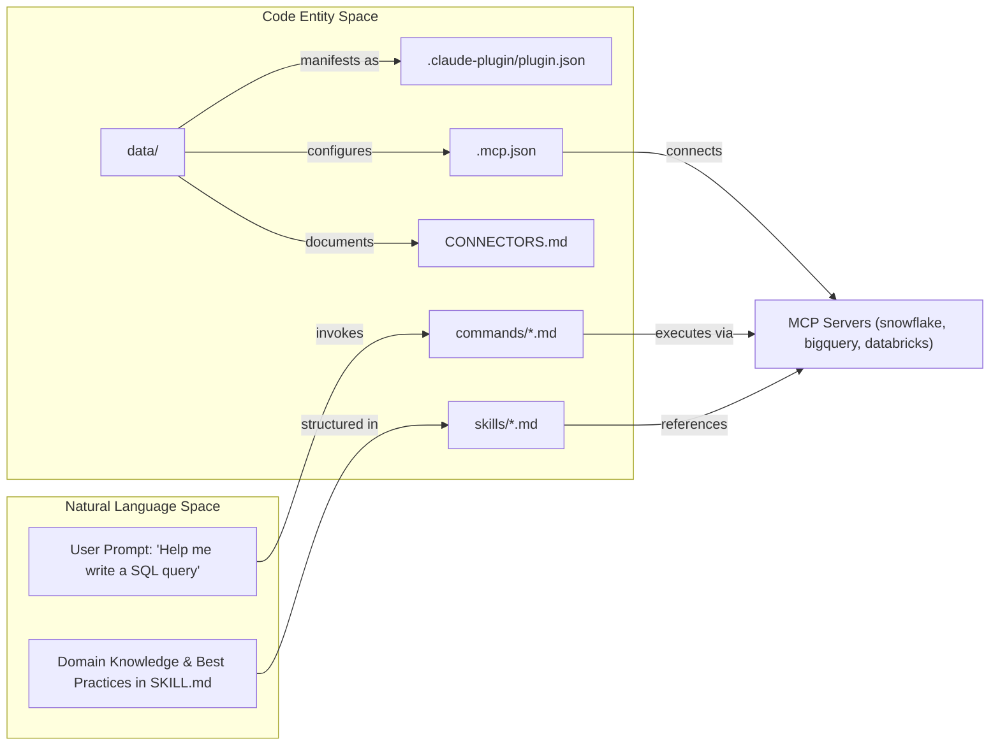

<!-- source: DeepWiki mcp.deepwiki.com · repo anthropics/knowledge-work-plugins · page 1 Introduction · fetched 2026-10-26 -->

# Introduction

<details>
<summary>Relevant source files</summary>

The following files were used as context for generating this wiki page:

- [.claude-plugin/marketplace.json](.claude-plugin/marketplace.json)
- [README.md](README.md)
- [data/.mcp.json](data/.mcp.json)
- [data/CONNECTORS.md](data/CONNECTORS.md)
- [pdf-viewer/.claude-plugin/plugin.json](pdf-viewer/.claude-plugin/plugin.json)

</details>


This document provides a comprehensive reference for the `knowledge-work-plugins` repository, an open-sourcing collection of specialized plugins that extend Claude's capabilities for professional knowledge work [README.md:1-13](). The repository is designed for users of **Claude Cowork** and **Claude Code** who want to customize AI assistance for specific job functions, tools, and workflows [README.md:3-9]().

**Scope**: This introduction covers the repository's purpose, architecture overview, and marketplace structure. For detailed explanations of plugin concepts, architecture, and components, see [What are Knowledge Work Plugins?](#1.1). For plugin descriptions, domains, and selection guidance across the marketplace, see [Plugin Marketplace](#1.2). For installation procedures using the CLI and initial setup steps, see [Installation and Getting Started](#1.3).

## Purpose and Audience

The `knowledge-work-plugins` repository enables organizations to configure Claude with specialized knowledge, tool integrations, and workflows for specific roles [README.md:6-9](). Each plugin packages domain expertise (skills), explicit actions (commands), and external tool connections (MCP servers) into a file-based bundle that requires no code or infrastructure [README.md:63-65]().

**Target Users**:
- **End users** in specific roles (sales, finance, legal, data analysis, bio-research, etc.) who want Claude to understand their domain [README.md:15-27]().
- **Team administrators** who want to customize plugins with company-specific terminology, processes, and tool stacks [README.md:9-10]().
- **Plugin developers** who want to create new plugins or extend existing ones using tools like `cowork-plugin-management` [.claude-plugin/marketplace.json:34-38]().

**Sources**: [README.md:1-10](), [.claude-plugin/marketplace.json:34-38]()

## Repository Structure

The repository is organized as a plugin marketplace owned by Anthropic, defining a catalog of first-party and partner-built plugins [.claude-plugin/marketplace.json:1-141](). For a comprehensive view of marketplace domains, see [Plugin Marketplace](#1.2).

Diagram: Marketplace Directory Mapping to Code Entities
```mermaid
graph TB
    Root["knowledge-work-plugins/"]
    Root --> Marketplace[".claude-plugin/marketplace.json"]
    Root --> P1["productivity/"]
    Root --> P2["enterprise-search/"]
    Root --> P3["cowork-plugin-management/"]
    Root --> P4["sales/"]
    Root --> P5["finance/"]
    Root --> P6["data/"]
    Root --> P7["legal/"]
    Root --> P8["marketing/"]
    Root --> P9["customer-support/"]
    Root --> P10["product-management/"]
    Root --> P11["bio-research/"]
    Root --> Partner["partner-built/"]
    
    Partner --> S1["slack/"]
    Partner --> S2["apollo/"]
    Partner --> S3["common-room/"]
    
    Marketplace --> Owner["owner: { name: \"Anthropic\" }"]
    Marketplace --> Plugins["plugins: [ ... ]"]
    
    subgraph "Code Entity Space"
        P1
        P2
        P3
        P4
        P5
        P6
        P7
        P8
        P9
        P10
        P11
        S1
        S2
        S3
    end
```
Sources: [.claude-plugin/marketplace.json:1-141](), [README.md:15-27]()

### Plugin Categories

The marketplace spans several operational, technical, and business domains:

| Category | Plugins | Purpose |
|----------|---------|---------|
| **Operations** | `productivity`, `enterprise-search`, `cowork-plugin-management`, `operations` | Task management, cross-tool search, plugin lifecycle, and process documentation [README.md:17, 25, 27](), [.claude-plugin/marketplace.json:133-137](). |
| **GTM & Business** | `sales`, `marketing`, `customer-support`, `common-room`, `apollo`, `small-business` | Prospecting, campaign planning, ticket triage, and SMB workflows [README.md:18, 19, 21](), [.claude-plugin/marketplace.json:97-113, 139-143](). |
| **Technical** | `data`, `engineering`, `product-management`, `design` | SQL generation, architecture decisions, roadmap planning, and UX writing [README.md:20, 24](), [.claude-plugin/marketplace.json:115-119, 127-131](). |
| **Specialized** | `legal`, `finance`, `bio-research`, `human-resources` | Contract review, month-end close, preclinical research, and people ops [README.md:22, 23, 26](), [.claude-plugin/marketplace.json:121-125](). |

For detailed breakdowns of specific plugins within these domains, see [Plugin Marketplace](#1.2).

**Sources**: [README.md:15-27](), [.claude-plugin/marketplace.json:6-141]()

## How Plugins Extend Claude

Plugins integrate with Claude through two primary execution surfaces: **Claude Cowork** and **Claude Code** [README.md:3](). For deep architectural details, see [What are Knowledge Work Plugins?](#1.1).

Diagram: Natural Language to Code Entity Space Mapping

Sources: [README.md:49-65](), [data/.mcp.json:1-36](), [data/CONNECTORS.md:1-18]()

### Key Architectural Principles

| Principle | Description | Benefit |
|-----------|-------------|---------|
| **File-Based** | No code or infrastructure—only Markdown and JSON [README.md:65](). | Easy to edit, review, and version control. |
| **Tool-Agnostic** | Skills use `~~category` placeholders (e.g., `~~data warehouse`) [data/CONNECTORS.md:5](). | Swap tools (e.g., Snowflake to BigQuery) without rewriting logic. |
| **MCP Integration** | Connects to external tools via Model Context Protocol servers [README.md:63](). | Unified interface to data warehouses, CRMs, and APIs. |

For a comprehensive explanation of components, connectors, and MCP integration, see [What are Knowledge Work Plugins?](#1.1).

**Sources**: [README.md:61-65](), [data/CONNECTORS.md:1-17]()

## Installation Methods

Plugins can be installed via Cowork web interfaces or using the `claude` CLI for Claude Code [README.md:31-45]().

```bash
# Add the marketplace repository to Claude Code
claude plugin marketplace add anthropics/knowledge-work-plugins

# Install a specific plugin (e.g., sales)
claude plugin install sales@knowledge-work-plugins
```

For step-by-step instructions, initial configuration steps, and environment verification, see [Installation and Getting Started](#1.3).

**Sources**: [README.md:31-47]()

## Customization Philosophy

Plugins are designed as generic starting points that can be customized to fit your organization's exact workflows and tool stack [README.md:67-69]().

1. **Swap Connectors**: Edit `.mcp.json` to point to your specific instances of tools like HubSpot, Snowflake, or Jira [README.md:71]().
2. **Add Context**: Insert company-specific terminology, team structures, and guidelines into skill markdown files [README.md:72]().
3. **Adjust Workflows**: Modify instruction prompts to match internal team processes rather than generic defaults [README.md:73]().

**Sources**: [README.md:67-74]()

## Next Steps

- **Understand plugin concepts and architecture**: See [What are Knowledge Work Plugins?](#1.1)
- **Browse available plugins and domains**: See [Plugin Marketplace](#1.2)
- **Install and configure plugins**: See [Installation and Getting Started](#1.3)

---
**Sources**: [.claude-plugin/marketplace.json:1-141](), [README.md:1-80](), [data/README.md:1-120](), [data/CONNECTORS.md:1-18](), [data/.mcp.json:1-36]()

---

