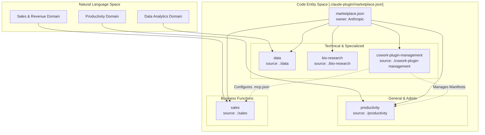
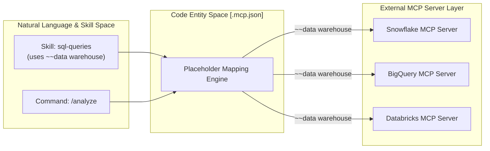

<!-- source: DeepWiki mcp.deepwiki.com · repo anthropics/knowledge-work-plugins · page 1.2 Plugin Marketplace · fetched 2026-10-26 -->

# Plugin Marketplace

Relevant source files

The following files were used as context for generating this wiki page:

- [.claude-plugin/marketplace.json](.claude-plugin/marketplace.json)
- [pdf-viewer/.claude-plugin/plugin.json](pdf-viewer/.claude-plugin/plugin.json)

This page provides a comprehensive overview of the knowledge work plugins available in the marketplace, their target domains, intended users, and how they relate to each other. For information about installing plugins, see **1.3 Installation and Getting Started**. For architectural details about how plugins work, see **2. Plugin System Architecture**.

## Overview

The knowledge work plugins marketplace is defined in [.claude-plugin/marketplace.json:1-141]() and contains a collection of open-source plugins owned by Anthropic, alongside featured partner-built plugins. These plugins extend Claude's capabilities across diverse professional domains, from general productivity to specialized fields like life sciences research and legal compliance. Each plugin integrates with external tools via MCP (Model Context Protocol) servers and provides domain-specific skills and commands [README.md:61-63]().

The marketplace follows a hub-and-spoke architecture where plugins are categorized into:
- **Core Role-Based Plugins**: Built by Anthropic for standard business functions (Sales, Finance, Legal, etc.) [README.md:15-27]().
- **Partner-Built Plugins**: Specialized integrations from providers like Salesforce (Slack), Apollo.io, Tribe AI, Common Room, Zoom, and Noibu [.claude-plugin/marketplace.json:8-20](), [.claude-plugin/marketplace.json:88-113](), [.claude-plugin/marketplace.json:145-156]().
- **Technical & Utility Plugins**: Tools for data analysis, engineering, and plugin management [.claude-plugin/marketplace.json:34-38](), [.claude-plugin/marketplace.json:52-56](), [.claude-plugin/marketplace.json:115-119]().

Sources: [.claude-plugin/marketplace.json:1-141](), [README.md:1-29]()

---

## Marketplace Structure

The marketplace is defined as a JSON configuration containing:
- **name**: `"knowledge-work-plugins"` [.claude-plugin/marketplace.json:2]()
- **owner**: `{"name": "Anthropic"}` [.claude-plugin/marketplace.json:3-5]()
- **plugins**: An array of plugin definitions including both local source paths and external repository URLs [.claude-plugin/marketplace.json:6-141]().

Each plugin entry specifies:
- `name`: Plugin identifier used in CLI commands (e.g., `sales`) [.claude-plugin/marketplace.json:40]().
- `source`: Relative path to plugin directory (e.g., `"./productivity"`) or a URL object for external plugins [.claude-plugin/marketplace.json:24](), [.claude-plugin/marketplace.json:12-18]().
- `description`: Technical summary of capabilities and use cases [.claude-plugin/marketplace.json:10]().
- `author`: (Optional) The entity responsible for the plugin (e.g., "Salesforce", "Apollo.io", "Tribe AI") [.claude-plugin/marketplace.json:92-94](), [.claude-plugin/marketplace.json:101-103]().

Sources: [.claude-plugin/marketplace.json:1-141]()

---

## Plugin Categories and Relationships

### Marketplace Architecture: Natural Language to Code Entity Mapping

The following diagram maps high-level business domains (Natural Language Space) to the specific plugin identifiers, JSON properties, and source directory entities defined in the codebase (Code Entity Space).

Sources: [.claude-plugin/marketplace.json:1-141](), [README.md:15-27]()

### Data Flow and Connector Mapping

Plugins use a category placeholder system to remain tool-agnostic. The `.mcp.json` file in each plugin directory maps these abstract categories to concrete MCP servers.

Sources: [data/README.md:107-120](), [README.md:63]()

---

## Complete Plugin Catalog

| Plugin Name | Primary Domain | Key Connectors | Target Users |
|------------|----------------|----------------|--------------|
| `productivity` | Task/Context Mgmt | Slack, Notion, Jira, M365 | All knowledge workers |
| `sales` | Prospecting/Strategy | HubSpot, Close, ZoomInfo | Sales & Account Teams |
| `finance` | Accounting/Audit | Snowflake, BigQuery, M365 | Finance & Controllers |
| `data` | SQL/Visualization | Snowflake, Databricks, Hex | Data Analysts |
| `legal` | Contract/Compliance | Box, Egnyte, Jira | Legal & Compliance |
| `marketing` | Content/Campaigns | Canva, HubSpot, Ahrefs | Marketing & Creative |
| `customer-support` | Triage/Knowledge | Intercom, Guru, Zendesk | Support & Success |
| `product-management` | Specs/Roadmaps | Linear, Figma, Amplitude | Product Managers |
| `bio-research` | Life Sciences R&D | PubMed, ChEMBL, Benchling | Researchers/Scientists |
| `engineering` | SDLC/Incidents | GitHub, Jira, PagerDuty | Software Engineers |
| `human-resources` | People Ops | Workday, Greenhouse | HR & Recruiting |
| `operations` | Process/Vendors | Vendor tools, Change Mgmt | Operations Managers |
| `small-business` | SMB Suite | QuickBooks, PayPal, Canva | Small Business Owners |
| `zoom` | Communication | Zoom REST APIs, Meeting SDK | All Zoom Users |
| `noibu` | Ecommerce | Noibu session/error data | Ecommerce & Marketing |

Sources: [README.md:15-27](), [.claude-plugin/marketplace.json:1-141]()

---

## Detailed Domain Descriptions

### Cross-Functional & Management

#### productivity
**Location:** [.claude-plugin/marketplace.json:22-26]()  
Focuses on personal and team efficiency. It syncs with calendars and task trackers to help users plan their day and build a persistent "memory" of work context [README.md:17]().

#### cowork-plugin-management
**Location:** [.claude-plugin/marketplace.json:34-38]()  
A meta-plugin for developers and admins. It provides tools to create new plugins from templates, configure MCP servers, and adapt existing skills to company-specific terminology [README.md:27]().

### Specialized Business Functions

#### data
**Location:** [.claude-plugin/marketplace.json:52-56]()  
Transforms Claude into a data analyst collaborator. It supports SQL generation across multiple dialects (Snowflake, BigQuery), data profiling via `/explore-data`, and visualization using Python or HTML/JS dashboards via `/create-viz` [data/README.md:30-37]().

#### bio-research
**Location:** [.claude-plugin/marketplace.json:82-86]()  
The most technically complex plugin in the repository. It accelerates early-stage R&D by connecting to life science databases (literature search, genomics, target prioritization) [README.md:26]().

#### small-business
**Location:** [.claude-plugin/marketplace.json:139-143]()  
A comprehensive suite for SMB owners covering payroll planning, month-end close, and growth campaigns. It integrates with QuickBooks, PayPal, and HubSpot, ensuring user approval for every step involving money or customers [.claude-plugin/marketplace.json:142]().

### Partner-Built Integrations

#### slack-by-salesforce
**Location:** [.claude-plugin/marketplace.json:88-95]()  
Official integration for searching messages, managing Slack Canvases, and sending communications directly from Claude.

#### apollo
**Location:** [.claude-plugin/marketplace.json:97-104]()  
Provides one-click MCP integration for lead enrichment and loading outreach sequences directly into Apollo.io.

#### common-room
**Location:** [.claude-plugin/marketplace.json:106-113]()  
Turns Common Room into a GTM copilot for account research, call prep with attendee profiles, and personalized outreach across email and LinkedIn [.claude-plugin/marketplace.json:109]().

#### noibu
**Location:** [.claude-plugin/marketplace.json:8-20]()  
Bridges the gap between customer experience and revenue by connecting Claude to store session, error, and conversion data. It allows users to surface revenue-impacting issues and take action across marketing and commerce platforms [.claude-plugin/marketplace.json:10]().

Sources: [.claude-plugin/marketplace.json:1-141](), [data/README.md:1-120](), [README.md:1-80]()

---

