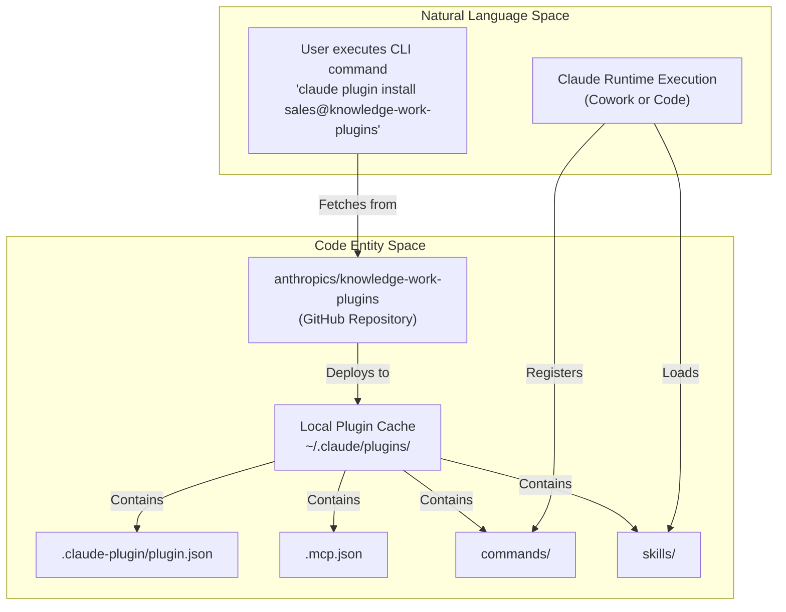
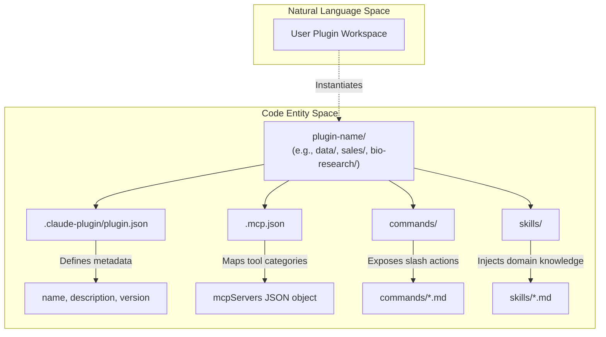

<!-- source: DeepWiki mcp.deepwiki.com · repo anthropics/knowledge-work-plugins · page 1.3 Installation and Getting Started · fetched 2026-10-26 -->

# Installation and Getting Started

<details>
<summary>Relevant source files</summary>

The following files were used as context for generating this wiki page:

- [README.md](README.md)
- [data/.mcp.json](data/.mcp.json)
- [data/CONNECTORS.md](data/CONNECTORS.md)

</details>


This page guides users through installing knowledge work plugins using the `claude` CLI, verifying the installation, understanding the runtime environment, and performing initial setup steps. For an architectural overview of plugins, refer to **2. Plugin System Architecture**. For instructions on customizing installed plugins, see **2.5. Customizing Plugins**.

Sources: [README.md:1-48]()

---

## Prerequisites

Before installing plugins from the marketplace, ensure your environment meets the following requirements:

| Requirement | Description | Reference / Source |
|------------|-------------|--------------------|
| **Claude CLI** | The `claude` command-line tool must be installed, updated, and authenticated in your terminal environment. | [README.md:37-45]() |
| **Claude Account** | An active Claude account with access to Claude Cowork or Claude Code environments. | [README.md:3-3]() |
| **Network Access** | Outbound HTTPS access to fetch plugin definitions and manifests from the `anthropics/knowledge-work-plugins` repository. | [README.md:31-45]() |

Sources: [README.md:3-45]()

---

## Installation Methods

### Adding the Marketplace

To access the official collection of specialist plugins, add the Anthropic knowledge-work-plugins marketplace to your local Claude CLI registry:

```bash
# Add the marketplace registry
claude plugin marketplace add anthropics/knowledge-work-plugins
```

### Installing Specific Plugins

Once the marketplace registry is registered, install individual functional plugins using the `@` marketplace specifier syntax:

```bash
# Install the sales domain plugin
claude plugin install sales@knowledge-work-plugins

# Install the data analysis plugin
claude plugin install data@knowledge-work-plugins

# Install the productivity plugin
claude plugin install productivity@knowledge-work-plugins
```

Sources: [README.md:37-45]()

---

## Installation Flow: Natural Language to Code Entity Space

The following diagram bridges the user-facing command-line interface (Natural Language Space) to the concrete file entities and directory structures created in the local runtime environment (Code Entity Space).



**Diagram: Installation Workflow and Code Mapping**

Sources: [README.md:37-64]()

---

## Post-Installation Structure

Once installed, every plugin follows a standardized, file-based directory layout consisting exclusively of JSON and markdown files without build steps or compiled binaries [README.md:49-65]().



**Diagram: Plugin File Structure Code Mapping**

Every plugin contains four core structural components:
1. **Manifest (`.claude-plugin/plugin.json`)**: Defines plugin metadata, version, and capabilities.
2. **MCP Configuration (`.mcp.json`)**: Configures external tool connections via Model Context Protocol servers [README.md:55-56]().
3. **Commands (`commands/`)**: Contains explicit user-invoked slash commands (e.g., `/data:write-query`) [README.md:57]().
4. **Skills (`skills/`)**: Contains domain knowledge files that Claude draws on automatically when relevant [README.md:58]() [README.md:61]().

Sources: [README.md:49-65]()

---

## Verifying Installation

### Check Installed Plugins

To verify that plugins are correctly registered in your local environment, execute the listing command:

```bash
# List all active plugins registered in the local CLI
claude plugin list
```

### Test Plugin Activation

Open Claude (Cowork or Code) and verify functionality across two vectors:
1. **Skills Activation**: Mention a domain topic (e.g., writing a SQL query or reviewing a sales pipeline). Claude will automatically reference the relevant skill files in `skills/` [README.md:47]().
2. **Slash Commands**: Type `/` in the prompt interface. You should see registered namespace commands corresponding to the installed plugins (e.g., `/sales:call-prep`, `/data:write-query`) [README.md:47]().

Sources: [README.md:37-48]()

---

## MCP Server Configuration and Tool Abstraction

### Connector Placeholder Architecture

Plugins remain tool-agnostic by utilizing a placeholder category system. Plugin documentation and skill instructions reference connectors using `~~category` notation (e.g., `~~data warehouse`), which maps dynamically to whatever tool backend the user configures [data/CONNECTORS.md:3-7]().

| Connector Category | Placeholder Syntax | Default Configured Servers | Alternative Options |
|--------------------|-------------------|----------------------------|---------------------|
| **Data Warehouse** | `~~data warehouse` | Snowflake, BigQuery, Databricks, Definite [data/CONNECTORS.md:13]() | Redshift, PostgreSQL, MySQL [data/CONNECTORS.md:13]() |
| **Notebook** | `~~notebook` | Hex [data/CONNECTORS.md:14]() | Jupyter, Deepnote, Observable [data/CONNECTORS.md:14]() |
| **Product Analytics** | `~~product analytics` | Amplitude [data/CONNECTORS.md:15]() | Mixpanel, Heap [data/CONNECTORS.md:15]() |
| **Project Tracker** | `~~project tracker` | Atlassian (Jira/Confluence) [data/CONNECTORS.md:16]() | Linear, Asana [data/CONNECTORS.md:16]() |

The `.mcp.json` configuration file binds these placeholder categories to concrete HTTP or stdio endpoints. For example, the `data` plugin configures multiple warehouse and analytics servers [data/.mcp.json:1-36]():

```json
{
  "mcpServers": {
    "snowflake": {
      "type": "http",
      "url": ""
    },
    "bigquery": {
      "type": "http",
      "url": "https://bigquery.googleapis.com/mcp"
    }
  }
}
```
*(Excerpt from `data/.mcp.json:1-14`)*

Sources: [data/CONNECTORS.md:1-18](), [data/.mcp.json:1-36]()

---

## Initial Usage Patterns and Customization

### Example: Getting Started with the Data Plugin

1. **Install Plugin**: Run `claude plugin install data@knowledge-work-plugins`.
2. **Explore Data**: Invoke `/data:explore-data` to profile schema attributes.
3. **Generate Queries**: Invoke `/data:write-query` to translate natural language data requests into SQL via connected warehouse MCP servers.

### Customizing Installed Plugins

To tailor installed plugins to your organization's environment:
* **Swap Connectors**: Edit `.mcp.json` to point `mcpServers` URLs to your internal infrastructure [README.md:71]().
* **Add Company Context**: Modify markdown files inside `skills/` to inject internal terminology, business logic, and standard operating procedures [README.md:72]().
* **Adjust Workflows**: Update command definitions in `commands/` to match team-specific review cycles or output formats [README.md:73]().

Sources: [README.md:69-74](), [data/.mcp.json:1-36]()

---

