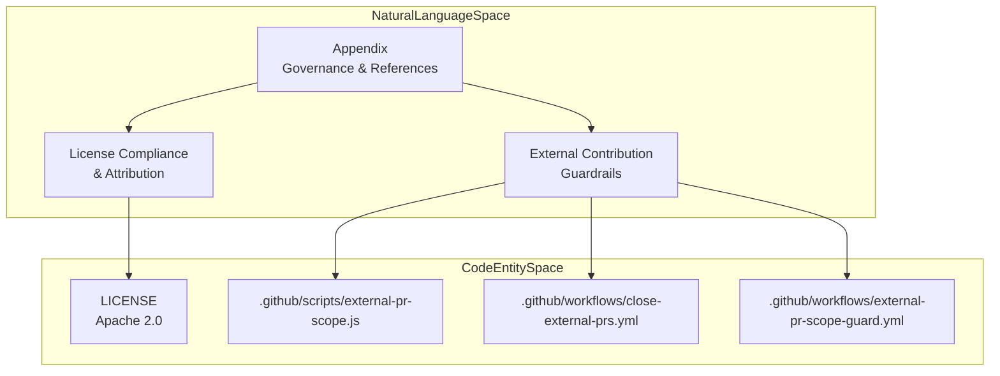
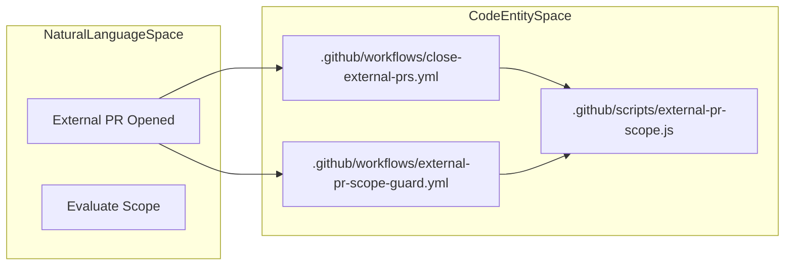

<!-- source: DeepWiki mcp.deepwiki.com · repo anthropics/knowledge-work-plugins · page 10 Appendix · fetched 2026-10-26 -->

# Appendix

Relevant source files

The following files were used as context for generating this wiki page:

- [.github/scripts/external-pr-scope.js](.github/scripts/external-pr-scope.js)
- [.github/workflows/close-external-prs.yml](.github/workflows/close-external-prs.yml)
- [.github/workflows/external-pr-scope-guard.yml](.github/workflows/external-pr-scope-guard.yml)
- [LICENSE](LICENSE)

## Purpose and Scope

This appendix serves as a high-level reference for governance, licensing, and repository automation policies that govern the `knowledge-work-plugins` repository outside of the core plugin policy pipeline. It provides a roadmap to auxiliary documentation and workflows covering open-source licensing and external contribution guardrails.

As a parent page, this section summarizes foundational governance topics and directs readers to detailed child pages for deep technical dives.

**Appendix Architecture**: Maps high-level governance domains to their underlying repository code entities and automation scripts.

**Sources**: `[LICENSE:1-126]()`, `[.github/scripts/external-pr-scope.js:1-144]()`, `[.github/workflows/close-external-prs.yml:1-63]()`, `[.github/workflows/external-pr-scope-guard.yml:1-54]()`

---

## License Information

The repository and its included plugins are governed under standardized open-source licensing terms centered around the Apache License 2.0. This ensures broad compatibility for commercial use, modification, and redistribution while preserving copyright and attribution notices across all derivative works.

For comprehensive details on terms, conditions, copyright grants, patent grants, and per-plugin licensing nuances, see [License Information](#10.1).

**Sources**: `[LICENSE:1-126]()`

---

## External Contribution Handling

To maintain repository integrity while allowing community participation, the repository implements automated guardrails for external pull requests. Non-member contributions are evaluated against strict scope rules to ensure they only add authorized marketplace entries without modifying existing core components or injecting untrusted execution paths.

**External PR Workflow Mapping**: Illustrates how incoming pull requests interact with automation scripts to enforce contribution boundaries.

For detailed documentation on the `close-external-prs` workflow, the `external-pr-scope-guard` advisory check, and the `external-pr-scope.js` evaluation engine, see [External Contribution Handling](#10.2).

**Sources**: `[.github/workflows/close-external-prs.yml:1-63]()`, `[.github/scripts/external-pr-scope.js:1-144]()`, `[.github/workflows/external-pr-scope-guard.yml:1-54]()`

---

