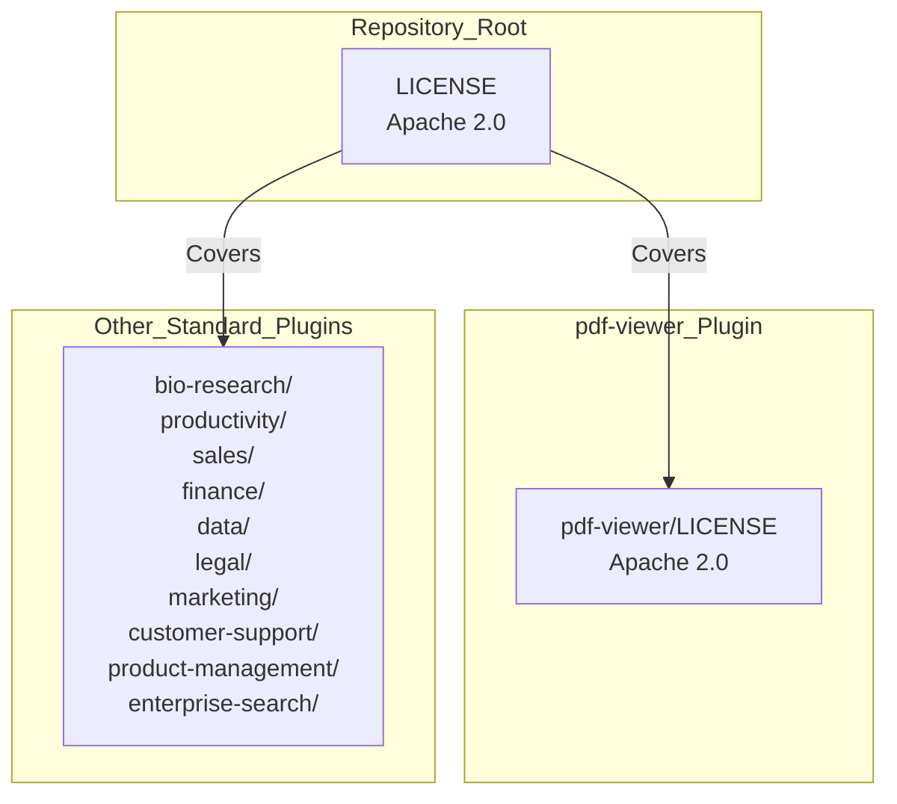
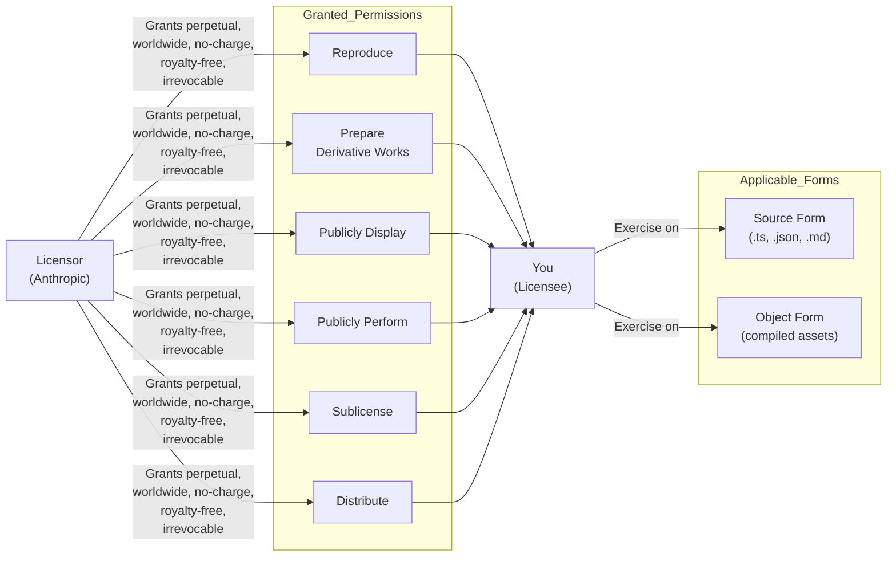
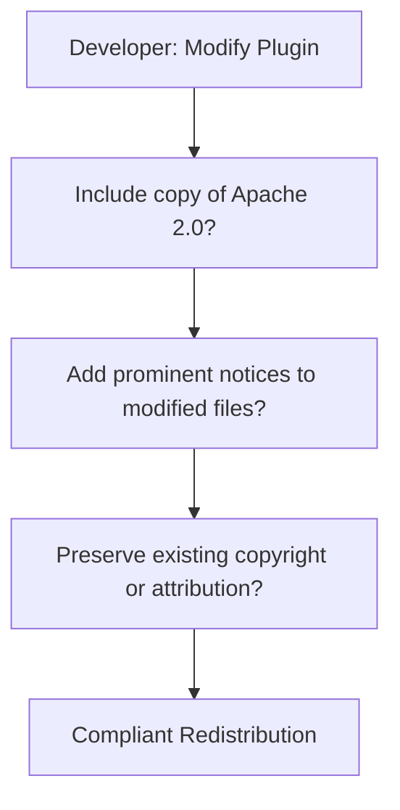

<!-- source: DeepWiki mcp.deepwiki.com · repo anthropics/knowledge-work-plugins · page 10.1 License Information · fetched 2026-10-26 -->

# License Information

Relevant source files

The following files were used as context for generating this wiki page:

- [LICENSE](LICENSE)
- [pdf-viewer/LICENSE](pdf-viewer/LICENSE)

This page documents the licensing structure for the `knowledge-work-plugins` repository. All components in the repository are released under the Apache License, Version 2.0. This page explains the license structure, key terms, permissions granted, and redistribution requirements.

---

## Overview

The `knowledge-work-plugins` repository and all its components are distributed under the Apache License, Version 2.0. The license governs the entire repository at the root level and is duplicated in specific subdirectories to ensure clear licensing for individual plugins and skills.

**License Structure Summary:**

| License File Location | Scope | Format |
|----------------------|-------|--------|
| `LICENSE` | Entire repository | Standard Apache 2.0 |
| `pdf-viewer/LICENSE` | PDF Viewer plugin | Standard Apache 2.0 |

Sources: [LICENSE:1-126](), [pdf-viewer/LICENSE:1-126]()

---

## License File Distribution Architecture

The following diagram maps the relationship between the root license and specific plugin licenses within the codebase.

**Diagram: License Coverage and Distribution**

**License Hierarchy**: The root `LICENSE` file [LICENSE:1-126]() provides blanket coverage for the entire repository. Individual plugins (like `pdf-viewer`) include duplicate `LICENSE` files [pdf-viewer/LICENSE:1-126]() to ensure clear licensing when components are extracted or redistributed independently. All licenses are byte-for-byte identical Apache License 2.0 texts.

Sources: [LICENSE:1-126](), [pdf-viewer/LICENSE:1-126]()

---

## Apache License 2.0 Key Terms

The Apache License 2.0 defines several critical terms that govern the use, modification, and distribution of the repository contents.

### Core Definitions

| Term | Definition Location | Summary |
|------|-------------------|---------|
| "License" | [LICENSE:10-11]() | The terms and conditions for use, reproduction, and distribution. |
| "Licensor" | [LICENSE:13-14]() | The copyright owner or entity authorized to grant the License. |
| "Legal Entity" | [LICENSE:16-22]() | The union of the acting entity and all entities that control it. |
| "Source" Form | [LICENSE:27-29]() | Preferred form for making modifications (code, docs, config). |
| "Object" Form | [LICENSE:31-34]() | Any form resulting from mechanical transformation (compiled code). |
| "Work" | [LICENSE:36-39]() | The work of authorship made available under the License. |
| "Derivative Works" | [LICENSE:41-47]() | Any work derived from the Work (editorial revisions, etc.). |
| "Contribution" | [LICENSE:49-61]() | Work intentionally submitted to Licensor for inclusion. |
| "Contributor" | [LICENSE:63-65]() | Licensor and any entity whose Contribution is incorporated. |

Sources: [LICENSE:8-65]()

---

## Permissions Granted

The Apache License 2.0 grants two primary types of licenses: copyright license and patent license.

### Copyright License Terms

**Diagram: Copyright Permissions Flow**

**Copyright Grant**: Section 2 of the license grants comprehensive copyright permissions. These permissions are perpetual (never expire), worldwide (no geographic restrictions), non-exclusive, no-charge (no licensing fees), royalty-free (no ongoing payments), and irrevocable [LICENSE:67-72]().

Sources: [LICENSE:67-72]()

### Patent License Terms

The patent license grant covers patent claims that contributors necessarily infringe through their contributions. Key characteristics:

- **Scope**: Applies only to patent claims licensable by contributors that are necessarily infringed by their Contribution(s) alone or by combination with the Work [LICENSE:74-82]().
- **Termination Condition**: Patent license terminates if the licensee institutes patent litigation against any entity (including cross-claims) alleging that the Work or a Contribution constitutes direct or contributory patent infringement [LICENSE:83-88]().

Sources: [LICENSE:74-88]()

---

## Redistribution Requirements

Section 4 establishes four mandatory conditions for redistributing the Work or Derivative Works.

### Redistribution Conditions Table

| Condition | Requirement | Implementation |
|-----------|-------------|----------------|
| **(a)** License Copy | Provide recipients with a copy of the License. | [LICENSE:95-96]() |
| **(b)** Modification Notices | Cause modified files to carry prominent notices of changes. | [LICENSE:98-99]() |
| **(c)** Attribution Retention | Retain all copyright, patent, trademark, and attribution notices. | [LICENSE:101-105]() |
| **(d)** NOTICE File | Include attribution notices from a NOTICE file if one exists. | [LICENSE:107-122]() |

**Additional Copyright Statements**: Redistributors may add their own copyright statements to modifications and provide different license terms and conditions for use, reproduction, or distribution of their modifications, or for any such Derivative Works as a whole, provided their use, reproduction, and distribution of the Work otherwise complies with the conditions stated in this License [LICENSE:124-126]().

Sources: [LICENSE:90-126]()

---

## Warranty Disclaimer and Liability Limitation

The Apache License 2.0 includes standard open-source disclaimers to protect contributors.

### Warranty Disclaimer (Section 7)

The Work is provided on an "AS IS" BASIS, WITHOUT WARRANTIES OR CONDITIONS OF ANY KIND, either express or implied, including warranties of TITLE, NON-INFRINGEMENT, MERCHANTABILITY, or FITNESS FOR A PARTICULAR PURPOSE [LICENSE:1-126]().

### Liability Limitation (Section 8)

In no event and under no legal theory shall any Contributor be liable for damages, including any direct, indirect, special, incidental, or consequential damages arising as a result of this License or out of the use or inability to use the Work (including loss of goodwill, work stoppage, computer failure, or any other commercial damages or losses) [LICENSE:1-126]().

Sources: [LICENSE:1-126]()

---

## Plugin-Specific License Implementations

### PDF Viewer Plugin License
The `pdf-viewer` plugin contains its own `LICENSE` file [pdf-viewer/LICENSE:1-126]() to facilitate standalone distribution of the PDF interaction tools. This file is a complete replica of the Apache License 2.0, ensuring that users downloading only the `pdf-viewer` directory have immediate access to the governing terms.

Sources: [pdf-viewer/LICENSE:1-126]()

---

## License Compliance Checklist for Developers

When creating derivative works or customized plugins, follow this flow to ensure compliance with Section 4.

**Diagram: Compliance Workflow**

1. **Include License**: Ensure the `LICENSE` file is present in the root of your distribution [LICENSE:95-96]().
2. **Mark Changes**: Add comments to the top of modified files indicating that they have been changed [LICENSE:98-99]().
3. **Retain Notices**: Do not remove existing copyright or attribution headers from source files [LICENSE:101-105]().

Sources: [LICENSE:90-122]()

---

