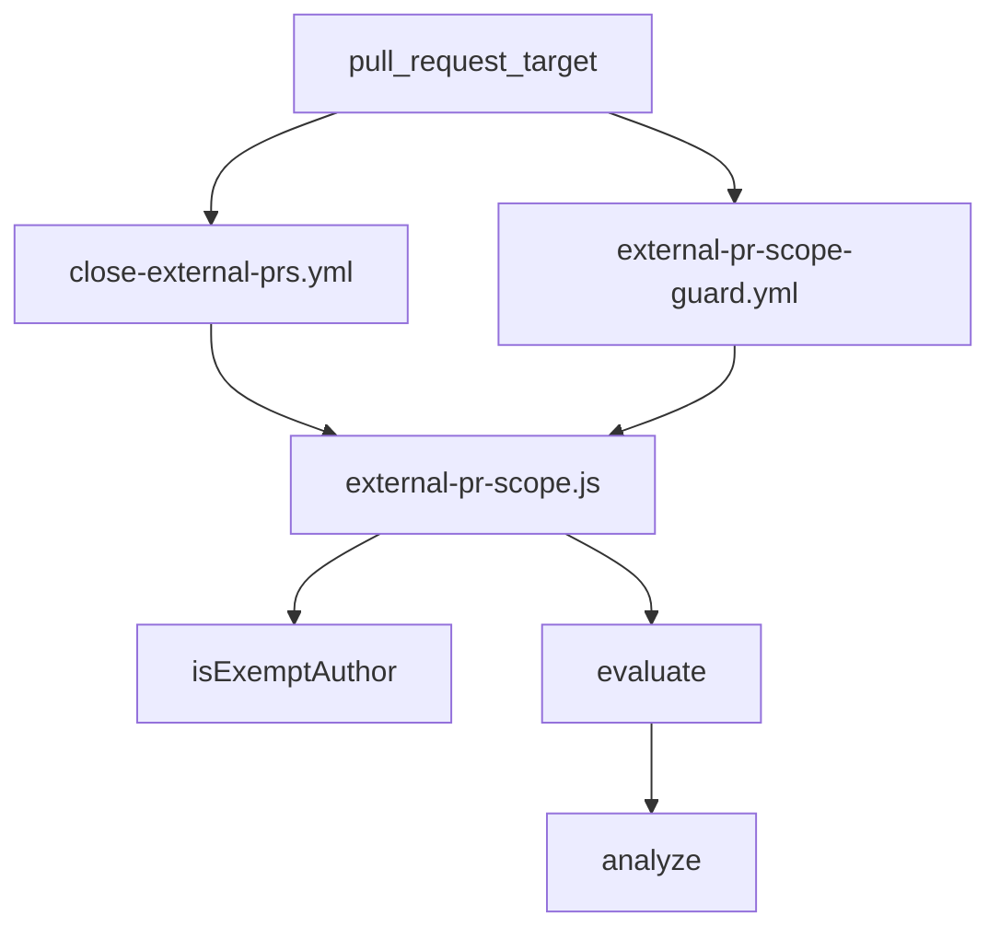
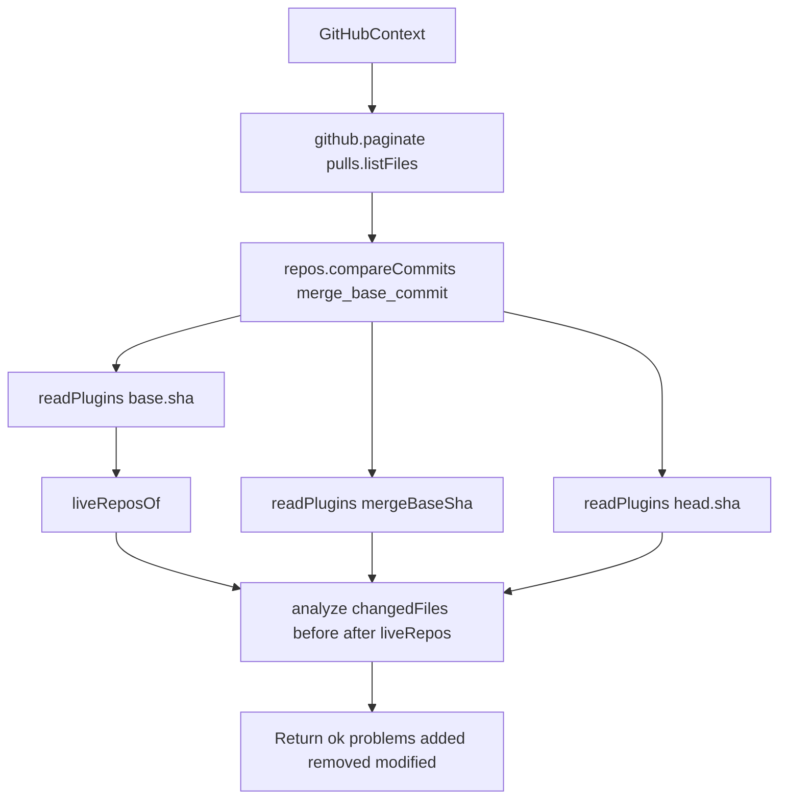

<!-- source: DeepWiki mcp.deepwiki.com · repo anthropics/knowledge-work-plugins · page 10.2 External Contribution Handling · fetched 2026-10-26 -->

# External Contribution Handling

Relevant source files

The following files were used as context for generating this wiki page:

- [.github/scripts/external-pr-scope.js](.github/scripts/external-pr-scope.js)
- [.github/workflows/close-external-prs.yml](.github/workflows/close-external-prs.yml)
- [.github/workflows/external-pr-scope-guard.yml](.github/workflows/external-pr-scope-guard.yml)

## Purpose and Scope
This page documents the automated governance mechanisms designed to handle pull requests from external (non-member) contributors in the repository. Specifically, it covers the `close-external-prs` workflow, the `external-pr-scope-guard` workflow, and the core JavaScript evaluation module `external-pr-scope.js`. These components restrict modifications by outside contributors to additions in `.claude-plugin/marketplace.json` referencing already-live plugin repositories, ensuring marketplace integrity while allowing authorized external plugin updates.

Sources: [.github/workflows/close-external-prs.yml:1-63](), [.github/workflows/external-pr-scope-guard.yml:1-54](), [.github/scripts/external-pr-scope.js:1-18]()

---

## Trust Model and Security Architecture
The external contribution handling pipeline operates under a strict trust and security model. Because pull requests originate from unverified external forks via the `pull_request_target` event trigger, the system must prevent arbitrary code execution from untrusted branches. 

To achieve this:
- Workflows check out only the trusted **base** repository code for validation scripts [.github/workflows/close-external-prs.yml:17-19](), [.github/workflows/external-pr-scope-guard.yml:31-31]().
- The `evaluate()` function fetches target marketplace metadata strictly as **data** via the GitHub API (`github.rest.repos.getContent`), parsing JSON payloads without ever checking out or executing untrusted head code [.github/scripts/external-pr-scope.js:16-17](), [.github/scripts/external-pr-scope.js:85-92]().
- Authorization relies on repository ownership derivation rather than a manually maintained static allowlist [.github/scripts/external-pr-scope.js:3-10]().

Sources: [.github/workflows/close-external-prs.yml:17-19](), [.github/workflows/external-pr-scope-guard.yml:31-31](), [.github/scripts/external-pr-scope.js:3-17](), [.github/scripts/external-pr-scope.js:85-92]()

---

## Automation Workflows
Two primary GitHub Actions workflows orchestrate the external contribution evaluation process upon pull request activity.

### Close External PRs (`close-external-prs.yml`)
Triggered on `pull_request_target` with the `opened` type [.github/workflows/close-external-prs.yml:3-5](), this workflow evaluates whether a non-member pull request should be automatically closed. If the author is neither an organization member nor an automated bot, and the PR falls out of scope, the job posts a comment directing the contributor to the official marketplace submission channel and closes the pull request [.github/workflows/close-external-prs.yml:30-63]().

### External PR Scope Guard (`external-pr-scope-guard.yml`)
Triggered on `pull_request_target` events (`opened`, `synchronize`, `reopened`) [.github/workflows/external-pr-scope-guard.yml:19-21](), this workflow acts as an advisory check (and status failure gate for non-compliant non-member PRs) [.github/workflows/external-pr-scope-guard.yml:3-15](). It runs `evaluate()` to ensure that non-member changes adhere strictly to marketplace additions [.github/workflows/external-pr-scope-guard.yml:45-53]().

Sources: [.github/workflows/close-external-prs.yml:1-63](), [.github/workflows/external-pr-scope-guard.yml:1-54]()

Title: "Workflow Interaction with Evaluation Script"

Sources: [.github/workflows/close-external-prs.yml:1-63](), [.github/workflows/external-pr-scope-guard.yml:1-54](), [.github/scripts/external-pr-scope.js:1-144]()

---

## Core Script Implementation (`external-pr-scope.js`)
The shared logic resides in `.github/scripts/external-pr-scope.js`, exporting helper utilities and decision functions [.github/scripts/external-pr-scope.js:1-144]().

### Key Functions and Data Structures
- **`normalizeRepo(u)`**: Standardizes repository URLs by trimming, lowercasing, and stripping git prefixes, `http://` protocols, and `.git` suffixes [.github/scripts/external-pr-scope.js:21-27]().
- **`liveReposOf(base)`**: Derives a `Set` of active repository identifiers (`host/org/repo`) from the base branch's `marketplace.json` entries [.github/scripts/external-pr-scope.js:35-45]().
- **`analyze({ changedFiles, before, after, liveRepos })`**: Performs a pure decision evaluation comparing pre- and post-states [.github/scripts/external-pr-scope.js:52-83](). It verifies that:
  - Only `.claude-plugin/marketplace.json` is modified [.github/scripts/external-pr-scope.js:55-56]().
  - No existing marketplace entries are removed or modified (`removed.length === 0`, `modified.length === 0`) [.github/scripts/external-pr-scope.js:66-67]().
  - Every added entry's `source.url` points to a repository present in `liveRepos` [.github/scripts/external-pr-scope.js:72-80]().
- **`readPlugins(github, owner, repo, ref)`**: Fetches and parses `.claude-plugin/marketplace.json` from a specified commit reference via the GitHub API [.github/scripts/external-pr-scope.js:85-92]().
- **`evaluate({ github, context })`**: Orchestrates file listing, merge-base comparison, and marketplace reading across base, merge-base, and head refs before delegating to `analyze()` [.github/scripts/external-pr-scope.js:95-122]().
- **`isExemptAuthor({ github, context })`**: Checks if the PR author is an exempt bot (e.g., `github-actions[bot]`) or holds `admin`/`write` collaborator permissions [.github/scripts/external-pr-scope.js:135-144]().

Sources: [.github/scripts/external-pr-scope.js:21-144]()

Title: "Evaluation Data Flow and Decision Logic"

Sources: [.github/scripts/external-pr-scope.js:95-122]()

---

