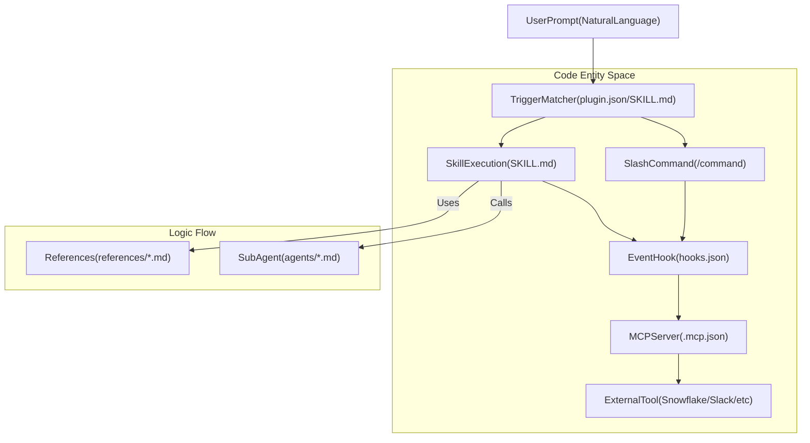
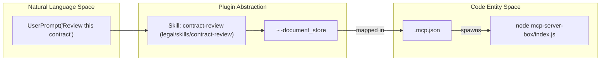

<!-- source: DeepWiki mcp.deepwiki.com · repo anthropics/knowledge-work-plugins · page 11 Glossary · fetched 2026-10-26 -->

# Glossary

Relevant source files

The following files were used as context for generating this wiki page:

- [.github/workflows/bump-plugin-shas.yml](.github/workflows/bump-plugin-shas.yml)
- [.github/workflows/scan-plugins.yml](.github/workflows/scan-plugins.yml)
- [README.md](README.md)
- [bio-research/.claude-plugin/plugin.json](bio-research/.claude-plugin/plugin.json)
- [bio-research/CONNECTORS.md](bio-research/CONNECTORS.md)
- [bio-research/README.md](bio-research/README.md)
- [data/.claude-plugin/plugin.json](data/.claude-plugin/plugin.json)
- [data/.mcp.json](data/.mcp.json)
- [data/CONNECTORS.md](data/CONNECTORS.md)
- [sales/.mcp.json](sales/.mcp.json)
- [sales/CONNECTORS.md](sales/CONNECTORS.md)

This glossary defines codebase-specific terms, architectural concepts, file manifests, and domain-specific jargon used across the Knowledge Work Plugins repository. It is designed to help onboarding engineers quickly master the intersection of the Model Context Protocol (MCP), the file-based plugin architecture, and various industry workflows (Bio-Research, Sales, Finance, Legal, Small Business, and CI/CD governance).

## Core System Terms

### MCP (Model Context Protocol)
The open standard protocol that enables Claude to securely connect to external data sources, enterprise tools, and APIs. In this repository, MCP servers act as the execution engines that allow plugins to interact with services like Snowflake, BigQuery, Slack, or specialized scientific databases like PubMed [README.md:63-64](), [data/.mcp.json:1-35]().

### Plugin
A self-contained, file-based directory structure that extends Claude's capabilities for a specific role or domain. A plugin bundles domain expertise (Skills), explicit actions (Commands), tool integrations (Connectors), and optional sub-agents [README.md:51-59](). Standard structure mandates a `.claude-plugin/plugin.json` manifest and an optional `.mcp.json` [cowork-plugin-management/skills/create-cowork-plugin/SKILL.md:30-45]().

### Skill
Encapsulated domain expertise, best practices, and multi-step workflows that Claude draws on **automatically** when relevant to a user's prompt. Skills are defined in markdown files (`SKILL.md`) with YAML frontmatter specifying trigger phrases and behavior [README.md:61-61](), [cowork-plugin-management/skills/create-cowork-plugin/SKILL.md:47-48]().

### Command
Explicit actions triggered directly by the user via slash commands (e.g., `/finance:reconciliation` or `/data:write-query`). While historically separated into standalone command files, commands are integrated tightly with skill definitions [README.md:62-62]().

### Connector
The abstraction layer wiring a plugin to external tools. Connectors ensure plugins remain tool-agnostic by utilizing category placeholders rather than hardcoding product names [README.md:63-64](), [sales/CONNECTORS.md:3-8]().

### Placeholder (`~~`)
A template syntax used across plugin files to represent a generic tool category (e.g., `~~CRM`, `~~literature`, or `~~project tracker`). During customization, these placeholders map to configured MCP servers [cowork-plugin-management/skills/create-cowork-plugin/SKILL.md:107-110](), [sales/CONNECTORS.md:5-7]().

### Waypoint
A structured verification or progression checkpoint within a complex multi-phase workflow. Waypoints help maintain execution state across long-running analytical or document-generation tasks.

### Agent / Sub-agent
Specialized, autonomous personas defined in `.md` files within a plugin's `agents/` directory. They possess restricted tool access, model overrides, and specialized system prompts to handle complex execution paths like ticket triage or code review [cowork-plugin-management/skills/create-cowork-plugin/references/component-schemas.md:58-71]().

### Hook
An event-driven interception mechanism (such as `PreToolUse`, `SessionStart`, or `Stop`) configured in `hooks/hooks.json` to execute automated validations or inject context dynamically [cowork-plugin-management/skills/create-cowork-plugin/references/component-schemas.md:142-160]().

Sources: [README.md:51-64](), [cowork-plugin-management/skills/create-cowork-plugin/SKILL.md:30-48](), [sales/CONNECTORS.md:3-8](), [data/.mcp.json:1-35]()

---

## File Manifests and Configurations

| File | Purpose and Role in Codebase |
| :--- | :--- |
| `plugin.json` | **Manifest**: Required entry point located under `.claude-plugin/plugin.json`. Declares metadata such as plugin name, version, and author [bio-research/.claude-plugin/plugin.json:1-8](), [data/.claude-plugin/plugin.json:1-8](). |
| `.mcp.json` | **Tool Configuration**: Defines the HTTP or local MCP servers assigned to the plugin, including endpoints and OAuth parameters [sales/.mcp.json:1-100](), [data/.mcp.json:1-35](). |
| `CONNECTORS.md` | **Mapping Documentation**: Maps tool-agnostic `~~category` placeholders to concrete MCP servers and alternative tools for that plugin [sales/CONNECTORS.md:1-25](), [bio-research/CONNECTORS.md:1-22](). |
| `SKILL.md` | **Instruction Set**: Core markdown document defining skill prompts, logic, instructions, and contextual schemas [cowork-plugin-management/skills/create-cowork-plugin/references/component-schemas.md:7-17](). |
| `TASKS.md` | **Project Tracker**: Convention file used within plugin development to track remaining implementation milestones. |
| `CLAUDE.md` | **Project Intelligence**: Contextual markdown file providing local repository guidelines and instructions for Claude. |

### System Diagram: Plugin Component Interaction
This diagram bridges natural language inputs to concrete code entities, illustrating how user prompts traverse skills, hooks, and MCP configurations.

Sources: [cowork-plugin-management/skills/create-cowork-plugin/SKILL.md:30-45](), [cowork-plugin-management/skills/create-cowork-plugin/references/component-schemas.md:144-160]()

---

## Domain-Specific Jargon

### Bio-Research
*   **ASM (Allotrope Simple Model)**: A standardized semantic data format for laboratory instrument outputs. The bio-research plugin includes a conversion skill transforming raw instrument files into ASM [bio-research/README.md:48-50]().
*   **scRNA-seq**: Single-cell RNA sequencing. A genomic technique to examine gene expression profiles of individual cells, supported via quality control and analysis skills [bio-research/README.md:36-38]().
*   **nf-core**: A community-curated collection of bioinformatics analysis pipelines built on the Nextflow workflow manager (e.g., `rnaseq`, `sarek`, `atacseq`) [bio-research/README.md:42-47]().

### Sales, Marketing & Product
*   **ICP (Ideal Customer Profile)**: A theoretical description of an account that yields the highest value from a product or service.
*   **ROAS (Return on Ad Spend)**: A marketing metric evaluating revenue generated per dollar spent on advertising campaigns.
*   **CAC (Customer Acquisition Cost)**: Total economic cost associated with acquiring a new customer.
*   **MQL / SQL**: Marketing Qualified Lead versus Sales Qualified Lead. MQLs indicate marketing engagement; SQLs are vetted prospects ready for sales rep outreach.

### Finance, Legal & Operations
*   **GAAP (Generally Accepted Accounting Principles)**: Standardized accounting framework governing financial reporting and compliance.
*   **SOX (Sarbanes-Oxley Act)**: U.S. federal regulatory compliance law. The finance plugin includes support for SOX testing and financial audits [README.md:23]().
*   **NDA (Non-Disclosure Agreement)**: Legally binding contract protecting confidential disclosures between parties.
*   **Redlining**: The collaborative editing process on legal contracts where modifications are tracked and negotiated [README.md:22]().
*   **ADR (Architecture Decision Record)**: A document capturing an architectural decision along with its context and consequences.
*   **RACI**: Responsibility assignment matrix defining roles (Responsible, Accountable, Consulted, Informed) in operational workflows.

### Small Business (SMB)
*   **smb-router**: A natural-language intent router that maps unstructured queries to specific small-business operational skills.
*   **business-pulse**: A macro-level analytical skill providing a consolidated one-page financial and operational snapshot of the business.
*   **smb-onboard**: A guided onboarding workflow capturing core business context and configuring initial tool connectors.

### Governance & CI/CD
*   **Verdict Cache**: A caching mechanism in `scan-plugins.yml` storing LLM policy evaluation verdicts for specific `(plugin, sha)` pairs to prevent redundant scans [.github/workflows/scan-plugins.yml:11-16]().
*   **WIF (Workload Identity Federation)**: Secure, keyless authentication mechanism used by GitHub Actions workflows to interact with Anthropic validation services [.github/workflows/scan-plugins.yml:35-35]().
*   **Bump/Plugin-SHAs**: Nightly automated workflow (`bump-plugin-shas.yml`) updating external marketplace plugin references to their latest upstream commit SHAs [.github/workflows/bump-plugin-shas.yml:1-8]().
*   **revert-failed-bumps**: An automated self-healing safety mechanism reacting to failed policy validation scans by pruning failing entries from pull requests [.github/workflows/scan-plugins.yml:18-21]().

### Implementation Diagram: Data Flow
This diagram maps natural language requests through plugin abstraction layers down to concrete MCP server processes and external execution environments.

Sources: [cowork-plugin-management/skills/create-cowork-plugin/SKILL.md:107-110](), [cowork-plugin-management/skills/create-cowork-plugin/references/component-schemas.md:236-245]()