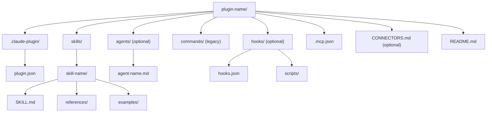
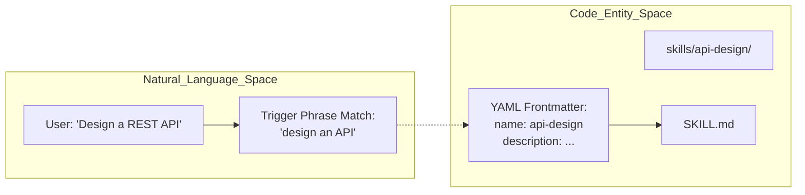
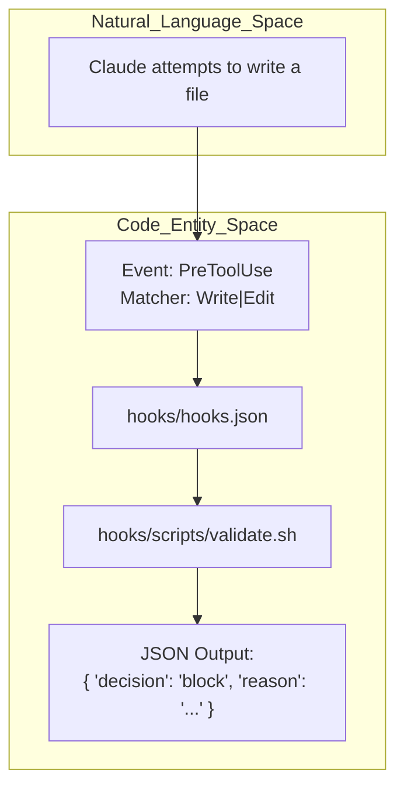

<!-- source: DeepWiki mcp.deepwiki.com · repo anthropics/knowledge-work-plugins · page 2.1 Plugin Structure and Components · fetched 2026-10-26 -->

# Plugin Structure and Components

<details>
<summary>Relevant source files</summary>

The following files were used as context for generating this wiki page:

- [cowork-plugin-management/.claude-plugin/plugin.json](cowork-plugin-management/.claude-plugin/plugin.json)
- [cowork-plugin-management/skills/cowork-plugin-customizer/SKILL.md](cowork-plugin-management/skills/cowork-plugin-customizer/SKILL.md)
- [cowork-plugin-management/skills/cowork-plugin-customizer/references/mcp-servers.md](cowork-plugin-management/skills/cowork-plugin-customizer/references/mcp-servers.md)
- [cowork-plugin-management/skills/create-cowork-plugin/SKILL.md](cowork-plugin-management/skills/create-cowork-plugin/SKILL.md)
- [cowork-plugin-management/skills/create-cowork-plugin/references/component-schemas.md](cowork-plugin-management/skills/create-cowork-plugin/references/component-schemas.md)
- [cowork-plugin-management/skills/create-cowork-plugin/references/example-plugins.md](cowork-plugin-management/skills/create-cowork-plugin/references/example-plugins.md)
- [design/.claude-plugin/plugin.json](design/.claude-plugin/plugin.json)
- [engineering/.claude-plugin/plugin.json](engineering/.claude-plugin/plugin.json)
- [marketing/.claude-plugin/plugin.json](marketing/.claude-plugin/plugin.json)
- [product-management/.claude-plugin/plugin.json](product-management/.claude-plugin/plugin.json)
- [sales/.claude-plugin/plugin.json](sales/.claude-plugin/plugin.json)

</details>


## Purpose and Scope

This page documents the standardized file and directory structure that all knowledge work plugins follow. It covers the physical layout of plugin files, the purpose of each directory, and the format of configuration files. For details on how connectors work and the `~~category` placeholder system, see [Connector System and Tool Abstraction](#2.2). For conceptual differences between skills and commands, see [Skills vs Commands](#2.3). For MCP server configuration details, see [MCP Server Integration](#2.4).

Sources: [cowork-plugin-management/skills/create-cowork-plugin/SKILL.md:12-16]()

## Standard Directory Structure

All plugins in the knowledge-work-plugins repository follow a consistent directory structure. This layout enables predictable installation, configuration, and runtime behavior across Claude Cowork and Claude Code.

**Directory Structure Diagram**



Sources: [cowork-plugin-management/skills/create-cowork-plugin/SKILL.md:30-45](), [cowork-plugin-management/skills/create-cowork-plugin/references/component-schemas.md:38-50]()

**Component Summary Table**

| Component | Required | Purpose | Format |
|-----------|----------|---------|--------|
| `.claude-plugin/plugin.json` | Yes | Plugin metadata and manifest | JSON |
| `.mcp.json` | Yes | MCP server definitions and tool connections | JSON |
| `skills/` | Yes* | Auto-activated domain knowledge (Standard format) | Markdown + YAML |
| `agents/` | No | Specialized autonomous sub-agents | Markdown + YAML |
| `commands/` | No | Legacy explicit slash commands | Markdown + YAML |
| `hooks/` | No | Event-driven logic (e.g., PreToolUse, SessionStart) | JSON + Scripts |
| `CONNECTORS.md` | No | Documentation for `~~` tool placeholders | Markdown |

*\*While technically optional, skills are the primary mechanism for Cowork plugins. Scaffold new plugins with `skills/*/SKILL.md` rather than legacy `commands/`.*

Sources: [cowork-plugin-management/skills/create-cowork-plugin/SKILL.md:47-59](), [cowork-plugin-management/skills/create-cowork-plugin/SKILL.md:100-101](), [cowork-plugin-management/skills/create-cowork-plugin/references/component-schemas.md:91-98]()

## Plugin Manifest (.claude-plugin/plugin.json)

The `plugin.json` file contains essential metadata. It is located in the `.claude-plugin/` subdirectory.

**Typical Manifest Structure**

```json
{
  "name": "plugin-name",
  "version": "0.1.0",
  "description": "Brief explanation of plugin purpose",
  "author": {
    "name": "Author Name"
  }
}
```

**Manifest Fields**

| Field | Type | Description |
|-------|------|-------------|
| `name` | string | Unique identifier (kebab-case, lowercase) |
| `version` | string | Semver format (MAJOR.MINOR.PATCH) |
| `description`| string | Human-readable purpose |
| `commands` | string/array | (Optional) Custom path to commands |
| `agents` | string/array | (Optional) Custom path to agents |
| `hooks` | string | (Optional) Custom path to `hooks.json` |
| `mcpServers` | string | (Optional) Custom path to MCP config |

Sources: [cowork-plugin-management/skills/create-cowork-plugin/SKILL.md:56-85]()

## Skills Directory

The `skills/` directory is the modern standard for encoding domain expertise. Each skill resides in its own subdirectory.

### Skill File Layout
A skill directory typically contains:
1.  **SKILL.md**: The core logic and "trigger" phrases.
2.  **references/**: Detailed documentation loaded only on demand (Progressive Disclosure).
3.  **examples/**: Sample code or configurations.
4.  **scripts/**: Utility scripts for the skill.

### Progressive Disclosure Levels
To manage context window efficiency, skills use a three-tier loading system:
1.  **Metadata**: Name and description are always in context.
2.  **SKILL.md Body**: Loaded when the description's trigger phrases match the conversation.
3.  **Bundled Resources**: `references/`, `examples/`, and `scripts/` are loaded only when Claude explicitly needs deeper detail.

Sources: [cowork-plugin-management/skills/create-cowork-plugin/references/component-schemas.md:5-57]()

## Tool Configuration (.mcp.json)

The `.mcp.json` file configures connections to external tools via the Model Context Protocol (MCP).

**Server Types**
-   **stdio**: Local processes (e.g., a Node.js or Python script).
-   **http**: Remote services via URL.

**The `${CLAUDE_PLUGIN_ROOT}` Variable**
To ensure portability, all intra-plugin path references in `.mcp.json` (like local script paths) must use the `${CLAUDE_PLUGIN_ROOT}` variable instead of absolute paths.

Sources: [cowork-plugin-management/skills/create-cowork-plugin/references/component-schemas.md:229-245](), [cowork-plugin-management/skills/create-cowork-plugin/SKILL.md:129-131]()

## Agents and Hooks

### Agents (`agents/*.md`)
Agents are specialized sub-personas with restricted toolsets and specific "Analysis Processes." They are defined in Markdown with YAML frontmatter specifying the `model` (e.g., `sonnet`), `color` (for UI), and allowed `tools`.

Sources: [cowork-plugin-management/skills/create-cowork-plugin/references/component-schemas.md:58-125]()

### Hooks (`hooks/hooks.json`)
Hooks allow plugins to intercept lifecycle events.
-   **Events**: `PreToolUse`, `PostToolUse`, `SessionStart`, `UserPromptSubmit`, `Stop`, `SubagentStop`, `SessionEnd`, `PreCompact`, `Notification`.
-   **Types**: 
    -   `prompt`: Claude evaluates the action based on a text prompt.
    -   `command`: A deterministic script (e.g., `bash validate.sh`) runs and returns a JSON decision.

Sources: [cowork-plugin-management/skills/create-cowork-plugin/references/component-schemas.md:142-228]()

## Natural Language to Code Entity Mapping

The following diagrams bridge how user intent in "Natural Language Space" triggers specific "Code Entities" within the plugin structure.

**Skill Activation Flow**



Sources: [cowork-plugin-management/skills/create-cowork-plugin/references/component-schemas.md:18-30]()

**Hook Execution Flow**



Sources: [cowork-plugin-management/skills/create-cowork-plugin/references/component-schemas.md:185-228]()

## Customizable Connectors (~~Placeholders)

Plugins intended for broad distribution use `~~category` placeholders (e.g., `~~project tracker`) instead of hardcoding specific tools like Jira or Linear. This abstraction allows organizations to map their own tools in `.mcp.json` while keeping the skill logic (`SKILL.md`) generic.

If placeholders are used, a `CONNECTORS.md` file must be included to define the available categories and options.

Sources: [cowork-plugin-management/skills/create-cowork-plugin/SKILL.md:102-128]()

---

