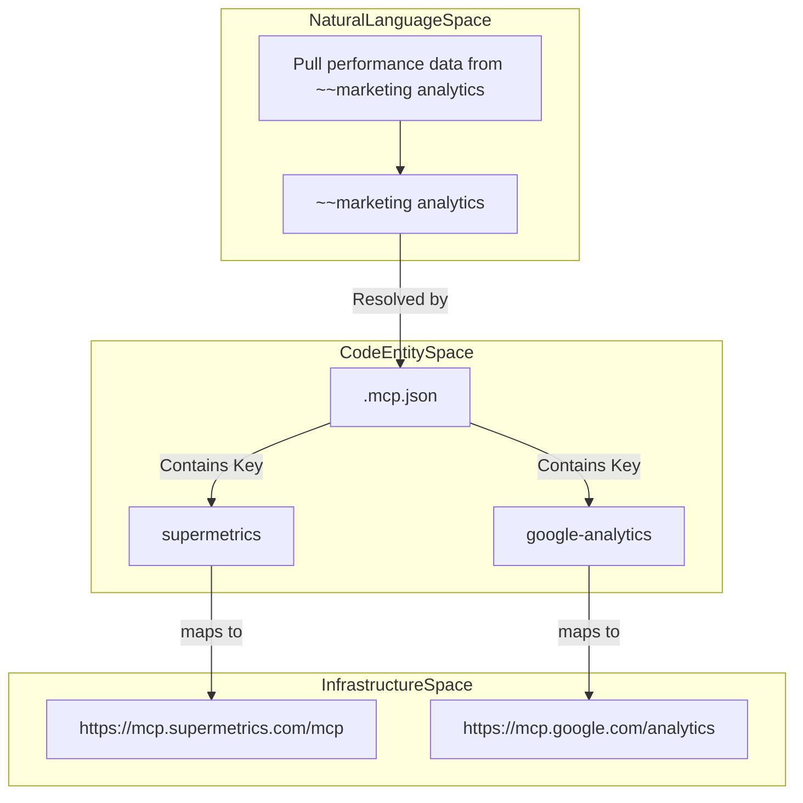
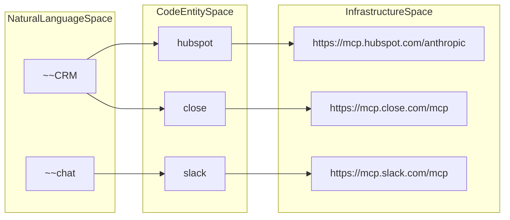

<!-- source: DeepWiki mcp.deepwiki.com · repo anthropics/knowledge-work-plugins · page 2.2 Connector System and Tool Abstraction · fetched 2026-10-26 -->

# Connector System and Tool Abstraction

Relevant source files

The following files were used as context for generating this wiki page:

- [marketing/CONNECTORS.md](marketing/CONNECTORS.md)
- [marketing/skills/performance-report/SKILL.md](marketing/skills/performance-report/SKILL.md)
- [sales/.mcp.json](sales/.mcp.json)
- [sales/CONNECTORS.md](sales/CONNECTORS.md)

## Purpose and Scope

This page documents the connector system's tool abstraction layer, which enables plugins to reference external tools generically rather than hardcoding specific integrations. The system uses `~~category` placeholders in plugin skills and commands, mapping them to concrete MCP servers via `.mcp.json` configuration files. This architecture allows the same plugin code to work with different tools simply by changing configuration. [sales/CONNECTORS.md:3-8](), [marketing/CONNECTORS.md:3-8]()

Sources: [sales/CONNECTORS.md:3-8](), [marketing/CONNECTORS.md:3-8]()

## Abstraction Architecture

The connector system implements a three-layer abstraction that separates plugin logic from tool implementations. This allows a plugin like `sales` or `marketing` to remain functional regardless of whether a user employs Slack versus Microsoft Teams for chat, or HubSpot versus Salesforce for CRM. [sales/CONNECTORS.md:5-8](), [marketing/CONNECTORS.md:5-8]()

### Natural Language to Code Entity Mapping

The following diagram illustrates how natural language intent in a skill file maps to specific code entities and server configurations.

**Natural Language to Code Entity Space**

Sources: [marketing/skills/performance-report/SKILL.md:28-32](), [marketing/CONNECTORS.md:9-20](), [sales/.mcp.json:1-100]()

## Category Placeholder Syntax

Plugin files use the `~~category` placeholder syntax to reference tool categories. The double-tilde prefix (`~~`) distinguishes tool references from regular text. [sales/CONNECTORS.md:5](), [marketing/CONNECTORS.md:5]()

### Standard Placeholder Format
`~~category-name`

Examples of categories defined across the marketplace:
- `~~CRM`: Maps to HubSpot, Close, or Monday. [sales/CONNECTORS.md:15]()
- `~~email`: Maps to Gmail or Microsoft 365. [sales/CONNECTORS.md:16]()
- `~~marketing analytics`: Maps to Supermetrics or Google Analytics. [marketing/CONNECTORS.md:20]()
- `~~chat`: Maps to Slack or Microsoft Teams. [sales/CONNECTORS.md:18](), [marketing/CONNECTORS.md:13]()

Sources: [sales/CONNECTORS.md:15-18](), [marketing/CONNECTORS.md:13-20]()

## Configuration Layer: `.mcp.json`

The `.mcp.json` file is the source of truth for tool connections. It defines the `mcpServers` available to the plugin, including their connection types and endpoints. [sales/.mcp.json:1-100]()

### Implementation Example: Sales Plugin
The sales plugin connects to a wide array of CRM and engagement tools. Note how it supports OAuth for specific servers like Slack. [sales/.mcp.json:1-100]()

| Server ID | Type | Default URL | OAuth Support |
|-----------|------|-------------|---------------|
| `slack` | `http` | `https://mcp.slack.com/mcp` | Yes [sales/.mcp.json:3-9]() |
| `hubspot` | `http` | `https://mcp.hubspot.com/anthropic` | No [sales/.mcp.json:11-14]() |
| `apollo` | `http` | `https://mcp.apollo.io/mcp` | No [sales/.mcp.json:47-50]() |
| `notion` | `http` | `https://mcp.notion.com/mcp` | No [sales/.mcp.json:35-38]() |

Sources: [sales/.mcp.json:1-50]()

### Cross-Plugin Server Mapping
Different plugins map placeholders to specific server endpoints defined within their respective configuration scopes.

**Tool Mapping across Plugins**

Sources: [sales/.mcp.json:3-22](), [sales/CONNECTORS.md:15-18]()

## Documentation Pattern: `CONNECTORS.md`

Each plugin includes a `CONNECTORS.md` file to help users understand how to map their specific tools to the plugin's placeholders. [sales/CONNECTORS.md:1-2](), [marketing/CONNECTORS.md:1-2]()

### Standard Table Structure
The `CONNECTORS.md` file typically includes a table with the following columns:
1. **Category**: Human-readable name.
2. **Placeholder**: The `~~` string used in code.
3. **Included servers**: Tools pre-configured in `.mcp.json`.
4. **Other options**: Suggestions for compatible alternatives.

Sources: [sales/CONNECTORS.md:11-24](), [marketing/CONNECTORS.md:9-20]()

## Swapping Tools Without Code Changes

The primary benefit of this system is the ability to swap a tool (e.g., moving from HubSpot to Salesforce) by only modifying the `.mcp.json` file. [sales/CONNECTORS.md:3-8]()

### Customization Workflow
1. **Identify Placeholder**: Locate the `~~category` in a skill or command (e.g., `~~marketing analytics` in `performance-report`). [marketing/skills/performance-report/SKILL.md:28-31]()
2. **Update .mcp.json**: Replace or add the corresponding server entry in the plugin's `.mcp.json`. [sales/.mcp.json:11-18]()
3. **Configure URL**: Provide the specific MCP server URL. For some tools, this may be configured directly in client settings. [sales/CONNECTORS.md:32-33]()

Sources: [marketing/skills/performance-report/SKILL.md:28-31](), [sales/.mcp.json:11-18](), [sales/CONNECTORS.md:32-33]()

## Benefits of Tool Abstraction

| Benefit | Description |
|---------|-------------|
| **Tool-Agnostic Workflows** | Skills describe *how* to do work rather than binding to specific product APIs. [sales/CONNECTORS.md:3-5](), [marketing/CONNECTORS.md:5-7]() |
| **Zero-Code Customization** | Users can point Claude at their own internal tools by editing JSON configuration files. [sales/CONNECTORS.md:5-8]() |
| **Graceful Degradation** | Skills can still function without a connection by parsing uploaded exports or pasted data. [sales/CONNECTORS.md:9]() |
| **Consistency** | Standardizes how different plugins interact with shared communication and data services. [sales/.mcp.json:3-10]() |

Sources: [sales/CONNECTORS.md:3-9](), [marketing/CONNECTORS.md:5-7](), [sales/.mcp.json:3-10]()

---

