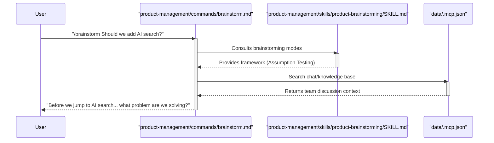

<!-- source: DeepWiki mcp.deepwiki.com · repo anthropics/knowledge-work-plugins · page 2.3 Skills vs Commands · fetched 2026-10-26 -->

# Skills vs Commands

<details>
<summary>Relevant source files</summary>

The following files were used as context for generating this wiki page:

- [README.md](README.md)
- [data/.mcp.json](data/.mcp.json)
- [data/CONNECTORS.md](data/CONNECTORS.md)
- [product-management/commands/brainstorm.md](product-management/commands/brainstorm.md)
- [product-management/skills/product-brainstorming/SKILL.md](product-management/skills/product-brainstorming/SKILL.md)

</details>


**Purpose and Scope:** This page explains the architectural distinction between skills (auto-activated domain expertise) and commands (explicit slash-command actions). In the knowledge work plugin system, skills provide the "brain" or procedural knowledge that Claude draws on automatically, while commands provide the "buttons" or entry points for users to initiate specific tasks [README.md:49-64](). Understanding this separation is fundamental to both using and developing plugins effectively.

---

## Core Concepts

The plugin system separates two fundamentally different types of functionality:

| Aspect | Skills | Commands |
|--------|--------|----------|
| **Activation** | Automatic when relevant (via description) [README.md:47-61]() | Explicit user invocation (slash command) [README.md:47-62]() |
| **Location** | `skills/skill-name/SKILL.md` [README.md:58]() | `commands/command-name.md` [README.md:57]() |
| **Format** | Markdown with YAML frontmatter [product-management/skills/product-brainstorming/SKILL.md:1-4]() | Markdown with YAML frontmatter [product-management/commands/brainstorm.md:1-4]() |
| **Purpose** | Provide domain knowledge and workflows [README.md:61]() | Execute specific tasks on demand [README.md:62]() |
| **Visibility** | Background context (progressive disclosure) [README.md:61]() | Visible in slash command menu [README.md:47]() |
| **User control** | Passive (Claude decides when to trigger) [README.md:61]() | Active (user decides when to trigger) [README.md:62]() |

> **Note on Commands**: Modern plugins prefer the `skills/` format, though legacy slash commands continue to serve as explicit user entry points [README.md:47-64](). 

Sources: [README.md:47-64](), [product-management/commands/brainstorm.md:1-4](), [product-management/skills/product-brainstorming/SKILL.md:1-4]()

---

## Skills: Auto-Activated Domain Knowledge

Skills are the primary unit of expertise. They are structured directories containing a `SKILL.md` file that uses YAML frontmatter to define trigger conditions [README.md:58]().

### Progressive Disclosure

To avoid overwhelming Claude's context window, skills use a hierarchical disclosure model [README.md:49-64]() where metadata (name and description) is always evaluated, but full instructions and supplemental resources (`references/`, `examples/`, `scripts/`) are loaded only when semantic matching indicates relevance [README.md:47-61]().

### Natural Language to Code Entity Mapping

This diagram illustrates how a user's natural language request maps to specific skill entities in the codebase.

```mermaid
graph TD
    subgraph "NaturalLanguageSpace"
        UserPrompt[""Help me brainstorm product ideas""]
        TriggerPhrases[""exploring a new opportunity", "stress-testing an idea""]
    end

    subgraph "CodeEntitySpace"
        SkillFile[""product-management/skills/product-brainstorming/SKILL.md""]
        Frontmatter[""YAML Frontmatter: name: product-brainstorming""]
        Instructions[""Markdown Body: Brainstorming Modes""]
    end

    UserPrompt -->|"Matches"| TriggerPhrases
    TriggerPhrases -->|"Defined in"| Frontmatter
    Frontmatter -->|"Triggers loading of"| Instructions
```

Sources: [README.md:49-64](), [product-management/skills/product-brainstorming/SKILL.md:1-4]()

---

## Commands: Explicit User Actions

Commands are slash commands (e.g., `/brainstorm`) that a user must type to trigger a specific workflow [README.md:47]().

### Implementation Pattern

Commands are single markdown files located in the `commands/` directory [README.md:57](). They use YAML frontmatter to specify descriptions and argument hints [product-management/commands/brainstorm.md:1-4]().

### Example: Product Management Commands

The Product Management plugin uses commands to provide a clear interface for common PM tasks [product-management/commands/brainstorm.md:1-16]():

| Command | Implementation File | Purpose |
|---------|---------------------|---------|
| `/brainstorm` | `product-management/commands/brainstorm.md` | Explore problem spaces with a partner [product-management/commands/brainstorm.md:1-11]() |

Sources: [README.md:57](), [product-management/commands/brainstorm.md:1-16]()

---

## Interaction: How Skills and Commands Work Together

In a sophisticated plugin, commands often act as the orchestrator or entry point while skills provide the expertise used during execution [README.md:49-64]().



### The Role of Connectors

Both skills and commands use tool-agnostic placeholders (e.g., `~~knowledge base`, `~~product analytics`) to refer to external tools configured in `.mcp.json` [data/CONNECTORS.md:3-8]().

- **Skills** describe *how* to use a category of tool during reasoning [data/CONNECTORS.md:3-8]().
- **Commands** perform the *action* of invoking the tool interface based on user instructions [product-management/commands/brainstorm.md:53-72]().

Sources: [data/CONNECTORS.md:3-8](), [product-management/commands/brainstorm.md:53-72](), [product-management/skills/product-brainstorming/SKILL.md:1-4]()

---

## Summary of Implementation Requirements

### Skill Requirements (`SKILL.md`)
- **Location**: Must reside in `skills/[skill-name]/SKILL.md` [README.md:58]().
- **Frontmatter**: Must include `name` and `description` with trigger context [product-management/skills/product-brainstorming/SKILL.md:1-4]().
- **Body**: Written in imperative or infinitive form, keeping core instructions focused while delegating detailed references to sub-directories [README.md:49-64]().

### Command Requirements (`.md`)
- **Location**: Must reside in the `commands/` directory [README.md:57]().
- **Format**: Markdown with YAML frontmatter containing `description` and optional `argument-hint` [product-management/commands/brainstorm.md:1-4]().

Sources: [README.md:57-58](), [product-management/commands/brainstorm.md:1-4](), [product-management/skills/product-brainstorming/SKILL.md:1-4]()

---

