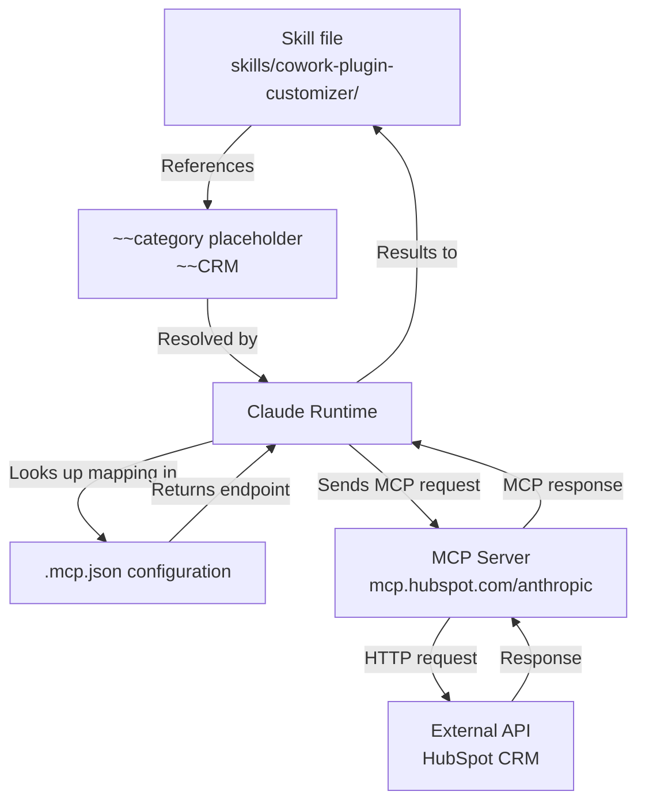
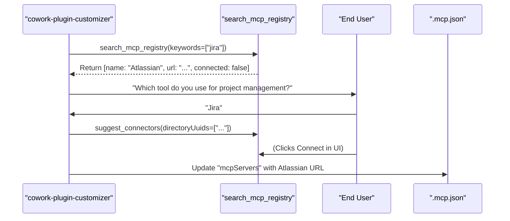

<!-- source: DeepWiki mcp.deepwiki.com · repo anthropics/knowledge-work-plugins · page 2.4 MCP Server Integration · fetched 2026-10-26 -->

# MCP Server Integration

<details>
<summary>Relevant source files</summary>

The following files were used as context for generating this wiki page:

- [bio-research/.mcp.json](bio-research/.mcp.json)
- [engineering/.mcp.json](engineering/.mcp.json)
- [marketing/.mcp.json](marketing/.mcp.json)
- [product-management/.mcp.json](product-management/.mcp.json)
- [small-business/.mcp.json](small-business/.mcp.json)

</details>


This document explains how plugins connect to external tools through MCP (Model Context Protocol) servers. It covers the `.mcp.json` configuration format, the discovery process, and the connection architecture that enables plugins to access third-party services.

## Overview

The Model Context Protocol (MCP) provides a standardized interface between plugins and external tools. Instead of plugins directly integrating with dozens of different APIs, they communicate with MCP servers that handle the translation between Claude's requests and each tool's specific API format.

MCP servers expose their capabilities through a standardized set of operations that plugins invoke via the Claude runtime. The runtime resolves tool references from skills, looks up the appropriate MCP server in `.mcp.json`, and routes requests to the configured endpoint.

**MCP Protocol Flow**



Sources: [cowork-plugin-management/skills/cowork-plugin-customizer/references/mcp-servers.md:1-4](), [sales/CONNECTORS.md:5-8]()

## The .mcp.json Configuration File

Every plugin contains a `.mcp.json` file in its root directory that maps server identifiers to MCP server endpoints. This file is the single source of truth for which external tools a plugin can access.

### File Structure

The `.mcp.json` file follows a standardized JSON schema under the `mcpServers` root object, defining server configurations such as `type` and `url` [small-business/.mcp.json:1-148]().

**Wrapped Format (Standard):**
```json
{
  "mcpServers": {
    "slack": {
      "type": "http",
      "url": "https://mcp.slack.com/mcp"
    },
    "google-calendar": {
      "type": "http",
      "url": ""
    }
  }
}
```

### Configuration Location
The system resolves the MCP configuration in the following order of precedence:
1. **Explicit path**: If `plugin.json` contains an `mcpServers` field, it uses the path specified there [cowork-plugin-management/skills/cowork-plugin-customizer/references/mcp-servers.md:59-65]().
2. **Default path**: If no field is present, it looks for `.mcp.json` at the plugin root [cowork-plugin-management/skills/cowork-plugin-customizer/references/mcp-servers.md:68-68]().
3. **New Creation**: If the plugin only uses bundled files, a new `.mcp.json` is created at the root for custom connections [cowork-plugin-management/skills/cowork-plugin-customizer/references/mcp-servers.md:70-70]().

Sources: [cowork-plugin-management/skills/cowork-plugin-customizer/references/mcp-servers.md:59-85](), [small-business/.mcp.json:1-148]()

## MCP Discovery and Customization

The `cowork-plugin-management` plugin provides tools to programmatically discover and connect MCP servers.

### Discovery Tools

| Tool Name | Purpose | Output |
|-----------|---------|--------|
| `search_mcp_registry` | Search the global MCP directory for connectors [cowork-plugin-management/skills/cowork-plugin-customizer/references/mcp-servers.md:7-9]() | Returns `name`, `url`, `tools`, and `connected` status [cowork-plugin-management/skills/cowork-plugin-customizer/references/mcp-servers.md:12-18]() |
| `suggest_connectors` | Triggers UI "Connect" buttons for users [cowork-plugin-management/skills/cowork-plugin-customizer/references/mcp-servers.md:20-22]() | Renders interactive UI for MCP installation [cowork-plugin-management/skills/cowork-plugin-customizer/references/mcp-servers.md:25-25]() |

### Category-to-Keywords Mapping
The system uses keyword mapping to find relevant MCP servers for abstract categories:

| Category | Keywords |
|----------|----------|
| `project-management` | `["asana", "jira", "linear", "monday", "tasks"]` |
| `software-coding` | `["github", "gitlab", "bitbucket", "code"]` |
| `chat` | `["slack", "teams", "discord"]` |
| `crm` | `["salesforce", "hubspot", "crm"]` |
| `data-warehouse` | `["bigquery", "snowflake", "redshift"]` |

Sources: [cowork-plugin-management/skills/cowork-plugin-customizer/references/mcp-servers.md:29-42]()

## MCP Server Endpoints across Plugins

Plugins across the repository define various HTTP endpoints via `.mcp.json`. While many share common tools like Slack, specialized plugins include domain-specific servers.

### Common and Specialized Connectors

| Plugin | Server ID | Type | URL |
|--------|-----------|------|-----|
| `small-business` | `intuit-quickbooks` | `http` | `https://ai-inc.quickbooks.intuit.com/v1/mcp` [small-business/.mcp.json:59-62]() |
| `small-business` | `paypal` | `http` | `https://mcp.paypal.com/mcp` [small-business/.mcp.json:75-78]() |
| `small-business` | `square` | `http` | `https://mcp.squareup.com/mcp` [small-business/.mcp.json:99-102]() |
| `bio-research` | `pubmed` | `http` | `https://pubmed.mcp.claude.com/mcp` [bio-research/.mcp.json:3-6]() |
| `bio-research` | `chembl` | `http` | `https://hcls.mcp.claude.com/chembl/mcp` [bio-research/.mcp.json:23-26]() |
| `engineering` | `github` | `http` | `https://api.githubcopilot.com/mcp/` [engineering/.mcp.json:27-30]() |
| `engineering` | `datadog` | `http` | `https://mcp.datadoghq.com/api/unstable/mcp-server/mcp` [engineering/.mcp.json:35-38]() |
| `marketing` | `ahrefs` | `http` | `https://api.ahrefs.com/mcp/mcp` [marketing/.mcp.json:35-38]() |
| `product-management` | `pendo` | `http` | `https://app.pendo.io/mcp/v0/shttp` [product-management/.mcp.json:47-50]() |

### Authentication and OAuth
Some servers, particularly `slack`, include OAuth configuration for user-specific authentication within `.mcp.json` files [small-business/.mcp.json:91-98](), [engineering/.mcp.json:3-10](), [marketing/.mcp.json:3-10](), [product-management/.mcp.json:3-10]().

```json
"slack": {
  "type": "http",
  "url": "https://mcp.slack.com/mcp",
  "oauth": {
    "clientId": "1601185624273.8899143856786",
    "callbackPort": 3118
  }
}
```
Sources: [small-business/.mcp.json:91-98](), [engineering/.mcp.json:3-10](), [marketing/.mcp.json:3-10](), [product-management/.mcp.json:3-10]()

## Dynamic and Named Servers

Some MCP servers do not have a static URL because the endpoint is generated dynamically when the admin connects the server. In these cases:
- The server is referenced in the `.mcp.json` config by **name** only [cowork-plugin-management/skills/cowork-plugin-customizer/references/mcp-servers.md:89-91]().
- If the name in the config matches a connected directory entry name, the system treats it as a valid connection [cowork-plugin-management/skills/cowork-plugin-customizer/references/mcp-servers.md:91-91]().
- Placeholder entries with empty URLs (e.g., `benchling` in bio-research or `google calendar` in engineering) indicate tools that require specific user configuration before use [bio-research/.mcp.json:43-46](), [engineering/.mcp.json:39-42]().

Sources: [cowork-plugin-management/skills/cowork-plugin-customizer/references/mcp-servers.md:89-91](), [bio-research/.mcp.json:43-46](), [engineering/.mcp.json:39-42]()

## Connection Flow Architecture

When a skill requires an external tool, the following sequence occurs:

1. **Customization Phase**: The `cowork-plugin-customizer` skill identifies `~~`-prefixed values [cowork-plugin-management/skills/cowork-plugin-customizer/references/mcp-servers.md:46-47]().
2. **Registry Search**: It calls `search_mcp_registry` with keywords [cowork-plugin-management/skills/cowork-plugin-customizer/references/mcp-servers.md:50-50]().
3. **User Confirmation**: The user selects the tool they use [cowork-plugin-management/skills/cowork-plugin-customizer/references/mcp-servers.md:51-51]().
4. **Connection**: If not already connected, `suggest_connectors` is called [cowork-plugin-management/skills/cowork-plugin-customizer/references/mcp-servers.md:52-52]().
5. **Config Update**: The `.mcp.json` file is updated with the `url` from search results [cowork-plugin-management/skills/cowork-plugin-customizer/references/mcp-servers.md:53-53]().

**Detailed Customization Sequence**



Sources: [cowork-plugin-management/skills/cowork-plugin-customizer/references/mcp-servers.md:44-54](), [small-business/.mcp.json:1-148](), [bio-research/.mcp.json:1-48](), [engineering/.mcp.json:1-48]()

---

