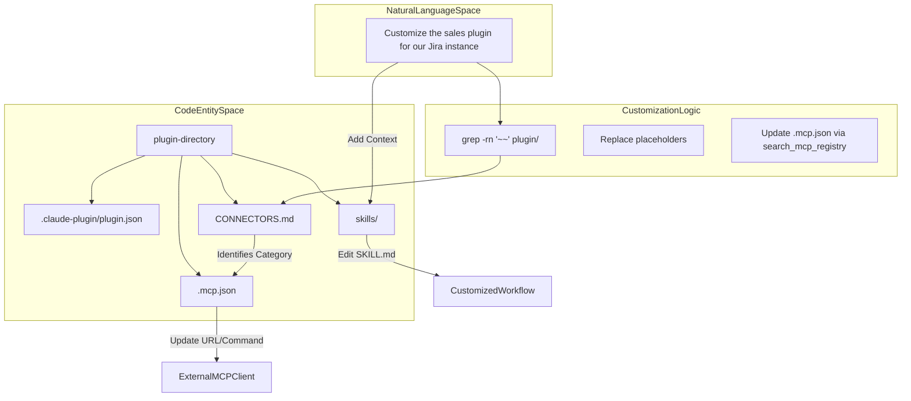
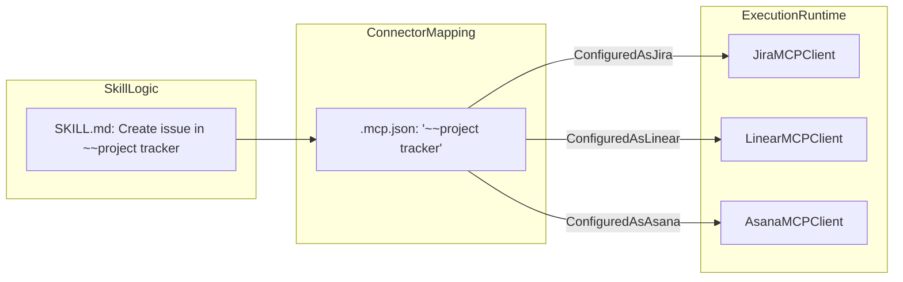

<!-- source: DeepWiki mcp.deepwiki.com · repo anthropics/knowledge-work-plugins · page 2.5 Customizing Plugins · fetched 2026-10-26 -->

# Customizing Plugins

<details>
<summary>Relevant source files</summary>

The following files were used as context for generating this wiki page:

- [README.md](README.md)
- [cowork-plugin-management/.claude-plugin/plugin.json](cowork-plugin-management/.claude-plugin/plugin.json)
- [cowork-plugin-management/skills/cowork-plugin-customizer/SKILL.md](cowork-plugin-management/skills/cowork-plugin-customizer/SKILL.md)
- [cowork-plugin-management/skills/cowork-plugin-customizer/references/mcp-servers.md](cowork-plugin-management/skills/cowork-plugin-customizer/references/mcp-servers.md)
- [cowork-plugin-management/skills/create-cowork-plugin/SKILL.md](cowork-plugin-management/skills/create-cowork-plugin/SKILL.md)
- [cowork-plugin-management/skills/create-cowork-plugin/references/component-schemas.md](cowork-plugin-management/skills/create-cowork-plugin/references/component-schemas.md)
- [cowork-plugin-management/skills/create-cowork-plugin/references/example-plugins.md](cowork-plugin-management/skills/create-cowork-plugin/references/example-plugins.md)
- [data/.mcp.json](data/.mcp.json)
- [data/CONNECTORS.md](data/CONNECTORS.md)

</details>


## Purpose and Scope

This document guides technical users through customizing plugins to match an organization's specific tools, terminology, and workflows. Customization transforms generic marketplace plugins into specialized company assistants by modifying file-based configurations and markdown instructions `[README.md:67-75]`.

This page focuses on manual and semi-automated customization. For programmatically creating or managing plugins, see [8.2. Using cowork-plugin-management]().

Sources: `[README.md:67-75]()`, `[README.md:6-9]()`

---

## Customization Architecture Overview

Plugin customization operates at three distinct layers, targeting different aspects of Claude's behavior:

| Layer | Target Component | File Types | Customization Goal |
| :--- | :--- | :--- | :--- |
| **1. Tool Integration** | `.mcp.json` | JSON | Map `~~category` placeholders to specific company tool URLs `[cowork-plugin-management/skills/create-cowork-plugin/SKILL.md:102-110]()`. |
| **2. Domain Knowledge** | `skills/*/SKILL.md` | Markdown | Inject company terminology, org structures, and internal references `[cowork-plugin-management/skills/create-cowork-plugin/references/component-schemas.md:38-45]()`. |
| **3. Workflows** | `skills/*/SKILL.md` | Markdown | Modify step-by-step instructions and validation criteria `[cowork-plugin-management/skills/create-cowork-plugin/references/example-plugins.md:45-56]()`. |

### Customization Data Flow

The following diagram bridges the **Natural Language Space** (how users request changes) to the **Code Entity Space** (the specific files and structures modified).

**Diagram: Customization Resolution Path**

Sources: `[cowork-plugin-management/skills/cowork-plugin-customizer/SKILL.md:10-32]()`, `[cowork-plugin-management/skills/cowork-plugin-customizer/references/mcp-servers.md:44-54]()`

---

## Connector Customization

### The Placeholder System (`~~category`)

Connectors use the `~~category` placeholder system to maintain tool-agnostic skill definitions `[cowork-plugin-management/skills/create-cowork-plugin/SKILL.md:102-109]()`. The `CONNECTORS.md` file at the plugin root explains which placeholders are used and what options are available `[cowork-plugin-management/skills/create-cowork-plugin/SKILL.md:110-127]()`.

**Diagram: Tool-Agnostic Connector Resolution**

Sources: `[cowork-plugin-management/skills/create-cowork-plugin/SKILL.md:110-127]`, `[cowork-plugin-management/skills/cowork-plugin-customizer/references/mcp-servers.md:46-53]()`, `[data/CONNECTORS.md:1-18]()`

### Modifying MCP Configuration

The MCP configuration is typically stored in `.mcp.json` at the plugin root, though the location can be customized in `.claude-plugin/plugin.json` `[cowork-plugin-management/skills/cowork-plugin-customizer/references/mcp-servers.md:57-68]()`.

To swap a connector:
1. Locate the config file (default `.mcp.json`) `[cowork-plugin-management/skills/cowork-plugin-customizer/references/mcp-servers.md:68]()`.
2. Update the server entry using the `url` from `search_mcp_registry` or a local `command` `[cowork-plugin-management/skills/cowork-plugin-customizer/references/mcp-servers.md:72-87]()`.
3. Use `${CLAUDE_PLUGIN_ROOT}` for all intra-plugin path references `[cowork-plugin-management/skills/create-cowork-plugin/SKILL.md:129-131]()`.

**Example: Switching Project Trackers**
```json
{
  "mcpServers": {
    "~~project tracker": {
      "type": "http",
      "url": "https://api.example.com/mcp/jira"
    }
  }
}
```
Sources: `[cowork-plugin-management/skills/cowork-plugin-customizer/references/mcp-servers.md:72-87]()`, `[cowork-plugin-management/skills/create-cowork-plugin/references/component-schemas.md:231-243]()`

---

## Adding Company Context to Skills

### Skill File Structure

Skills are defined in `skills/<skill-name>/SKILL.md` using Markdown with YAML frontmatter `[cowork-plugin-management/skills/create-cowork-plugin/references/component-schemas.md:7-10]()`.

| Component | Purpose | Customization Opportunity |
| :--- | :--- | :--- |
| **Frontmatter** | Metadata & Triggers | Add company-specific trigger phrases (e.g., "Project X review") `[cowork-plugin-management/skills/create-cowork-plugin/references/component-schemas.md:12-16]()`. |
| **SKILL.md Body** | Core Logic | Replace generic steps with internal SOPs (Standard Operating Procedures) `[cowork-plugin-management/skills/create-cowork-plugin/references/example-plugins.md:45-56]()`. |
| **`references/`** | Deep Knowledge | Add detailed internal docs (style guides, naming conventions) `[cowork-plugin-management/skills/create-cowork-plugin/references/component-schemas.md:38-45]()`. |

### Customization Workflow (Automated via Cowork)

The `cowork-plugin-customizer` skill automates the discovery and replacement of placeholders `[cowork-plugin-management/skills/cowork-plugin-customizer/SKILL.md:2-6]()`.

1. **Locate the Plugin**: The tool searches `mnt/.local-plugins` or `mnt/.plugins` `[cowork-plugin-management/skills/cowork-plugin-customizer/SKILL.md:14]()`.
2. **Identify Placeholders**: It runs `grep -rn '~~'` to find customization points `[cowork-plugin-management/skills/cowork-plugin-customizer/SKILL.md:18]()`.
3. **Gather Context**: It uses Knowledge MCPs (Slack, Documents, Email) to find internal tool names and workspace IDs `[cowork-plugin-management/skills/cowork-plugin-customizer/SKILL.md:45-62]()`.
4. **Apply Changes**:
    - **Placeholder replacements**: `~~Jira` → `Asana` `[cowork-plugin-management/skills/cowork-plugin-customizer/SKILL.md:87]()`.
    - **URL pattern updates**: Updating ticketing links to match company domain `[cowork-plugin-management/skills/cowork-plugin-customizer/SKILL.md:89]()`.
    - **Content updates**: Modifying instructions to match org-specific workflows `[cowork-plugin-management/skills/cowork-plugin-customizer/SKILL.md:88]()`.

Sources: `[cowork-plugin-management/skills/cowork-plugin-customizer/SKILL.md:14-93]()`

---

## Adjusting Workflows

Workflows are modified by changing the imperative instructions in the `SKILL.md` body.

### Workflow Modification Patterns

1. **Adding Approval Steps**: Insert requirements for user confirmation (e.g., "Ask the user to confirm the budget before proceeding") `[cowork-plugin-management/skills/create-cowork-plugin/SKILL.md:135]()`.
2. **Changing Validation Logic**: Update the success criteria (e.g., "After all fixes, run the linter again to confirm clean output") `[cowork-plugin-management/skills/create-cowork-plugin/references/example-plugins.md:141]()`.
3. **Output Formatting**: Modify sections like "Include these sections" to match internal reporting standards `[cowork-plugin-management/skills/create-cowork-plugin/references/example-plugins.md:47-53]()`.

### Example: Customizing a Review Skill
**Generic `review-changes/SKILL.md` snippet:**
```markdown
1. Run `git diff --name-only` to get the list of changed files.
2. Check against the coding-standards skill for style violations
3. Identify potential bugs or anti-patterns
```

**Customized snippet for a specific team:**
```markdown
1. Run `git diff --name-only` to get the list of changed files.
2. Check against the coding-standards skill for style violations.
3. **New Step**: Verify that all new exported functions have TSDoc comments following the template in `references/tsdoc-guidelines.md`.
4. Identify potential bugs or anti-patterns.
5. **New Step**: If changes impact the `~~billing-engine` module, flag for senior review and check against the SOX compliance checklist.
```
Sources: `[cowork-plugin-management/skills/create-cowork-plugin/references/example-plugins.md:107-121]()`, `[cowork-plugin-management/skills/cowork-plugin-customizer/SKILL.md:88]()`

---

## Testing Customizations

After modifying plugin files, verify the changes:

1. **Trigger the Skill**: Use defined trigger phrases to ensure the skill loads correctly `[cowork-plugin-management/skills/create-cowork-plugin/references/component-schemas.md:34]()`.
2. **Check Tool Output**: Verify that `~~category` references resolve to the intended MCP server tools `[cowork-plugin-management/skills/cowork-plugin-customizer/references/mcp-servers.md:46-53]()`.
3. **Verify Compliance**: Ensure the generated output follows the newly added company-specific instructions `[cowork-plugin-management/skills/cowork-plugin-customizer/SKILL.md:88]()`.

Sources: `[cowork-plugin-management/skills/cowork-plugin-customizer/SKILL.md:108-110]()`

---

