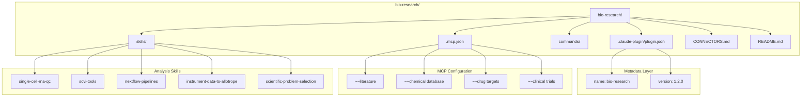
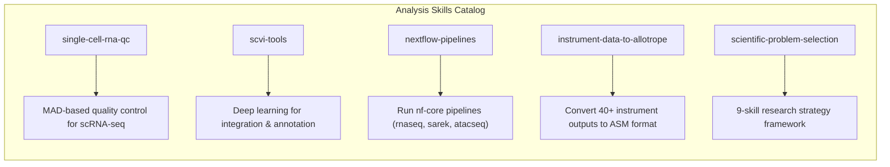

<!-- source: DeepWiki mcp.deepwiki.com · repo anthropics/knowledge-work-plugins · page 3 Bio-Research Plugin · fetched 2026-10-26 -->

# Bio-Research Plugin

<details>
<summary>Relevant source files</summary>

The following files were used as context for generating this wiki page:

- [bio-research/.claude-plugin/plugin.json](bio-research/.claude-plugin/plugin.json)
- [bio-research/CONNECTORS.md](bio-research/CONNECTORS.md)
- [bio-research/README.md](bio-research/README.md)
- [data/.claude-plugin/plugin.json](data/.claude-plugin/plugin.json)

</details>


## Purpose and Scope

This page provides a high-level overview of the bio-research plugin, the most complex plugin in the `knowledge-work-plugins` repository [bio-research/README.md:5](). It consolidates multiple MCP server integrations and analysis skills designed for life sciences researchers working on preclinical R&D, genomics, drug discovery, and clinical trials [bio-research/README.md:1-5]().

As a parent page, this document summarizes the core capabilities, architecture, and tool integrations. For detailed technical information, refer to the child pages:
- **Overview and Capabilities:** See [Bio-Research Overview and Capabilities](#3.1)
- **Getting Started & Workflows:** See [Getting Started with Bio-Research](#3.2)
- **MCP Server Integrations:** See [MCP Server Integrations](#3.3)
- **Analysis Skills Overview:** See [Analysis Skills Overview](#3.4)
- **Single-Cell RNA Analysis:** See [Single-Cell RNA Analysis Skills](#3.6)
- **Nextflow Pipelines:** See [Nextflow Pipelines Skill](#3.7)
- **Instrument Data Converter:** See [Instrument Data to Allotrope Converter](#3.8)
- **Scientific Problem Selection:** See [Scientific Problem Selection Framework](#3.9)

Sources: [bio-research/README.md:1-5]()

---

## Overview and Architecture

The bio-research plugin connects preclinical research tools, literature databases, and analytical pipelines into a unified agentic environment [bio-research/README.md:1-5](). It uses tool-agnostic `~~category` placeholders in its configuration to decouple workflows from specific vendor implementations [bio-research/CONNECTORS.md:5-7]().



**Bio-Research Plugin Directory Structure**

Sources: [bio-research/.claude-plugin/plugin.json:1-8](), [bio-research/CONNECTORS.md:1-23]()

---

## MCP Server Integrations Summary

The plugin integrates a wide array of data sources and computational tools via Model Context Protocol (MCP) servers, organized through category placeholders [bio-research/README.md:9-25](), [bio-research/CONNECTORS.md:1-23]().

| Category Placeholder | Primary Provider | Data Source / Tool | Use Case |
|---------------------|-----------------|-------------------|----------|
| `~~literature` | NLM / deepsense.ai / Consensus | PubMed, bioRxiv, Consensus | Biomedical literature search & synthesis [bio-research/README.md:15-17]() |
| `~~journal access` | John Wiley & Sons | Academic Journals | Full-text article retrieval [bio-research/README.md:18]() |
| `~~data repository` | Sage Bionetworks | Synapse | Collaborative research data [bio-research/README.md:19]() |
| `~~chemical database` | deepsense.ai | ChEMBL | Bioactive compound properties [bio-research/README.md:20]() |
| `~~drug targets` | OpenTargets | Open Targets | Target discovery and prioritization [bio-research/README.md:21]() |
| `~~clinical trials` | deepsense.ai | ClinicalTrials.gov | Trial registry and results [bio-research/README.md:22]() |
| `~~scientific illustration` | BioRender | BioRender | Scientific figure creation [bio-research/README.md:23]() |
| `~~AI research` | Owkin | Owkin Histopathology | AI-powered biology analysis [bio-research/README.md:24]() |
| `~~lab platform` | Benchling | Benchling LIMS | Lab data management [bio-research/README.md:25]() |

For deep-dive documentation on these integrations, see [MCP Server Integrations](#3.3).

Sources: [bio-research/README.md:9-25](), [bio-research/CONNECTORS.md:1-23]()

---

## Analysis Skills Summary

The plugin bundles several specialized analysis skills that automate complex bioinformatics and research strategy workflows [bio-research/README.md:34-53]().



**Analysis Skills Overview**

For detailed guides on each skill, refer to their respective child pages:
- Single-cell quality control and deep learning: see [Single-Cell RNA Analysis Skills](#3.6)
- Pipeline execution: see [Nextflow Pipelines Skill](#3.7)
- Laboratory instrument conversion: see [Instrument Data to Allotrope Converter](#3.8)
- Problem selection framework: see [Scientific Problem Selection Framework](#3.9)

Sources: [bio-research/README.md:34-53]()

---

## Getting Started and Common Workflows

To install and initialize the bio-research plugin, use the standard command interface [bio-research/README.md:54-62]():

```bash
# Install the bio-research plugin
/install anthropics/knowledge-work-plugins bio-research

# Run the start command to inspect available tools and skills
/start
```

Common workflows supported by this plugin include literature reviews, single-cell RNA sequencing analysis, genomics pipelines execution, and drug discovery target prioritization [bio-research/README.md:64-80](). For step-by-step tutorials, see [Getting Started with Bio-Research](#3.2).

Sources: [bio-research/README.md:54-80]()

---

