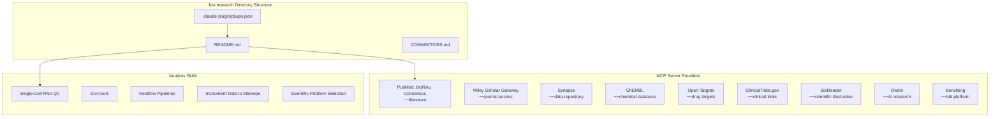
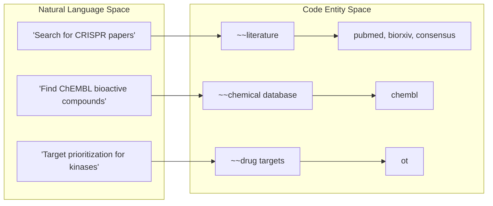
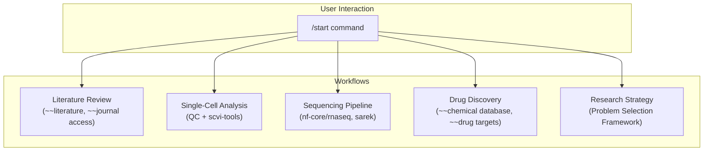

<!-- source: DeepWiki mcp.deepwiki.com · repo anthropics/knowledge-work-plugins · page 3.1 Bio-Research Overview and Capabilities · fetched 2026-10-26 -->

# Bio-Research Overview and Capabilities

<details>
<summary>Relevant source files</summary>

The following files were used as context for generating this wiki page:

- [bio-research/.claude-plugin/plugin.json](bio-research/.claude-plugin/plugin.json)
- [bio-research/CONNECTORS.md](bio-research/CONNECTORS.md)
- [bio-research/README.md](bio-research/README.md)
- [data/.claude-plugin/plugin.json](data/.claude-plugin/plugin.json)

</details>


## Purpose and Scope

The `bio-research` plugin is a specialized suite designed for life sciences researchers, molecular biologists, computational biologists, and bioinformaticians. It consolidates multiple MCP server integrations and core analysis skill categories into a unified package to accelerate early-stage life sciences R&D, ranging from biomedical literature synthesis and drug target prioritization to deep learning-based single-cell analysis, bioinformatics pipelines, and laboratory instrument data standardization.

**Sources:** [bio-research/README.md:1-5](), [bio-research/.claude-plugin/plugin.json:1-8]()

## Plugin Identity and Metadata

The plugin is defined by its manifest located at `bio-research/.claude-plugin/plugin.json`. It exposes metadata describing its core function and targeting life sciences R&D workflows.

| Property | Value |
|----------|-------|
| **Name** | `bio-research` [bio-research/.claude-plugin/plugin.json:2-2]() |
| **Version** | `1.2.0` [bio-research/.claude-plugin/plugin.json:3-3]() |
| **Description** | Connect to preclinical research tools and databases (literature search, genomics analysis, target prioritization) to accelerate early-stage life sciences R&D [bio-research/.claude-plugin/plugin.json:4-4]() |
| **Author** | Anthropic [bio-research/.claude-plugin/plugin.json:5-7]() |

**Sources:** [bio-research/.claude-plugin/plugin.json:1-8](), [bio-research/README.md:1-5]()

## Plugin Architecture and Component Layout

The plugin architecture cleanly decouples external data retrieval (handled via MCP servers and category placeholders) from local domain logic (handled by analysis skills).



**Diagram: Bio-Research Plugin Architecture and Components**

The system coordinates between user intent, standardized category placeholders (`~~category`), concrete MCP provider endpoints, and local workflow execution skills [bio-research/README.md:7-53](), [bio-research/CONNECTORS.md:3-8]().

**Sources:** [bio-research/README.md:7-53](), [bio-research/CONNECTORS.md:3-8](), [bio-research/.claude-plugin/plugin.json:1-8]()

## MCP Server Integrations and Connectors

The plugin maps external scientific data sources and tools to tool-agnostic category placeholders. This design allows skills to reference capabilities via placeholders like `~~literature` or `~~chemical database` while remaining independent of specific vendor endpoints [bio-research/CONNECTORS.md:3-8]().

### Core Connectors and Providers

| Category | Placeholder | Included Servers / Providers |
|----------|-------------|----------------------------|
| Literature | `~~literature` | PubMed, bioRxiv, Consensus [bio-research/README.md:15-17](), [bio-research/CONNECTORS.md:13-13]() |
| Scientific illustration | `~~scientific illustration` | BioRender [bio-research/README.md:23-23](), [bio-research/CONNECTORS.md:14-14]() |
| Clinical trials | `~~clinical trials` | ClinicalTrials.gov [bio-research/README.md:22-22](), [bio-research/CONNECTORS.md:15-15]() |
| Chemical database | `~~chemical database` | ChEMBL [bio-research/README.md:20-20](), [bio-research/CONNECTORS.md:16-16]() |
| Drug targets | `~~drug targets` | Open Targets [bio-research/README.md:21-21](), [bio-research/CONNECTORS.md:17-17]() |
| Data repository | `~~data repository` | Synapse [bio-research/README.md:19-19](), [bio-research/CONNECTORS.md:18-18]() |
| Journal access | `~~journal access` | Wiley Scholar Gateway [bio-research/README.md:18-18](), [bio-research/CONNECTORS.md:19-19]() |
| AI research | `~~AI research` | Owkin [bio-research/README.md:24-24](), [bio-research/CONNECTORS.md:20-20]() |
| Lab platform | `~~lab platform` | Benchling (Placeholder) [bio-research/README.md:25-25](), [bio-research/CONNECTORS.md:21-21]() |

**Sources:** [bio-research/README.md:13-26](), [bio-research/CONNECTORS.md:9-23]()

### Optional Binary MCP Servers

In addition to HTTP-based MCP endpoints, the plugin accommodates optional binary servers that require separate local installation:
- **10X Genomics (`txg-mcp`)**: Cloud analysis data and workflows, mapped to `~~genomics platform` [bio-research/README.md:31-31]().
- **ToolUniverse**: AI tools for scientific discovery from Harvard MIMS, mapped to `~~tool database` [bio-research/README.md:32-32]().

**Sources:** [bio-research/README.md:27-33]()



**Diagram: Natural Language to Connector Placeholder Mapping**

This diagram illustrates how natural language queries from users map onto connector placeholders (`~~literature`, `~~chemical database`, `~~drug targets`), which in turn resolve to specific MCP server integrations defined in the configuration [bio-research/README.md:13-26](), [bio-research/CONNECTORS.md:3-8]().

**Sources:** [bio-research/README.md:13-26](), [bio-research/CONNECTORS.md:3-8]()

## Analysis Skills Overview

The plugin bundles several specialized analysis workflows that automate complex multi-step computational procedures in life sciences:

1. **Single-Cell RNA QC**: Automated quality control for single-cell RNA sequencing (`scRNA-seq`) data following scverse best practices. Supports `.h5ad` and `.h5` files with Median Absolute Deviation (MAD) filtering and diagnostic visualizations [bio-research/README.md:36-38]().
2. **scvi-tools**: Deep learning toolkit for single-cell omics covering models like scVI, scANVI, totalVI, PeakVI, MultiVI, destVI, veloVI, and sysVI for data integration, batch correction, and multi-modal analysis [bio-research/README.md:39-41]().
3. **Nextflow Pipelines**: Execution manager for nf-core bioinformatics pipelines (`rnaseq`, `sarek`, `atacseq`) on local or public GEO/SRA sequencing datasets [bio-research/README.md:42-47]().
4. **Instrument Data to Allotrope Converter**: Transformation utility converting laboratory instrument output files (PDF, CSV, Excel, TXT across 40+ instrument types such as plate readers and chromatography systems) into Allotrope Simple Model (ASM) structured format [bio-research/README.md:48-50]().
5. **Scientific Problem Selection**: Systematic framework based on Fischbach & Walsh's methodology, encompassing 9 discrete skills for research ideation, risk assessment, decision trees, and adversity planning [bio-research/README.md:51-53]().

**Sources:** [bio-research/README.md:34-53]()



**Diagram: Bio-Research Execution Workflows**

This diagram depicts how users initiate workflows via the `/start` command to engage literature search, single-cell analysis, sequencing pipelines, drug discovery databases, or research strategy frameworks [bio-research/README.md:54-80]().

**Sources:** [bio-research/README.md:54-80]()

## Getting Started and Execution

To install the bio-research plugin and initialize its capabilities within Claude Code or Cowork, execute the installation and startup commands:

```bash
# Install the bio-research plugin
/install anthropics/knowledge-work-plugins bio-research

# Run start command to inspect connected tools and available skills
/start
```

**Sources:** [bio-research/README.md:56-62]()

---

