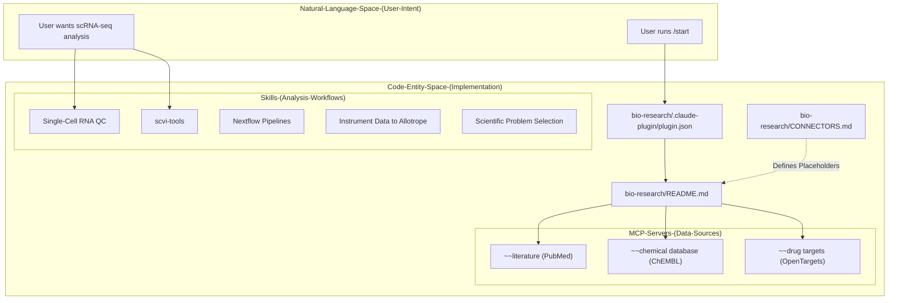
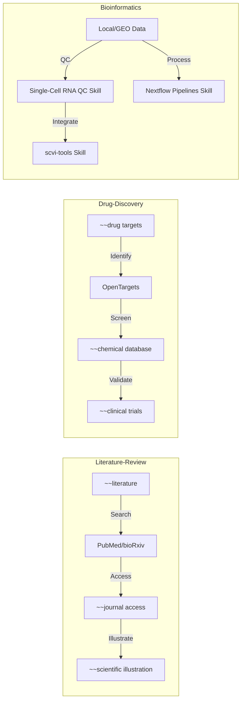

<!-- source: DeepWiki mcp.deepwiki.com · repo anthropics/knowledge-work-plugins · page 3.2 Getting Started with Bio-Research · fetched 2026-10-26 -->

# Getting Started with Bio-Research

<details>
<summary>Relevant source files</summary>

The following files were used as context for generating this wiki page:

- [bio-research/.claude-plugin/plugin.json](bio-research/.claude-plugin/plugin.json)
- [bio-research/CONNECTORS.md](bio-research/CONNECTORS.md)
- [bio-research/README.md](bio-research/README.md)
- [data/.claude-plugin/plugin.json](data/.claude-plugin/plugin.json)

</details>


## Purpose and Scope

This page provides a practical walkthrough for initializing and exploring the bio-research plugin. It covers the `/start` command, verifying MCP server connectivity, understanding the skill catalog, and selecting appropriate workflows for common research tasks. The bio-research plugin consolidates 11 MCP server integrations and 5 primary analysis skills into a single package for life science researchers [bio-research/README.md:1-5]().

Sources: [bio-research/README.md:1-5]()

## The /start command

The bio-research plugin provides a `/start` command that serves as the primary entry point for new users. This command executes a guided setup process that:

1. Displays a welcome message.
2. Detects and reports available MCP server connections based on the configuration in `.mcp.json` [bio-research/README.md:9-11]().
3. Lists the analysis skills included in the plugin [bio-research/README.md:34-52]().
4. Documents optional binary MCP server installations such as `txg-mcp` and `ToolUniverse` [bio-research/README.md:27-32]().
5. Prompts the user to select a workflow based on their research needs [bio-research/README.md:64-79]().

**Command Invocation:**

```bash
# Install the plugin
/install anthropics/knowledge-work-plugins bio-research

# Run the start command to see available tools
/start
```

Sources: [bio-research/README.md:9-11](), [bio-research/README.md:27-32](), [bio-research/README.md:34-52](), [bio-research/README.md:54-62](), [bio-research/README.md:64-79]()

## MCP Server Detection and Configuration

The plugin uses a standardized placeholder system to define the connection parameters for various research tools. These tools are abstracted using a `~~category` placeholder to remain tool-agnostic, allowing users to swap specific providers (e.g., swapping PubMed for Google Scholar) [bio-research/CONNECTORS.md:1-8]().

### Configuration Mapping

The following table shows how the functional categories used in workflows map to specific providers and their placeholders:

| Category | Placeholder | Included Servers / Providers |
|----------|-------------|-----------------------------|
| Literature | `~~literature` | PubMed, bioRxiv, Consensus [bio-research/README.md:15-17]() |
| Journal Access | `~~journal access` | John Wiley & Sons [bio-research/README.md:18]() |
| Chemical Database | `~~chemical database` | ChEMBL (via deepsense.ai) [bio-research/README.md:20]() |
| Drug Targets | `~~drug targets` | OpenTargets [bio-research/README.md:21]() |
| Clinical Trials | `~~clinical trials` | NIH/NLM ClinicalTrials.gov [bio-research/README.md:22]() |
| Data Repository | `~~data repository` | Synapse (Sage Bionetworks) [bio-research/README.md:19]() |
| Scientific Illustration | `~~scientific illustration` | BioRender [bio-research/README.md:23]() |
| AI Research | `~~AI research` | Owkin [bio-research/README.md:24]() |
| Lab Platform | `~~lab platform` | Benchling [bio-research/README.md:25]() |

Sources: [bio-research/CONNECTORS.md:1-21](), [bio-research/README.md:13-25]()

## System Architecture: Code Entity Space

Title: "Bio-Research Plugin Entity Mapping"


Sources: [bio-research/.claude-plugin/plugin.json:1-8](), [bio-research/README.md:9-52](), [bio-research/CONNECTORS.md:1-21]()

## Skill Catalog Overview

The plugin includes specialized analysis workflows implemented as skills. These are triggered automatically when relevant research data or tasks are identified [bio-research/README.md:34-52]().

* **Single-Cell RNA QC**: Automated quality control for scRNA-seq data following `scverse` best practices. Supports `.h5ad` and `.h5` files with MAD-based filtering [bio-research/README.md:36-38]().
* **scvi-tools**: Deep learning toolkit for single-cell omics, covering models like `scVI`, `scANVI`, and `totalVI` for integration, batch correction, and label transfer [bio-research/README.md:39-41]().
* **Nextflow Pipelines**: Interface for running `nf-core` bioinformatics pipelines (rnaseq, sarek, atacseq) on local or public GEO/SRA data [bio-research/README.md:42-46]().
* **Instrument Data to Allotrope**: Converts 40+ laboratory instrument output types (PDF, CSV, Excel, TXT) to Allotrope Simple Model (ASM) format [bio-research/README.md:48-50]().
* **Scientific Problem Selection**: A 9-skill framework based on Fischbach & Walsh for systematic research ideation, risk assessment, and decision trees [bio-research/README.md:51-52]().

Sources: [bio-research/README.md:34-52]()

## Common Workflow Implementation

Title: "Data Flow for Bio-Research Workflows"


### Literature Review
Users can search the `~~literature` database for papers, access full-text through `~~journal access`, and create figures with `~~scientific illustration` [bio-research/README.md:66-67]().

### Single-Cell Analysis
The workflow involves running QC on scRNA-seq data via the Single-Cell RNA QC skill, then using `scvi-tools` for integration and cell type annotation [bio-research/README.md:69-70]().

### Sequencing Pipeline
Researchers can download data from GEO/SRA and run `nf-core` pipelines (RNA-seq, variant calling, ATAC-seq) using the Nextflow Pipelines skill [bio-research/README.md:72-74]().

### Drug Discovery
This workflow utilizes `~~chemical database` for compound search, `~~drug targets` for prioritization, and `~~clinical trials` for reviewing registry data [bio-research/README.md:75-77]().

### Research Strategy
Uses the scientific problem selection framework to pitch ideas, troubleshoot projects, or evaluate strategic decisions [bio-research/README.md:78-79]().

Sources: [bio-research/README.md:64-79](), [bio-research/CONNECTORS.md:1-21]()

---

