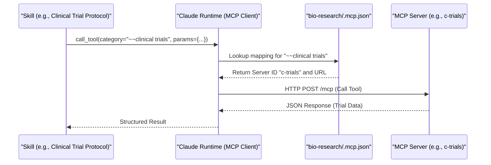

<!-- source: DeepWiki mcp.deepwiki.com · repo anthropics/knowledge-work-plugins · page 3.3 MCP Server Integrations · fetched 2026-10-26 -->

# MCP Server Integrations

<details>
<summary>Relevant source files</summary>

The following files were used as context for generating this wiki page:

- [bio-research/.claude-plugin/plugin.json](bio-research/.claude-plugin/plugin.json)
- [bio-research/.mcp.json](bio-research/.mcp.json)
- [bio-research/CONNECTORS.md](bio-research/CONNECTORS.md)
- [bio-research/README.md](bio-research/README.md)
- [data/.claude-plugin/plugin.json](data/.claude-plugin/plugin.json)
- [small-business/.mcp.json](small-business/.mcp.json)

</details>


This document provides detailed documentation of the MCP (Model Context Protocol) server integrations configured across the repository, with a primary focus on the bio-research plugin. Each server provides access to specific scientific databases, research tools, or business platforms through a standardized protocol.

For information about the connector abstraction system and how skills reference these servers using `~~category` placeholders, see [Connector System and Tool Abstraction [2.2]](#). For an overview of all bio-research capabilities including analysis skills, see [Bio-Research Overview and Capabilities [3.1]](#).

## MCP Server Configuration Architecture

The bio-research plugin defines its MCP server integrations in `bio-research/.mcp.json`. Each server entry specifies a connection type and endpoint URL that the Claude runtime uses to communicate with external services.

### Natural Language to Code Entity Mapping: Bio-Research Connectors
The following diagram maps the natural language categories used in prompts and skills to the specific server configurations and external endpoints defined in the codebase.

```mermaid
graph TB
    subgraph "NaturalLanguageSpace (Skills/Prompts)"
        ["~~literature"]
        ["~~journal access"]
        ["~~chemical database"]
        ["~~drug targets"]
        ["~~clinical trials"]
        ["~~AI research"]
    end

    subgraph "CodeEntitySpace (bio-research/.mcp.json)"
        direction TB
        ["pubmed"]
        ["biorxiv"]
        ["consensus"]
        ["wiley"]
        ["chembl"]
        ["ot"]
        ["c-trials"]
        ["owkin"]
    end

    subgraph "ExternalProviderSpace"
        ["PubMed API"]
        ["deepsense.ai bioRxiv"]
        ["Consensus App"]
        ["Wiley Scholar Gateway"]
        ["ChEMBL API"]
        ["Open Targets Platform"]
        ["NIH ClinicalTrials.gov"]
        ["Owkin K Platform"]
    end

    ["~~literature"] --> ["pubmed"]
    ["~~literature"] --> ["biorxiv"]
    ["~~literature"] --> ["consensus"]
    ["~~journal access"] --> ["wiley"]
    ["~~chemical database"] --> ["chembl"]
    ["~~drug targets"] --> ["ot"]
    ["~~clinical trials"] --> ["c-trials"]
    ["~~AI research"] --> ["owkin"]

    ["pubmed"] --> ["PubMed API"]
    ["biorxiv"] --> ["deepsense.ai bioRxiv"]
    ["consensus"] --> ["Consensus App"]
    ["wiley"] --> ["Wiley Scholar Gateway"]
    ["chembl"] --> ["ChEMBL API"]
    ["ot"] --> ["Open Targets Platform"]
    ["c-trials"] --> ["NIH ClinicalTrials.gov"]
    ["owkin"] --> ["Owkin K Platform"]
```

**Configuration Structure from `.mcp.json`**

Each server in the `mcpServers` object follows this structure:
- **Server ID** (e.g., `pubmed`, `chembl`): Internal identifier used in logging and debugging [bio-research/.mcp.json:3-42]().
- **`type`**: Protocol type, primarily `"http"` for bio-research integrations [bio-research/.mcp.json:4-46]().
- **`url`**: HTTP endpoint for the MCP server [bio-research/.mcp.json:5-47]().

Sources: [bio-research/.mcp.json:1-48](), [bio-research/README.md:9-25](), [bio-research/CONNECTORS.md:9-21]()

## Literature and Preprint Access

### PubMed (pubmed)
- **Server ID**: `pubmed`
- **Endpoint**: `https://pubmed.mcp.claude.com/mcp` [bio-research/.mcp.json:5]()
- **Category**: `~~literature` [bio-research/README.md:15]()
- **Provider**: U.S. National Library of Medicine [bio-research/README.md:15]()
Provides access to PubMed for searching biomedical literature and research articles [bio-research/README.md:15]().
**Configuration**: [bio-research/.mcp.json:3-6]()

### bioRxiv/medRxiv (biorxiv)
- **Server ID**: `biorxiv`
- **Endpoint**: `https://hcls.mcp.claude.com/biorxiv/mcp` [bio-research/.mcp.json:13]()
- **Category**: `~~literature` [bio-research/README.md:16]()
- **Provider**: deepsense.ai [bio-research/README.md:16]()
Access to preprints from bioRxiv and medRxiv [bio-research/README.md:16]().
**Configuration**: [bio-research/.mcp.json:11-14]()

### Consensus (consensus)
- **Server ID**: `consensus`
- **Endpoint**: `https://mcp.consensus.app/mcp` [bio-research/.mcp.json:17]()
- **Category**: `~~literature` [bio-research/README.md:17]()
- **Provider**: Consensus [bio-research/README.md:17]()
AI-powered search and synthesis of peer-reviewed research [bio-research/README.md:17]().
**Configuration**: [bio-research/.mcp.json:15-18]()

Sources: [bio-research/.mcp.json:3-18](), [bio-research/README.md:15-17]()

## Scientific Publishing and Illustration

### Wiley Scholar Gateway (wiley)
- **Server ID**: `wiley`
- **Endpoint**: `https://connector.scholargateway.ai/mcp` [bio-research/.mcp.json:33]()
- **Category**: `~~journal access` [bio-research/README.md:18]()
- **Provider**: John Wiley & Sons [bio-research/README.md:18]()
Access to academic research and publications [bio-research/README.md:18]().
**Configuration**: [bio-research/.mcp.json:31-34]()

### BioRender (biorender)
- **Server ID**: `biorender`
- **Endpoint**: `https://mcp.services.biorender.com/mcp` [bio-research/.mcp.json:9]()
- **Category**: `~~scientific illustration` [bio-research/README.md:23]()
- **Provider**: BioRender [bio-research/README.md:23]()
Scientific illustration creation [bio-research/README.md:23]().
**Configuration**: [bio-research/.mcp.json:7-10]()

Sources: [bio-research/.mcp.json:7-10,31-34](), [bio-research/README.md:18,23]()

## Chemical and Drug Discovery Databases

### ChEMBL (chembl)
- **Server ID**: `chembl`
- **Endpoint**: `https://hcls.mcp.claude.com/chembl/mcp` [bio-research/.mcp.json:25]()
- **Category**: `~~chemical database` [bio-research/README.md:20]()
- **Provider**: deepsense.ai [bio-research/README.md:20]()
Bioactive drug-like compound database [bio-research/README.md:20]().
**Configuration**: [bio-research/.mcp.json:23-26]()

### Open Targets (ot)
- **Server ID**: `ot`
- **Endpoint**: `https://mcp.platform.opentargets.org/mcp` [bio-research/.mcp.json:41]()
- **Category**: `~~drug targets` [bio-research/README.md:21]()
- **Provider**: OpenTargets [bio-research/README.md:21]()
Drug target discovery and prioritization [bio-research/README.md:21]().
**Configuration**: [bio-research/.mcp.json:39-42]()

Sources: [bio-research/.mcp.json:23-26,39-42](), [bio-research/README.md:20-21]()

## Clinical Trials and Research Platforms

### ClinicalTrials.gov (c-trials)
- **Server ID**: `c-trials`
- **Endpoint**: `https://hcls.mcp.claude.com/clinical_trials/mcp` [bio-research/.mcp.json:21]()
- **Category**: `~~clinical trials` [bio-research/README.md:22]()
- **Provider**: deepsense.ai [bio-research/README.md:22]()
NIH/NLM clinical trial registry access [bio-research/README.md:22]().
**Configuration**: [bio-research/.mcp.json:19-22]()

### Synapse (synapse)
- **Server ID**: `synapse`
- **Endpoint**: `https://mcp.synapse.org/mcp` [bio-research/.mcp.json:29]()
- **Category**: `~~data repository` [bio-research/README.md:19]()
- **Provider**: Sage Bionetworks [bio-research/README.md:19]()
Collaborative research data management [bio-research/README.md:19]().
**Configuration**: [bio-research/.mcp.json:27-30]()

### Owkin (owkin)
- **Server ID**: `owkin`
- **Endpoint**: `https://mcp.k.owkin.com/mcp` [bio-research/.mcp.json:37]()
- **Category**: `~~AI research` [bio-research/README.md:24]()
- **Provider**: Owkin [bio-research/README.md:24]()
AI for biology — histopathology and drug discovery [bio-research/README.md:24]().
**Configuration**: [bio-research/.mcp.json:35-38]()

Sources: [bio-research/.mcp.json:19-38](), [bio-research/README.md:19,22,24]()

## Lab Platform Integration

### Benchling (benchling)
- **Server ID**: `benchling`
- **Endpoint**: *(Not yet configured)* [bio-research/.mcp.json:45]()
- **Category**: `~~lab platform` [bio-research/README.md:25]()
- **Provider**: Benchling [bio-research/README.md:25]()
Lab data management platform. The URL is currently empty in the configuration [bio-research/.mcp.json:45]().
**Configuration**: [bio-research/.mcp.json:43-46]()

Sources: [bio-research/.mcp.json:43-46](), [bio-research/README.md:25]()

## Small Business Plugin MCP Servers

The `small-business` plugin utilizes a broad set of MCP servers to facilitate financial, design, communication, and operational workflows [small-business/.mcp.json:1-148]().

### Natural Language to Code Entity Mapping: SMB Connectors
```mermaid
graph TB
    subgraph "NaturalLanguageSpace (SMB Skills)"
        ["~~finance"]
        ["~~payments"]
        ["~~crm"]
        ["~~design"]
        ["~~communication"]
    end

    subgraph "CodeEntitySpace (small-business/.mcp.json)"
        direction TB
        ["intuit-quickbooks"]
        ["stripe"]
        ["paypal"]
        ["hubspot"]
        ["canva"]
        ["slack"]
        ["gmail"]
    end

    ["~~finance"] --> ["intuit-quickbooks"]
    ["~~finance"] --> ["stripe"]
    ["~~payments"] --> ["paypal"]
    ["~~crm"] --> ["hubspot"]
    ["~~design"] --> ["canva"]
    ["~~communication"] --> ["slack"]
    ["~~communication"] --> ["gmail"]
```

**Key SMB Server Configurations:**
- **QuickBooks**: HTTP endpoint at `https://ai-inc.quickbooks.intuit.com/v1/mcp` [small-business/.mcp.json:59-62]().
- **Stripe**: HTTP endpoint at `https://mcp.stripe.com` [small-business/.mcp.json:103-106]().
- **PayPal**: HTTP endpoint at `https://mcp.paypal.com/mcp` [small-business/.mcp.json:75-78]().
- **Slack**: HTTP endpoint with OAuth configuration (`clientId`, `callbackPort`) [small-business/.mcp.json:91-98]().
- **Google Suite**: MCP endpoints for Gmail, Google Calendar, and Google Drive [small-business/.mcp.json:35-46]().

Sources: [small-business/.mcp.json:1-148]()

## Optional Binary MCP Servers

The bio-research plugin supports additional servers that require separate binary installation to function:

| Provider | Server Name | Category Placeholder | Source |
|----------|-------------|---------------------|--------|
| 10X Genomics | **txg-mcp** | `~~genomics platform` | [GitHub](https://github.com/10XGenomics/txg-mcp/releases) [bio-research/README.md:31] |
| Harvard MIMS | **ToolUniverse** | `~~tool database` | [GitHub](https://github.com/mims-harvard/ToolUniverse/releases) [bio-research/README.md:32] |

Sources: [bio-research/README.md:27-33]()

## Data Flow: Skill to MCP Server Interaction

The following diagram illustrates the internal data flow when a research skill interacts with an MCP server via the placeholder system.



Sources: [bio-research/.mcp.json:1-48](), [bio-research/CONNECTORS.md:1-21]()

---

