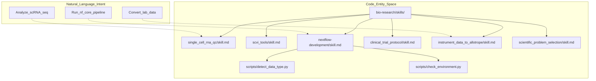
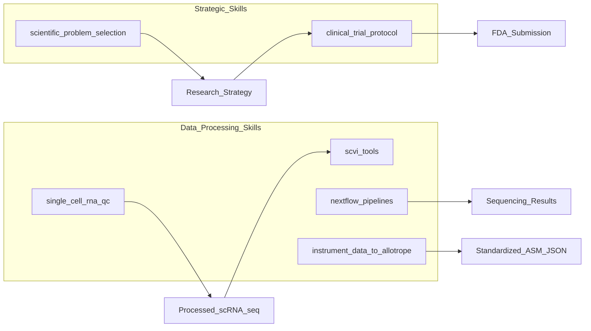
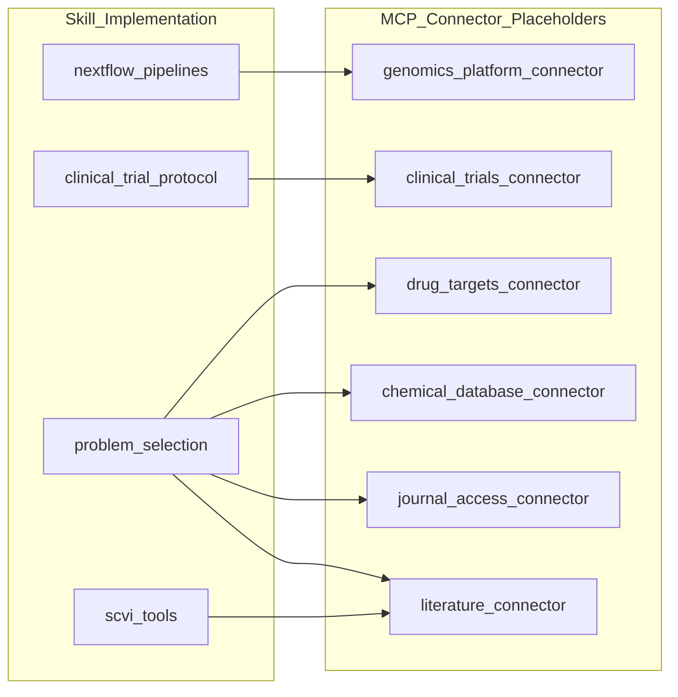
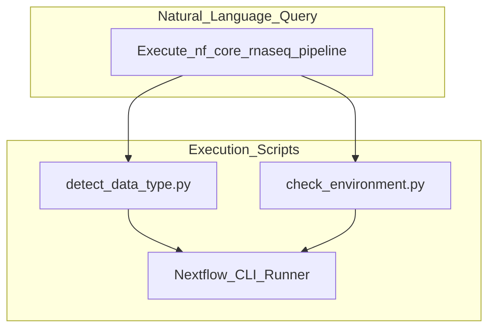
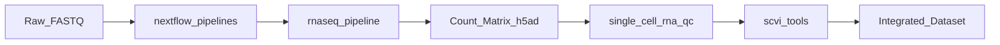

<!-- source: DeepWiki mcp.deepwiki.com · repo anthropics/knowledge-work-plugins · page 3.4 Analysis Skills Overview · fetched 2026-10-26 -->

# Analysis Skills Overview

Relevant source files

The following files were used as context for generating this wiki page:

- [bio-research/.claude-plugin/plugin.json](bio-research/.claude-plugin/plugin.json)
- [bio-research/CONNECTORS.md](bio-research/CONNECTORS.md)
- [bio-research/README.md](bio-research/README.md)
- [data/.claude-plugin/plugin.json](data/.claude-plugin/plugin.json)

This page provides a comprehensive survey of the six analysis skills included in the bio-research plugin. Skills are auto-activated domain knowledge modules that Claude uses to perform specialized analysis workflows. Unlike commands, skills are not explicitly invoked by users—instead, Claude automatically activates them when relevant to the conversation context [bio-research/README.md:34-35]().

For detailed documentation of individual skills, see:
- Clinical Trial Protocol: [3.5]()
- Single-Cell RNA Analysis Skills: [3.6]()
- Nextflow Pipelines: [3.7]()
- Instrument Data to Allotrope Converter: [3.8]()
- Scientific Problem Selection Framework: [3.9]()

For MCP server integrations that skills connect to, see [3.3]().

Sources: [bio-research/README.md:34-35]()

## Skills Architecture

Skills in the bio-research plugin are stored as Markdown files in the `bio-research/skills/` directory. Each skill contains step-by-step workflows, best practices, and technical specifications that guide Claude through complex analysis tasks. The Nextflow skill, in particular, includes Python scripts for environment validation and data detection [bio-research/skills/nextflow-development/scripts/check_environment.py:1-11](), [bio-research/skills/nextflow-development/scripts/detect_data_type.py:1-11]().

### Code Entity Mapping: Skills to Files

**Skill Directory Structure and Intent Mapping**

Sources: [bio-research/README.md:34-53](), [bio-research/skills/nextflow-development/scripts/detect_data_type.py:1-11](), [bio-research/skills/nextflow-development/scripts/check_environment.py:1-11]()

## Skill Taxonomy and Relationships

The bio-research plugin includes six specialized skills covering quality control, pipeline orchestration, regulatory compliance, data standardization, and strategic research planning [bio-research/README.md:5-5]().

**Skill Workflow Relationships**

Sources: [bio-research/README.md:34-53]()

## Skill Descriptions

### 1. Single-Cell RNA QC
- **Purpose**: Automated quality control for single-cell RNA sequencing data following scverse consortium best practices [bio-research/README.md:37-37]().
- **Key Features**: Supports `.h5ad` and `.h5` files with Median Absolute Deviation (MAD)-based filtering and comprehensive visualizations [bio-research/README.md:37-37]().

### 2. scvi-tools
- **Purpose**: Deep learning toolkit for single-cell omics analysis using probabilistic models [bio-research/README.md:40-40]().
- **Supported Models**: Covers `scVI`, `scANVI`, `totalVI`, `PeakVI`, `MultiVI`, `DestVI`, `veloVI`, and `sysVI` for integration, batch correction, label transfer, and multi-modal analysis [bio-research/README.md:40-40]().

### 3. Nextflow Pipelines
- **Purpose**: Run production-grade nf-core bioinformatics pipelines on local or public sequencing data [bio-research/README.md:43-43]().
- **Supported Pipelines**: `rnaseq` (gene expression), `sarek` (germline/somatic variant calling), and `atacseq` (chromatin accessibility) [bio-research/README.md:44-46]().
- **Detection Logic**: Uses `detect_data_type.py` to calculate confidence scores for pipelines based on file extensions (e.g., `.fastq.gz`, `.bam`, `.cram`) and directory hints [bio-research/skills/nextflow-development/scripts/detect_data_type.py:37-77](), [bio-research/skills/nextflow-development/scripts/detect_data_type.py:80-172]().
- **Validation**: Employs `check_environment.py` to verify Docker availability, Nextflow version (requires >= 23.04), and Java version (requires >= 11) [bio-research/skills/nextflow-development/scripts/check_environment.py:47-221]().

### 4. Clinical Trial Protocol
- **Purpose**: Generate FDA/NIH-compliant clinical trial protocols for medical devices or drugs [bio-research/README.md:51-52]().
- **Integration**: Leverages the `~~clinical trials` connector (typically ClinicalTrials.gov) to identify prior art and existing study designs [bio-research/README.md:22-22](), [bio-research/CONNECTORS.md:15-15]().

### 5. Instrument Data to Allotrope Converter
- **Purpose**: Convert laboratory instrument output files (PDF, CSV, Excel, TXT) to Allotrope Simple Model (ASM) format [bio-research/README.md:49-49]().
- **Scope**: Supports 40+ instrument types including cell counters, spectrophotometers, plate readers, qPCR, and chromatography systems [bio-research/README.md:49-49]().

### 6. Scientific Problem Selection
- **Purpose**: Systematic framework for research problem selection based on Fischbach & Walsh's framework [bio-research/README.md:52-52]().
- **Components**: 9 sub-skills covering ideation, risk assessment, optimization, decision trees, and adversity planning [bio-research/README.md:52-52]().

Sources: [bio-research/README.md:37-53](), [bio-research/skills/nextflow-development/scripts/detect_data_type.py:37-172](), [bio-research/skills/nextflow-development/scripts/check_environment.py:47-221]()

## Integration with MCP Servers

The following diagram maps the analysis skills to the MCP connector categories defined in the plugin manifest and connector documentation.

**MCP Server Dependencies by Skill**

Sources: [bio-research/README.md:9-53](), [bio-research/CONNECTORS.md:11-21](), [bio-research/README.md:31-31]()

## Pipeline Execution and Script Mapping

To transition from user intent to concrete code execution, the skill architecture bridges natural language requests to validation and execution scripts.

**Script Execution Flow**

Sources: [bio-research/skills/nextflow-development/scripts/detect_data_type.py:1-201](), [bio-research/skills/nextflow-development/scripts/check_environment.py:1-221]()

## Common Workflows Using Multiple Skills

### Workflow: Sequencing to Integration
Users typically start by downloading data from GEO/SRA, running nf-core pipelines, and then moving into downstream analysis [bio-research/README.md:73-73]().

Sources: [bio-research/README.md:69-74](), [bio-research/skills/nextflow-development/scripts/detect_data_type.py:175-201]()

---

