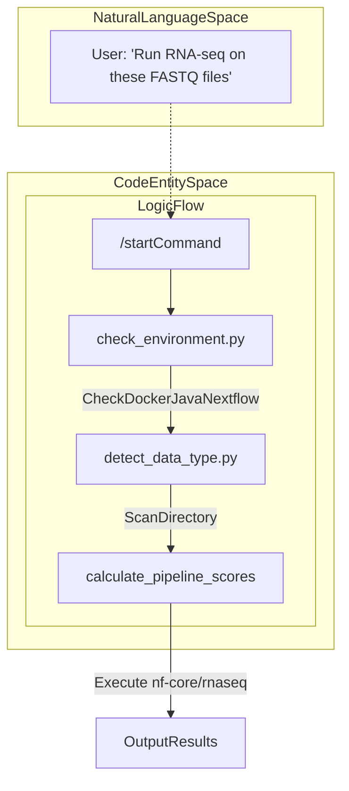
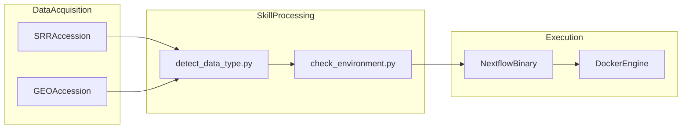

<!-- source: DeepWiki mcp.deepwiki.com · repo anthropics/knowledge-work-plugins · page 3.7 Nextflow Pipelines Skill · fetched 2026-10-26 -->

# Nextflow Pipelines Skill

Relevant source files

The following files were used as context for generating this wiki page:

- [bio-research/skills/nextflow-development/scripts/check_environment.py](bio-research/skills/nextflow-development/scripts/check_environment.py)
- [bio-research/skills/nextflow-development/scripts/detect_data_type.py](bio-research/skills/nextflow-development/scripts/detect_data_type.py)

## Purpose and Scope

This document describes the Nextflow Pipelines skill, a core analysis capability within the `bio-research` plugin [bio-research/README.md:42-47](). This skill enables the automated execution of nf-core bioinformatics pipelines for processing sequencing data sourced from local files or public repositories like GEO and SRA [bio-research/README.md:43-47](). It specifically supports three production-ready workflows: RNA-seq analysis, variant calling (Sarek), and ATAC-seq chromatin accessibility analysis [bio-research/README.md:43-47]().

For general bio-research plugin capabilities, see Bio-Research Overview and Capabilities. For other analysis skills, see Analysis Skills Overview.

Sources: [bio-research/README.md:42-47]()

---

## Skill Overview

The Nextflow Pipelines skill provides a curated interface to three widely-used nf-core community pipelines. nf-core is a standardized framework for Nextflow-based bioinformatics workflows that ensures reproducibility and best practices.

| Pipeline | nf-core Name | Primary Use Case | Sequencing Technology |
|----------|--------------|------------------|----------------------|
| RNA-seq | `nf-core/rnaseq` | Gene expression quantification and differential expression analysis | Illumina RNA-seq (single/paired-end) |
| Variant Calling | `nf-core/sarek` | Germline and somatic variant detection in whole genome/exome sequencing | WGS, WES (Illumina, PacBio, ONT) |
| ATAC-seq | `nf-core/atacseq` | Chromatin accessibility profiling and peak calling | ATAC-seq (Illumina) |

The skill manages the full lifecycle of a pipeline run: environment configuration, data retrieval, execution management, and results verification [bio-research/README.md:72-74]().

Sources: [bio-research/README.md:42-47](), [bio-research/README.md:72-74]()

---

## Skill Architecture

The skill includes automated environment validation via `check_environment.py` [bio-research/skills/nextflow-development/scripts/check_environment.py:3-6]() and data type detection via `detect_data_type.py` [bio-research/skills/nextflow-development/scripts/detect_data_type.py:3-6]() to ensure pipelines run correctly on the provided hardware and data.

**Diagram: Nextflow Skill Natural Language to Code Mapping**

Sources: [bio-research/skills/nextflow-development/scripts/check_environment.py:3-6](), [bio-research/skills/nextflow-development/scripts/detect_data_type.py:3-6]()

### Environment Validation

Before execution, the system utilizes `check_environment.py` to perform pre-flight checks [bio-research/skills/nextflow-development/scripts/check_environment.py:3-6]():
- **Docker**: The `check_docker` function verifies availability, daemon status, and user permissions [bio-research/skills/nextflow-development/scripts/check_environment.py:47-55]().
- **Nextflow**: The `check_nextflow` function verifies installation and enforces a version requirement of `>= 23.04` [bio-research/skills/nextflow-development/scripts/check_environment.py:113-156]().
- **Java**: The `check_java` function ensures Java 11 or higher is available in the environment [bio-research/skills/nextflow-development/scripts/check_environment.py:180-221]().

Sources: [bio-research/skills/nextflow-development/scripts/check_environment.py:3-221]()

### Automated Data Detection

The skill uses `detect_data_type.py` to analyze file contents and directory structures to suggest the most appropriate pipeline [bio-research/skills/nextflow-development/scripts/detect_data_type.py:2-6]().

| Detection Logic | Implementation Detail |
|-----------------|-----------------------|
| **File Scanning** | `scan_directory` identifies `.fastq.gz`, `.bam`, and `.cram` extensions [bio-research/skills/nextflow-development/scripts/detect_data_type.py:56-66](). |
| **Pipeline Scoring** | `calculate_pipeline_scores` assigns weights based on `detection_hints` in YAML configs [bio-research/skills/nextflow-development/scripts/detect_data_type.py:80-100](). |
| **Sarek Boost** | Increases score if tumor/normal indicators (e.g., 'cancer', 'germline') are found [bio-research/skills/nextflow-development/scripts/detect_data_type.py:124-138](). |
| **ATAC-seq Boost** | Increases score if keywords like 'chromatin' or 'macs' are present [bio-research/skills/nextflow-development/scripts/detect_data_type.py:156-163](). |

Sources: [bio-research/skills/nextflow-development/scripts/detect_data_type.py:2-163]()

---

## Pipeline Details

### nf-core/rnaseq — RNA-seq Analysis

Used for gene expression quantification and differential expression analysis [bio-research/README.md:44-45](). The detection logic looks for `rna`, `expression`, or `transcript` keywords in the data path [bio-research/skills/nextflow-development/scripts/detect_data_type.py:147-154]().

Sources: [bio-research/README.md:44-45](), [bio-research/skills/nextflow-development/scripts/detect_data_type.py:147-154]()

### nf-core/sarek — Variant Calling (WGS/WES)

Designed for germline and somatic variant calling on whole genome or whole exome sequencing data [bio-research/README.md:45-46]().

**Detection Logic in `detect_data_type.py`:**
- Identifies DNA-related hints like `wgs`, `wes`, `exome`, `variant`, `snp`, `indel` [bio-research/skills/nextflow-development/scripts/detect_data_type.py:139-145]().
- Specifically looks for `tumor`, `cancer`, or `normal` strings to identify somatic vs germline workflows [bio-research/skills/nextflow-development/scripts/detect_data_type.py:124-138]().

Sources: [bio-research/README.md:45-46](), [bio-research/skills/nextflow-development/scripts/detect_data_type.py:124-145]()

### nf-core/atacseq — ATAC-seq Analysis

Analyzes chromatin accessibility and peak calling [bio-research/README.md:46-47]().

**Detection Logic in `detect_data_type.py`:**
- Looks for keywords: `atac`, `chromatin`, `accessibility`, `peak`, `macs` [bio-research/skills/nextflow-development/scripts/detect_data_type.py:156-163]().

Sources: [bio-research/README.md:46-47](), [bio-research/skills/nextflow-development/scripts/detect_data_type.py:156-163]()

---

## Data Source Integration

The skill bridges Natural Language requests for public data with the execution of specialized Nextflow binaries.

**Diagram: Data Acquisition to Execution Flow**

**Supported Accession Types:**
- **GSE** (GEO Series)
- **SRR** (SRA Run)

Sources: [bio-research/README.md:42-47](), [bio-research/skills/nextflow-development/scripts/check_environment.py:47-55]()

---

## Execution Configuration

### Computational Resources

The `EnvironmentReport` generated by `check_environment.py` ensures the system meets the high resource demands of bioinformatics pipelines [bio-research/skills/nextflow-development/scripts/check_environment.py:33-44]().

| Resource | Requirement | Validation Method |
|----------|-------------|-------------------|
| **Docker** | Running Daemon | `docker info` [bio-research/skills/nextflow-development/scripts/check_environment.py:58-63]() |
| **Nextflow** | Version >= 23.04 | `nextflow -version` [bio-research/skills/nextflow-development/scripts/check_environment.py:124-156]() |
| **Java** | Version >= 11 | `java -version` [bio-research/skills/nextflow-development/scripts/check_environment.py:191-221]() |

Sources: [bio-research/skills/nextflow-development/scripts/check_environment.py:3-221]()

---

## Integration with Bio-Research Ecosystem

The Nextflow Pipelines skill is a mid-stream component in the bio-research workflow [bio-research/README.md:5-7]().

- **Literature Review**: Users can search `~~literature` for papers and then instruct the skill to run a pipeline on the specific data mentioned in those papers [bio-research/README.md:66-68]().
- **Downstream Analysis**: Once `rnaseq` produces counts, the **Single-Cell RNA QC** or **scvi-tools** skills can be invoked for secondary analysis [bio-research/README.md:69-72]().
- **Visualization**: Figures from pipeline outputs (like MultiQC reports) can be referenced when creating illustrations via `~~scientific illustration` [bio-research/README.md:66-68]().

Sources: [bio-research/README.md:1-80]()

---

## Comparison with Other Bio-Research Skills

| Feature | Nextflow Pipelines | Single-Cell RNA QC | scvi-tools |
|---------|-------------------|-------------------|------------|
| **Data Type** | Bulk/WGS/ATAC/scRNA | scRNA-seq | scRNA-seq |
| **Primary Goal** | Raw Data Processing | Quality Control | Deep Learning Analysis |
| **Implementation** | Nextflow/nf-core | Python (scverse) | PyTorch |
| **Reference** | [bio-research/README.md:42-47]() | [bio-research/README.md:36-38]() | [bio-research/README.md:39-41]() |

Sources: [bio-research/README.md:35-52]()

---

