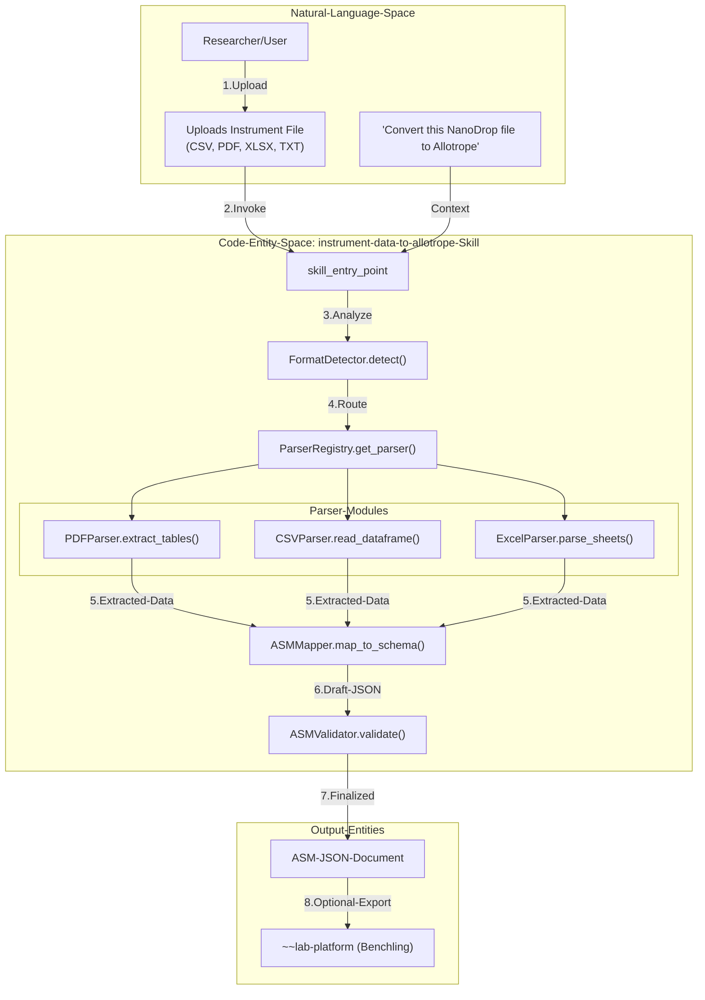
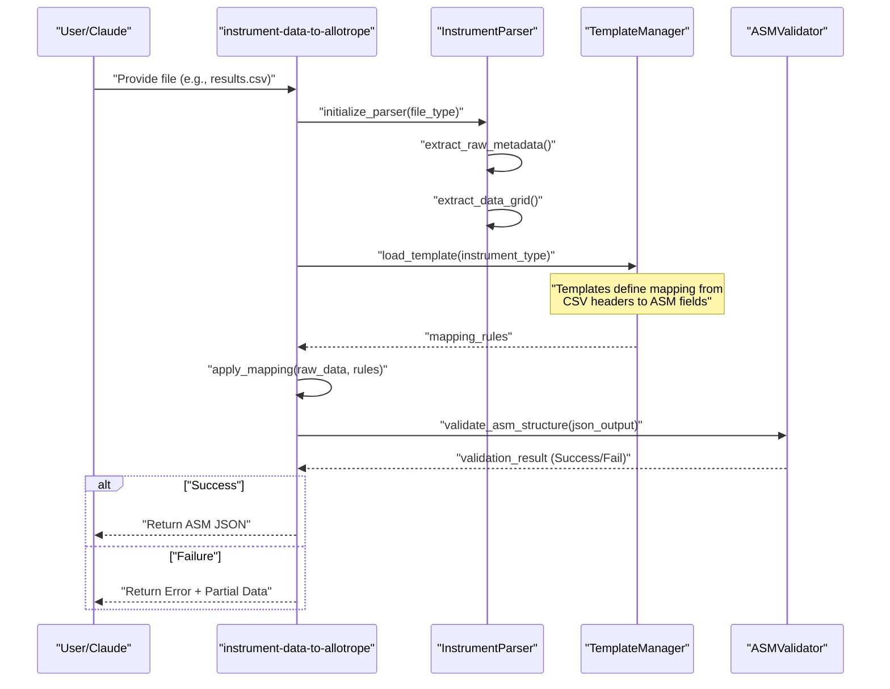

<!-- source: DeepWiki mcp.deepwiki.com · repo anthropics/knowledge-work-plugins · page 3.8 Instrument Data to Allotrope Converter · fetched 2026-10-26 -->

# Instrument Data to Allotrope Converter

Relevant source files

The following files were used as context for generating this wiki page:

- [bio-research/.claude-plugin/plugin.json](bio-research/.claude-plugin/plugin.json)
- [bio-research/CONNECTORS.md](bio-research/CONNECTORS.md)
- [bio-research/README.md](bio-research/README.md)
- [data/.claude-plugin/plugin.json](data/.claude-plugin/plugin.json)

## Purpose and Scope

The Instrument Data to Allotrope Converter is a specialized analysis skill within the **bio-research** plugin [bio-research/.claude-plugin/plugin.json:1-8](). Its primary function is to transform heterogeneous laboratory instrument output files—often in proprietary or loosely structured formats like PDF, CSV, Excel, and TXT—into the standardized **Allotrope Simple Model (ASM)** format [bio-research/README.md:48-50](). This conversion enables vendor-neutral data interoperability, structured downstream analysis, and adherence to FAIR (Findable, Accessible, Interoperable, and Reusable) data principles in life sciences R&D.

The skill supports over 40 instrument types across diverse domains including cell counters, spectrophotometers, plate readers, qPCR, and chromatography systems [bio-research/README.md:48-50]().

Sources: [bio-research/README.md:48-50](), [bio-research/.claude-plugin/plugin.json:1-8]()

---

## Allotrope Simple Model (ASM) Overview

The Allotrope Simple Model (ASM) is a JSON-based schema developed by the Allotrope Foundation. It provides a structured framework for representing analytical laboratory data by decoupling it from proprietary vendor software.

An ASM document generated by this skill typically follows this high-level structure:
*   **Manifest**: Metadata about the document itself (analyst, timestamp).
*   **Device System**: Details about the physical instrument (manufacturer, serial number).
*   **Data System**: Information about the software that generated the raw data.
*   **Measurement Documents**: The core analytical data, including technique-specific settings and results.
*   **Sample Documents**: Metadata regarding the samples being measured.

Sources: [bio-research/README.md:48-50]()

---

## Architecture and Data Flow

The conversion process bridges the "Natural Language Space" (where a user describes a file) to the "Code Entity Space" (where parsers and mappers execute logic).

### System Logic Flow

**Diagram: Natural Language to Code Entity Mapping for Instrument Conversion**

Sources: [bio-research/README.md:48-50](), [bio-research/README.md:25-25](), [bio-research/CONNECTORS.md:21-21]()

---

## Supported Instrument Domains

The converter handles a wide array of laboratory equipment, mapping their specific outputs to corresponding ASM models [bio-research/README.md:48-50]().

| Domain | Instrument Examples | Key ASM Mappings |
| :--- | :--- | :--- |
| **Cell Counting** | Vi-CELL, Countess, Luna | Viability, Total Cell Count, Diameter |
| **Spectroscopy** | NanoDrop, SpectraMax | Absorbance, Wavelength, Pathlength |
| **Chromatography** | Agilent HPLC, Waters UHPLC | Retention Time, Peak Area, Flow Rate |
| **Molecular Biology** | QuantStudio qPCR, Bioanalyzer | Ct Values, Fragment Size, Concentration |
| **Plate Readers** | Tecan, BMG Labtech | Well ID, Fluorescence Intensity, OD |

Sources: [bio-research/README.md:48-50]()

---

## Implementation Details: Conversion Sequence

The following diagram illustrates the internal sequence of operations when the `instrument-data-to-allotrope` skill is activated.

**Diagram: Conversion Execution Sequence**

Sources: [bio-research/README.md:48-50]()

---

## Integration with Laboratory Ecosystems

The converter does not operate in isolation. It serves as a bridge between raw data and laboratory management platforms via the connector system [bio-research/CONNECTORS.md:5-8]().

*   **Benchling Integration**: Converted ASM data can be pushed to Benchling via the `~~lab platform` connector to populate Notebook entries or Registry schemas [bio-research/README.md:25-25](), [bio-research/CONNECTORS.md:21-21]().
*   **Downstream Analysis**: Standardized data from the converter can be used as input for other skills, such as the **Single-Cell RNA QC** skill if the input was a cell counter file [bio-research/README.md:36-37]().
*   **Data Repositories**: ASM files are suited for storage in `~~data repository` (e.g., Synapse) for collaborative research management [bio-research/README.md:19-19](), [bio-research/CONNECTORS.md:18-18]().

Sources: [bio-research/README.md:19-19](), [bio-research/README.md:25-25](), [bio-research/README.md:36-37](), [bio-research/CONNECTORS.md:18-21]()

---

## Technical Limitations

*   **Proprietary Binary Formats**: While the skill supports 40+ types, some proprietary binary formats may require pre-export to a readable format like `.csv` or `.xlsx` before processing [bio-research/README.md:48-50]().
*   **Image Processing**: The converter focuses on numerical and metadata extraction from report files. It does not perform primary image analysis (e.g., counting cells directly from raw microscopy images); it relies on the instrument's own processed output reports [bio-research/README.md:48-50]().

Sources: [bio-research/README.md:48-50]()

---

