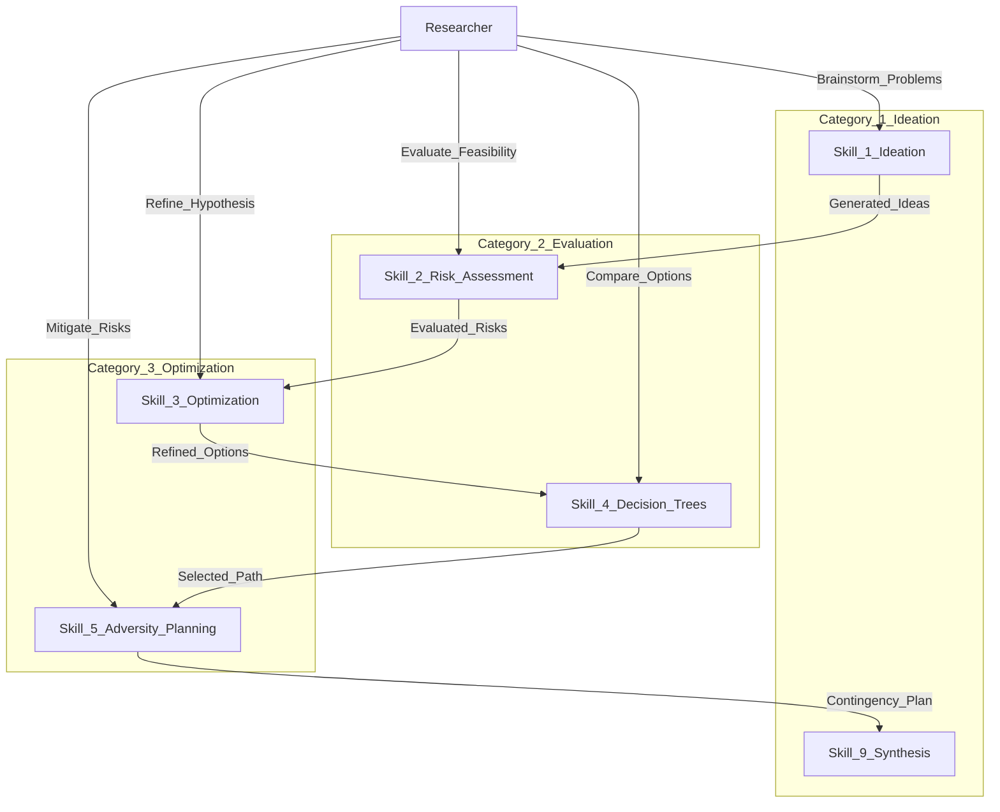
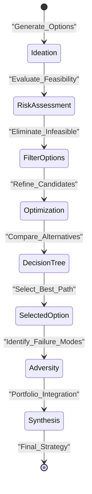
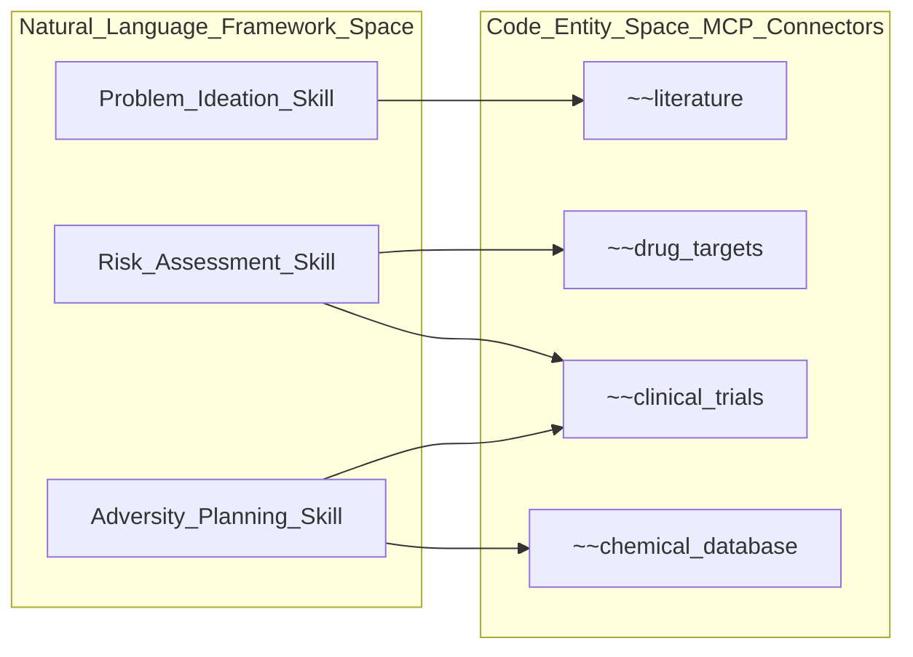
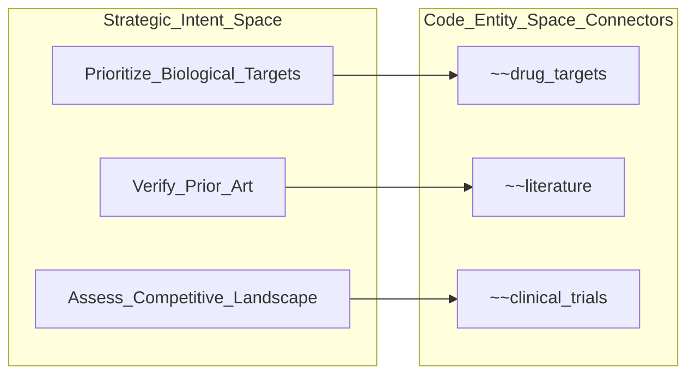

<!-- source: DeepWiki mcp.deepwiki.com · repo anthropics/knowledge-work-plugins · page 3.9 Scientific Problem Selection Framework · fetched 2026-10-26 -->

# Scientific Problem Selection Framework

Relevant source files

The following files were used as context for generating this wiki page:

- [bio-research/.claude-plugin/plugin.json](bio-research/.claude-plugin/plugin.json)
- [bio-research/CONNECTORS.md](bio-research/CONNECTORS.md)
- [bio-research/README.md](bio-research/README.md)
- [data/.claude-plugin/plugin.json](data/.claude-plugin/plugin.json)

**Purpose**: This page documents the Scientific Problem Selection Framework skill in the `bio-research` plugin. This is a systematic decision-making framework for life sciences researchers based on Fischbach & Walsh's methodology for evaluating research directions. The framework consists of component skills covering ideation, risk assessment, optimization, decision trees, adversity planning, and synthesis.

**Scope**: This document covers the framework's architecture, component skills, decision workflows, MCP data source mapping, and usage patterns for research strategy evaluation within the bio-research plugin ecosystem.

Sources: [bio-research/README.md:51-53](), [bio-research/.claude-plugin/plugin.json:2-4]()

## Overview and Purpose

The Scientific Problem Selection Framework is a structured methodology for researchers to evaluate scientific problems, research directions, and strategic decisions [bio-research/README.md:51-53](). Unlike technical analysis skills (such as single-cell QC or Nextflow pipelines), this framework provides cognitive tools for meta-research decisions: determining what problems to work on, assessing whether a direction is worth pursuing, and optimizing research strategy [bio-research/README.md:36-53]().

The framework is implemented within the `bio-research` plugin and auto-activates when queries involve research strategy, problem evaluation, or scientific decision-making [bio-research/README.md:51-53]().

- **Modular Design**: Structured around distinct analytical steps (ideation, risk assessment, optimization, decision trees, adversity planning, and synthesis) [bio-research/README.md:51-53]().
- **Systematic Approach**: Replaces ad-hoc intuition with structured evaluation criteria [bio-research/README.md:51-53]().
- **Methodological Foundation**: Implements Fischbach & Walsh's research problem selection methodology [bio-research/README.md:51-53]().
- **Tool-Agnostic Integration**: Combines pure reasoning workflows with live data from MCP server connectors [bio-research/README.md:13-26]().

Sources: [bio-research/README.md:13-53]()

## Framework Architecture

The framework is organized into specialized skills that can be invoked individually or sequentially depending on the research query.

### Framework Components Overview

**Diagram: Framework component organization and typical workflow progression**

Sources: [bio-research/README.md:51-53](), [bio-research/README.md:78-80]()

## Skill Activation and Workflow Patterns

The framework relies on auto-activation when Claude detects strategic research queries, mapping user intents to specific evaluation modalities [bio-research/README.md:51-53]().

### Activation Triggers

| User Intent / Query Type | Activated Component | Example Scenario |
|-------------------------|---------------------|------------------|
| Problem generation | Skill 1 (Ideation) | "What are promising research directions in CRISPR therapeutics?" [bio-research/README.md:51-53]() |
| Feasibility check | Skill 2 (Risk Assessment) | "Is developing a new AAV vector feasible for my lab?" [bio-research/README.md:51-53]() |
| Problem refinement | Skill 3 (Optimization) | "How can I improve my hypothesis about mitochondrial dysfunction?" [bio-research/README.md:51-53]() |
| Option comparison | Skill 4 (Decision Trees) | "Should I pursue target A or target B for drug discovery?" [bio-research/README.md:51-53]() |
| Risk mitigation | Skill 5 (Adversity Planning) | "What could go wrong with this clinical trial design?" [bio-research/README.md:51-53]() |
| Portfolio strategy | Skill 9 (Synthesis) | "How do I balance three different research projects?" [bio-research/README.md:51-53]() |

Sources: [bio-research/README.md:51-53](), [bio-research/README.md:78-80]()

### Sequential Workflow State Machine

**Diagram: Complete state progression for strategic research development**

Sources: [bio-research/README.md:51-53](), [bio-research/README.md:78-80]()

## Integration with Bio-Research MCP Servers

To ground its reasoning, the framework interfaces with the MCP servers and connector placeholders defined in `CONNECTORS.md` [bio-research/CONNECTORS.md:3-8]().

### Natural Language to Code Entity Mapping

**Diagram: Bridging natural language strategy execution to MCP connector entities**

### Second Natural Language to Code Entity Space Mapping

**Diagram: Mapping strategic research intent to specific connector categories**

### Key MCP Data Sources for Selection
- **`~~literature`**: Used via PubMed, bioRxiv, or Consensus to verify novelty during Ideation and check prior art during Risk Assessment [bio-research/README.md:15-17](), [bio-research/CONNECTORS.md:13]().
- **`~~drug targets`**: Used via OpenTargets to prioritize targets based on genetic evidence and tractability [bio-research/README.md:21](), [bio-research/CONNECTORS.md:17]().
- **`~~clinical trials`**: Used via ClinicalTrials.gov to assess the competitive landscape and regulatory feasibility [bio-research/README.md:22](), [bio-research/CONNECTORS.md:15]().
- **`~~chemical database`**: Used via ChEMBL to evaluate the availability of bioactive drug-like compounds for a chosen target [bio-research/README.md:20](), [bio-research/CONNECTORS.md:16]().

Sources: [bio-research/README.md:13-26](), [bio-research/CONNECTORS.md:11-21]()

## Skill-Specific Workflows

### Risk Assessment Dimensions
Skill 2 evaluates research risk across four primary dimensions:
1. **Technical Risk**: Scientific feasibility and technology maturity [bio-research/README.md:51-53]().
2. **Market Risk**: Clinical need and competitive landscape [bio-research/README.md:51-53]().
3. **Regulatory Risk**: FDA pathway clarity and safety profile [bio-research/README.md:51-53]().
4. **Resource Risk**: Funding and infrastructure requirements [bio-research/README.md:51-53]().

### Decision Trees and Multi-Criteria Scoring
Skill 4 constructs weighted scoring matrices where users can customize criteria based on their institutional setting [bio-research/README.md:51-53](). For academic environments, high weight is assigned to scientific impact; for startup environments, high weight is assigned to timeline to results and funding availability [bio-research/README.md:51-53]().

### Adversity Planning and Failure Modes
Skill 5 applies a pre-mortem approach, prompting researchers to analyze failure modes across three vectors:
- **Prevention**: Actions to reduce the likelihood of failure [bio-research/README.md:51-53]().
- **Detection**: Early warning indicators such as assay variability [bio-research/README.md:51-53]().
- **Response**: Pre-planned contingency actions [bio-research/README.md:51-53]().

Sources: [bio-research/README.md:51-53](), [bio-research/README.md:78-80]()

## Summary of Framework Components

| Skill Identifier | Name | Primary Purpose | Associated Connectors |
|------------------|------|-----------------|----------------------|
| Skill 1 | Ideation | Generate 5-10 research problems | `~~literature` [bio-research/README.md:15-17](), [bio-research/CONNECTORS.md:13]() |
| Skill 2 | Risk Assessment | Evaluate technical and market feasibility | `~~drug targets`, `~~clinical trials` [bio-research/README.md:21-22](), [bio-research/CONNECTORS.md:15](), [bio-research/CONNECTORS.md:17]() |
| Skill 3 | Optimization | Refine problem formulation | N/A |
| Skill 4 | Decision Trees | Multi-criteria comparison | N/A |
| Skill 5 | Adversity Planning | Failure mode analysis | `~~clinical trials` [bio-research/README.md:22](), [bio-research/CONNECTORS.md:15]() |
| Skill 9 | Synthesis | Portfolio optimization | N/A |

Sources: [bio-research/README.md:13-26](), [bio-research/README.md:51-53](), [bio-research/CONNECTORS.md:11-21]()

---

