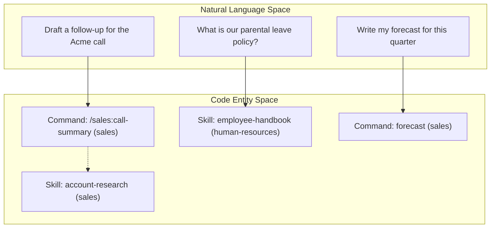
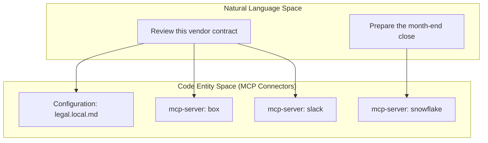

<!-- source: DeepWiki mcp.deepwiki.com · repo anthropics/knowledge-work-plugins · page 4 Business Function Plugins · fetched 2026-10-26 -->

# Business Function Plugins

Relevant source files

The following files were used as context for generating this wiki page:

- [README.md](README.md)
- [data/.mcp.json](data/.mcp.json)
- [data/CONNECTORS.md](data/CONNECTORS.md)
- [human-resources/README.md](human-resources/README.md)
- [legal/README.md](legal/README.md)
- [sales/README.md](sales/README.md)

## Purpose and Scope

This page provides a high-level overview of the core business function plugins within the `knowledge-work-plugins` repository. These plugins are designed to extend Claude's capabilities into specific professional domains, providing specialized slash commands and auto-activated skills for roles in Sales, Finance, Legal, Marketing, Product Management, HR, Customer Support, and Operations.

These plugins follow the standard architecture of using `~~category` placeholders to remain tool-agnostic while providing deep domain expertise. For architectural details, see [Plugin System Architecture](#2).

---

## Sales and Revenue Plugins
**Location:** `/sales`

The Sales plugin focuses on the end-to-end revenue cycle, from initial prospecting to deal closure and forecasting. It is designed to assist Account Executives (AEs) and Business Development Representatives (BDRs) by automating research and administrative tasks [sales/README.md:3-3]().

*   **Key Workflows:** Automated call summaries [sales/README.md:32-32](), weighted pipeline forecasting [sales/README.md:73-73](), and deal risk analysis [sales/README.md:57-57]().
*   **Core Skills:** Automated account research [sales/README.md:43-43](), personalized outreach drafting [sales/README.md:46-46](), and competitive intelligence [sales/README.md:63-63]().
*   **Integrations:** Connects via MCP to CRM (HubSpot, Close), Transcripts (Fireflies, Gong), and Enrichment tools (Apollo, Clay, ZoomInfo) [README.md:18-18]().

For details, see [Sales and Revenue Plugins](#4.1).

**Sources:** [sales/README.md:1-106](), [README.md:18-18]()

---

## Finance and Legal Plugins
**Location:** `/finance` and `/legal`

These plugins automate critical back-office operations, ensuring compliance and financial accuracy.

### Finance
The Finance plugin streamlines accounting workflows, from journal entries to audit preparation [README.md:23-23]().
*   **Capabilities:** Month-end close, journal entry generation, reconciliation, and variance analysis [README.md:23-23]().

### Legal
The Legal plugin is built for in-house legal teams to automate high-volume tasks like contract triage and playbook-driven redlining [legal/README.md:1-3]().
*   **Legal Playbook:** Users can define standard positions on liability, indemnification, and IP in a `legal.local.md` file [legal/README.md:34-80]().
*   **Key Commands:** `/review-contract` for clause-by-clause analysis against the playbook [legal/README.md:89-95]() and `/triage-nda` for rapid green/yellow/red categorization [legal/README.md:99-105]().
*   **Skills:** Includes specialized domain knowledge for `contract-review`, `compliance` (GDPR/CCPA), and `legal-risk-assessment` [legal/README.md:141-145]().

For details, see [Finance and Legal Plugins](#4.2).

**Sources:** [legal/README.md:1-158](), [README.md:23-23]()

---

## Marketing and Product Management Plugins
**Locations:** `/marketing`, `/product-management`

These plugins support the creative and strategic phases of the product lifecycle, from initial brainstorming to campaign performance reporting.

### Marketing
The Marketing plugin provides commands and skills for content creation, campaign planning, and brand review.
*   **Key Commands:** `/draft-content`, `/campaign-plan`, `/brand-review`, and `/performance-report`.
*   **Core Skills:** `content-creation`, `campaign-planning`, `brand-voice`, and `performance-analytics`.

### Product Management
The Product Management plugin assists with the full PM workflow, including feature specification and roadmap management.
*   **Key Commands:** `/write-spec` for PRDs, `/roadmap-update`, and `/synthesize-research`.
*   **Core Skills:** `feature-spec`, `roadmap-management`, and `product-brainstorming`.

For details, see [Marketing and Product Management Plugins](#4.3).

**Sources:** [README.md:20-21]()

---

## HR, Customer Support, and Operations Plugins
**Locations:** `/human-resources`, `/operations`

These plugins assist people operations and general operations teams with the employee lifecycle and process documentation.

### Human Resources
The HR plugin supports recruiting, onboarding, performance management, and compensation analysis [human-resources/README.md:1-3]().
*   **Key Commands:** `/draft-offer` for compensation-aware offer letters [human-resources/README.md:18-18](), `/onboarding` for checklist generation [human-resources/README.md:19-19](), `/performance-review` for structuring reviews [human-resources/README.md:20-20](), and `/comp-analysis` for benchmarking [human-resources/README.md:22-22]().
*   **Core Skills:** `recruiting-pipeline`, `employee-handbook` for automated policy lookups, `compensation-benchmarking`, and `people-analytics` [human-resources/README.md:31-37]().
*   **Integrations:** Connects to HRIS (Workday, BambooHR), ATS (Greenhouse, Lever), and Compensation data (Pave, Radford) [human-resources/README.md:104-106]().

### Operations
The Operations plugin focuses on vendor review, process documentation, and change management.
*   **Capabilities:** Vendor review, process documentation, and capacity planning.

For details, see [HR, Customer Support, and Operations Plugins](#4.4).

**Sources:** [human-resources/README.md:1-138]()

---

## Engineering and Design Plugins
**Locations:** `/engineering`, `/design`

The Engineering and Design plugins streamline technical and creative workflows.

### Engineering
*   **Capabilities:** Standup automation, code review assistance, architecture decisions, incident response, and debugging.

### Design
*   **Capabilities:** Design critique, design system management, UX writing, and accessibility audits.

For details, see [Engineering and Design Plugins](#4.5).

**Sources:** [README.md:3-3]()

---

## Bridge: Natural Language to Code Entity Space

The following diagrams illustrate how user intents in natural language map to specific code entities (Commands and Skills) within the business plugins.

### Sales and HR Intent Mapping

**Sources:** [sales/README.md:23-35](), [human-resources/README.md:34-34]()

### Legal and Finance Tool Mapping

**Sources:** [legal/README.md:34-86](), [data/.mcp.json:3-6]()

---

## Data Plugin
**Location:** `/data`

The Data plugin provides technical assistance for data exploration and analysis across enterprise data warehouses.

*   **Capabilities:** SQL generation, data visualization, and statistical analysis [README.md:24-24]().
*   **Connectors:** Maps to Snowflake, BigQuery, and Databricks [data/.mcp.json:3-14]().

For details, see [Data Plugin](#4.7).

**Sources:** [README.md:24-24](), [data/.mcp.json:1-36]()

---

## Next Steps

For detailed technical documentation, command lists, and skill definitions for each functional area, please navigate to the respective child pages:

*   [Sales and Revenue Plugins](#4.1)
*   [Finance and Legal Plugins](#4.2)
*   [Marketing and Product Management Plugins](#4.3)
*   [HR, Customer Support, and Operations Plugins](#4.4)
*   [Engineering and Design Plugins](#4.5)
*   [Productivity and Enterprise Search Plugins](#4.6)
*   [Data Plugin](#4.7)

---

