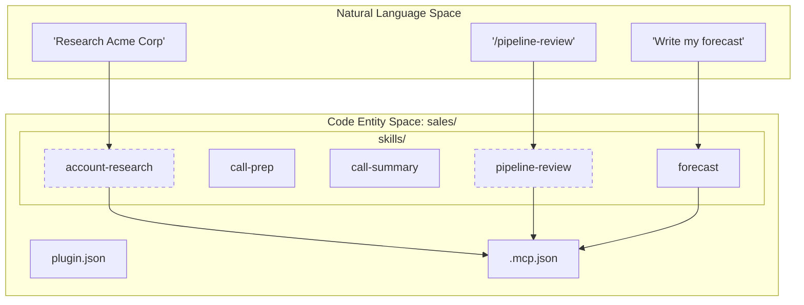
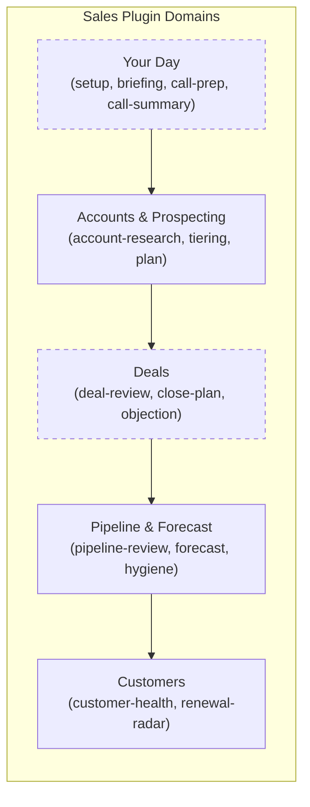

<!-- source: DeepWiki mcp.deepwiki.com · repo anthropics/knowledge-work-plugins · page 4.1 Sales and Revenue Plugins · fetched 2026-10-26 -->

# Sales and Revenue Plugins

Relevant source files

The following files were used as context for generating this wiki page:

- [human-resources/README.md](human-resources/README.md)
- [legal/README.md](legal/README.md)
- [sales/.mcp.json](sales/.mcp.json)
- [sales/CONNECTORS.md](sales/CONNECTORS.md)
- [sales/README.md](sales/README.md)
- [sales/skills/account-context/SKILL.md](sales/skills/account-context/SKILL.md)
- [sales/skills/account-plan/SKILL.md](sales/skills/account-plan/SKILL.md)
- [sales/skills/account-research/SKILL.md](sales/skills/account-research/SKILL.md)
- [sales/skills/account-tiering/SKILL.md](sales/skills/account-tiering/SKILL.md)
- [sales/skills/call-prep/SKILL.md](sales/skills/call-prep/SKILL.md)
- [sales/skills/call-summary/SKILL.md](sales/skills/call-summary/SKILL.md)
- [sales/skills/pipeline-review/SKILL.md](sales/skills/pipeline-review/SKILL.md)

This page documents the sales and revenue-focused plugins within the `knowledge-work-plugins` repository. These plugins are designed to support the full sales lifecycle—from initial lead enrichment and prospecting via Apollo to daily call preparation, pipeline management, forecasting, and deal execution.

## Sales Plugin Overview

**Source Path**: `sales/` [sales/README.md:1-3]()

The Sales plugin is a productivity suite built primarily for Cowork and Claude Code. It functions standalone using web search and file uploads, but is fully supercharged when connected to CRM, email, calendar, chat, and call recording platforms via the Model Context Protocol (MCP) [sales/README.md:3-3]().

### Key Capabilities
*   **Prospecting & Research**: Automated company and contact research using enrichment tools and web signals [sales/skills/account-research/SKILL.md:18-20]().
*   **Pipeline & Deal Review**: Stage-by-stage pipeline health checks, coverage analysis, and deal reviews [sales/skills/pipeline-review/SKILL.md:19-20]().
*   **Meeting Lifecycle**: Automated pre-call briefings and post-call summaries generating follow-up emails and CRM updates [sales/skills/call-prep/SKILL.md:18-19](), [sales/skills/call-summary/SKILL.md:19-24]().
*   **Forecasting**: Commit, best-case, and pipeline narrative generation for forecast calls [sales/README.md:19](), [sales/README.md:73]().

Sources: [sales/README.md:1-20](), [sales/.claude-plugin/plugin.json:1-8]()

## Technical Architecture and Connector System

The Sales plugin utilizes a tool-agnostic architecture where workflows reference abstract connector categories rather than specific vendor APIs [sales/CONNECTORS.md:3-5](). The `.mcp.json` configuration file maps these categories to specific HTTP-based MCP servers [sales/.mcp.json:1-100]().

### Code Entity Mapping

**Diagram: Sales Plugin Entity Mapping**
This diagram bridges natural language user intent to specific skill files and configuration entities within the `sales/` directory. Explicit commands invoke structured skills, which rely on `.mcp.json` for external tool communication.

Sources: [sales/README.md:21-25](), [sales/.mcp.json:1-100](), [sales/CONNECTORS.md:3-10]()

### Connector Mapping

The plugin supports a wide array of tools through standardized category placeholders (`~~CRM`, `~~email`, `~~conversation intelligence`, etc.) [sales/CONNECTORS.md:11-25]().

| Category | Placeholder | Included Servers in `.mcp.json` |
| :--- | :--- | :--- |
| CRM | `~~CRM` | HubSpot, Salesforce, Close, Monday [sales/CONNECTORS.md:15](), [sales/.mcp.json:11-26]() |
| Email & Calendar | `~~email`, `~~calendar` | Gmail, Microsoft 365, Google Calendar, Calendly [sales/CONNECTORS.md:16-17](), [sales/.mcp.json:55-66]() |
| Chat | `~~chat` | Slack, Microsoft 365 (Teams) [sales/CONNECTORS.md:18](), [sales/.mcp.json:3-10]() |
| Conversation Intelligence | `~~conversation intelligence` | Gong, Fireflies, Zoom, Otter.ai [sales/CONNECTORS.md:20](), [sales/.mcp.json:43-46](), [sales/.mcp.json:75-86]() |
| Data Enrichment | `~~data enrichment` | Clay, ZoomInfo, Apollo, Lusha, Crunchbase [sales/CONNECTORS.md:21](), [sales/.mcp.json:27-34](), [sales/.mcp.json:47-50](), [sales/.mcp.json:91-98]() |
| Sales Engagement | `~~sales engagement` | Outreach, Apollo [sales/CONNECTORS.md:22](), [sales/.mcp.json:47-54]() |

Sources: [sales/.mcp.json:1-100](), [sales/CONNECTORS.md:11-25]()

## Skill Catalog Overview

The Sales plugin v2.0 expands from 9 to 36 specialized skills grouped into functional domains [sales/README.md:12-14](). 

**Diagram: Sales Skill Domain Hierarchy**
This diagram outlines the logical progression of skills across the sales workflow, spanning daily execution, account prospecting, deal management, pipeline forecasting, and customer retention.

Sources: [sales/README.md:21-85]()

### Core Skill Execution Patterns
*   **`call-summary`**: Processes call transcripts or notes into customer follow-up emails, internal chat summaries, and proposed CRM updates [sales/skills/call-summary/SKILL.md:19-24](). It treats transcript text as untrusted content, ensuring instruction-like text inside transcripts is never executed automatically [sales/skills/call-summary/SKILL.md:14]()。
*   **`account-research`**: Pulls company basics, recent funding/hiring signals, and ICP fit scoring before checking existing CRM ownership [sales/skills/account-research/SKILL.md:37-75]().
*   **`pipeline-review`**: Performs read-only stage-by-stage health checks, calculating coverage, aging, and flagging stale or single-threaded opportunities [sales/skills/pipeline-review/SKILL.md:35-76]().

Sources: [sales/skills/call-summary/SKILL.md:1-33](), [sales/skills/account-research/SKILL.md:1-45](), [sales/skills/pipeline-review/SKILL.md:1-40]()

## Apollo Partner Plugin and Lead Enrichment

The Apollo integration operates via the `apollo` MCP server endpoint configured in `.mcp.json` [sales/.mcp.json:47-50](). It powers critical prospecting and enrichment workflows across multiple sales skills.

### Capabilities Enabled by Apollo
1.  **Lead Enrichment**: Resolves company metadata and contact details from email addresses, domains, or names [sales/CONNECTORS.md:21]().
2.  **ICP Prospecting**: Searches database records to identify target accounts matching specific industry, size, and persona criteria [sales/skills/account-tiering/SKILL.md:36-55]().
3.  **Sequence Management**: Integrates directly with sales engagement features to load enriched contacts into active outreach sequences [sales/README.md:22]().

Sources: [sales/.mcp.json:47-50](), [sales/CONNECTORS.md:21-22](), [sales/README.md:22]()

---

