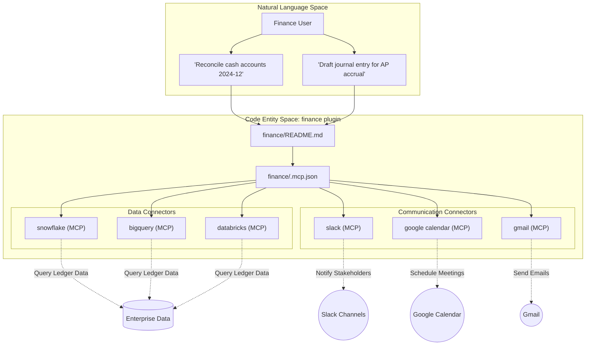
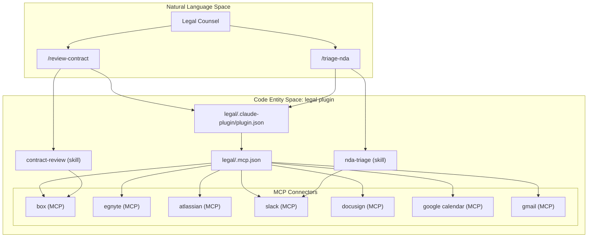

<!-- source: DeepWiki mcp.deepwiki.com · repo anthropics/knowledge-work-plugins · page 4.2 Finance and Legal Plugins · fetched 2026-10-26 -->

# Finance and Legal Plugins

Relevant source files

The following files were used as context for generating this wiki page:

- [finance/.mcp.json](finance/.mcp.json)
- [finance/README.md](finance/README.md)
- [legal/.claude-plugin/plugin.json](legal/.claude-plugin/plugin.json)
- [legal/.mcp.json](legal/.mcp.json)

## Purpose and Scope

This document details the **Finance** and **Legal** productivity plugins within the knowledge-work-plugins repository. These plugins are designed to automate high-stakes, document-heavy workflows for corporate finance and in-house legal teams.

The **Finance Plugin** focuses on streamlining accounting operations, including month-end close, journal entries, reconciliation, financial statements, variance analysis, and audit preparation [finance/README.md:1-5](). The **Legal Plugin** provides a playbook-driven framework for contract review, NDA triage, and compliance workflows [legal/.claude-plugin/plugin.json:1-8](). Both plugins utilize the Model Context Protocol (MCP) to connect with enterprise data sources and communication tools like Snowflake, BigQuery, Slack, Box, and DocuSign [finance/.mcp.json:1-32](), [legal/.mcp.json:1-36]().

---

## Finance Plugin

The Finance plugin facilitates clean bookkeeping and efficient financial reporting. It bridges the gap between raw data in warehouses (Snowflake/Databricks/BigQuery) and communication/collaboration tools used for coordination (Slack/Email) [finance/.mcp.json:1-32](), [finance/README.md:62-81]().

### Implementation and Data Flow

The plugin architecture centers on connecting analytical tools with communication platforms to manage the lifecycle of financial transactions.

**Figure 4.2.1: Finance Plugin Data Flow**

**Sources:** [finance/README.md:1-50](), [finance/.mcp.json:1-32]()

### Key Capabilities

| Workflow | Description | Data Sources |
| :--- | :--- | :--- |
| **Month-End Close** | Automates checklist items, variance analysis, and status reporting via `close-management` and `/journal-entry`. | Slack, Google Calendar, Gmail, ERP Data [finance/README.md:18-32]() |
| **Journal Entries** | Drafts accruals, prepaids, fixed assets, and revenue entries with debits/credits via `/journal-entry`. | Snowflake, Databricks, BigQuery [finance/README.md:18-18](), [finance/.mcp.json:1-14]() |
| **Reconciliation** | Compares GL balances to subledger/bank balances using `reconciliation` skill and `/reconciliation`. | BigQuery, Snowflake, Databricks, CSV Uploads [finance/README.md:19-29](), [finance/.mcp.json:1-14]() |
| **Audit Prep / SOX** | Generates sample selections, workpapers, and control assessments via `/sox-testing` and `audit-support`. | Gmail, Google Calendar, ERP Data [finance/README.md:22-33]() |

**Sources:** [finance/README.md:16-34](), [finance/.mcp.json:1-32]()

---

## Legal Plugin

The Legal plugin is an AI-powered assistant for in-house legal teams. It assists with contract review, NDA triage, and compliance workflows [legal/.claude-plugin/plugin.json:1-8]().

### Technical Architecture: Redlining and Triage

The legal plugin maps natural language commands to specific skills that interact with external storage and document signing via MCP servers [legal/.mcp.json:1-36]().

**Figure 4.2.2: Legal Plugin Skill Mapping**

**Sources:** [legal/.claude-plugin/plugin.json:1-8](), [legal/.mcp.json:1-36]()

### Core Commands and Skills

#### Commands (Described in Plugin Documentation)
- `/review-contract`: Compares documents against playbook standards, flagging deviations and generating redlines.
- `/triage-nda`: Rapidly screens incoming NDAs based on standard criteria (mutual obligations, term limits).
- `/vendor-check`: Queries connected systems (Box, Egnyte) to report on existing MSAs, DPAs, and expiration dates.
- `/brief`: Generates contextual briefings for legal work and morning alignment.
- `/respond`: Generates templated responses for common inquiry types like data subject requests.

#### Skills
- `contract-review`: Playbook-based contract analysis, deviation classification, and redline generation.
- `nda-triage`: NDA screening criteria, classification rules, and routing recommendations.
- `compliance`: Specialized knowledge for privacy regulations (GDPR, CCPA), DPA review, and data subject requests.
- `canned-responses`: Template management, response categories, and escalation triggers.
- `legal-risk-assessment`: Risk severity framework, classification levels, and escalation criteria.
- `meeting-briefing`: Meeting preparation methodology, context gathering, and action item tracking.

**Sources:** [legal/.claude-plugin/plugin.json:1-8](), [legal/.mcp.json:1-36]()

---

## Comparison of Business Function Plugins

The Finance and Legal plugins share a common architecture with other business plugins like **Sales** and **HR**, but differ in their data sensitivity and regulatory focus.

| Plugin | Primary Data Source | Core Object | Key Output |
| :--- | :--- | :--- | :--- |
| **Finance** | Data Warehouses (Snowflake, BigQuery, Databricks) | Transactions | Reconciled Ledgers, Journal Entries [finance/.mcp.json:1-14](), [finance/README.md:18-19]() |
| **Legal** | Document Repositories (Box, Egnyte, DocuSign) | Clauses / Agreements | Redlined Contracts, NDA Triage [legal/.mcp.json:1-36](), [legal/.claude-plugin/plugin.json:1-8]() |
| **Sales** | CRM (HubSpot/Salesforce) | Deals | Forecasts / Outreach [sales/README.md:101-110]() |
| **HR** | HRIS (Workday/Bamboo) | Employees | Offer Letters / Checklists [human-resources/README.md:101-108]() |

**Sources:** [finance/.mcp.json:1-14](), [finance/README.md:18-19](), [legal/.mcp.json:1-36](), [legal/.claude-plugin/plugin.json:1-8](), [sales/README.md:101-110](), [human-resources/README.md:101-108]()

---

