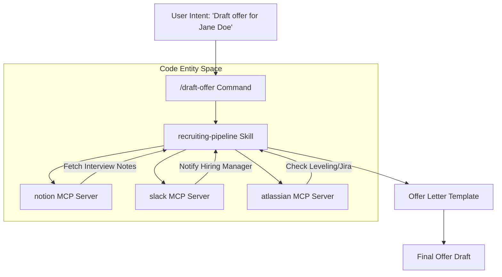
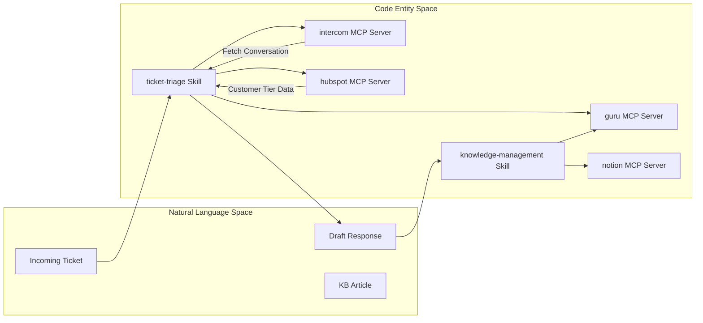
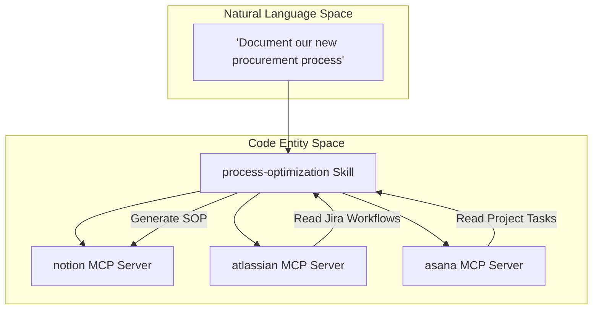

<!-- source: DeepWiki mcp.deepwiki.com · repo anthropics/knowledge-work-plugins · page 4.4 HR, Customer Support, and Operations Plugins · fetched 2026-10-26 -->

# HR, Customer Support, and Operations Plugins

Relevant source files

The following files were used as context for generating this wiki page:

- [customer-support/.mcp.json](customer-support/.mcp.json)
- [customer-support/README.md](customer-support/README.md)
- [human-resources/.mcp.json](human-resources/.mcp.json)
- [operations/.mcp.json](operations/.mcp.json)
- [operations/README.md](operations/README.md)

This page documents the technical implementation and capabilities of the Human Resources, Customer Support, and Operations plugins. These plugins are designed to automate high-to-medium complexity business processes by combining domain-specific skills with Model Context Protocol (MCP) tool integrations.

## 1. Human Resources (HR) Plugin

The HR plugin streamlines people operations including recruiting, onboarding, performance management, and compensation analysis. It utilizes a "Standalone + Supercharged" model, where logic can run on manual user input or pull live data from HRIS, ATS, and Compensation tools.

### HR Plugin MCP Configuration
The HR plugin connects to a suite of communication and documentation tools via the `.mcp.json` configuration.

| MCP Server | Type | URL |
| :--- | :--- | :--- |
| `slack` | http | `https://mcp.slack.com/mcp` [human-resources/.mcp.json:3-10]() |
| `notion` | http | `https://mcp.notion.com/mcp` [human-resources/.mcp.json:19-22]() |
| `atlassian` | http | `https://mcp.atlassian.com/v1/mcp` [human-resources/.mcp.json:23-26]() |
| `google calendar` | http | "" [human-resources/.mcp.json:11-14]() |
| `gmail` | http | "" [human-resources/.mcp.json:15-18]() |

Sources: [human-resources/.mcp.json:1-28]()

### HR Plugin Architecture
The HR plugin organizes its logic into explicit commands for structured workflows and skills for background domain knowledge.

#### Data Flow: Offer Letter Generation
The following diagram illustrates the data flow for candidate processing, bridging the natural language intent to the underlying MCP connectors and skills.

**Diagram: HR Candidate Processing Workflow**

Sources: [human-resources/.mcp.json:1-28]()

---

## 2. Customer Support Plugin

The Customer Support plugin focuses on ticket triage, response drafting, and knowledge base (KB) management [customer-support/README.md:16-20](). It is designed to bridge the gap between reactive support (tickets) and proactive support (KB authoring).

### Commands and Skills Overview
The support plugin exposes specialized slash commands and auto-activated domain skills [customer-support/README.md:22-41]():

| Command | Description | Corresponding Skill |
| :--- | :--- | :--- |
| `/triage` [customer-support/README.md:26]() | Categorize, prioritize, and route a support ticket | `ticket-triage` [customer-support/README.md:36]() |
| `/research` [customer-support/README.md:27]() | Multi-source research on a customer question | `customer-research` [customer-support/README.md:37]() |
| `/draft-response` [customer-support/README.md:28]() | Draft a customer-facing response | `response-drafting` [customer-support/README.md:38]() |
| `/escalate` [customer-support/README.md:29]() | Package an escalation for engineering/product | `escalation` [customer-support/README.md:39]() |
| `/kb-article` [customer-support/README.md:30]() | Draft a knowledge base article from a resolved issue | `knowledge-management` [customer-support/README.md:40]() |

Sources: [customer-support/README.md:22-41]()

### Connector Ecosystem
The Support plugin features a diverse set of MCP integrations to handle ticket lifecycle management across multiple platforms [customer-support/.mcp.json:1-40]().

**Diagram: Support Tool Integration Mapping**

Sources: [customer-support/.mcp.json:1-40](), [customer-support/README.md:32-41]()

### Supported Support Tools
| Tool | MCP URL | Purpose |
| :--- | :--- | :--- |
| `intercom` | `https://mcp.intercom.com/mcp` [customer-support/.mcp.json:11-14]() | Direct customer messaging and ticket retrieval. |
| `hubspot` | `https://mcp.hubspot.com/anthropic` [customer-support/.mcp.json:15-18]() | CRM context and account health. |
| `guru` | `https://mcp.api.getguru.com/mcp` [customer-support/.mcp.json:19-22]() | Knowledge management and internal wikis. |
| `slack` | `https://mcp.slack.com/mcp` [customer-support/.mcp.json:3-10]() | Internal escalation and triage channels. |
| `notion` | `https://mcp.notion.com/mcp` [customer-support/.mcp.json:27-30]() | General documentation and knowledge base. |
| `atlassian` | `https://mcp.atlassian.com/v1/mcp` [customer-support/.mcp.json:23-26]() | Project tracking and issue management (e.g., Jira). |
| `google calendar` | "" [customer-support/.mcp.json:31-34]() | Scheduling and event management. |
| `gmail` | "" [customer-support/.mcp.json:35-38]() | Email communication. |

Sources: [customer-support/.mcp.json:1-40]()

---

## 3. Operations Plugin

The Operations plugin manages vendor reviews, process documentation, change management, and capacity planning [operations/README.md:3](). It optimizes business operations and compliance tracking to keep organizations running efficiently.

### Key Commands and Skills
The operations plugin bundles operational workflows and optimization frameworks [operations/README.md:12-39]():

| Command | Description | Skill | Description |
| :--- | :--- | :--- | :--- |
| `/vendor-review` [operations/README.md:18]() | Evaluate a vendor cost/risk | `vendor-management` [operations/README.md:33]() | Vendor contracts and risk |
| `/process-doc` [operations/README.md:19]() | Document business process / SOP | `process-optimization` [operations/README.md:34]() | Streamline workflows |
| `/change-request` [operations/README.md:20]() | Change management ticket | `change-management` [operations/README.md:35]() | Organizational changes |
| `/capacity-plan` [operations/README.md:21]() | Plan team resource capacity | `resource-planning` [operations/README.md:38]() | Allocation and utilization |
| `/status-report` [operations/README.md:22]() | Leadership status reports | `risk-assessment` [operations/README.md:36]() | Operational risks |
| `/runbook` [operations/README.md:23]() | Create/update operational runbooks | `compliance-tracking` [operations/README.md:37]() | Audits and regulatory needs |

Sources: [operations/README.md:12-39]()

### Cross-Functional Data Flow
Operations often acts as a middleware between other departments, such as Project Management and Engineering.

**Diagram: Operations Process Flow**

Sources: [operations/README.md:3-39](), [operations/.mcp.json:1-32]()

### Operations Plugin MCP Configuration
The Operations plugin integrates with several tools for project management, documentation, and communication [operations/.mcp.json:1-32]().

| MCP Server | Type | URL |
| :--- | :--- | :--- |
| `slack` | http | `https://mcp.slack.com/mcp` [operations/.mcp.json:3-10]() |
| `google calendar` | http | "" [operations/.mcp.json:11-14]() |
| `gmail` | http | "" [operations/.mcp.json:15-18]() |
| `notion` | http | `https://mcp.notion.com/mcp` [operations/.mcp.json:19-22]() |
| `atlassian` | http | `https://mcp.atlassian.com/v1/mcp` [operations/.mcp.json:23-26]() |
| `asana` | http | `https://mcp.asana.com/v2/mcp` [operations/.mcp.json:27-30]() |

Sources: [operations/.mcp.json:1-32]()

---

## 4. Technical Summary of Manifests

All three plugins follow standardized metadata structures and utilize `.mcp.json` for tool discovery across workspace environments.

| Plugin | Core Focus | Configuration References |
| :--- | :--- | :--- |
| `human-resources` | People ops, compliance, and recruiting | [human-resources/.mcp.json:1-28]() |
| `customer-support` | Triage, responses, and self-service content | [customer-support/.mcp.json:1-40]() |
| `operations` | Efficiency, vendor management, and capacity | [operations/.mcp.json:1-32]() |

Sources: [human-resources/.mcp.json:1-28](), [customer-support/.mcp.json:1-40](), [operations/.mcp.json:1-32]()

---

