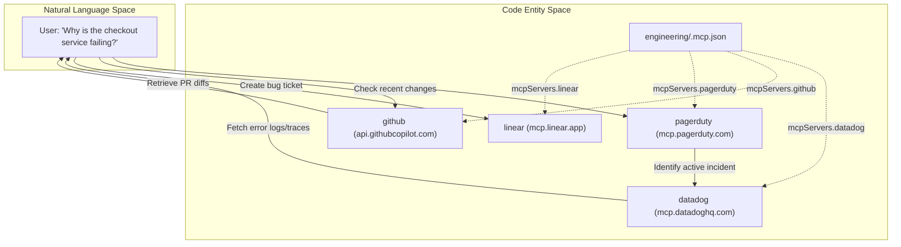
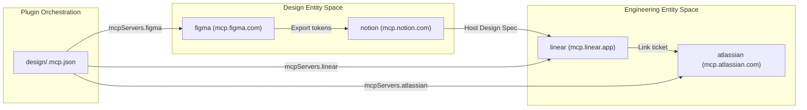

<!-- source: DeepWiki mcp.deepwiki.com · repo anthropics/knowledge-work-plugins · page 4.5 Engineering and Design Plugins · fetched 2026-10-26 -->

# Engineering and Design Plugins

Relevant source files

The following files were used as context for generating this wiki page:

- [design/.mcp.json](design/.mcp.json)
- [design/README.md](design/README.md)
- [engineering/.mcp.json](engineering/.mcp.json)
- [engineering/README.md](engineering/README.md)

The Engineering and Design plugins are specialized toolsets designed to streamline technical and creative workflows. These plugins bridge the gap between high-level project management, version control, and real-time operational data. By integrating with Model Context Protocol (MCP) servers, they allow Claude to interact directly with codebases, design files, ticketing systems, and monitoring tools [engineering/README.md:1-4](), [design/README.md:1-4]().

## Engineering Plugin

The Engineering plugin is architected to support the full software development lifecycle (SDLC), from initial architecture decisions to incident response, debugging, and deployment verification [engineering/README.md:1-4]().

### Capabilities, Commands, and Skills
The plugin provides explicit slash commands and automatic background skills across core technical domains [engineering/README.md:12-39]():
*   **Commands**: `/standup`, `/review`, `/debug`, `/architecture`, `/incident`, and `/deploy-checklist` [engineering/README.md:16-23]().
*   **Skills**: `code-review`, `incident-response`, `system-design`, `tech-debt`, `testing-strategy`, and `documentation` [engineering/README.md:31-38]().
*   **Local Settings**: Supports personalization via configuration files defining `techStack`, `defaultBranch`, and `deployProcess` [engineering/README.md:120-134]().

### MCP Server Integration
The engineering plugin connects to an extensive technical toolchain defined in its configuration manifest [engineering/.mcp.json:1-48]().

| Tool Category | MCP Server Name | Configuration Endpoint |
| :--- | :--- | :--- |
| **Chat & Coordination** | `slack` | `https://mcp.slack.com/mcp` [engineering/.mcp.json:3-10]() |
| **Project Tracking** | `linear`, `asana`, `atlassian` | `https://mcp.linear.app/mcp`, `https://mcp.asana.com/v2/mcp`, `https://mcp.atlassian.com/v1/mcp` [engineering/.mcp.json:11-22]() |
| **Knowledge Base** | `notion` | `https://mcp.notion.com/mcp` [engineering/.mcp.json:23-26]() |
| **Version Control** | `github` | `https://api.githubcopilot.com/mcp/` [engineering/.mcp.json:27-30]() |
| **Observability & Ops** | `pagerduty`, `datadog` | `https://mcp.pagerduty.com/mcp`, `https://mcp.datadoghq.com/api/unstable/mcp-server/mcp` [engineering/.mcp.json:31-38]() |
| **Scheduling & Mail** | `google calendar`, `gmail` | Empty/local handlers [engineering/.mcp.json:39-46]() |

Sources: [engineering/README.md:1-136](), [engineering/.mcp.json:1-48]()

### Data Flow: Incident Response Scenario
The following diagram illustrates how the Engineering plugin bridges Natural Language requests to the underlying code entities and MCP server endpoints configured in `engineering/.mcp.json` [engineering/.mcp.json:1-48]().

**Engineering Incident Data Flow**

Sources: [engineering/.mcp.json:1-48](), [engineering/README.md:1-136]()

---

## Design Plugin

The Design plugin is tailored for designers and UX researchers, focusing on critique, system management, UX writing, accessibility, research synthesis, and developer handoff [design/README.md:1-4]().

### Capabilities, Commands, and Skills
The design plugin automates creative evaluation workflows through dedicated commands and skills [design/README.md:12-39]():
*   **Commands**: `/critique`, `/design-system`, `/handoff`, `/ux-copy`, `/accessibility`, and `/research-synthesis` [design/README.md:18-23]().
*   **Skills**: `design-critique`, `design-system-management`, `ux-writing`, `accessibility-review`, `user-research`, and `design-handoff` [design/README.md:33-38]().

### MCP Server Integration
The design plugin leverages creative tool integrations alongside standard project tracking systems [design/.mcp.json:1-44]().

| Tool Category | MCP Server Name | Configuration Endpoint |
| :--- | :--- | :--- |
| **Design Tooling** | `figma` | `https://mcp.figma.com/mcp` [design/.mcp.json:11-14]() |
| **Project Tracking** | `linear`, `asana`, `atlassian` | `https://mcp.linear.app/mcp`, `https://mcp.asana.com/v2/mcp`, `https://mcp.atlassian.com/v1/mcp` [design/.mcp.json:15-26]() |
| **Knowledge Base** | `notion` | `https://mcp.notion.com/mcp` [design/.mcp.json:27-30]() |
| **User Feedback** | `intercom` | `https://mcp.intercom.com/mcp` [design/.mcp.json:31-34]() |
| **Communication** | `slack`, `gmail`, `google calendar` | OAuth / Local handlers [design/.mcp.json:3-10, 35-42]() |

Sources: [design/README.md:1-117](), [design/.mcp.json:1-44]()

### Data Flow: Design Handoff
This diagram demonstrates the transition of entities from design-centric MCP servers to engineering tracking endpoints as specified in `design/.mcp.json` [design/.mcp.json:1-44]().

**Design to Development Handoff Flow**

Sources: [design/.mcp.json:1-44](), [design/README.md:1-117]()

## Implementation Details

### Configuration and Standalone/Supercharged Execution
Both engineering and design plugins operate under a dual-mode execution model:
*   **Standalone Mode**: Fully functional using direct user inputs (pasting code diffs, describing system architectures, or uploading design screenshots) [engineering/README.md:25](), [design/README.md:25]().
*   **Supercharged Mode**: Automatically integrates live data streams when respective MCP servers (`github`, `datadog`, `figma`, `linear`) are authenticated and active in `.mcp.json` [engineering/.mcp.json:1-48](), [design/.mcp.json:1-44]().

Sources: [engineering/README.md:1-136](), [design/README.md:1-117]()

---

