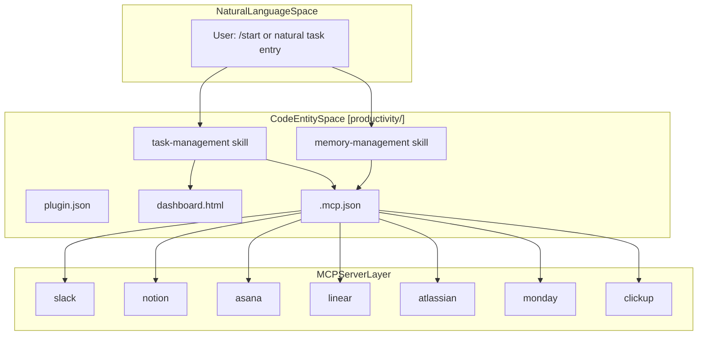
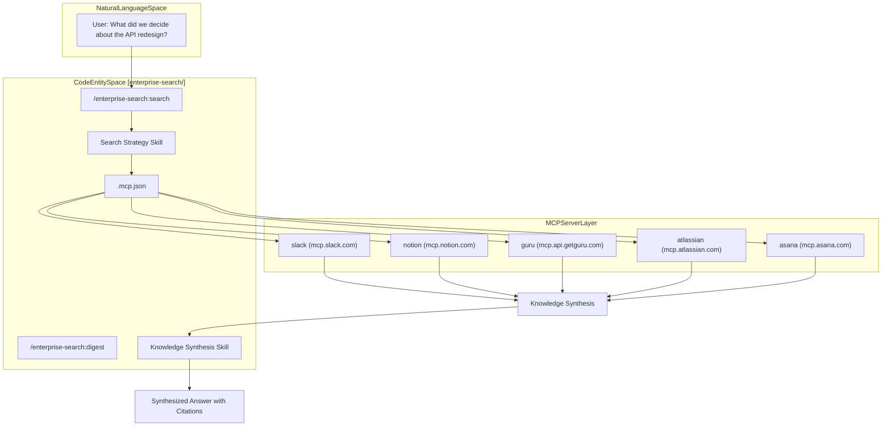

<!-- source: DeepWiki mcp.deepwiki.com · repo anthropics/knowledge-work-plugins · page 4.6 Productivity and Enterprise Search Plugins · fetched 2026-10-26 -->

# Productivity and Enterprise Search Plugins

Relevant source files

The following files were used as context for generating this wiki page:

- [enterprise-search/.mcp.json](enterprise-search/.mcp.json)
- [enterprise-search/README.md](enterprise-search/README.md)
- [productivity/.claude-plugin/plugin.json](productivity/.claude-plugin/plugin.json)
- [productivity/README.md](productivity/README.md)
- [productivity/skills/dashboard.html](productivity/skills/dashboard.html)

## Purpose and Scope

This document covers the technical implementation and architecture of the **productivity** and **enterprise-search** plugins. These plugins provide cross-functional capabilities that span across teams and job functions, focusing on task management, workplace memory, unified knowledge retrieval, and automated activity digests.

The productivity plugin manages personal task execution, daily planning workflows, and persistent workplace context via Markdown files and a visual HTML dashboard. The enterprise-search plugin provides a unified query and synthesis interface across fragmented organizational tools like email, chat, wikis, and project trackers.

Sources: [productivity/.claude-plugin/plugin.json:1-8](), [enterprise-search/README.md:1-24]()

---

## Productivity Plugin

### Overview and Capabilities

The `productivity` plugin is designed to help users manage tasks, plan daily workflows, and build a persistent "workplace memory" of important context. It acts as a central coordinator for personal work data and operational shorthand.

**Key Functions:**
- **Task Management**: Markdown-based task tracking using a shared `TASKS.md` file that Claude reads, writes, and executes against, syncing with tools like Asana, Linear, Jira, and Monday [productivity/README.md:16-16]().
- **Workplace Memory**: A two-tier memory system (`CLAUDE.md` for working memory and the `memory/` directory for deep storage) that teaches Claude shorthand, key personnel, projects, and domain terminology [productivity/README.md:17-17]().
- **Visual Dashboard**: A local HTML file providing a Kanban board view of tasks and a live view of workplace memory [productivity/README.md:18-18]().

**Commands and Skills:**
- **Commands**: `/start` (initializes tasks and memory, opens dashboard), `/update` (triages stale items and checks memory gaps), `/update --comprehensive` (deep scans email, calendar, and chat) [productivity/README.md:24-27]().
- **Skills**: `memory-management` and `task-management` [productivity/README.md:32-33]().

Sources: [productivity/.claude-plugin/plugin.json:1-8](), [productivity/README.md:14-34]()

### Visual Dashboard Implementation

The productivity plugin includes a visual interface for task management, implemented as a standalone HTML dashboard (`dashboard.html`). This dashboard provides a Kanban-style view for organizing work items.

**Key Dashboard Features:**
- **Kanban Board**: A multi-column layout for task status tracking [productivity/skills/dashboard.html:132-151]().
- **Task Cards**: Interactive elements displaying task titles, notes, and subtasks [productivity/skills/dashboard.html:203-272]().
- **Drag-and-Drop**: Support for reordering tasks and moving them between columns [productivity/skills/dashboard.html:198-201]().
- **Styling**: Uses a custom CSS variable system for a cohesive look and feel (e.g., `--accent: #D97757`) [productivity/skills/dashboard.html:14-27]().

Sources: [productivity/skills/dashboard.html:1-272]()

### Architecture and Data Flow

The productivity plugin follows the standard directory structure, separating domain expertise (`skills/`) from explicit user actions (`commands/`). It utilizes an array of HTTP-based MCP servers for cross-platform task orchestration.

**Figure 4.6.1: Productivity Plugin Architecture (Natural Language to Code Entity Space)**

Sources: [productivity/.claude-plugin/plugin.json:1-8](), [productivity/README.md:1-34]()

---

## Enterprise Search Plugin

### Overview and Capabilities

The `enterprise-search` plugin solves information fragmentation by providing a single query interface across all company data sources. It allows users to search email, chat, documents, and wikis simultaneously without switching applications [enterprise-search/README.md:1-3]().

**Key Functions:**
- **Cross-Tool Search**: Unified querying across Slack, Notion, Guru, Atlassian (Jira/Confluence), and Asana via `/search` [enterprise-search/README.md:9-9]().
- **Daily and Weekly Digests**: Automated rollups of activity, action items, and decisions via `/digest --daily` or `/digest --weekly` [enterprise-search/README.md:67-68]().
- **Knowledge Synthesis**: Deduplicating cross-source information, attributing sources, and scoring confidence based on freshness and authority [enterprise-search/README.md:83-84]().

**Commands and Skills:**
- **Commands**: `/enterprise-search:search` and `/enterprise-search:digest` [enterprise-search/README.md:57-68]().
- **Skills**: `Search Strategy`, `Source Management`, and `Knowledge Synthesis` [enterprise-search/README.md:77-84]().

Sources: [enterprise-search/README.md:1-85](), [enterprise-search/.mcp.json:1-36]()

### Unified Search Data Flow

**Figure 4.6.2: Enterprise Search Cross-Tool Synthesis Flow**

Sources: [enterprise-search/README.md:7-21](), [enterprise-search/.mcp.json:1-36]()

---

## Connector Configuration Comparison

Both plugins share an underlying MCP connector architecture but prioritize different integration endpoints based on their core workflows.

| MCP Server | Productivity Plugin | Enterprise Search Plugin | Endpoint Type |
|------------|:-------------------:|:------------------------:|---------------|
| `slack` | Yes [productivity/.mcp.json:3-5]() | Yes [enterprise-search/.mcp.json:3-5]() | `http` |
| `notion` | Yes [productivity/.mcp.json:11-13]() | Yes [enterprise-search/.mcp.json:11-13]() | `http` |
| `asana` | Yes [productivity/.mcp.json:15-17]() | Yes [enterprise-search/.mcp.json:23-25]() | `http` |
| `linear` | Yes [productivity/.mcp.json:19-21]() | No | `http` |
| `guru` | No | Yes [enterprise-search/.mcp.json:15-17]() | `http` |
| `atlassian` | Yes [productivity/.mcp.json:23-25]() | Yes [enterprise-search/.mcp.json:19-22]() | `http` |
| `monday` | Yes [productivity/.mcp.json:27-29]() | No | `http` |
| `clickup` | Yes [productivity/.mcp.json:31-33]() | No | `http` |
| `google calendar` | Yes [productivity/.mcp.json:35-38]() | Yes [enterprise-search/.mcp.json:27-30]() | `http` |
| `gmail` | Yes [productivity/.mcp.json:39-42]() | Yes [enterprise-search/.mcp.json:31-34]() | `http` |

### Customizing for the Enterprise

To deploy these plugins, developers configure the `.mcp.json` file in each plugin directory:
1. **Server Mapping**: Update the `url` fields in `.mcp.json` to point to private or regional MCP instances [enterprise-search/.mcp.json:1-36]().
2. **OAuth Setup**: Configure OAuth credentials (such as `clientId` and `callbackPort` for Slack integration) [enterprise-search/.mcp.json:6-9]().
3. **Google/Gmail Activation**: Populate missing URL endpoints to activate calendar and email connectors [productivity/.mcp.json:35-43]().

Sources: [productivity/.mcp.json:1-44](), [enterprise-search/.mcp.json:1-36]()

---

