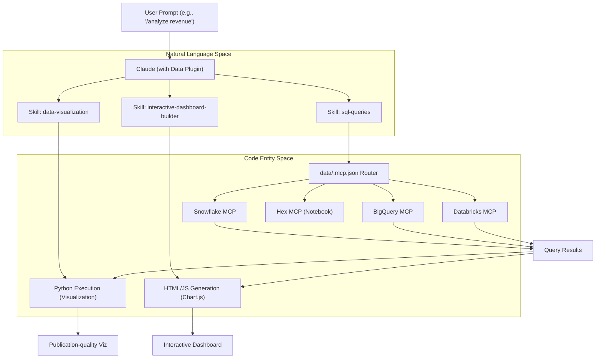

<!-- source: DeepWiki mcp.deepwiki.com · repo anthropics/knowledge-work-plugins · page 4.7 Data Plugin · fetched 2026-10-26 -->

# Data Plugin

<details>
<summary>Relevant source files</summary>

The following files were used as context for generating this wiki page:

- [README.md](README.md)
- [data/.mcp.json](data/.mcp.json)
- [data/CONNECTORS.md](data/CONNECTORS.md)
- [data/README.md](data/README.md)

</details>


The Data Plugin transforms Claude into a specialized data analyst collaborator capable of SQL generation, data exploration, visualization, and statistical analysis. It is designed to interface directly with major data warehouses like Snowflake, BigQuery, and Databricks, while also supporting local file analysis (CSV/Excel) and interactive dashboard construction [data/README.md:1-13]().

## Architecture and Data Flow

The plugin follows a standardized structure [README.md:50-59]() consisting of explicit commands and background skills. It operates in a tool-agnostic manner by using category placeholders (e.g., `~~data warehouse`) which are mapped to specific Model Context Protocol (MCP) servers via configuration [data/CONNECTORS.md:3-8]().

### Conceptual Data Flow: Natural Language to Code Execution

The following diagram illustrates how a user's natural language request is translated into executable SQL or Python code and routed to the appropriate data infrastructure.

**Data Analysis Execution Flow**

Sources: [data/README.md:15-27](), [data/.mcp.json:1-36](), [data/CONNECTORS.md:11-16]()

## Core Components

### Slash Commands
Commands are explicit actions triggered by the user to initiate specific data workflows [README.md:62]().

| Command | Function | Code Reference |
| :--- | :--- | :--- |
| `/analyze` | Answer data questions -- from quick lookups to full analyses | [data/README.md:33]() |
| `/explore-data` | Profile and explore a dataset to understand its shape, quality, and patterns | [data/README.md:34]() |
| `/write-query` | Write optimized SQL for your dialect with best practices | [data/README.md:35]() |
| `/create-viz` | Create publication-quality visualizations with Python | [data/README.md:36]() |
| `/build-dashboard` | Build interactive HTML dashboards with filters and charts | [data/README.md:37]() |
| `/validate` | QA an analysis before sharing -- methodology, accuracy, and bias checks | [data/README.md:38]() |

### Background Skills
Skills provide the domain expertise that Claude draws upon automatically during interactions [README.md:61]().

*   **`sql-queries`**: SQL best practices across dialects, common patterns, and performance optimization [data/README.md:44]().
*   **`data-exploration`**: Data profiling, quality assessment, and pattern discovery [data/README.md:45]().
*   **`data-visualization`**: Chart selection, Python viz code patterns, and design principles [data/README.md:46]().
*   **`statistical-analysis`**: Descriptive stats, trend analysis, outlier detection, and hypothesis testing [data/README.md:47]().
*   **`data-validation`**: Pre-delivery QA, sanity checks, and documentation standards [data/README.md:48]().
*   **`interactive-dashboard-builder`**: HTML/JS dashboard construction with Chart.js, filters, and styling [data/README.md:49]().

Sources: [data/README.md:28-49](), [README.md:54-63]()

## Connector System

The Data Plugin uses a placeholder system to remain tool-agnostic. This allows the same skills to work regardless of whether the underlying warehouse is Snowflake, Databricks, or BigQuery [data/CONNECTORS.md:3-8]().

**Placeholder Mapping to MCP Entities**
```mermaid
classDiagram
    class PluginFiles {
        <<Markdown/SKILL.md>>
        +~~data warehouse
        +~~notebook
        +~~product analytics
        +~~project tracker
    }
    class MCP_Config {
        <<data/.mcp.json>>
        +snowflake
        +bigquery
        +databricks
        +hex
        +amplitude
        +atlassian
        +definite
    }
    PluginFiles ..> MCP_Config : "Resolves via category mapping"
    MCP_Config --> Snowflake_Target : "User-defined URL"
    MCP_Config --> BigQuery_API : "https://bigquery.googleapis.com/mcp"
    MCP_Config --> Hex_API : "https://app.hex.tech/mcp"
    MCP_Config --> Definite_API : "https://api.definite.app/v3/mcp/http"
```

### Configured MCP Servers
The following servers are defined in the plugin's configuration [data/.mcp.json:1-36]():
*   **Data Warehouse**: Snowflake, Databricks (placeholders), BigQuery, and Definite [data/CONNECTORS.md:13]().
*   **Notebook**: Hex (configured at `https://app.hex.tech/mcp`) [data/.mcp.json:15-18]().
*   **Product Analytics**: Amplitude and Amplitude-EU [data/.mcp.json:19-26]().
*   **Project Tracker**: Atlassian (Jira/Confluence) at `https://mcp.atlassian.com/v1/mcp` [data/.mcp.json:27-30]().

Sources: [data/.mcp.json:1-36](), [data/CONNECTORS.md:1-18]()

## Workflow Examples

### SQL Generation and Optimization
When a user invokes `/write-query`, Claude utilizes the `sql-queries` skill to generate dialect-specific code. For example, a request for cohort retention on Snowflake will produce optimized SQL using Common Table Expressions (CTEs) and include performance notes regarding partition pruning [data/README.md:74-83]().

### Interactive Dashboarding
The `/build-dashboard` command triggers the `interactive-dashboard-builder` skill. This process involves:
1.  **Data Ingestion**: Reading from a connected warehouse or a provided CSV/Excel file [data/README.md:88-89]().
2.  **Code Generation**: Producing a self-contained HTML file [data/README.md:91]().
3.  **Visualization**: Injecting Chart.js logic for interactive elements and dropdown filters [data/README.md:92-93]().

### Pre-Share Validation
Using the `/validate` command, Claude reviews analysis documents for methodology errors, survivorship bias, and aggregation logic, providing a confidence score before the work is shared with stakeholders [data/README.md:99-106]().

Sources: [data/README.md:51-107]()

---

