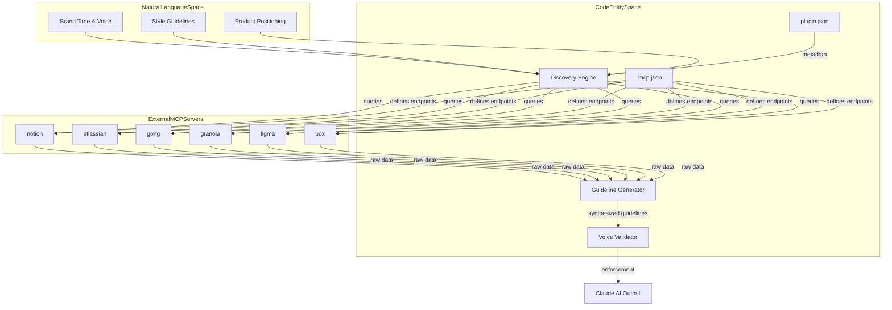
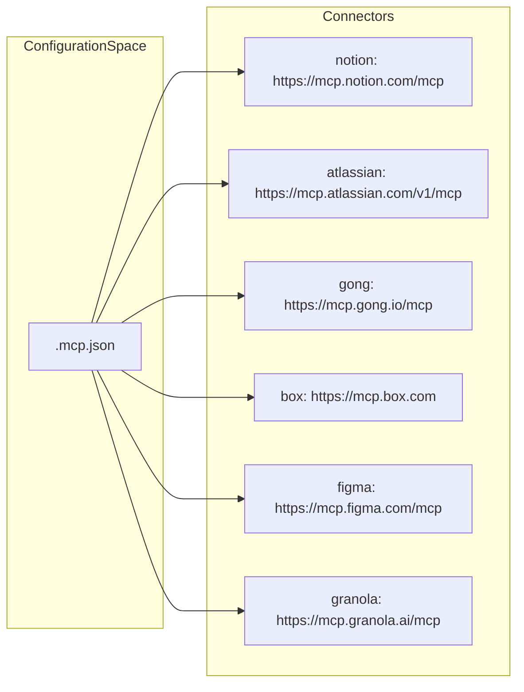

<!-- source: DeepWiki mcp.deepwiki.com · repo anthropics/knowledge-work-plugins · page 5.1 Brand Voice Plugin (Tribe AI) · fetched 2026-10-26 -->

# Brand Voice Plugin (Tribe AI)

Relevant source files

The following files were used as context for generating this wiki page:

- [partner-built/apollo/.claude-plugin/plugin.json](partner-built/apollo/.claude-plugin/plugin.json)
- [partner-built/brand-voice/.claude-plugin/plugin.json](partner-built/brand-voice/.claude-plugin/plugin.json)
- [partner-built/brand-voice/.mcp.json](partner-built/brand-voice/.mcp.json)
- [partner-built/slack/.claude-plugin/plugin.json](partner-built/slack/.claude-plugin/plugin.json)

The Brand Voice plugin, developed by Tribe AI, is designed to transform fragmented brand materials into enforceable AI guardrails. It automates the process of brand discovery by searching across enterprise communication and documentation tools to distill brand signals into a single source of truth. This ensures that AI-generated content remains consistent with established tone, positioning, and style guidelines.

## Purpose and Scope

The primary objective of the Brand Voice plugin is to solve the problem of brand inconsistency in AI outputs. It achieves this through three core pillars:
1.  **Discovery**: Extracting brand essence from existing documents and conversations.
2.  **Guideline Generation**: Creating structured, machine-readable brand guidelines.
3.  **Enforcement**: Validating and adjusting AI-generated content against those guidelines.

| Feature | Description |
| :--- | :--- |
| **Multi-Source Discovery** | Scans Notion, Google Drive, Confluence, Gong, Slack, and meeting transcripts. |
| **Signal Distillation** | Identifies the strongest brand signals from scattered materials. |
| **Voice Enforcement** | Applies brand guardrails to every piece of content generated with Claude. |
| **Consistency Loop** | Improves brand alignment the more the team creates. |

Sources: `[partner-built/brand-voice/.claude-plugin/plugin.json:4-4]()`

## System Architecture

The plugin functions as an orchestration layer between enterprise data sources (via MCP connectors) and Claude's generation capabilities. It utilizes the standardized knowledge-work-plugin structure to manage discovery and enforcement workflows.

### MCP Connector Integration
The plugin is powered by a diverse array of Model Context Protocol (MCP) servers defined in its configuration. These servers provide the infrastructure for the discovery engine to ingest brand context from across the enterprise stack.

*   **Notion**: Accesses wikis, strategy docs, and brand portals `[partner-built/brand-voice/.mcp.json:3-6]()`.
*   **Atlassian**: Connects to Confluence for product requirements and corporate guidelines `[partner-built/brand-voice/.mcp.json:7-10]()`.
*   **Gong**: Ingests sales call transcripts to capture "voice of the customer" and winning sales talk tracks `[partner-built/brand-voice/.mcp.json:19-22]()`.
*   **Granola**: Extracts insights from meeting notes and transcripts `[partner-built/brand-voice/.mcp.json:23-26]()`.
*   **Box & Figma**: Pulls from asset repositories and design system documentation `[partner-built/brand-voice/.mcp.json:11-18]()`.

### Brand Voice Implementation Logic
The following diagram illustrates how the "Natural Language Space" of brand identity is mapped to the "Code Entity Space" and external MCP infrastructure.

**Brand Voice Discovery and Enforcement Flow**

Sources: `[partner-built/brand-voice/.claude-plugin/plugin.json:4-8]()`, `[partner-built/brand-voice/.mcp.json:2-27]()`

## Key Components

### Plugin Manifest
The `plugin.json` file defines the identity and scope of the Brand Voice toolset. It categorizes the plugin for use in sales, marketing, and content creation domains.

*   **Name**: `brand-voice` `[partner-built/brand-voice/.claude-plugin/plugin.json:2-2]()`
*   **Version**: `1.1.0` `[partner-built/brand-voice/.claude-plugin/plugin.json:3-3]()`
*   **Author**: `Tribe AI` `[partner-built/brand-voice/.claude-plugin/plugin.json:6-6]()`
*   **Keywords**: Includes `brand-voice`, `sales`, `marketing`, `content-creation`, `guidelines`, `discovery`, and `enterprise` `[partner-built/brand-voice/.claude-plugin/plugin.json:8-8]()`

Sources: `[partner-built/brand-voice/.claude-plugin/plugin.json:2-8]()`

### MCP Configuration
The `.mcp.json` file specifies the technical endpoints for the discovery process. It uses `http` type connections to interact with various SaaS platforms.

**MCP Infrastructure Mapping**

Sources: `[partner-built/brand-voice/.mcp.json:1-28]()`

## Workflow: Discovery to Enforcement

1.  **Source Connection**: The plugin initializes connections to the MCP servers defined in `.mcp.json` `[partner-built/brand-voice/.mcp.json:2-27]()`.
2.  **Signal Extraction**: The plugin searches across Notion, Google Drive, Confluence, Gong, Slack, and meeting transcripts to identify recurring linguistic patterns and core values `[partner-built/brand-voice/.claude-plugin/plugin.json:4-4]()`.
3.  **Guideline Synthesis**: Scattered materials are distilled into a single source of truth or a set of machine-readable guidelines `[partner-built/brand-voice/.claude-plugin/plugin.json:4-4]()`.
4.  **Content Validation**: When content is generated, the plugin applies these synthesized guidelines as enforceable guardrails.
5.  **Iterative Alignment**: The system becomes more consistent as more content is created and refined within the Claude environment `[partner-built/brand-voice/.claude-plugin/plugin.json:4-4]()`.

Sources: `[partner-built/brand-voice/.claude-plugin/plugin.json:4-4]`, `[partner-built/brand-voice/.mcp.json:2-27]()`

---

