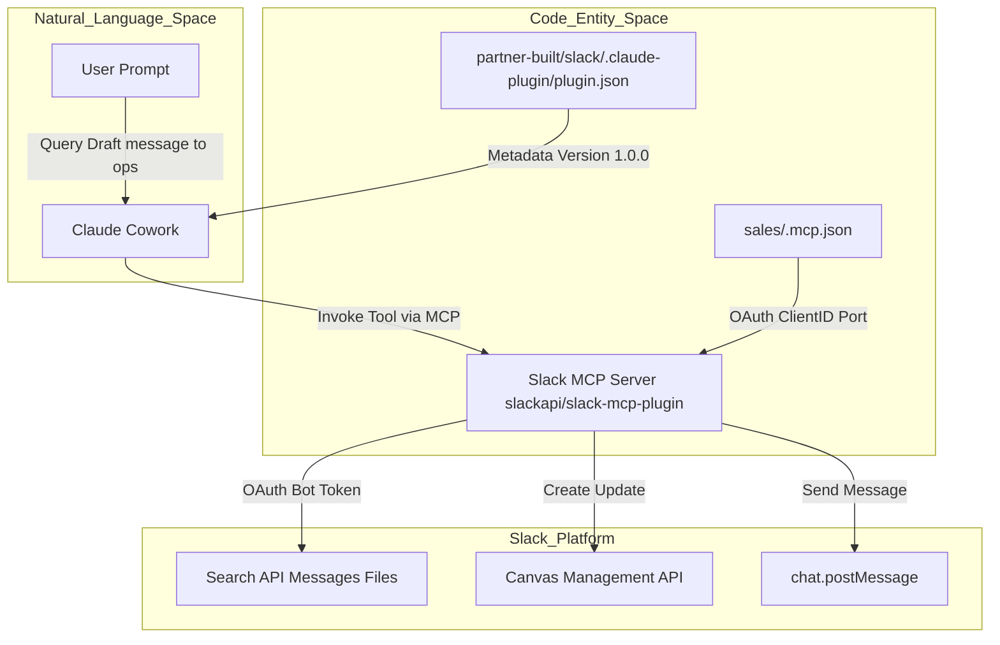
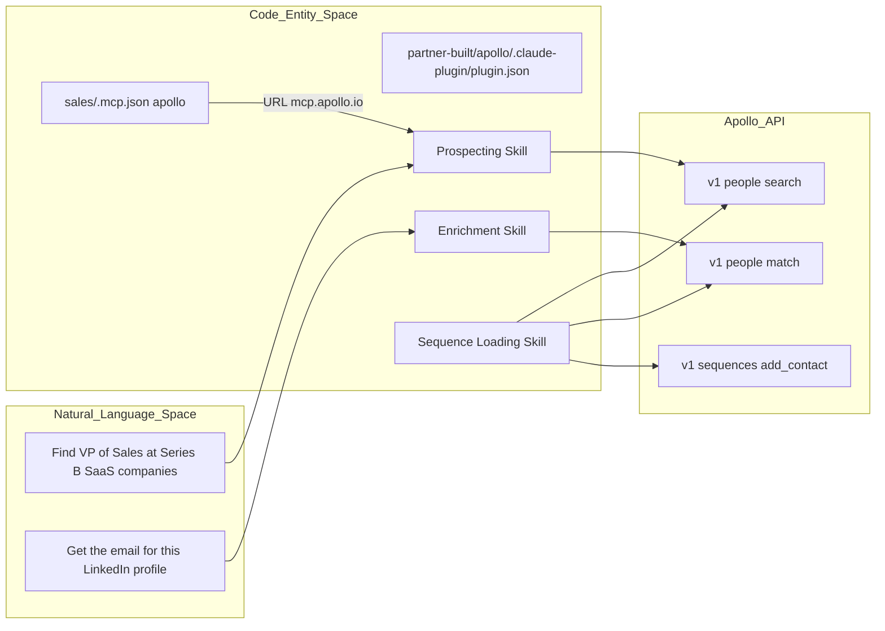

<!-- source: DeepWiki mcp.deepwiki.com · repo anthropics/knowledge-work-plugins · page 5.2 Slack and Apollo Partner Plugins · fetched 2026-10-26 -->

# Slack and Apollo Partner Plugins

Relevant source files

The following files were used as context for generating this wiki page:

- [partner-built/apollo/.claude-plugin/plugin.json](partner-built/apollo/.claude-plugin/plugin.json)
- [partner-built/brand-voice/.claude-plugin/plugin.json](partner-built/brand-voice/.claude-plugin/plugin.json)
- [partner-built/slack/.claude-plugin/plugin.json](partner-built/slack/.claude-plugin/plugin.json)

This page documents the partner-built plugins for Slack (by Salesforce) and Apollo.io. These plugins extend the knowledge-work-plugins ecosystem by providing deep integrations into two critical platforms for communication and sales prospecting. They utilize the Model Context Protocol (MCP) to bridge natural language requests with structured API actions.

## 1. Slack Plugin (by Salesforce)

The Slack plugin, authored by Salesforce, provides an official MCP integration for managing communications and collaboration directly from Claude. It is designed to handle message search, communication drafting, and canvas management.

### 1.1 Overview and Purpose
The plugin enables Claude to act as an agent within the Slack ecosystem, allowing users to surface insights from historical conversations and engage teams without context-switching [partner-built/slack/.claude-plugin/plugin.json:2-3]().

| Component | Description |
| :--- | :--- |
| **Author** | Salesforce [partner-built/slack/.claude-plugin/plugin.json:5-8]() |
| **Version** | 1.0.0 [partner-built/slack/.claude-plugin/plugin.json:4]() |
| **Official Homepage** | https://github.com/slackapi/slack-mcp-plugin [partner-built/slack/.claude-plugin/plugin.json:9]() |

Sources: [partner-built/slack/.claude-plugin/plugin.json:1-11]()

### 1.2 OAuth and Configuration
The Slack MCP server is frequently utilized across multiple plugins (e.g., Sales, Operations) as the primary `~~chat` connector [sales/CONNECTORS.md:14](). Configuration requires an OAuth setup with specific client identifiers and callback ports to handle user authentication securely.

*   **MCP URL:** `https://mcp.slack.com/mcp` [sales/.mcp.json:5]()
*   **OAuth Client ID:** `1601185624273.8899143856786` [sales/.mcp.json:7]()
*   **Callback Port:** `3118` [sales/.mcp.json:8]()

Sources: [sales/.mcp.json:3-10](), [operations/.mcp.json:3-10](), [sales/CONNECTORS.md:11-16]()

### 1.3 Data Flow: Natural Language to Slack API
The following diagram illustrates how a natural language request (e.g., "Find the latest updates on the Project X canvas") is processed through the Slack MCP server, bridging natural language input with internal plugin configurations and external API endpoints.

**Slack Integration Architecture**

Sources: [partner-built/slack/.claude-plugin/plugin.json:1-11](), [sales/.mcp.json:3-10](), [operations/.mcp.json:3-10]()

---

## 2. Apollo Plugin (by Apollo.io)

The Apollo plugin provides a one-click MCP server integration for sales prospecting, lead enrichment, and sequence management. It is specifically designed to chain multiple Apollo APIs into cohesive workflows.

### 2.1 Core Skills and Workflows
The plugin includes 3 pre-built skills that automate complex sales tasks by chaining multiple Apollo APIs into complete sales workflows without manual steps [partner-built/apollo/.claude-plugin/plugin.json:4]().

1.  **Lead Enrichment:** Enrich any contact data from a name, email address, or LinkedIn URL [partner-built/apollo/.claude-plugin/plugin.json:4]().
2.  **Plain-English Prospecting:** Prospect by describing an Ideal Customer Profile (ICP) in plain English to get ranked leads [partner-built/apollo/.claude-plugin/plugin.json:4]().
3.  **Sequence Loading:** A "one-shot" workflow to find, enrich, and load contacts into a sequence [partner-built/apollo/.claude-plugin/plugin.json:4]().

Sources: [partner-built/apollo/.claude-plugin/plugin.json:1-13]()

### 2.2 Implementation Details
The Apollo plugin is hosted as an external repository and integrated into the marketplace via a standardized manifest. It is registered in the Sales plugin's `.mcp.json` to handle `~~data enrichment` and `~~sales engagement` placeholders [sales/CONNECTORS.md:17-22]().

| Attribute | Value |
| :--- | :--- |
| **Author** | Apollo.io [partner-built/apollo/.claude-plugin/plugin.json:5-8]() |
| **Repository** | https://github.com/apolloio/apollo-mcp-plugin [partner-built/apollo/.claude-plugin/plugin.json:9]() |
| **MCP URL** | `https://mcp.apollo.io/mcp` [sales/.mcp.json:45]() |
| **Keywords** | apollo, sales, prospecting, icp, enrichment, sequences, mcp [partner-built/apollo/.claude-plugin/plugin.json:12]() |

Sources: [partner-built/apollo/.claude-plugin/plugin.json:1-13](), [sales/.mcp.json:43-46](), [sales/CONNECTORS.md:17-22]()

### 2.3 Lead Enrichment and Prospecting Flow
The diagram below maps the transition from a user's intent to the specific Apollo API actions facilitated by the MCP server, spanning natural language prompts and code entities.

**Apollo Sales Workflow Mapping**

Sources: [partner-built/apollo/.claude-plugin/plugin.json:1-13](), [sales/.mcp.json:43-46](), [sales/CONNECTORS.md:17-22]()

---

## 3. Comparison of Partner Capabilities

The Slack and Apollo plugins represent two different categories of partner integrations: **Collaboration** and **Revenue Operations**. They often work in tandem with other partner plugins like the Brand Voice plugin by Tribe AI, which distills brand signals from Slack and other sources to ensure consistent content creation [partner-built/brand-voice/.claude-plugin/plugin.json:4]().

| Feature | Slack Plugin | Apollo Plugin |
| :--- | :--- | :--- |
| **Primary Use Case** | Communication & Knowledge Retrieval | Lead Generation & Sales Outreach |
| **Integration Type** | Interactive/Collaborative [partner-built/slack/.claude-plugin/plugin.json:3]() | Chained API Workflows [partner-built/apollo/.claude-plugin/plugin.json:4]() |
| **Data Source** | Internal Workspace Data | External B2B Database |
| **Primary Action** | Message Search/Drafting | Prospecting/Enrichment |
| **Connector Placeholder**| `~~chat` [sales/CONNECTORS.md:14]() | `~~data enrichment`, `~~sales engagement` [sales/CONNECTORS.md:17-22]() |

Sources: [partner-built/slack/.claude-plugin/plugin.json:1-11](), [partner-built/apollo/.claude-plugin/plugin.json:1-13](), [partner-built/brand-voice/.claude-plugin/plugin.json:1-9](), [sales/CONNECTORS.md:11-22]()

---

