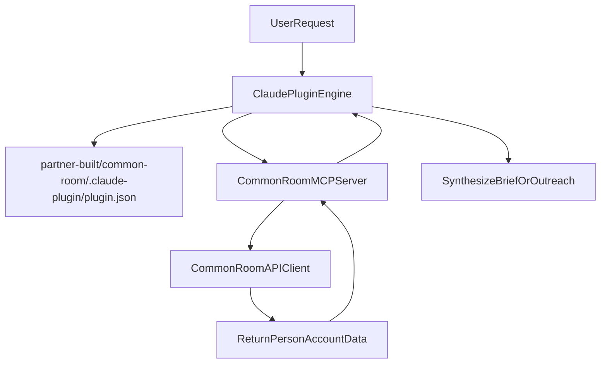
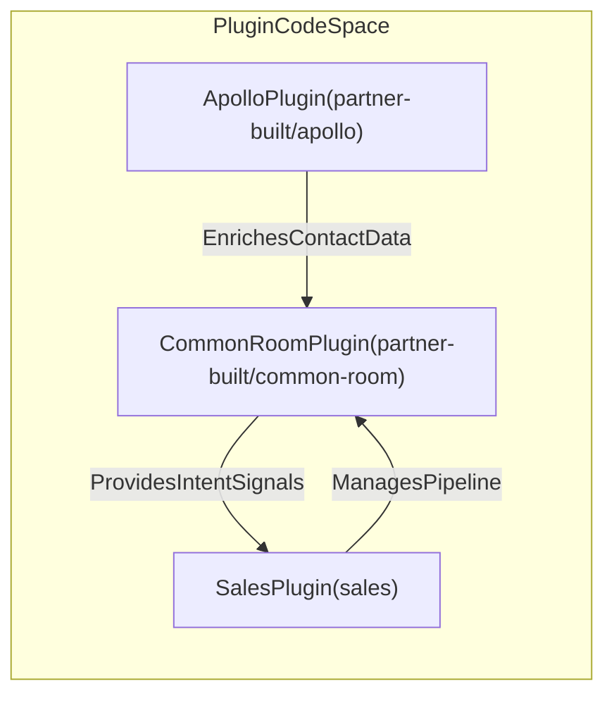

<!-- source: DeepWiki mcp.deepwiki.com · repo anthropics/knowledge-work-plugins · page 5.3 Common Room Plugin · fetched 2026-10-26 -->

# Common Room Plugin

Relevant source files

The following files were used as context for generating this wiki page:

- [partner-built/apollo/.claude-plugin/plugin.json](partner-built/apollo/.claude-plugin/plugin.json)
- [partner-built/brand-voice/.claude-plugin/plugin.json](partner-built/brand-voice/.claude-plugin/plugin.json)
- [partner-built/slack/.claude-plugin/plugin.json](partner-built/slack/.claude-plugin/plugin.json)

The Common Room plugin serves as a Go-To-Market (GTM) copilot, integrating Common Room's signal data directly into Claude. It enables automated account and contact research, call preparation, and personalized outreach composition by leveraging high-intent signals and unified customer data.

## Overview and Purpose

The Common Room plugin is designed for sales and revenue teams to streamline the prospecting and engagement lifecycle. By connecting to Common Room's intelligence platform, the plugin allows users to transition from identifying "dark social" signals or product-led growth (PLG) indicators to executing highly personalized outreach without leaving the chat interface.

### Key Capabilities
*   **Account & Contact Research**: Deep dives into organizational structures and individual profiles using Common Room's unified data [`[.claude-plugin/marketplace.json:106-113]()`].
*   **Call Preparation**: Generation of attendee profiles and strategic talking points based on historical interactions and social signals [`[.claude-plugin/marketplace.json:106-113]()`].
*   **Outreach Composition**: Drafting personalized messaging across Email, LinkedIn, and Phone, grounded in real-time signal data [`[.claude-plugin/marketplace.json:106-113]()`].
*   **Prospecting & Briefs**: Creation of weekly preparation briefs and proactive prospecting powered by signal intelligence [`[.claude-plugin/marketplace.json:106-113]()`].

Sources: `[.claude-plugin/marketplace.json:106-113]()`

---

## Plugin Architecture

The Common Room plugin follows the standardized knowledge-work-plugin structure, operating as a partner-built integration. It utilizes the Model Context Protocol (MCP) to bridge Claude's reasoning capabilities with Common Room's proprietary data API.

### Data Flow Diagram: Signal to Outreach

The following diagram bridges the natural language space (user commands) to the underlying code entity space (`partner-built/common-room/.claude-plugin/plugin.json` and MCP server modules) to illustrate how a user request flows through the system.

**Common Room Intelligence Flow**

Sources: `[.claude-plugin/marketplace.json:106-113]()`

---

## Technical Implementation

The plugin is defined within the `partner-built/common-room` directory. Its core functionality is exposed via a manifest that describes its role in the GTM workflow.

### Plugin Manifest
The `plugin.json` defines the scope of the plugin's authority. It is categorized under partner-built tools and is authored by the Common Room team.

| Property | Value |
| :--- | :--- |
| **Name** | `common-room` |
| **Display Name** | Common Room |
| **Author** | Common Room |
| **Source Path** | `./partner-built/common-room` |
| **Primary Goal** | GTM Copilot & Account Research |

Sources: `[.claude-plugin/marketplace.json:106-113]()`

---

## Core Workflows

The Common Room plugin automates several high-touch sales activities by chaining data retrieval with LLM synthesis.

### 1. Account and Contact Research
The plugin retrieves "Person" and "Account" entities from Common Room. This includes:
*   **Identity Resolution**: Mapping social handles, community contributions, and product usage to a single CRM record.
*   **Signal Detection**: Identifying recent activity (e.g., a prospect joining a community Slack or starring a GitHub repo).

### 2. Call Prep and Talking Points
When a user requests preparation for a meeting, the plugin:
1. Queries the Common Room MCP server for the attendees' recent activities.
2. Cross-references these activities with the Account's historical context.
3. Generates a "Brief" that highlights common interests or recent triggers.

### 3. Outreach Composition
The plugin uses the retrieved signals to ground its generation. Instead of generic templates, it drafts:
*   **LinkedIn InMails**: Referencing specific community posts or shared connections.
*   **Email Sequences**: Tailored to the prospect's recent product interactions or intent signals.

Sources: `[.claude-plugin/marketplace.json:106-113]()`

---

## Integration with Other Plugins

The Common Room plugin is often used in conjunction with other Sales and Productivity plugins within the marketplace to create a full-stack revenue workflow.

**System Entity Relationship**

*   **Sales Plugin**: Used for pipeline review and deal strategy based on Common Room signals [`[.claude-plugin/marketplace.json:40-44]()`].
*   **Apollo Plugin**: Used to find and enrich new contacts that match the ICP identified by Common Room's "Person" data [`[.claude-plugin/marketplace.json:88-95]()`].
*   **Slack Plugin**: Used to surface these insights and draft messages directly within Slack channels [`[.claude-plugin/marketplace.json:97-104]()`].

Sources: `[.claude-plugin/marketplace.json:40-44]()`, `[.claude-plugin/marketplace.json:88-95]`, `[.claude-plugin/marketplace.json:97-104]()`, `[.claude-plugin/marketplace.json:106-113]()`

---

