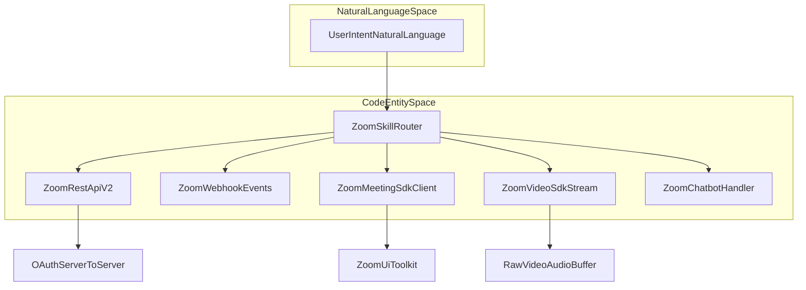
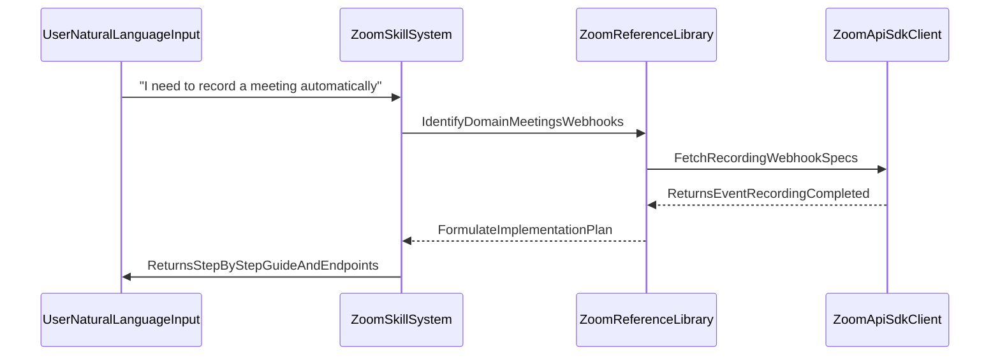

<!-- source: DeepWiki mcp.deepwiki.com · repo anthropics/knowledge-work-plugins · page 5.4 Zoom Plugin · fetched 2026-10-26 -->

# Zoom Plugin

Relevant source files

The following files were used as context for generating this wiki page:

- [.claude-plugin/marketplace.json](.claude-plugin/marketplace.json)
- [partner-built/apollo/.claude-plugin/plugin.json](partner-built/apollo/.claude-plugin/plugin.json)
- [partner-built/brand-voice/.claude-plugin/plugin.json](partner-built/brand-voice/.claude-plugin/plugin.json)
- [partner-built/slack/.claude-plugin/plugin.json](partner-built/slack/.claude-plugin/plugin.json)
- [pdf-viewer/.claude-plugin/plugin.json](pdf-viewer/.claude-plugin/plugin.json)

The Zoom plugin is a comprehensive partner-built integration designed to facilitate the planning, building, and management of Zoom-based workflows. It provides a deep reference library and automated skills for navigating the extensive Zoom developer ecosystem, including REST APIs, Meeting SDKs, Video SDKs, webhooks, bots, Team Chat, Phone, and Contact Center.

## Overview and Purpose

The plugin serves as a technical bridge for developers and product managers working with Zoom's platform. It consolidates disparate documentation and implementation patterns into 15+ slash workflows and internal routing skills.

| Component | Description |
| :--- | :--- |
| **Name** | `zoom-plugin` |
| **Author** | Zoom |
| **Source Path** | `./partner-built/zoom-plugin` |
| **Core Capabilities** | API planning, SDK implementation, Webhook configuration, Bot development |

Sources: [.claude-plugin/marketplace.json:1-141]()

## System Architecture

The Zoom plugin operates by mapping high-level natural language intents (e.g., "How do I build a meeting bot?") to specific technical implementation paths across Zoom's product suites.

### Technical Flow: Intent to Implementation

The following diagram illustrates how the plugin processes a request to build a Zoom integration, moving from "Natural Language Space" to the "Code Entity Space" of Zoom's developer tools.

**Diagram: Zoom Integration Routing**

Sources: [.claude-plugin/marketplace.json:1-141]()

## Key Workflows and Commands

The plugin supports over 15 distinct slash workflows categorized by Zoom product area. These workflows automate the retrieval of technical specifications and implementation steps.

### 1. Meeting and Video SDKs
Provides guidance on embedding Zoom functionality into third-party applications.
*   **Meeting SDK (`ZoomMeetingSdkClient`):** Focuses on the standard Zoom interface, including gallery view and screen sharing.
*   **Video SDK (`ZoomVideoSdkStream`):** Focuses on custom UI/UX where the developer has full control over raw media streams.

### 2. Team Chat and Bots
Covers the implementation of interactive apps within the Zoom Team Chat environment via `ZoomChatbotHandler`.
*   **Slash Commands:** Implementing custom `/` commands.
*   **Chatbots:** Handling interactive buttons and message cards.

### 3. Zoom Phone and Contact Center
Advanced workflows for enterprise communication and call control (`ZoomPhoneApi`).

### Implementation Reference Table

| Implementation Area | Key Code Entities / APIs | Workflow Type |
| :--- | :--- | :--- |
| **Authentication** | `OAuthServerToServer`, `PKCE` | Setup / Security |
| **Meetings** | `ZoomRestApiV2`, `ZoomMeetingSdkClient` | Management |
| **Events** | `ZoomWebhookEvents`, `EventSubscriptions` | Automation |
| **Messaging** | `ZoomChatbotHandler`, `TeamChatSdk` | Collaboration |

Sources: [.claude-plugin/marketplace.json:1-141]()

## Internal Routing Skills and Data Flow

The plugin utilizes internal routing skills to provide deep context without requiring the user to know specific API endpoints.

### Skill-Based Data Flow

The second architectural bridge maps user diagnostic queries directly to internal code and reference classes in the reference library.

**Diagram: Internal Skill Logic**

Sources: [.claude-plugin/marketplace.json:1-141]()

## Integration with MCP

The Zoom plugin leverages the Model Context Protocol (MCP) to maintain a live connection to Zoom's developer resources (`ZoomMcpServerConnector`). This ensures that the documentation and API references provided are up-to-date with the latest Zoom API versions (`ZoomRestApiV2`).

*   **Reference Library:** A deep, searchable index of Zoom's technical documentation.
*   **Workflow Automation:** Pre-built templates for common tasks like creating server-to-server OAuth apps or setting up Video SDK sessions.

Sources: [.claude-plugin/marketplace.json:1-141]()

---

