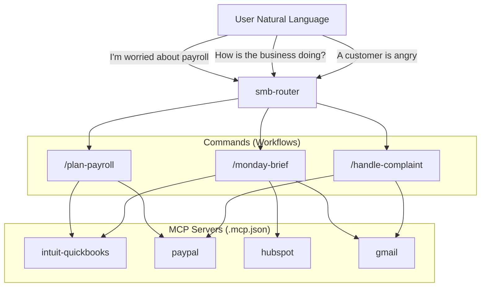
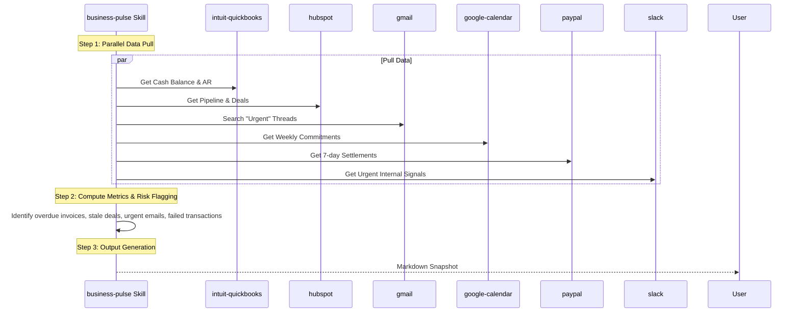

<!-- source: DeepWiki mcp.deepwiki.com · repo anthropics/knowledge-work-plugins · page 6 Small Business Plugin · fetched 2026-10-26 -->

# Small Business Plugin

Relevant source files

The following files were used as context for generating this wiki page:

- [bio-research/.mcp.json](bio-research/.mcp.json)
- [small-business/.claude-plugin/plugin.json](small-business/.claude-plugin/plugin.json)
- [small-business/.mcp.json](small-business/.mcp.json)

The **Small Business Plugin** is a comprehensive suite designed to automate the critical workflows of Small and Medium-Sized Business (SMB) owners. It integrates fragmented data across finance, sales, marketing, and operations into a cohesive agentic experience [small-business/.claude-plugin/plugin.json:1-9]().

The plugin consists of atomic **skills** (building blocks) and **commands** (orchestrated workflows) that leverage a broad array of third-party integrations via the Model Context Protocol (MCP) [small-business/.claude-plugin/plugin.json:4]().

### Core Architecture

The plugin operates on a three-layer architecture to ensure ease of use and safety:

1.  **Skills**: Atomic units of domain knowledge (e.g., forecasting cash, scoring leads).
2.  **Commands**: Multi-step "recipes" that chain skills together, including mandatory checkpoints for user approval before any action involving money or customers is taken [small-business/.claude-plugin/plugin.json:4]().
3.  **The Router**: A natural language interface (the `smb-router` skill) that maps plain-English requests (e.g., "I'm stressed about payroll") to the appropriate command or skill.

### Intent Mapping: Natural Language to Code Entities

The following diagram illustrates how user intents are routed through the `smb-router` to specific code-defined commands and their underlying MCP integrations.

**SMB Intent Routing Map**

Sources: [small-business/.mcp.json:1-148](), [small-business/.claude-plugin/plugin.json:1-9]()

---

## Plugin Components

### 1. Overview and Setup
The entry point for the plugin is the `smb-onboard` skill, which captures business context and identifies which of the supported MCP servers are available. The plugin supports a wide range of connectors including QuickBooks, PayPal, HubSpot, Stripe, and Canva [small-business/.mcp.json:1-148]().

For details, see [Small Business Plugin Overview and Setup](#6.1).

Sources: [small-business/.claude-plugin/plugin.json:1-24](), [small-business/.mcp.json:1-148]()

### 2. Finance and Operations
These skills focus on financial and operational workflows. They target accounting systems like **intuit-quickbooks** [small-business/.mcp.json:59-62]() and **xero** [small-business/.mcp.json:119-122](), supplemented by payment processors like **paypal** [small-business/.mcp.json:75-78]() and **stripe** [small-business/.mcp.json:103-106]().
*   **Key Skills**: `cash-flow-snapshot`, `invoice-chase`, `ap-processor`, `payroll-prep`, `month-end-prep`, `tax-season-organizer`, `close-month`, `inventory-planner`.
*   **Key Commands**: `/plan-payroll`, `/month-heads-up`, `/close-month`, `/tax-prep`.

For details, see [Finance and Operations Skills](#6.2).

Sources: [small-business/.mcp.json:59-122]()

### 3. Sales, Marketing, and Customer Relations
This module manages growth, outreach, and customer retention. It bridges CRM data from **hubspot** [small-business/.mcp.json:51-54]() and **zoho-crm** [small-business/.mcp.json:131-134]() with creative tools like **canva** [small-business/.mcp.json:15-18]() and communication pipelines via **gmail** [small-business/.mcp.json:35-38]().
*   **Key Skills**: `lead-triage`, `lead-finder`, `speed-to-lead`, `content-strategy`, `social-content-engine`, `canva-creator`, `ad-manager`, `crm-autopilot`, `seo-ai-visibility`, `outreach-composer`, `ticket-deflector`, `review-reputation`.
*   **Key Commands**: `/call-list`, `/run-campaign`, `/sales-brief`, `/customer-pulse-check`, `/handle-complaint`.

For details, see [Sales, Marketing, and Customer Skills](#6.3).

Sources: [small-business/.mcp.json:15-18](), [small-business/.mcp.json:35-38](), [small-business/.mcp.json:51-54](), [small-business/.mcp.json:131-134]()

### 4. Business Intelligence and Hiring
The intelligence layer provides high-level synthesis across all connected tools. The `business-pulse` and `growth-pulse` skills pull data in parallel from across the stack to create executive snapshots. This module also houses hiring and administrative tooling.
*   **Key Skills**: `business-pulse`, `growth-pulse`, `smb-router`, `report-builder`, `job-post-builder`, `hiring-screener`, `grant-rfp-writer`, `proposal-builder`.
*   **Key Commands**: `/monday-brief`, `/friday-brief`, `/quarterly-review`.

For details, see [Business Intelligence and Hiring Skills](#6.4).

Sources: [small-business/.claude-plugin/plugin.json:1-24]()

---

## Technical Integration Matrix

The plugin relies on an extensive set of MCP servers defined in the configuration [small-business/.mcp.json:1-148]().

**MCP Server Mapping**
| Category | MCP Server Key | Primary Purpose | File Path |
| :--- | :--- | :--- | :--- |
| **Accounting** | `intuit-quickbooks`, `xero`, `myob`, `zoho-books` | Cash flow, P&L, AR/AP | [small-business/.mcp.json:59-62](), [small-business/.mcp.json:67-70](), [small-business/.mcp.json:119-122](), [small-business/.mcp.json:127-130]() |
| **Payments** | `paypal`, `stripe`, `square`, `ramp`, `airwallex-agentos` | Transactions, disputes, expenses | [small-business/.mcp.json:3-6](), [small-business/.mcp.json:75-78](), [small-business/.mcp.json:79-82](), [small-business/.mcp.json:99-106]() |
| **CRM & Sales** | `hubspot`, `apollo-io`, `zoho-crm`, `clay` | Leads, deals, contact enrichment | [small-business/.mcp.json:7-10](), [small-business/.mcp.json:19-22](), [small-business/.mcp.json:51-54](), [small-business/.mcp.json:131-134]() |
| **Creative & Marketing** | `canva`, `intuit-mailchimp`, `tiktok` | Asset generation, email campaigns, ads | [small-business/.mcp.json:15-18](), [small-business/.mcp.json:55-58](), [small-business/.mcp.json:107-110]() |
| **Productivity** | `gmail`, `google-calendar`, `google-drive`, `notion` | Communication, scheduling, file storage | [small-business/.mcp.json:35-46](), [small-business/.mcp.json:71-74]() |
| **E-Signature** | `docusign` | Contract execution | [small-business/.mcp.json:23-26]() |
| **Communication** | `slack`, `ringex-chat` | Brief delivery and chat notifications | [small-business/.mcp.json:83-86](), [small-business/.mcp.json:91-98]() |

Sources: [small-business/.mcp.json:1-148]()

### Data Flow: Business Pulse Synthesis
The `business-pulse` skill demonstrates the plugin's ability to synthesize multi-source data by dispatching parallel connector calls to services defined in the configuration.

**Business Pulse Data Synthesis**

Sources: [small-business/.mcp.json:1-148](), [small-business/.claude-plugin/plugin.json:1-9]()

---

