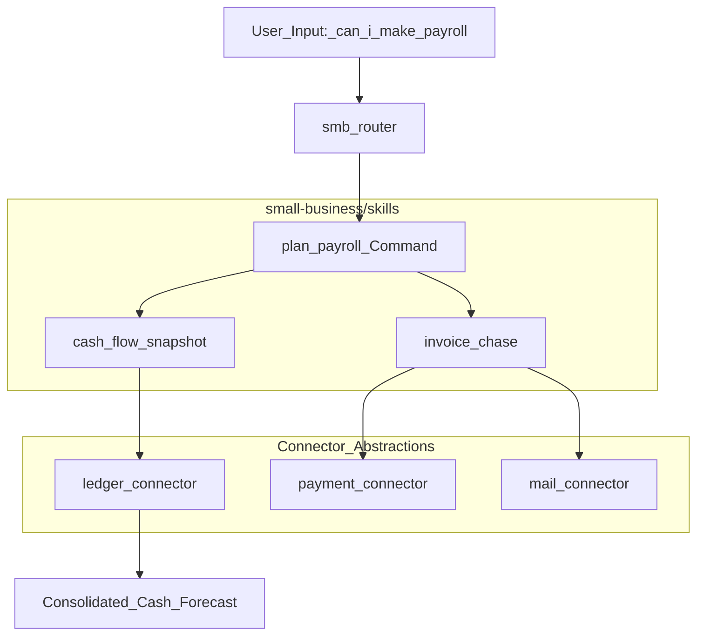
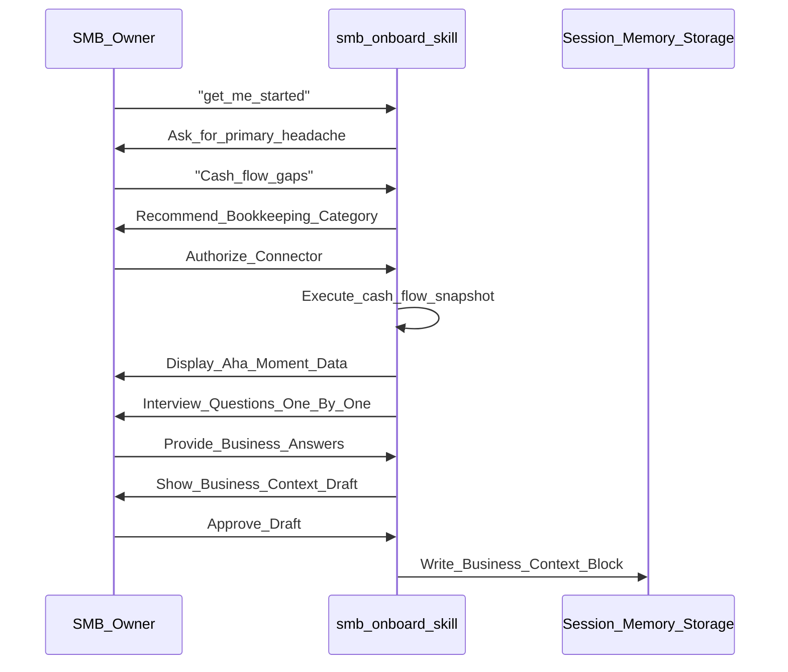

<!-- source: DeepWiki mcp.deepwiki.com · repo anthropics/knowledge-work-plugins · page 6.1 Small Business Plugin Overview and Setup · fetched 2026-10-26 -->

# Small Business Plugin Overview and Setup

<details>
<summary>Relevant source files</summary>

The following files were used as context for generating this wiki page:

- [small-business/.claude-plugin/plugin.json](small-business/.claude-plugin/plugin.json)
- [small-business/skills/smb-onboard/SKILL.md](small-business/skills/smb-onboard/SKILL.md)
- [small-business/skills/smb-onboard/reference/examples/happy-path.md](small-business/skills/smb-onboard/reference/examples/happy-path.md)
- [small-business/skills/smb-onboard/reference/gotchas.md](small-business/skills/smb-onboard/reference/gotchas.md)

</details>


The Small Business (SMB) plugin (`small-business`) is a comprehensive suite designed to act as an AI chief of staff for small business owners. It provides a unified interface across finance, sales, marketing, and operations, allowing owners to manage their business through plain-English conversation rather than navigating multiple disparate SaaS platforms [small-business/.claude-plugin/plugin.json:1-5]().

## Purpose and Target Audience

The plugin is built specifically for **SMB owners**—typically sole operators or leaders of small teams (e.g., 1–20 employees) who manage their own books, sales pipelines, and customer support [small-business/skills/smb-onboard/SKILL.md:4-7](). Its primary goal is to reduce day-to-day operational friction, specifically targeting cash flow management, slow-paying contractors, and lead follow-up [small-business/skills/smb-onboard/reference/examples/happy-path.md:17-19]().

Sources: [small-business/.claude-plugin/plugin.json:1-5](), [small-business/skills/smb-onboard/SKILL.md:4-7](), [small-business/skills/smb-onboard/reference/examples/happy-path.md:17-19]()

## Three-Layer Architecture

The plugin follows a hierarchical design pattern that separates atomic capabilities from complex workflows and user intent routing.

| Layer | Component | Description |
| :--- | :--- | :--- |
| **1. Router** | `smb-router` | The entry point that maps natural language intents to specific workflows and skills. |
| **2. Commands** | `workflows` | Pre-built multi-step recipes that chain multiple skills together with human-in-the-loop approval gates. |
| **3. Skills** | `building-blocks` | Atomic functions that perform specific tasks (e.g., `cash-flow-snapshot`, `lead-triage`) by interacting with connected tools. |

### Data Flow: Natural Language to Code Execution

The following diagram bridges natural language space to code entity space, illustrating how user requests map to specific internal routing logic and skill execution modules.

**Intent Routing and Execution Flow**

Sources: [small-business/skills/smb-onboard/SKILL.md:50-51](), [small-business/skills/smb-onboard/reference/examples/happy-path.md:25-30]()

## Installation and Manifest Configuration

The plugin is identified in the marketplace as `small-business` (version `1.35.1`) and includes metadata, keywords, and installation hooks defined in its manifest [small-business/.claude-plugin/plugin.json:1-24]().

```json
{
  "name": "small-business",
  "displayName": "Small Business",
  "version": "1.35.1",
  "description": "Pre-built small business workflows to help you run and grow your business...",
  "keywords": ["all-in-one", "automation", "finance", "growth", "hr", "small-business"]
}
```

Sources: [small-business/.claude-plugin/plugin.json:1-24]()

## The `smb-onboard` Skill and Context Capture

The foundational entry point for any new installation is the `smb-onboard` skill, invoked when an owner says phrases like `"get me started"`, `"set me up"`, or `"what can you do"` [small-business/skills/smb-onboard/SKILL.md:8-10](). 

The onboarding arc executes four moves: connect two tools, run one recipe to prove immediate value, interview the owner about their business context, and establish a weekly check-in rhythm [small-business/skills/smb-onboard/SKILL.md:17-18]().

### Onboarding Execution Sequence

The sequence below details the interaction between the user, the `smb-onboard` skill logic, and persistent session memory storage (`CLAUDE.md`).

**Onboarding Implementation Logic**

Sources: [small-business/skills/smb-onboard/SKILL.md:37-57](), [small-business/skills/smb-onboard/reference/gotchas.md:13-17](), [small-business/skills/smb-onboard/reference/examples/happy-path.md:19-19]()

### Onboarding Guardrails and Gotchas

When implementing or executing onboarding workflows, the plugin enforces strict interaction patterns defined in `gotchas.md`:
* **Never skip the prove-value step**: If a tool connection completes, Claude must immediately run a recipe (e.g., `cash-flow-snapshot`) before starting the interview [small-business/skills/smb-onboard/reference/gotchas.md:3-19]().
* **Conversational pacing**: Never dump all interview questions at once; ask them sequentially to prevent drop-offs [small-business/skills/smb-onboard/reference/gotchas.md:23-34]().
* **Connector neutrality**: Never recommend a specific vendor unprompted; ask what category tool they use first [small-business/skills/smb-onboard/reference/gotchas.md:95-111]().

Sources: [small-business/skills/smb-onboard/reference/gotchas.md:3-111]()

## Persistent Context Management

The `smb-onboard` skill writes captured details into a structured `## Business context` block within the session memory. This ensures all downstream skills access the organization's parameters without redundant prompting [small-business/skills/smb-onboard/SKILL.md:38-39]().

### Context Schema Specification
- **Business**: Industry and company one-liner description [small-business/skills/smb-onboard/reference/examples/happy-path.md:66-66]().
- **Size**: Total headcount including the owner [small-business/skills/smb-onboard/reference/examples/happy-path.md:67-67]().
- **Top headaches**: Three primary business friction points [small-business/skills/smb-onboard/reference/examples/happy-path.md:68-68]().
- **Connected tools**: Active integrations inventory [small-business/skills/smb-onboard/reference/examples/happy-path.md:69-69]().
- **Locale**: Country, currency, and financial year-end dates [small-business/skills/smb-onboard/reference/examples/happy-path.md:70-72]().
- **Weekly cadence**: Preferred check-in schedule and trigger phrase [small-business/skills/smb-onboard/reference/examples/happy-path.md:73-73]().

Sources: [small-business/skills/smb-onboard/SKILL.md:38-39](), [small-business/skills/smb-onboard/reference/examples/happy-path.md:66-75]()

---

